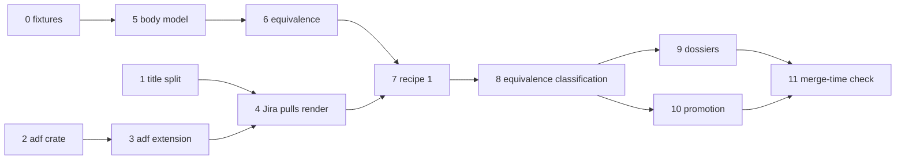

# Sync Round-Trip Defects Implementation Plan

## Overview

`accelerator work sync` treats the tracker's projected body
(`"{title}\n{description}"`) as local content, and compares bodies by
whitespace-trimmed bytes. Pulls therefore write a title line above the H1 (and,
for Jira, raw ADF JSON), and Linear's cosmetic re-serialisation registers as
change and conflict. This plan strips the projected title line on every pull
path, renders Jira descriptions to Markdown through an extended ADF converter,
introduces a minimal rich body model in `corpus` with CommonMark equivalence,
moves baselines to digest recipe `1`, and makes classification
equivalence-aware with a recovery path for items without a usable baseline.

## Current State Analysis

- `RemoteIssue.body` (`cli/tracker/src/lib.rs:107-135`) is the projected
  `"{title}\n{description}"`; for Jira the description is canonical ADF JSON
  (`cli/remote-projection/src/lib.rs:97-124`).
- Only `split_projected` (`cli/work-cli/src/sync_author.rs:211-216`) strips
  the title, and only `author_from_remote` calls it.
- `reconstruct_pulled_content` (`cli/work-adapters/src/sync/run.rs:378-386`)
  writes the full projected body after the local frontmatter; `pull_outcome`
  (`run.rs:736-757`) and `readable_dossier` (`run.rs:545-563`) both use it.
- Nothing on the sync path calls `document_to_markdown`; a Jira pull writes
  ADF JSON. The converter rejects blockquotes, pipe tables and nested lists
  (`cli/jira-client/src/adf/tokenise.rs:74-114`) and its renderer drops
  `strike`, `underline` and later list-item children and emits
  `[unsupported ADF node: …]` placeholders (`adf/render.rs:135-212`).
- `classify` (`cli/work/src/sync/classify.rs:110-134`) is two booleans; a
  missing hash, an unfetched body and a failed `show` all read as changed.
  `ItemDigests::remote_body` returns a hash.
- `digest::local` hashes frontmatter and body together; `digest::remote_body`
  hashes the trimmed projected body including the title
  (`cli/work-adapters/src/sync/digest.rs:76-94`).
- `Entry` (`cli/work-adapters/src/sync/baseline.rs:17-23`) has no recipe
  marker. Nine production sites build one, and the pending-push marker
  persists an `IntendedBaseline { remote_hash, local_hash }`
  (`cli/work/src/promotion.rs:103`, `cli/work-adapters/src/sync/pending_push.rs:308-323`).
- `differing_sections` (`cli/work/src/section_diff.rs:176-205`) compares
  trimmed text per level-2 section, so a re-serialised list marks its section
  as differing.
- `--preview` already returns before `ItemApplier` is built
  (`run.rs:1163-1192`), so `last-sync.json` is untouched; it still writes
  dossiers by design.
- Promotion's `agree_but_for_ids` (`cli/work-adapters/src/promotion.rs:343-347`)
  compares title-inclusive projected bodies through `digest::remote_body`.
- No Markdown parser is in `cli/Cargo.lock`. `document` (technical library)
  owns the file format and confines `serde-saphyr`; `corpus` (platform domain,
  kernel-only) owns the serde-free document model; `corpus-adapters` bridges
  them through the `FrontmatterParser` port. Bodies are `String` in both.

## Desired End State

- No pull path writes a projected title line or ADF JSON into a local file.
- Jira descriptions render to Markdown and Markdown converts to ADF for
  blockquotes, pipe tables, rules, nested lists, multi-paragraph list items
  and strike; malformed or placeholder-bearing remote ADF refuses the pull.
- `corpus::body` holds a minimal parsed body model with sections and an
  equivalence relation; `document::markdown` parses with an exact-pinned
  `pulldown-cmark`; `corpus-adapters` provides the `BodyParser` port.
- Baseline entries carry `digest_recipe: 1` with split local hashes once a
  run classifies them; unmarked entries classify with the legacy recipe.
- Noise never registers as change or conflict; equivalent items with a
  missing or empty hash are baselined without a file write.
- Dossiers omit equivalent sections, never carry the title line, and show
  `title: <local> → <remote>` when the titles differ.
- Promotion compares titles exactly and bodies by equivalence.
- `mise run` exits 0.

### Key Discoveries:

- `adf` depends only on `std` and `serde_json`; its tests locate fixtures via
  `CARGO_MANIFEST_DIR`, except `adf_inventory.rs`, which reads
  `src/adf/render.rs` as text (`cli/jira-client/tests/adf_inventory.rs:41,54,140`).
- `remote-projection` cannot depend on `jira-client` (Cargo cycle and the
  technical-library role rule); `adf` must become its own technical library.
- `pulldown-cmark` with `default-features = false` adds one package; its
  dependencies (`bitflags` 2, `memchr`, `unicase`) already resolve singly.
- `corpus`'s pup rule admits no third-party crate
  (`cli/pup.ron` `corpus_domain_imports_only_permitted`); `work` may import
  `corpus` (`work_domain_imports_only_permitted`, `cli/pup.ron:151-167`), so
  the domain can compare `corpus::body` values directly.
- `document` and `corpus` are pinned in `tasks/public_api.py:15-30`; no
  parser type may surface in either public API.
- `finalise_run` blanks `local_hash` for unresolved conflicts
  (`baseline_store.rs:122-148`, `run.rs:793-798`); this is kept.
- `fetch.rs:341-354` skips `show` when the stamp proves the item unchanged;
  legacy entries must now force the read so they can be rewritten.
- `jira-cli` maps `AdfError::Unsupported*` to exit code 41
  (`cli/jira-cli/src/exit_codes.rs:65,241-249`), and `adf_differential.rs:51-61`
  pins those codes against the frozen bash oracle.
- `RecordingTracker` stores `"{title}\n{body}"` and never re-serialises
  (`cli/tracker-test-support/src/lib.rs:522-562`).

## What We're NOT Doing

- Building the full rich document model or migrating the string-based fence
  and frontmatter consumers in `work`, `work-cli`, `migrate`, `corpus` and
  `config-adapters` onto it (0330).
- Removing the legacy digest recipe (0331).
- Pulling the title or syncing any field beyond title and body (0290).
- Fixing Linear's meaning-changing rewrites on push (0320).
- Mapping ADF nodes with no Markdown form (`underline`, `panel`, `mention`,
  `emoji`, `inlineCard`, `status`, `media`); they stay unsupported.
- Deciding the sync authority model (0321).
- Changing `RemoteIssue`'s shape; the projection stays, split by position.

## Implementation Approach

Every production change is test-first: a failing unit or crate test, the
minimum code, then refactor. Each phase is independently mergeable and leaves
`mise run` green.

The design follows the existing frontmatter split. `corpus` owns what a body
*means* (the model, its sections, equivalence and a canonical form); `document`
owns how Markdown is *read* (a faithful event stream over `pulldown-cmark`,
exposed through `document`'s own types); `corpus-adapters` translates events
into `corpus::Body` behind a `corpus::body::BodyParser` port. Equivalence is
defined as equality of `CanonicalBody`, so the hash and the predicate can
never disagree. Tracker specifics (title split, ADF round trip) stay in the
adapter layer: `remote-projection` owns the split, `work-adapters` composes
the Jira round trip.



Cross-cutting chores, owed by every phase that touches them:

- `mise run public-api:update` after reviewing the diff, for `corpus`,
  `document`, `remote-projection`, `work`.
- `cli/pup.ron` rule and probe pair for any new crate.
- `EXPECTED_CASE_COUNT` bumps in fixture-driven tests that gain cases.

---

## Phase 0: Fixture Capture

### Overview

Capture live tracker data the later phases test against. Manual, with PP
Linear workspace credentials. Nothing in production code changes.

### Changes Required:

#### 1. Recovery fixtures

**Directory**: `cli/work-adapters/tests/fixtures/work-item-sync-recovery/`
**Changes**: one directory per item (`0275`, `0276`, `0293`, `0294`, `0302`)
holding `local.md` (the committed work item at capture time) and
`remote.json` (`accelerator linear show PP-…` output with `state`,
`comments`, `assignee` and `outcome` stripped).

#### 2. `issueCreate` read-back

**Directory**: `cli/work-adapters/tests/fixtures/linear-rewrites/`
**Changes**: create a scratch Linear issue whose description exercises all
thirteen Equivalence-table rewrites, capture `accelerator linear show`,
archive the issue. Commit `pushed.md` and `read-back.json`. Record the
observed rewrite per row in `README.md` beside them, including whether a
leading blank line in the pushed body survives.

### Success Criteria:

#### Automated Verification:

- [ ] Every `remote.json` parses: `jq -e .data cli/work-adapters/tests/fixtures/work-item-sync-recovery/*/remote.json`
- [ ] `mise run check` exits 0

#### Manual Verification:

- [ ] The read-back reproduces each of the thirteen rewrites, or 0296's
      Equivalence table and criteria are amended before Phase 6 starts
- [ ] No credentials or personal data in the committed fixtures

---

## Phase 1: Projected Title Split

### Overview

Defect 1 for Linear, and the title-line half for Jira. One splitter in
`remote-projection` serves every pull path; unblocks 0291.

### Changes Required:

#### 1. Failing tests first

**File**: `cli/remote-projection/src/lib.rs` (unit tests)

- `splitting_takes_the_first_line_as_the_title`
- `an_empty_description_splits_to_an_empty_body`
- `a_description_whose_first_line_equals_the_title_keeps_that_line`
- `splitting_preserves_the_description_verbatim_including_blank_lines`
- `a_projection_without_a_newline_is_all_title`

**File**: `cli/work-adapters/tests/sync_run.rs`

- `a_pulled_file_carries_no_projected_title_line`: pullable item; written
  body starts with `Remote body`, never `Title`.
- `a_remote_resolution_writes_no_projected_title_line`
- `a_frontmatter_kept_pull_keeps_local_frontmatter_and_no_title_line`
- `a_dossier_remote_side_begins_with_the_description`: conflicting item whose
  remote projection carries a title; no section named `(preamble)` holds it.

**File**: `cli/work-adapters/tests/sync_run_real_client.rs`

- `linear_pull_writes_no_title_line_through_the_real_client`
- `jira_pull_writes_no_title_line_through_the_real_client`

**File**: `cli/work-cli/src/sync.rs` (tests)

- `a_targeted_pull_create_writes_no_projected_title_line`
- `a_pulled_item_syncs_again_as_synced_with_no_update`

#### 2. Splitter

**File**: `cli/remote-projection/src/lib.rs`
**Changes**: add the inverse of `project_raw`.

```rust
pub struct ProjectedIssue<'a> {
    pub title: &'a str,
    pub description: &'a str,
}

#[must_use]
pub fn split_projected(projected: &str) -> ProjectedIssue<'_> {
    projected.split_once('\n').map_or(
        ProjectedIssue { title: projected, description: "" },
        |(title, description)| ProjectedIssue { title, description },
    )
}
```

#### 3. Pull and dossier paths

**File**: `cli/work-adapters/src/sync/run.rs`
**Changes**: `reconstruct_pulled_content` takes the description, not the
projected body; `pull_outcome` and `readable_dossier` split first. The
baseline `remote_hash` in `ItemApplier::pull` keeps hashing the full projected
body (recipe unchanged until Phase 7), so `PullRequest` carries both.

**File**: `cli/work-adapters/Cargo.toml`
**Changes**: promote `remote-projection` from dev-dependency to dependency.

#### 4. Author path

**File**: `cli/work-cli/src/sync_author.rs`
**Changes**: delete the private `split_projected`; call
`remote_projection::split_projected`. Add `remote-projection` to
`cli/work-cli/Cargo.toml`.

### Success Criteria:

#### Automated Verification:

- [ ] `cargo test --manifest-path cli/Cargo.toml -p remote-projection -p work-adapters -p work-cli`
- [ ] `mise run public-api:check` (after `public-api:update` for `remote-projection`)
- [ ] `mise run lint:crate-dependencies:check`
- [ ] `mise run` exits 0

#### Manual Verification:

- [ ] `work sync --preview` on this repo: dossiers under
      `.accelerator/state/integrations/linear/conflicts/` no longer show the
      title line in `(preamble)`

---

## Phase 2: `adf` Crate Extraction

### Overview

Move `cli/jira-client/src/adf/` to a new `adf` technical library with no
behaviour change.

### Changes Required:

#### 1. New crate

**Directory**: `cli/adf/`
**Changes**: `src/lib.rs` (from `adf/mod.rs`), `src/adf/{tokenise,assemble,render}.rs`
kept at that relative path so `adf_inventory.rs` still reads
`src/adf/render.rs`. Move `tests/adf*.rs`, `tests/support/adf_oracle.rs`,
`tests/support/capture-adf-oracle.sh`, `tests/fixtures/adf/`,
`tests/fixtures/adf-fidelity-quirks.txt`, `tests/fixtures/adf-node-types.txt`.
Rewrite `jira_client::adf::` paths in tests to `adf::`.

#### 2. Registration (`tasks/README.md` "Registering a library crate")

- `cli/Cargo.toml` `[workspace].members`; sync the lock with
  `cargo metadata --manifest-path cli/Cargo.toml --format-version 1`.
- `cli/adf/Cargo.toml`: inherited fields, `[lints] workspace = true`,
  `[package.metadata.accelerator] role = "technical-library"`,
  `serde_json` dependency, dev-dependencies `sha2`, `hex`, `tempfile`.
- `_EXPECTED_DECLARATIONS` row in `tests/unit/tasks/test_crate_dependencies.py`.
- `cli/pup.ron`: `adf_is_a_pure_codec` denying `std::process`, `std::fs`,
  `reqwest`, `hyper`; add `adf` to the
  `only_the_consent_policy_names_the_command_runner` regex.
- Probe pair in `tests/integration/pup/test_import_rule.py`.
- `tasks/public_api.py`: pin `adf`; commit `cli/adf/tests/fixtures/public-api.txt`.

#### 3. Re-export

**File**: `cli/jira-client/src/lib.rs`
**Changes**: depend on `adf`; replace `pub mod adf;` with
`pub use adf::{document_to_markdown, markdown_to_document, AdfError};`.
Internal users (`surface.rs`, `comment.rs`, `client.rs`, `transition.rs`,
`mutation.rs`) import from `adf`. `jira-cli/src/exit_codes.rs:140` switches
to `adf::AdfError` and `jira-cli` gains the dependency.

### Success Criteria:

#### Automated Verification:

- [ ] `cargo test --manifest-path cli/Cargo.toml -p adf -p jira-client -p jira-cli`
- [ ] `adf_oracle_manifest` still counts 57 cases
- [ ] `uv run pytest tests/unit/tasks/test_crate_dependencies.py tests/unit/tasks/test_rust.py`
- [ ] `mise run pup:check && mise run deny:check && mise run public-api:check`
- [ ] `mise run` exits 0

#### Manual Verification:

- [ ] `accelerator jira show <key> --render-adf` output unchanged on a real issue

---

## Phase 3: ADF Converter Extension

### Overview

Both directions gain blockquote, pipe table, thematic break, nested lists,
multi-paragraph list items and `~~strike~~`. Underline and nodes with no
Markdown form keep their current handling.

### Changes Required:

#### 1. Failing tests first

**Directory**: `cli/adf/tests/fixtures/adf/`
**Changes**: new `render-*` and `assemble-*` cases without frozen oracle
files: `render-blockquote`, `render-table`, `render-rule`,
`render-nested-bullet`, `render-nested-ordered`, `render-list-item-paragraphs`,
`render-strike`, and the matching `assemble-*` cases, plus
`roundtrip-*` cases asserting
`document_to_markdown(markdown_to_document(md)) == md` for canonical inputs.

**File**: `cli/adf/tests/adf.rs`

- `a_blockquote_round_trips`
- `a_pipe_table_round_trips_with_a_header_row`
- `table_alignment_is_dropped_on_assembly`
- `a_thematic_break_assembles_to_a_rule`
- `a_nested_bullet_list_round_trips`
- `a_list_item_with_two_paragraphs_round_trips`
- `strike_round_trips`
- `underline_is_still_dropped`
- `an_unknown_node_still_renders_a_placeholder`

**File**: `cli/adf/tests/adf_differential.rs`
**Changes**: the frozen-oracle cases whose bash oracle returned
`UnsupportedBlockquote`, `UnsupportedTable` or `UnsupportedNestedList` move to
an explicit `DELIBERATE_DIVERGENCES` list with the new expected outputs; the
differential test asserts the list is exact.

#### 2. Tokeniser and assembler

**Files**: `cli/adf/src/adf/tokenise.rs`, `cli/adf/src/adf/assemble.rs`
**Changes**: tokens for `BlockQuote`, `TableRow`, `Rule`, indented list items
(two spaces for bullets, marker width for ordered) and continuation
paragraphs; `~~` as the `strike` mark in `parse_inlines`. ADF `table` with
`tableHeader` cells for the first row, `tableCell` after; each cell one
paragraph.

#### 3. Renderer

**File**: `cli/adf/src/adf/render.rs`
**Changes**: render the same nodes back; every `listItem` child rendered,
later children indented; `strike` → `~~`. Keep the `"type" =>` match-arm
shape `adf_inventory.rs` scrapes.

#### 4. Error variants and exit codes

**Files**: `cli/adf/src/lib.rs`, `cli/jira-cli/src/exit_codes.rs`
**Changes**: remove `UnsupportedBlockquote`, `UnsupportedTable`,
`UnsupportedNestedList`; `ADF_UNSUPPORTED` (41) stays reserved for
`BadInput`-class rejections if any remain, otherwise is retired with its
`for_adf` arm and tests.

#### 5. Node inventory and quirks

**Files**: `cli/adf/tests/fixtures/adf-node-types.txt`,
`cli/adf/tests/fixtures/adf-fidelity-quirks.txt`
**Changes**: mark the newly supported nodes; drop quirks the extension
removes.

### Success Criteria:

#### Automated Verification:

- [ ] `cargo test --manifest-path cli/Cargo.toml -p adf -p jira-client -p jira-cli`
- [ ] `mise run public-api:check` (after reviewing the `adf` snapshot diff)
- [ ] `mise run test:integration:characterisation`
- [ ] `mise run` exits 0

#### Manual Verification:

- [ ] Create a Jira issue from Markdown with a table, blockquote and nested
      list via `accelerator jira create`; it renders correctly in the Jira UI
- [ ] `accelerator jira show <key> --render-adf` renders it back to the same
      Markdown

---

## Phase 4: Jira Pulls Render Markdown

### Overview

Defect 1 for Jira. Every pull path converts a Jira description through
`document_to_markdown`; unrenderable remote ADF refuses the pull.

### Changes Required:

#### 1. Failing tests first

**File**: `cli/work-adapters/src/sync/remote_body.rs` (unit tests)

- `a_linear_description_is_the_local_body_verbatim`
- `a_jira_description_renders_to_markdown`
- `a_null_jira_description_renders_to_an_empty_body`
- `malformed_jira_adf_is_unrenderable`
- `a_jira_render_with_an_unsupported_placeholder_is_unrenderable`

**File**: `cli/work-adapters/tests/sync_run_real_client.rs`

- `jira_pull_writes_rendered_markdown_through_the_real_client`: ADF with
  strike, a table and a two-paragraph list item; written body equals
  `adf::document_to_markdown` of the remote ADF.
- `jira_remote_resolution_writes_rendered_markdown`
- `jira_targeted_pull_create_writes_rendered_markdown`
- `jira_pull_of_unrenderable_adf_fails_the_item_and_writes_nothing`

#### 2. Local body from a remote description

**File**: `cli/work-adapters/src/sync/remote_body.rs` (new)

```rust
pub enum LocalBody {
    Rendered(String),
    Unrenderable { reason: String },
}

pub fn local_body_of(integration: Integration, description: &str) -> LocalBody
```

Jira: parse the description JSON, `adf::document_to_markdown`, treat any
`[unsupported ADF` placeholder as `Unrenderable`. Linear: the description.
`work-adapters` gains the `adf` dependency.

#### 3. Callers

**Files**: `cli/work-adapters/src/sync/run.rs`, `cli/work-adapters/src/sync/apply.rs`,
`cli/work-adapters/src/sync/create.rs`, `cli/work-cli/src/sync_author.rs`
**Changes**: `pull_outcome` and `readable_dossier` use `local_body_of`;
`Unrenderable` becomes `ApplyError::UnrenderableRemote { id, reason }` and a
failed item, with no write. `DiscoveredIssue` carries `title` and `body:
LocalBody` instead of the raw `RemoteIssue`; `ItemApplier::create_from_remote`
builds it, so `author_from_remote` no longer splits.

### Success Criteria:

#### Automated Verification:

- [ ] `cargo test --manifest-path cli/Cargo.toml -p work-adapters -p work-cli`
- [ ] `mise run test:integration:tracker-contract`
- [ ] `mise run` exits 0

#### Manual Verification:

- [ ] Against a Jira sandbox, `work sync --target <key>` writes readable
      Markdown with no title line

---

## Phase 5: Minimal Rich Body Model

### Overview

`corpus::body` models a parsed Markdown body; `document::markdown` reads
Markdown with an exact-pinned `pulldown-cmark`; `corpus-adapters` implements
the parser port. No sync behaviour changes.

### Changes Required:

#### 1. Failing tests first

**File**: `cli/corpus/src/body.rs` (unit tests, building bodies by hand)

- `sections_split_on_level_two_headings`
- `text_before_the_first_level_two_heading_is_the_preamble`
- `a_section_keeps_its_source_text`

**File**: `cli/document/tests/markdown.rs`

- `a_paragraph_yields_text_and_soft_break_events_with_offsets`
- `angle_bracketed_destinations_are_unwrapped`
- `tables_tasks_and_strikethrough_are_recognised`
- `fenced_code_is_one_literal_event`
- `an_ordered_list_reports_its_start_number`

**File**: `cli/corpus-adapters/tests/body_parser.rs`

- `a_heading_paragraph_and_list_parse_into_the_model`
- `a_loose_list_is_marked_loose`
- `a_task_marker_parses_as_checked_regardless_of_case`
- `section_source_text_matches_the_input_slice`

#### 2. `document::markdown`

**File**: `cli/document/src/markdown.rs` (new)
**Changes**: `pub fn events(source: &str) -> Vec<(MarkdownEvent, Range<usize>)>`
over `pulldown_cmark::Parser::new_ext` with tables, task lists and
strikethrough enabled. `MarkdownEvent`, `MarkdownTag` and `Alignment` are
`document`'s own enums mirroring the subset used; no `pulldown_cmark` type is
public.

**File**: `cli/Cargo.toml`
**Changes**: `pulldown-cmark = { version = "=0.13.0", default-features = false }`
in `[workspace.dependencies]` (exact pin: digests depend on its output); the
implementer confirms the latest 0.13.x at the time and pins that.

#### 3. `corpus::body`

**File**: `cli/corpus/src/body.rs` (new)

```rust
pub struct Body {
    source: String,
    blocks: Vec<SourcedBlock>,
}

pub struct SourcedBlock {
    pub block: Block,
    pub span: Range<usize>,
}

pub enum Block {
    Heading { level: u8, inlines: Vec<Inline> },
    Paragraph(Vec<Inline>),
    List { start: Option<u64>, loose: bool, items: Vec<ListItem> },
    CodeBlock { info: String, literal: String },
    BlockQuote(Vec<Block>),
    Table { alignments: Vec<Alignment>, rows: Vec<Vec<Vec<Inline>>> },
    ThematicBreak,
    Html(String),
}

pub struct ListItem {
    pub task: Option<bool>,
    pub blocks: Vec<Block>,
}

pub enum Inline {
    Text(String),
    Code(String),
    Emphasis(Vec<Inline>),
    Strong(Vec<Inline>),
    Strikethrough(Vec<Inline>),
    Link { destination: String, title: String, children: Vec<Inline> },
    Image { destination: String, title: String, alt: Vec<Inline> },
    SoftBreak,
    HardBreak,
    Html(String),
}

pub struct Section<'a> {
    pub heading: Option<&'a str>,
    pub source: &'a str,
    pub blocks: &'a [SourcedBlock],
}

pub trait BodyParser {
    fn parse(&self, markdown: &str) -> Body;
}
```

`Body::sections()` groups by level-2 headings; tight list items hold their
inline content as a `Paragraph`, so tightness lives only in `loose`.

#### 4. Adapter

**File**: `cli/corpus-adapters/src/body.rs` (new)
**Changes**: `CommonMarkBody` implements `BodyParser` by folding
`document::markdown::events` into `corpus::body`.

#### 5. Dependency checks

- `mise run deny:check`; regenerate `cli/licence-audit/new-trees.txt` only if
  the licence-identifier set changes (MIT is already present).
- `mise run notices:update`.
- `mise run public-api:update` for `corpus` and `document`, reviewed for
  leaked `pulldown_cmark` paths.

### Success Criteria:

#### Automated Verification:

- [ ] `cargo test --manifest-path cli/Cargo.toml -p corpus -p document -p corpus-adapters`
- [ ] `mise run deny:check && mise run pup:check && mise run public-api:check`
- [ ] `rg pulldown_cmark cli/document/tests/fixtures/public-api.txt cli/corpus/tests/fixtures/public-api.txt` finds nothing
- [ ] `mise run` exits 0

#### Manual Verification:

- [ ] None

---

## Phase 6: Body Equivalence

### Overview

`corpus::body` gains a canonical form and equivalence implementing 0296's
Equivalence rules; consumable by 0320.

### Changes Required:

#### 1. Failing tests first

**File**: `cli/corpus-adapters/tests/body_equivalence.rs` (parses real
Markdown through `CommonMarkBody`, compares with `corpus::body::equivalent`)

- One test per cosmetic Equivalence-table row, named for the rewrite
  (`escaping_is_noise`, `joined_continuation_lines_are_noise`,
  `per_line_bold_is_noise`, `bold_hoisted_off_code_is_noise`,
  `angle_bracketed_destinations_are_noise`, `autolinked_urls_are_noise`,
  `bullet_markers_are_noise`, `task_marker_case_is_noise`,
  `table_delimiter_rows_are_noise`, `inserted_blank_lines_between_items_are_noise`),
  inputs taken from the Phase 0 read-back.
- One test per meaning-changing row (`wrapped_digit_lines_differ`,
  `autolinked_dotted_tokens_differ`, `code_span_indentation_differs`).
- `a_marker_swap_inside_fenced_code_differs`
- `ordered_list_start_numbers_differ`
- Near-misses: `strong_and_plain_differ`, `link_text_differs`,
  `bullet_and_ordered_lists_differ`, `hard_and_soft_breaks_differ`,
  `code_span_contents_differ`, `table_alignment_differs`,
  `task_state_differs`, `heading_levels_differ`,
  `paragraph_break_and_soft_break_differ_outside_a_list`
- `strong_on_a_code_span_is_noise`

**File**: `cli/corpus/src/body/canonical.rs` (unit tests on hand-built models)

- `canonical_form_is_deterministic`
- `emphasis_on_whitespace_is_ignored`

#### 2. Canonical form

**File**: `cli/corpus/src/body/canonical.rs` (new)

```rust
#[derive(Debug, Clone, PartialEq, Eq)]
pub struct CanonicalBody(Vec<CanonicalBlock>);

impl Body {
    #[must_use]
    pub fn canonical(&self) -> CanonicalBody;
}

impl CanonicalBody {
    #[must_use]
    pub fn render(&self) -> String;
}

#[must_use]
pub fn equivalent(left: &Body, right: &Body) -> bool {
    left.canonical() == right.canonical()
}
```

Normalisation: soft breaks become spaces; inlines flatten to runs of
`(text, marks, code)` merging adjacent equal runs; emphasis and strong marks
are dropped from code characters and whitespace; a link whose plain text
equals its destination becomes text; list items always hold blocks and
`loose` is dropped; table alignment is kept. `render` is a stable,
unambiguous serialisation used only for hashing.

### Success Criteria:

#### Automated Verification:

- [ ] `cargo test --manifest-path cli/Cargo.toml -p corpus -p corpus-adapters`
- [ ] `mise run public-api:check` (after `public-api:update` for `corpus`)
- [ ] `mise run` exits 0

#### Manual Verification:

- [ ] The twenty-three equivalence tests above map one-to-one onto 0296's
      table rows and near-miss criterion

---

## Phase 7: Digest Recipe 1

### Overview

Baseline entries become a sum type over the legacy and recipe-1 shapes; every
writer records recipe 1; classification compares each entry under its own
recipe; every classified entry is rewritten under recipe 1 without a file
write or tracker call.

### Changes Required:

#### 1. Failing tests first

**File**: `cli/work-adapters/src/sync/baseline.rs` (unit tests)

- `an_unmarked_entry_reads_as_legacy`
- `a_recipe_one_entry_round_trips_through_render_and_read`
- `a_recipe_one_entry_renders_its_keys_in_fixed_order`
- `an_unknown_recipe_discards_the_entry_with_degradation`
- `a_legacy_entry_renders_byte_identically`

**File**: `cli/work-adapters/src/sync/digest.rs` (unit tests)

- `the_frontmatter_hash_ignores_provenance_keys`
- `the_body_hash_ignores_cosmetic_rewrites`
- `the_remote_hash_strips_the_projected_title_line`
- `a_jira_body_hash_digests_the_round_tripped_body`
- `a_jira_body_the_converter_rejects_is_digested_without_the_round_trip`
- `an_unrenderable_jira_remote_hashes_its_canonical_json`

**File**: `cli/work-adapters/tests/golden_digests.rs` (new)
**Fixture**: `cli/work-adapters/tests/fixtures/golden-digests/` with one body
per Equivalence-table row plus fenced code and a table, and `recipe.json`
recording `digest_recipe` and the `pulldown-cmark` version.

- `every_golden_body_digests_to_its_recorded_hash`
- `the_recorded_parser_version_matches_the_lock_or_the_recipe_was_bumped`
  (reads `cli/Cargo.lock` as `the_jj_binary_matches_the_resolved_library`
  does, `cli/vcs-adapters/tests/queries.rs:611-633`)
- `a_mismatched_recorded_parser_version_fails_the_guard` (calls the guard
  function with a deliberately wrong version)

**File**: `cli/work/tests/fixtures/work-item-sync-classify.json` and
`cli/work/tests/sync_classify.rs`
**Changes**: `FakeDigests` answers per recipe; new rows:
`a_recipe_one_entry_with_cosmetic_remote_noise_is_synced`,
`a_recipe_one_entry_with_a_frontmatter_edit_is_locally_modified`;
existing rows pinned as legacy.

**File**: `cli/work-adapters/tests/sync_run.rs`

- `a_run_rewrites_every_classified_legacy_entry_under_recipe_one`
- `rewriting_a_synced_legacy_entry_writes_no_file_and_calls_no_mutation`
- `remote_absent_indeterminate_and_unresolved_entries_keep_the_legacy_recipe`
- `a_preview_leaves_last_sync_json_byte_identical`
- `a_remote_updated_at_change_alone_leaves_the_hashes_unchanged`

**File**: `cli/work-adapters/tests/pending_push.rs` (or the marker module's tests)

- `a_marker_written_before_recipe_one_still_parses_as_legacy`

#### 2. Domain recipe types

**File**: `cli/work/src/sync/recipe.rs` (new)

```rust
pub const CURRENT_DIGEST_RECIPE: u32 = 1;

pub enum LocalBaseline<'a> {
    Absent,
    Legacy(&'a str),
    RecipeOne { frontmatter: &'a str, body: &'a str },
}

pub enum LocalDigest {
    Legacy(String),
    RecipeOne { frontmatter: String, body: String },
}
```

`BaselineEntry.local_hash` becomes `local: LocalBaseline<'a>`. `ItemDigests`
gains `local(&self, recipe: Recipe) -> Result<LocalDigest, _>` and
`remote_body` is renamed `remote_hash(&self, recipe: Recipe)`.
`IntendedBaseline.local_hash` becomes `local: LocalDigest`.

#### 3. Digests

**File**: `cli/work-adapters/src/sync/digest.rs`
**Changes**: keep `local` and `remote_body` as the legacy recipe. Add
`frontmatter`, `body(integration, body)` and `remote(integration, projected)`
for recipe 1, each `sha256_hex` of a canonical form:
`filter_frontmatter_keys` for frontmatter; `CanonicalBody::render` of the
parsed body (Jira: of the `markdown_to_document` → `document_to_markdown`
round trip, falling back to the raw body when rejected); remote strips the
title with `split_projected` then renders via `local_body_of`, hashing
`"adf:" + description` when unrenderable. `LazyItemDigests` takes a
`&dyn BodyParser` and the `Integration`.

#### 4. Entry and store

**File**: `cli/work-adapters/src/sync/baseline.rs`
**Changes**: `Entry { remote_updated_at, remote_hash, local: LocalDigest | Absent, local_synced_at }`
with `parse_entry` dispatching on `digest_recipe`; `render_entry` writes
`digest_recipe`, `local_body_hash`, `local_frontmatter_hash`,
`local_synced_at`, `remote_hash`, `remote_updated_at` for recipe 1 and the
existing four keys for legacy.

**File**: `cli/work-adapters/src/sync/baseline_store.rs`
**Changes**: `finalise_run` blanks the local digest of either shape.

#### 5. Every writer to recipe 1

**File**: `cli/work-adapters/src/sync/baseline_digests.rs` (new)
**Changes**: `BaselineDigests::of(local_content, remote: Option<&RemoteIssue>, integration, parser) -> (LocalDigest, String)`,
used by `ItemApplier::{push, pull, create_from_remote, link_and_baseline}`,
`creation::read_back_of` / `record_baseline_after_create`,
`promotion::{read_back_of, retire, finish_promotion}`, `realign_one_baseline`
(recomputes both local hashes when the old digest matched),
`work-cli/src/update.rs:241-249`, and the pending-push marker writer
(`pending_push.rs`, new keys `local_frontmatter_hash`/`local_body_hash`,
reading `local_hash` as legacy).

#### 6. Rewriting classified entries

**Files**: `cli/work/src/sync/decide.rs`, `cli/work/src/sync/plan.rs`,
`cli/work-adapters/src/sync/apply.rs`, `cli/work-adapters/src/sync/run.rs`,
`cli/work-adapters/src/sync/fetch.rs`
**Changes**: `Action::RecordBaseline` (keyword `record-baseline`); `plan`
assigns it to a `Synced` item whose entry is legacy. `ItemApplier::record_baseline`
writes a recipe-1 entry from the current bodies. Push and pull already write
recipe 1. `gather_from_bulk` reads the body of a legacy entry even when its
stamp proves it unchanged. `fetch.rs` keeps `""` → absent for both shapes.

**File**: `cli/work-cli/tests/fixtures/sync-report.golden`
**Changes**: regenerated only if `record-baseline` surfaces in the report.

### Success Criteria:

#### Automated Verification:

- [ ] `cargo test --manifest-path cli/Cargo.toml -p work -p work-adapters -p work-cli -p migrate-cli`
- [ ] `cargo test --manifest-path cli/Cargo.toml -p work-adapters --test sync_baseline_corpus --test corpus_hashes` (legacy oracle unchanged)
- [ ] `mise run public-api:check` (after `public-api:update` for `work`)
- [ ] `mise run test:integration:conformance`
- [ ] `mise run` exits 0

#### Manual Verification:

- [ ] Copy this repo's `last-sync.json`, run `work sync --preview`, confirm
      byte-identical; run `work sync` on a scratch clone and confirm every
      classified entry gains `"digest_recipe":1` with no work-item file
      changed (`jj diff --stat meta/work` empty)

---

## Phase 8: Equivalence-Aware Classification

### Overview

Each side becomes `Unchanged`, `Changed` or `Unknown`; when either side is
not `Unchanged`, the bodies' equivalence decides. Implements Required
behaviour, the recovery table and the legacy-recipe rules.

### Changes Required:

#### 1. Failing tests first

**File**: `cli/work/tests/fixtures/work-item-sync-classify.json` and
`cli/work/tests/sync_classify.rs`
**Changes**: `FakeDigests` gains `equivalent` and `titles_differ`; rows
replace "first-sync on dirty → conflict" and "absent local_hash forces
local-changed" with:

| Row | Expected state | Expected resolution |
|---|---|---|
| no entry, equivalent | synced | record |
| no entry, not equivalent | conflict | — |
| empty local hash, equivalent | synced | record |
| empty remote hash, equivalent | synced | record |
| both changed, equivalent, no frontmatter change | synced | record |
| local frontmatter and body changed, equivalent, titles equal | locally-modified | record |
| local frontmatter and body changed, equivalent, titles differ | locally-modified | push |
| local frontmatter only, remote body changed, not equivalent | remotely-modified | pull |
| legacy local changed, remote changed, equivalent | locally-modified | record |
| remote title changed, description unchanged | synced | — |

**File**: `cli/work-adapters/tests/sync_run.rs`

- Recovery table: `a_missing_entry_with_an_equivalent_remote_is_baselined_without_a_write`,
  `a_missing_entry_with_a_differing_remote_stays_absent_and_conflicted`,
  `an_empty_local_hash_with_an_equivalent_remote_is_baselined`,
  `an_empty_local_hash_with_a_differing_remote_is_unchanged`,
  `an_empty_remote_hash_with_an_equivalent_remote_is_baselined`,
  `an_empty_remote_hash_with_a_differing_remote_has_its_local_hash_emptied`,
  each followed by `…_then_syncs_as_synced` where equivalent.
- `preview_and_apply_report_the_same_state_for_every_recovery_row`
- `each_cosmetic_remote_rewrite_alone_is_synced_with_unchanged_hashes`
  (driven by a `RecordingTracker::rewriting(…)` builder that applies one
  rewrite on `update` and `show`)
- `each_cosmetic_local_rewrite_alone_is_synced_with_no_update_or_write`
- `a_frontmatter_only_edit_is_locally_modified_with_no_update`
- `a_frontmatter_only_edit_with_a_real_remote_edit_pulls_the_body_and_keeps_the_frontmatter`
- `a_remote_title_edit_with_cosmetic_body_noise_is_synced_and_not_overwritten`
- `an_equivalent_change_with_a_differing_local_title_sends_one_update_with_title_and_body`
- `a_legacy_entry_with_cosmetic_local_rewrites_sends_no_update_and_gains_the_recipe`
- `a_conflicting_preview_leaves_last_sync_json_byte_identical`

**File**: `cli/work-adapters/tests/sync_recovery_corpus.rs` (new, over the
Phase 0 fixtures)

- `items_0275_0294_and_0302_classify_as_synced`
- `items_0276_and_0293_classify_as_unresolved_conflicts`

**File**: `cli/work-cli/src/sync.rs` (tests)

- `a_create_then_sync_reports_synced` asserts the state string.
- `a_create_whose_read_back_failed_syncs_as_synced_and_gains_a_remote_hash`

**File**: `cli/work-adapters/tests/sync_run_real_client.rs`

- `a_baselined_jira_item_with_a_rejected_local_body_and_no_edits_is_synced`
- `an_unbaselined_jira_item_with_a_rejected_local_body_is_an_unresolved_conflict`
  (local body containing `\u{1e}`, still rejected after Phase 3)
- `jira_remote_paragraph_text_differences_are_not_equivalent`
- Linear and Jira `a_pulled_item_syncs_again_as_synced_with_no_update`

#### 2. Domain

**File**: `cli/work/src/sync/classify.rs`

```rust
pub enum LocalChange { Unchanged, FrontmatterOnly, Body, Unknown }
pub enum RemoteChange { Unchanged, Changed, Unknown }

pub enum EquivalentResolution { RecordBaseline, PushTitle }

pub struct Classification {
    pub state: SyncState,
    pub equivalent: Option<EquivalentResolution>,
}
```

`ItemDigests` gains `bodies_equivalent() -> Result<Option<bool>, _>` (`None`
when the remote body was not fetched) and `titles_differ() -> Result<Option<bool>, _>`.
Decision, after presence:

1. Both `Unchanged` → `Synced`.
2. Equivalent → `LocallyModified` when the local frontmatter changed
   (recipe-1 frontmatter hash, or any legacy local change), else `Synced`;
   resolution `PushTitle` when the local side changed and titles differ,
   else `RecordBaseline`.
3. Not equivalent, or equivalence unknown → today's mapping with `Unknown`
   and `Body` counting as changed and `FrontmatterOnly` as unchanged.

**File**: `cli/work/src/sync/plan.rs`
**Changes**: a `Some` resolution overrides `decide`: `RecordBaseline` →
`Action::RecordBaseline`; `PushTitle` → `Action::Push` unless the direction
is `PullOnly`, which records instead.

#### 3. Adapters

**File**: `cli/work-adapters/src/sync/digest.rs`
**Changes**: `LazyItemDigests::bodies_equivalent` compares canonical forms
(Jira: the round-tripped local body against the rendered remote; a rejected
local body or unrenderable remote is never equivalent);
`titles_differ` compares the frontmatter `title` with the split remote
title.

**File**: `cli/work-adapters/src/sync/run.rs`
**Changes**: `push_outcome` for a `PushTitle` resolution sends title and body
and records the read-back; the local file is untouched.

**File**: `cli/tracker-test-support/src/lib.rs`
**Changes**: `RecordingTracker::rewriting(issues, Rewrite)` applying one
named cosmetic rewrite to stored descriptions.

### Success Criteria:

#### Automated Verification:

- [ ] `cargo test --manifest-path cli/Cargo.toml -p work -p work-adapters -p work-cli -p tracker-test-support`
- [ ] `mise run public-api:check` (after `public-api:update` for `work`)
- [ ] `mise run test:integration:tracker-contract`
- [ ] `mise run` exits 0

#### Manual Verification:

- [ ] On a scratch clone of this repo, `work sync --preview` reports far
      fewer conflicts than the 25 of 2026-10-10, each with a real difference

---

## Phase 9: Dossier Presentation

### Overview

Dossiers omit equivalent sections and show the title difference. The skill
text documents the new `title:` form.

### Changes Required:

#### 1. Failing tests first

**File**: `cli/work/src/section_diff.rs` (unit tests)

- `an_equivalent_section_is_omitted`
- `a_section_absent_on_one_side_is_listed`

**File**: `cli/work-adapters/tests/sync_run.rs` and `sync_run_real_client.rs`

- Linear and Jira `a_real_conflict_lists_only_the_edited_section`: one
  section edited both sides, another holding a `-` list locally and `*`
  remotely; only the edited section listed; remote side begins with the H1.
- `a_title_difference_renders_local_arrow_remote`
- `matching_titles_render_the_local_title_alone`

**File**: `cli/work-cli/src/sync.rs` (golden test)
**Changes**: `sync-report.golden` dossier case gains a title-difference
dossier.

#### 2. Section diff over the model

**File**: `cli/work/src/section_diff.rs`
**Changes**: `differing_sections(local: &Document, remote: &Document)` where
`Document { frontmatter: &str, body: &corpus::body::Body }`; sections compare
by `corpus::body::Section` canonical equality; `SectionDiff` carries each
side's `source` text for rendering. `work-cli/src/diff.rs:31` builds the
same inputs.

#### 3. Header

**File**: `cli/work-adapters/src/sync/run.rs`
**Changes**: `ConflictDossier` gains `remote_title: Option<String>`;
`dossier_header` renders `title: {local} → {remote}` when they differ.

#### 4. Skill

**File**: `skills/work/sync-work-items/SKILL.md`
**Changes**: at the dossier description (around lines 245-256), name the
`title: <local> → <remote>` form alongside the existing render fields.

### Success Criteria:

#### Automated Verification:

- [ ] `cargo test --manifest-path cli/Cargo.toml -p work -p work-adapters -p work-cli`
- [ ] `rg -n '→ <remote>' skills/work/sync-work-items/SKILL.md`
- [ ] `mise run docs:check`
- [ ] `mise run` exits 0

#### Manual Verification:

- [ ] A dossier written from this repo reads cleanly to a person resolving
      it

---

## Phase 10: Promotion Adopts Equivalence

### Overview

`agree_but_for_ids` compares titles exactly and bodies by equivalence, so
Linear noise after a promotion push is not read as a remote edit.

### Changes Required:

#### 1. Failing tests first

**File**: `cli/work-adapters/tests/promotion.rs`

- `a_cosmetically_rewritten_remote_still_agrees_with_the_draft`
- `a_remote_title_edit_does_not_agree`
- `a_remote_body_edit_does_not_agree`

#### 2. Comparison

**File**: `cli/work-adapters/src/promotion.rs`
**Changes**: `agree_but_for_ids` splits both projections, compares
`without_ids` titles for equality and bodies through the same
`bodies_equivalent` used by sync (integration-aware); `DraftContent::projected`
and the inline `format!` at `promotion.rs:708` are replaced by a
`DraftContent { title, body }` comparison that needs no hand-rolled
projection.

### Success Criteria:

#### Automated Verification:

- [ ] `cargo test --manifest-path cli/Cargo.toml -p work -p work-adapters`
- [ ] `mise run` exits 0

#### Manual Verification:

- [ ] A promotion under `{tracker}` against Linear completes without a
      spurious retitle

---

## Phase 11: Merge-Time Verification

### Overview

Run the corpus check 0296 asks for and record it in the PR.

### Changes Required:

#### 1. Corpus preview

Run `accelerator work sync --preview` on this repo at merge time. Confirm
every planned pull is for non-equivalent bodies and every unresolved
conflict's dossier lists a section or a title difference.

#### 2. PR record

Table in the PR description: each of the 32 items pulled or conflicted on
2026-10-10, with `synced`, `still differs` or `edited since`.

### Success Criteria:

#### Automated Verification:

- [ ] `mise run` exits 0

#### Manual Verification:

- [ ] Preview result recorded in the PR
- [ ] 0161, 0203, 0276 and 0293 remain conflicted pending 0320, as expected

---

## Testing Strategy

### Unit Tests:

- `remote-projection`: splitter edge cases.
- `adf`: every new node in both directions; round-trip identity on canonical
  input.
- `corpus::body`: sections, canonical form, whitespace and code-span marks.
- `work::sync`: the classify table, now recipe- and equivalence-aware.
- `work-adapters::sync::{baseline, digest}`: entry shapes, recipe-1 hashes.

### Integration Tests:

- `corpus-adapters/tests/body_equivalence.rs`: the full Equivalence table and
  near-misses over real parsing.
- `work-adapters/tests/sync_run.rs`: recovery table, migration, every pull
  entry point, preview read-only.
- `work-adapters/tests/sync_run_real_client.rs`: Linear and Jira through real
  clients and projections.
- `work-adapters/tests/golden_digests.rs`: digest stability and parser pin.
- `work-adapters/tests/sync_recovery_corpus.rs`: the five captured items.

### Manual Testing Steps:

1. Phase 7 and 8 scratch-clone runs over this repo's `last-sync.json`.
2. Jira sandbox pull of an issue with a table, blockquote and nested list.
3. Phase 11 merge-time preview.

## Performance Considerations

- ⏱️ The first run after Phase 7 issues one `show` per legacy entry the
  stamp would otherwise skip (about 280 items here); later runs return to
  the two-tier read.
- Parsing each body once per run with `pulldown-cmark` is linear in body
  size; `LazyItemDigests` memoises the parsed body and canonical form.

## Migration Notes

- `last-sync.json` migrates entry by entry as runs classify them. Recipe-1
  entries keep `remote_updated_at`, `remote_hash` and `local_synced_at` under
  their existing names, so an older binary reads them, finds no `local_hash`,
  and treats the local side as changed: it reports a conflict rather than
  overwriting anything.
- Pending-push markers written before Phase 7 parse as legacy and finish
  their promotion under the legacy local digest.
- `last-sync.json` is committed as a single line, so the migrating run
  produces one large diff.

## Amendments to 0296 Required by This Plan

- Requirements: the Jira losses accepted are now `underline` and nodes with
  no Markdown form; `strike` and a list item's later children are kept.
- Acceptance criterion 2: strike and later children are kept; underline
  is dropped.
- Jira rejected-body criteria: blockquotes, pipe tables and nested lists are
  no longer rejected; examples use a body with a control character.
- Final criterion: an unresolved conflict still blanks its local hash; the
  remote hash, stamps and absent marker are unchanged.
- Out of scope: converter extension is now in scope.
- Open Questions: parser (`pulldown-cmark`), `adf` placement (own crate),
  Markdown placement (`corpus` model, `document` parser) resolved.
- New: unrenderable remote ADF refuses the pull; promotion compares by
  equivalence.

## Acceptance-Criteria Traceability

| 0296 criterion | Phase | Test |
|---|---|---|
| Pulled body equals remote body, no title line | 1, 4 | `a_pulled_file_carries_no_projected_title_line`, `jira_pull_writes_rendered_markdown_through_the_real_client` |
| Jira pull with strike, underline, later child | 4 | `jira_pull_writes_rendered_markdown_through_the_real_client` |
| No title line on targeted, frontmatter-kept, `remote` resolution (both trackers) | 1, 4 | Phase 1 and 4 entry-point tests |
| Pulled item syncs again as `synced` | 1, 8 | `a_pulled_item_syncs_again_as_synced_with_no_update` |
| Cosmetic remote rewrite alone is `synced`, hashes unchanged | 8 | `each_cosmetic_remote_rewrite_alone_is_synced_with_unchanged_hashes` |
| Hashes equal for cosmetic rows, differ for meaning rows | 7 | `golden_digests.rs` |
| Remote title change only | 8 | classify row; `a_remote_title_edit_with_cosmetic_body_noise_is_synced_and_not_overwritten` |
| Legacy entry, remote changed, equivalent | 8 | `legacy local changed, remote changed, equivalent` row |
| Meaning-changing rows not equivalent | 6 | three `…_differ` tests |
| Fenced code swap; ordered start | 6 | `a_marker_swap_inside_fenced_code_differs`, `ordered_list_start_numbers_differ` |
| Near-misses; `**`c`**` | 6 | near-miss tests; `strong_on_a_code_span_is_noise` |
| Title-line strip edge cases | 1 | splitter unit tests |
| Cosmetic local rewrite alone | 8 | `each_cosmetic_local_rewrite_alone_is_synced_with_no_update_or_write` |
| No entry, equivalent, preview | 8 | recovery-row tests |
| Preview and apply agree per recovery row | 8 | `preview_and_apply_report_the_same_state_for_every_recovery_row` |
| Preview leaves `last-sync.json` byte-identical | 7, 8 | `a_preview_leaves_last_sync_json_byte_identical`, `a_conflicting_preview_…` |
| Both changed, equivalent | 8 | classify row |
| Frontmatter and body changed, equivalent; titles equal/differ | 8 | classify rows; `an_equivalent_change_with_a_differing_local_title_sends_one_update_with_title_and_body` |
| Remote title edit plus cosmetic body | 8 | `a_remote_title_edit_with_cosmetic_body_noise_is_synced_and_not_overwritten` |
| Frontmatter-only edit, remote unchanged | 8 | `a_frontmatter_only_edit_is_locally_modified_with_no_update` |
| Frontmatter-only edit, real remote edit | 8 | `a_frontmatter_only_edit_with_a_real_remote_edit_pulls_the_body_and_keeps_the_frontmatter` |
| Jira round-trip equivalence and rejection | 8 | Jira real-client tests |
| Jira paragraph text differs | 8 | `jira_remote_paragraph_text_differences_are_not_equivalent` |
| Baselined Jira item with rejected body, no edits | 8 | `a_baselined_jira_item_with_a_rejected_local_body_and_no_edits_is_synced` |
| Unbaselined Jira item with rejected body | 8 | `an_unbaselined_jira_item_with_a_rejected_local_body_is_an_unresolved_conflict` |
| Golden-digest fixture and parser guard | 7 | `golden_digests.rs` |
| Real conflict lists only edited section (both trackers) | 9 | `a_real_conflict_lists_only_the_edited_section` |
| Title arrow in dossier header | 9 | `a_title_difference_renders_local_arrow_remote` |
| Skill names the title form | 9 | `rg` check |
| Recovery-table rows | 8 | recovery-row tests |
| `create --push` with failed read-back | 8 | `a_create_whose_read_back_failed_syncs_as_synced_and_gains_a_remote_hash` |
| Fixtures for 0275, 0276, 0293, 0294, 0302 | 0, 8 | `sync_recovery_corpus.rs` |
| Merge-time corpus preview | 11 | manual |
| Unmarked entry's first sync | 7, 8 | `a_run_rewrites_every_classified_legacy_entry_under_recipe_one` and classify rows |
| Unmarked entry with cosmetic local rewrites | 8 | `a_legacy_entry_with_cosmetic_local_rewrites_sends_no_update_and_gains_the_recipe` |
| Unmarked entry the run does not rewrite | 7 | `remote_absent_indeterminate_and_unresolved_entries_keep_the_legacy_recipe` |

## References

- Original work item: `meta/work/0296-sync-round-trip-defects-between-local-work-items-and-the-tracker.md`
- Related codebase research: `meta/research/codebase/2026-10-10-0296-sync-round-trip-defects.md`
- Review: `meta/reviews/work/0296-sync-round-trip-defects-between-local-work-items-and-the-tracker-review-1.md`
- PR: `meta/prs/156-description.md`
- ADR-0069: `meta/decisions/ADR-0069-crate-dependency-rules-for-the-hexagonal-cli-workspace.md`
- Follow-ups: `meta/work/0330-rich-document-model-for-corpus-documents.md`,
  `meta/work/0331-remove-the-legacy-sync-digest-recipe.md`
- Frontmatter port precedent: `cli/corpus-adapters/src/document.rs:20`
- Lock-version guard precedent: `cli/vcs-adapters/tests/queries.rs:611-633`
