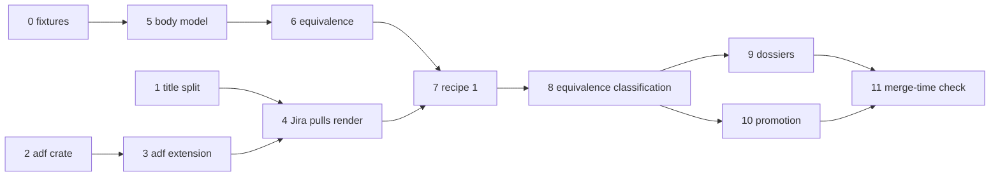

# Sync Round-Trip Defects Implementation Plan

## Overview

`accelerator work sync` treats the tracker's projected body
(`"{title}\n{description}"`) as local content, and compares bodies by
whitespace-trimmed bytes. Pulls therefore write a title line above the H1 (and,
for Jira, raw ADF JSON), and Linear's cosmetic re-serialisation registers as
change and conflict. This plan strips the projected title line on every pull
path, renders Jira descriptions to Markdown through an extended ADF converter,
introduces a minimal rich body model in `corpus` with CommonMark equivalence,
moves baselines to digest recipe `1`, and makes classification
equivalence-aware with a recovery path for items without a usable baseline.

## Current State Analysis

- `RemoteIssue.body` (`cli/tracker/src/lib.rs:107-135`) is the projected
  `"{title}\n{description}"`; for Jira the description is canonical ADF JSON
  (`cli/remote-projection/src/lib.rs:97-124`).
- Only `split_projected` (`cli/work-cli/src/sync_author.rs:211-216`) strips
  the title, and only `author_from_remote` calls it.
- `reconstruct_pulled_content` (`cli/work-adapters/src/sync/run.rs:378-386`)
  writes the full projected body after the local frontmatter; `pull_outcome`
  (`run.rs:736-757`) and `readable_dossier` (`run.rs:545-563`) both use it.
- Nothing on the sync path calls `document_to_markdown`; a Jira pull writes
  ADF JSON. The converter rejects blockquotes, pipe tables and nested lists
  (`cli/jira-client/src/adf/tokenise.rs:74-114`) and its renderer drops
  `strike`, `underline` and later list-item children and emits
  `[unsupported ADF node: …]` placeholders (`adf/render.rs:135-212`).
- `classify` (`cli/work/src/sync/classify.rs:110-134`) is two booleans; a
  missing hash, an unfetched body and a failed `show` all read as changed.
  `ItemDigests::remote_body` returns a hash.
- `digest::local` hashes frontmatter and body together; `digest::remote_body`
  hashes the trimmed projected body including the title
  (`cli/work-adapters/src/sync/digest.rs:76-94`).
- `Entry` (`cli/work-adapters/src/sync/baseline.rs:17-23`) has no recipe
  marker. Nine production sites build one, and the pending-push marker
  persists an `IntendedBaseline { remote_hash, local_hash }`
  (`cli/work/src/promotion.rs:103`, `cli/work-adapters/src/sync/pending_push.rs:308-323`).
- `differing_sections` (`cli/work/src/section_diff.rs:176-205`) compares
  trimmed text per level-2 section, so a re-serialised list marks its section
  as differing.
- `--preview` already returns before `ItemApplier` is built
  (`run.rs:1163-1192`), so `last-sync.json` is untouched; it still writes
  dossiers by design.
- Promotion's `agree_but_for_ids` (`cli/work-adapters/src/promotion.rs:343-347`)
  compares title-inclusive projected bodies through `digest::remote_body`.
- No Markdown parser is in `cli/Cargo.lock`. `document` (technical library)
  owns the file format and confines `serde-saphyr`; `corpus` (platform domain,
  kernel-only) owns the serde-free document model; `corpus-adapters` bridges
  them through the `FrontmatterParser` port. Bodies are `String` in both.

## Desired End State

- No pull path writes a projected title line or ADF JSON into a local file.
- Jira descriptions render to Markdown and Markdown converts to ADF for
  blockquotes, pipe tables, rules, nested lists, multi-paragraph list items
  and strike; malformed or placeholder-bearing remote ADF refuses the pull.
- `corpus::body` holds a minimal parsed body model with sections and an
  equivalence relation; `document::markdown` parses with an exact-pinned
  `pulldown-cmark`; `corpus-adapters` provides the `BodyParser` port.
- Baseline entries carry `digest_recipe: 1` with split local hashes once a
  run classifies them; unmarked entries classify with the legacy recipe.
- Noise never registers as change or conflict; equivalent items with a
  missing or empty hash are baselined without a file write.
- Dossiers omit equivalent sections, never carry the title line, and show
  `title: <local> → <remote>` when the titles differ.
- Promotion compares titles exactly and bodies by equivalence.
- `mise run` exits 0.

### Key Discoveries:

- `adf` depends only on `std` and `serde_json`; its tests locate fixtures via
  `CARGO_MANIFEST_DIR`, except `adf_inventory.rs`, which reads
  `src/adf/render.rs` as text (`cli/jira-client/tests/adf_inventory.rs:41,54,140`).
- `adf` becomes its own technical library: a codec with its own public-api
  pin and tests, independent of `jira-client`'s HTTP stack, that a
  crate-level pup rule holds to a pure codec and that `work-adapters` is
  denied by name.
- `pulldown-cmark` with `default-features = false` adds one package; its
  dependencies (`bitflags` 2, `memchr`, `unicase`) already resolve singly.
- `corpus`'s pup rule admits no third-party crate
  (`cli/pup.ron` `corpus_domain_imports_only_permitted`); `work` may import
  `corpus` (`work_domain_imports_only_permitted`, `cli/pup.ron:151-167`), so
  the domain can compare `corpus::body` values directly.
- `document` and `corpus` are pinned in `tasks/public_api.py:15-30`; no
  parser type may surface in either public API.
- `finalise_run` blanks `local_hash` for unresolved conflicts
  (`baseline_store.rs:122-148`, `run.rs:793-798`); this is kept.
- `fetch.rs:341-354` skips `show` when the stamp proves the item unchanged;
  legacy entries must now force the read so they can be rewritten.
- `jira-cli` maps `AdfError::Unsupported*` to exit code 41
  (`cli/jira-cli/src/exit_codes.rs:65,241-249`), and `adf_differential.rs:51-61`
  pins those codes against the frozen bash oracle.
- `RecordingTracker` stores `"{title}\n{body}"` and never re-serialises
  (`cli/tracker-test-support/src/lib.rs:522-562`).

## What We're NOT Doing

- Building the full rich document model or migrating the string-based fence
  and frontmatter consumers in `work`, `work-cli`, `migrate`, `corpus` and
  `config-adapters` onto it (0330).
- Removing the legacy digest recipe (0331).
- Pulling the title or syncing any field beyond title and body (0290).
- Fixing Linear's meaning-changing rewrites on push (0320).
- Mapping ADF nodes with no Markdown form (`underline`, `panel`, `mention`,
  `emoji`, `inlineCard`, `status`, `media`); they stay unsupported.
- Deciding the sync authority model (0321).
- Changing `RemoteIssue`'s shape; the projection stays, split by position.

## Implementation Approach

Every production change is test-first: a failing unit or crate test, the
minimum code, then refactor. Each phase is independently mergeable and leaves
`mise run` green.

The design follows the existing frontmatter split. `corpus` owns what a body
*means* (the model, its sections, equivalence and a canonical form); `document`
owns how Markdown is *read* (a faithful event stream over `pulldown-cmark`,
exposed through `document`'s own types); `corpus-adapters` translates events
into `corpus::Body` behind a `corpus::body::BodyParser` port. Equivalence is
defined as equality of `CanonicalBody`, so the hash and the predicate can
never disagree. Tracker specifics stay behind the tracker port:
`remote-projection` owns the title split, and each tracker's `BodyDialect`
(a supertrait of `RemoteTracker`) renders its descriptions to local Markdown
and says how it would store a pushed body (identity for Linear, the ADF
round trip for Jira). In `work-adapters`, one `BodyComparison` service
composes a `BodyDialect` and the `BodyParser` and owns
every body rule sync and promotion apply, so nothing there matches on
`Integration`. The `work-cli` root builds the parser once and passes it in
with the tracker.



Cross-cutting chores, owed by every phase that touches them:

- `mise run public-api:update` after reviewing the diff, for `adf`,
  `corpus`, `document`, `remote-projection`, `tracker`, `work`.
- `cli/pup.ron` rule and probe pair for any new crate.
- `EXPECTED_CASE_COUNT` bumps in fixture-driven tests that gain cases.

---

## Phase 0: Fixture Capture

### Overview

Capture live tracker data the later phases test against. Manual, with PP
Linear workspace credentials. Nothing in production code changes.

### Changes Required:

#### 1. Recovery fixtures

**Directory**: `cli/work-adapters/tests/fixtures/work-item-sync-recovery/`
**Changes**: one directory per item (`0275`, `0276`, `0293`, `0294`, `0302`)
holding `local.md` (the committed work item at capture time) and
`remote.json` (`accelerator linear show PP-…` output projected through a
`jq` allowlist of the keys the fixture readers parse, so no other tracker
field, such as `comments` or `assignee`, is committed). The allowlist
filter is recorded in the directory's `README.md` so a recapture applies
the same one.

#### 2. `issueCreate` read-back

**Directory**: `cli/work-adapters/tests/fixtures/linear-rewrites/`
**Changes**: create a scratch Linear issue in a sandbox team whose
description exercises all thirteen Equivalence-table rewrites, capture
`accelerator linear show` through the same `jq` allowlist, then delete the
issue rather than archive it. Commit `pushed.md` and `read-back.json`. Record the
observed rewrite per row in `README.md` beside them, with each row's
fragment boundaries in both files and its enclosing container (top level, a
list item with its content indent, a blockquote), including whether a
leading blank line in the pushed body survives.

### Success Criteria:

#### Automated Verification:

- [ ] Every `remote.json` parses: `jq -e .data cli/work-adapters/tests/fixtures/work-item-sync-recovery/*/remote.json`
- [ ] `mise run` exits 0

#### Manual Verification:

- [ ] The read-back reproduces each of the thirteen rewrites, or 0296's
      Equivalence table and criteria are amended before Phase 6 starts
- [ ] No credentials or personal data in the committed fixtures
- [ ] Re-applying the recorded allowlist to each committed JSON fixture
      leaves it unchanged
- [ ] The scratch issue no longer exists in the sandbox team

---

## Phase 1: Projected Title Split

### Overview

Defect 1 for Linear, and the title-line half for Jira. One splitter in
`remote-projection` serves every pull path; unblocks 0291.

### Changes Required:

#### 1. Failing tests first

**File**: `cli/remote-projection/src/lib.rs` (unit tests)

- `splitting_takes_the_first_line_as_the_title`
- `an_empty_description_splits_to_an_empty_body`
- `a_description_whose_first_line_equals_the_title_keeps_that_line`
- `splitting_preserves_the_description_verbatim_including_blank_lines`
- `a_projection_without_a_newline_is_all_title`

**File**: `cli/work-adapters/tests/sync_run.rs`

- `a_pulled_file_carries_no_projected_title_line`: pullable item; written
  body starts with `Remote body`, never `Title`.
- `a_remote_resolution_writes_no_projected_title_line`
- `a_frontmatter_kept_pull_keeps_local_frontmatter_and_no_title_line`
- `a_dossier_remote_side_begins_with_the_description`: conflicting item whose
  remote projection carries a title; no section named `(preamble)` holds it.
- `a_failed_show_after_a_stamp_change_is_indeterminate_and_writes_nothing`
- `a_remote_resolution_without_a_fetched_body_fails_the_item_and_writes_nothing`
- `an_unreadable_local_file_fails_the_pull_and_writes_nothing`
- `an_empty_fetched_description_pulls_to_an_empty_body`

**File**: `cli/work-cli/src/sync.rs` (tests)

- `a_local_io_failure_reports_terminal_and_exits_71`
- `a_remote_body_unavailable_failure_reports_retryable_and_exits_70`

**File**: `cli/work-adapters/tests/sync_run_real_client.rs`

- `every_pull_entry_point_writes_the_description_without_a_title_line`:
  a table over a `PullEntryPoint` enum (reconcile pull, frontmatter-kept
  pull, `--resolve <id>=remote`, targeted pull-create, conflict dossier) ×
  {Linear, Jira}, through the real clients. Phase 1 asserts the projected
  description with no title line; 0291 adds its entry points as variants.

**File**: `cli/work-cli/src/sync.rs` (tests)

- `a_targeted_pull_create_writes_no_projected_title_line`, for Linear and
  Jira through `ConfiguredLocalAuthor`, since the split lives there until
  Phase 4 moves it into `create_from_remote`
- `a_pulled_item_syncs_again_as_synced_with_no_update`

#### 2. Splitter

**File**: `cli/remote-projection/src/lib.rs`
**Changes**: add the inverse of `project_raw`.

```rust
pub struct ProjectedIssue<'a> {
    pub title: &'a str,
    pub description: &'a str,
}

#[must_use]
pub fn split_projected(projected: &str) -> ProjectedIssue<'_> {
    projected.split_once('\n').map_or(
        ProjectedIssue { title: projected, description: "" },
        |(title, description)| ProjectedIssue { title, description },
    )
}
```

#### 3. Pull and dossier paths

**File**: `cli/work-adapters/src/sync/run.rs`
**Changes**: `reconstruct_pulled_content` takes the description, not the
projected body; `pull_outcome` and `readable_dossier` split first. The
baseline `remote_hash` in `ItemApplier::pull` keeps hashing the full projected
body (recipe unchanged until Phase 7), so `PullRequest` carries both.
`pull_outcome` takes the remote body as `Option<&str>`: `None` fails the item
with `ApplyError::RemoteBodyUnavailable { item_id }` and writes nothing, and an
unreadable local file fails the item instead of defaulting to empty.
`Some("")` remains a valid pull.

**File**: `cli/work-adapters/src/sync/apply.rs`
**Changes**: `ApplyError::class()` stops returning `None`:
`RemoteBodyUnavailable` is `Retryable` (exit `70`), and `Io` is `Terminal`
(exit `71`, detail `terminal`), since a local read or write failure is not
safe to retry blindly. Today both exit `0`.

**File**: `skills/work/sync-work-items/SKILL.md`
**Changes**: the `71` sentence names a local file read or write failure.

**File**: `cli/work-adapters/src/sync/fetch.rs`
**Changes**: a `show` that fails after the stamp moved records
`RemotePresence::Indeterminate`, not `Present` with no body.

**File**: `cli/work-adapters/Cargo.toml`
**Changes**: promote `remote-projection` from dev-dependency to dependency.

#### 4. Author path

**File**: `cli/work-cli/src/sync_author.rs`
**Changes**: delete the private `split_projected`; call
`remote_projection::split_projected`. Add `remote-projection` to
`cli/work-cli/Cargo.toml`.

**File**: `CHANGELOG.md`
**Changes**: an `[Unreleased]` entry under `### Breaking`, opening with a bold lead sentence: a `work sync` local file read or write failure exits `71` (`terminal`),
where it exited `0`, and a pull whose remote body could not be fetched
fails as `retryable` (exit `70`) instead of writing an empty body; pulled
files no longer carry the tracker title as a first line. Scripts that parse
`work sync` exit codes need updating.

### Success Criteria:

#### Automated Verification:

- [x] `cargo nextest run --manifest-path cli/Cargo.toml -p remote-projection -p work-adapters -p accelerator-work`
- [x] `mise run public-api:check` (after `public-api:update` for `remote-projection`)
- [x] `mise run lint:crate-dependencies:check`
- [ ] `mise run` exits 0

#### Manual Verification:

- [ ] `work sync --preview` on this repo: dossiers under
      `.accelerator/state/integrations/linear/conflicts/` no longer show the
      title line in `(preamble)`

#### Implementation Notes:

- `a_pulled_item_syncs_again_as_synced_with_no_update` is deferred until
  0300 lands. Production wires `SyncPorts.writer` to the baseline-rooted
  `FileCorpusStore`, so every reconcile pull's work-item write is refused as
  an unsafe path; the test cannot pass through `run_sync` until then. Until
  0300 lands, that refusal now exits `71` where it exited `0`.
- The real-client table has no targeted pull-create variant: the split lives
  in `ConfiguredLocalAuthor` until Phase 4, which `work-adapters` cannot reach.
  `a_targeted_pull_create_writes_no_projected_title_line` in `work-cli`
  covers it for both trackers; Phase 4 or 0291 adds the variant.
- `ApplyError::class()` returns `FailureClass` rather than an `Option`.
- The shared splitter keeps the description verbatim, so the author now
  appends a terminating newline only when the description lacks one
  (`a_pulled_description_ends_with_exactly_one_newline`).
- The dossier fixtures in `sync_run.rs` gained the title line every
  projection carries.
- `mise run` is not yet green end-to-end: `e2e/kanban-drag-overlay.spec.ts`
  ("Escape-cancelling a drag clears the SSE gate…") failed in two of three
  full runs and passed when `test:e2e:visualiser` ran alone. Every other task
  passed.

---

## Phase 2: `adf` Crate Extraction

### Overview

Move `cli/jira-client/src/adf/` to a new `adf` technical library with no
behaviour change.

### Changes Required:

#### 1. New crate

**Directory**: `cli/adf/`
**Changes**: `src/lib.rs` (from `adf/mod.rs`) and
`src/{tokenise,assemble,render}.rs`, with `crate::adf::` paths rewritten to
`crate::`. The three modules become private, so the public surface is
`markdown_to_document`, `document_to_markdown` and `AdfError`. Move
`tests/adf*.rs`, `tests/support/adf_oracle.rs`,
`tests/support/capture-adf-oracle.sh`, `tests/fixtures/adf/`,
`tests/fixtures/adf-fidelity-quirks.txt`, `tests/fixtures/adf-node-types.txt`.
Rewrite `jira_client::adf::` paths in tests to `adf::`; the three
`source("src/adf/render.rs")` reads in `adf_inventory.rs` become
`src/render.rs`. The tests that reach into the tokeniser
(`tests/adf.rs:9,380`, `tests/adf_differential.rs:228`) move to unit tests
in `src/tokenise.rs`.

#### 2. Registration (`tasks/README.md` "Registering a library crate")

- `cli/Cargo.toml` `[workspace].members`; sync the lock with
  `cargo metadata --manifest-path cli/Cargo.toml --format-version 1`.
- `cli/adf/Cargo.toml`: inherited fields, `[lints] workspace = true`,
  `[package.metadata.accelerator] role = "technical-library"`,
  `serde_json` dependency, dev-dependencies `sha2`, `hex`, `tempfile`.
- `_EXPECTED_DECLARATIONS` row in `tests/unit/tasks/test_crate_dependencies.py`.
- `cli/pup.ron`: `adf_is_a_pure_codec` denying `std::process`, `std::fs`,
  `reqwest`, `hyper`; add `adf` to the
  `only_the_consent_policy_names_the_command_runner` regex.
- Probe pair in `tests/integration/pup/test_import_rule.py`.
- `tasks/public_api.py`: pin `adf`; commit `cli/adf/tests/fixtures/public-api.txt`.
- `tasks/README.md`: the paragraph on pins that name third-party types
  (around lines 804-810) names `adf` beside `document`: its entry points
  take and return `serde_json::Value` by design, since it is a JSON codec
  and `JiraClient` already holds the document as a `Value`, so a
  `serde_json` bump can move its pin with no first-party change.

#### 3. Re-export

**File**: `cli/jira-client/src/lib.rs`
**Changes**: depend on `adf`; replace `pub mod adf;` with
`pub use adf::{document_to_markdown, markdown_to_document, AdfError};`.
Internal users (`surface.rs`, `comment.rs`, `client.rs`, `transition.rs`,
`mutation.rs`) import from `adf`. `jira-cli/src/exit_codes.rs:140` switches
to `adf::AdfError` and `jira-cli` gains the dependency.

### Success Criteria:

#### Automated Verification:

- [ ] `cargo nextest run --manifest-path cli/Cargo.toml -p adf -p jira-client -p jira-cli`
- [ ] `adf_oracle_manifest` still counts 57 cases
- [ ] `uv run pytest tests/unit/tasks/test_crate_dependencies.py tests/unit/tasks/test_rust.py`
- [ ] `mise run pup:check && mise run deny:check && mise run public-api:check`
- [ ] `mise run test:integration:pup` (the new probe pair; outside `mise run`)
- [ ] `mise run` exits 0

#### Manual Verification:

- [ ] `accelerator jira show <key> --render-adf` output unchanged on a real issue

---

## Phase 3: ADF Converter Extension

### Overview

Both directions gain blockquote, pipe table, thematic break, nested lists,
multi-paragraph list items and `~~strike~~`. Text that the tokeniser would
read as syntax is escaped on render, and assembly honours an ordered list's
start number, so every rendered body is a fixed point of the round trip:
sync compares a pulled Jira body with its own source through that round
trip. Underline and nodes with no Markdown form keep their current handling.

### Changes Required:

#### 1. Failing tests first

**Directory**: `cli/adf/tests/fixtures/adf-extension/` (new, separate from
the frozen `tests/fixtures/adf/` corpus, whose 57-case manifest and `cases()`
filter stay untouched)
**Changes**: `render-*` and `assemble-*` cases, each with input and expected
files: `render-blockquote`, `render-table`, `render-rule`,
`render-nested-bullet`, `render-nested-ordered`,
`render-list-item-paragraphs`, `render-strike`, the matching `assemble-*`
cases, `render-ordered-start-three`, `render-adjacent-marks`,
`render-text-like-code-span`, and `render-text-like-*` cases whose
text nodes begin with each line-start marker the tokeniser reads (`>`, `|`,
`---`, `-`, `*`, `+`, `1.`, `#`, a code fence) or contain each inline marker
(`*`, `_`, a backtick, `[`, `~~`).

**File**: `cli/adf/tests/adf_extension.rs` (new)

- `the_extension_case_count_is_pinned`
- `every_extension_case_renders_and_assembles_to_its_expected_output`
- `a_rendered_body_is_a_fixed_point_of_the_round_trip`: for every `render-*`
  case in both corpora that `document_to_markdown_strict` renders, the
  renderer sync uses, `document_to_markdown_strict(markdown_to_document(r))
  == r` where `r` is the rendered output; the cases it refuses are asserted
  to be exactly the five `render-abort-*` cases, the two `render-*-placeholders`
  cases and the level-nine heading in `render-headings`, each with its
  reason
- `adjacent_marked_runs_render_unambiguously` over a new
  `render-adjacent-marks` case, and `a_text_node_without_text_renders_nothing`
- `code_text_is_never_escaped` over a new `render-text-like-code-span` case
  whose code span and code block hold `*`, `_` and `[`
- `strong_around_a_code_span_assembles_both_marks`: ``**`all`**`` and
  ``[**`all`**](https://x)`` assemble to one text node carrying `strong`
  and `code` (and `link`), so `render-marks-pipeline` is a fixed point
- `text_that_resembles_markdown_syntax_is_escaped_and_survives_the_round_trip`
- `ordered_list_start_survives_the_round_trip`

**File**: `cli/adf/tests/adf.rs`

- `a_blockquote_round_trips`
- `a_pipe_table_round_trips_with_a_header_row`
- `table_alignment_is_dropped_on_assembly`
- `a_thematic_break_assembles_to_a_rule`
- `a_nested_bullet_list_round_trips`
- `a_list_item_with_two_paragraphs_round_trips`
- `strike_round_trips`
- `underline_is_still_dropped`
- `an_unknown_node_still_renders_a_placeholder`
- `a_strict_render_refuses_a_panel`
- `a_strict_render_refuses_a_mention`
- `a_strict_render_drops_underline`

Existing characterisation tests in `tests/adf.rs` are rewritten into
regression tests for the new behaviour, never deleted:

- `each_of_the_four_refusals_carries_its_message` → the refusals that remain
- `the_round_trip_is_asymmetric_rather_than_lossless` → the remaining
  asymmetries (underline, unknown nodes)
- `marks_outside_the_pipeline_are_dropped_without_a_placeholder` → strike
  kept, underline dropped
- `a_list_item_renders_its_first_child_only` → every child rendered
- `a_nested_list_as_a_first_child_renders_inline_placeholders` → a nested
  list renders
- `the_table_guard_is_narrow_by_design` → `| a | b` without a closing pipe
  stays a paragraph, so `assemble-table-guard-narrow` is unchanged
- `the_nested_list_guard_rejects_an_indented_continuation_line` →
  `paragraph\n  -word` stays a paragraph continuation
- `text_is_never_escaped_on_the_way_out` → text that the tokeniser would
  read as syntax is escaped, and nothing else
- `an_ordered_list_always_assembles_with_order_one` → an ordered list
  assembles with the start number its Markdown used

**File**: `cli/adf/tests/adf_differential.rs`
**Changes**: frozen-oracle cases whose bash oracle returned
`UnsupportedBlockquote`, `UnsupportedTable` or `UnsupportedNestedList`, or
whose rendered text gains an escape, or whose ordered list now keeps its
start number (`assemble-ordered-order-always-one`), move to an explicit
`DELIBERATE_DIVERGENCES` list with the new expected outputs; the
differential test asserts the list is exact. So do the render cases whose
output the extension changes, each with its reason:
`render-listitem-second-child-dropped` (later children render),
`render-listitem-nested-list-first-child` (the nested list renders),
`render-marks-silently-ignored` (`strike` renders as `~~`),
`render-text-without-text-field` (an empty text node renders nothing),
`render-block-placeholders` (the blockquote renders as `> quoted`, the
empty table renders nothing and the rule as `---`; `panel`, `expand`,
`decisionList`, `mediaSingle` and `blockCard` stay placeholders) and
`render-marks-pipeline` (the adjacent `both` and `both-reversed` runs share
one mark set and render as one run).

#### 2. Tokeniser and assembler

**Files**: `cli/adf/src/tokenise.rs`, `cli/adf/src/assemble.rs`
**Changes**: tokens for `BlockQuote`, `TableRow`, `Rule`, indented list items
(two spaces for bullets, marker width for ordered) and continuation
paragraphs; `~~` as the `strike` mark in `parse_inlines`, which recurses
into `strong` and `em` content as it does into link labels, so a code span
inside them keeps its `code` mark; a backslash before
any escaped marker yields the literal character; an ordered list assembles
with `attrs.order` from its first item's number. ADF `table` with
`tableHeader` cells for the first row, `tableCell` after; each cell one
paragraph.

#### 3. Renderer

**File**: `cli/adf/src/render.rs`
**Changes**: render the same nodes back; every `listItem` child rendered,
later children indented; `strike` → `~~`. Text outside code marks and code
blocks is escaped with `\` wherever the tokeniser or `parse_inlines` would
read it as syntax; both read their markers from one `adf::syntax` table, so
the escape set cannot drift from what the tokeniser recognises. Adjacent
text nodes sharing marks render as one run, and nested marks open and
close in a fixed order, so no two delimiter runs touch ambiguously; a text
node without text renders nothing, as does a table with no rows. Add `document_to_markdown_strict`,
returning `AdfError::Unrepresentable { node }` at the first node with no
Markdown form, including a heading above level six (`underline` is still
dropped); `document_to_markdown` keeps
its placeholders for `jira show --render-adf`. Both share one walk with a
mode, keeping the `"type" =>` match-arm shape `adf_inventory.rs` scrapes.

#### 4. Error variants and exit codes

**Files**: `cli/adf/src/lib.rs`, `cli/jira-cli/src/exit_codes.rs`
**Changes**: remove `UnsupportedBlockquote`, `UnsupportedTable`,
`UnsupportedNestedList`, the `for_adf` arm at `exit_codes.rs:248` and its
assertions at `exit_codes.rs:455-457`. `ADF_UNSUPPORTED` (41) stays as a
reserved constant, never reissued, because `exit_codes_parity.rs` requires a
constant for every row of the frozen `captured-exit-codes.txt`.

**Files**: `cli/adf/tests/adf_inventory.rs`, `cli/adf/tests/fixtures/adf-node-types.txt`
**Changes**: drop the three `E_ADF_UNSUPPORTED_*` mappings and the three
`reject 41` rows.

#### 5. Node inventory and quirks

**Files**: `cli/adf/tests/fixtures/adf-node-types.txt`,
`cli/adf/tests/fixtures/adf-fidelity-quirks.txt`
**Changes**: mark the newly supported nodes; drop the quirks the extension
removes, including `ordered-list-order-always-one` and `no-text-escaping`.

**File**: `cli/adf/src/lib.rs`
**Changes**: rewrite the crate documentation, which describes the silent
`strike` and later-child drops and the three hard rejections this phase
removes.

#### 6. Visible output change

**File**: `cli/jira-cli/tests/flow_show.rs`
**Changes**: `render_adf_escapes_text_that_resembles_markdown_syntax`
pins one escaped render through `jira show --render-adf`.

**File**: `CHANGELOG.md`
**Changes**: an `[Unreleased]` entry under `### Breaking`, opening with a bold lead sentence: `jira show` and `jira search
--render-adf` now render strike, nested lists and later list-item
children, and backslash-escape any text that would read as Markdown syntax,
including ordinary `*`, `_` and `[` in prose; Markdown given to `jira
create`, `update` and `comment` reads `~~x~~` as strike, honours those
escapes, and keeps an ordered list's start number.

### Success Criteria:

#### Automated Verification:

- [ ] `cargo nextest run --manifest-path cli/Cargo.toml -p adf -p jira-client -p jira-cli`
- [ ] `mise run public-api:check` (after reviewing the `adf` snapshot diff)
- [ ] `mise run` exits 0

#### Manual Verification:

- [ ] Create a Jira issue from Markdown with a table, blockquote and nested
      list via `accelerator jira create`; it renders correctly in the Jira UI
- [ ] `accelerator jira show <key> --render-adf` renders it back to the same
      Markdown

---

## Phase 4: Jira Pulls Render Markdown

### Overview

Defect 1 for Jira. The tracker port gains a body dialect and a title-only
`retitle`; every pull path takes its local body from the tracker through
`BodyComparison`; unrenderable remote ADF refuses the pull.

### Changes Required:

#### 1. Failing tests first

**File**: `cli/tracker/src/lib.rs` (unit tests)

- `the_default_local_body_is_the_description_verbatim`
- `the_default_as_pushed_body_is_the_body_verbatim`
- `the_plain_dialect_is_the_identity`

**File**: `cli/jira-client/tests/body_dialect.rs` (new, over
`JiraBodyDialect`)

- `a_jira_description_renders_to_local_markdown`
- `a_null_jira_description_renders_to_an_empty_body`
- `malformed_jira_adf_is_unrenderable`
- `a_jira_description_with_an_unsupported_node_is_unrenderable`
- `a_jira_description_quoting_the_placeholder_text_renders`
- `a_jira_body_as_pushed_is_its_round_trip`
- `a_jira_body_the_converter_rejects_is_as_pushed_verbatim`

**File**: `cli/tracker-test-support/src/lib.rs` (tests)

- `a_recording_tracker_answers_body_rules_through_its_dialect`: a stub
  dialect's `local_body` and `as_pushed` answers are returned unchanged
- `a_plain_recording_tracker_uses_the_identity_dialect`
- `retitle_is_recorded_and_leaves_the_stored_description`

**Files**: `cli/linear-client/tests/contract_offline.rs`,
`cli/jira-client/tests/contract_offline.rs`

- `retitle_sends_only_the_title`: Linear's `issueUpdate` input carries
  `title` alone; Jira's `PUT` carries `fields.summary` alone

**File**: `cli/work-adapters/tests/body_comparison.rs` (new)

- `a_linear_description_is_the_local_body_verbatim`
- `a_jira_description_is_rendered_through_the_tracker`
- `an_unrenderable_description_has_no_local_body`

**File**: `cli/work-adapters/tests/sync_run_real_client.rs`

- `jira_pull_writes_rendered_markdown_through_the_real_client`:
  `fixtures/jira-pull/remote.json` holds ADF with strike, underline, a table
  and a two-paragraph list item; the written body equals the committed
  literal `fixtures/jira-pull/expected.md` byte for byte (`~~strike~~`, the
  pipe table, the indented second paragraph, underlined text without
  markers, no title line).
- `every_pull_entry_point_writes_the_description_without_a_title_line`: the
  Jira column now expects `expected.md`.
- `every_pull_entry_point_refuses_unrenderable_jira_adf_and_writes_nothing`:
  reconcile pull, frontmatter-kept pull, `--resolve <id>=remote` and
  targeted pull-create (which creates no file), each reporting
  `unrenderable`.
- `a_dossier_for_an_unrenderable_remote_names_the_reason_instead_of_a_body`:
  the header region above the first `=== ` delimiter carries
  `status: unrenderable` and `reason: remote-unrenderable`, and names both
  remedies; no section follows.
- `a_dossier_for_an_unreadable_local_file_names_its_reason`: the header
  region carries `status: unrenderable` and `reason: local-unreadable`.

**File**: `cli/work/tests/sync_decide.rs` and `cli/work/src/sync/plan.rs`
(tests)

- `a_resolved_local_push_is_an_overwrite`: `--resolve <id>=local` on a
  `Prompt` item plans `Action::Overwrite`; the report action stays `push`
- `a_local_resolution_on_an_item_that_did_not_prompt_stays_inert`
- `a_resolved_local_overwrite_counts_against_max_pushes`

**File**: `cli/work-adapters/tests/sync_run.rs` (through
`jira_recording_tracker`)

- `a_push_over_an_unrenderable_jira_description_is_refused_and_sends_nothing`:
  a locally modified item whose remote ADF holds a panel fails as
  `unrenderable` with no update sent.
- `resolve_local_overwrites_an_unrenderable_jira_description`: the
  applier sends title and description for an `Action::Overwrite`
- `a_previewed_overwrite_carries_a_payload_check`
- `resolving_local_on_an_entryless_residue_item_sends_nothing`: an item
  with no baseline entry whose file holds a title line and ADF JSON that
  differs from the current remote document, over a remote holding a
  mention, writes a `reason: local-pull-residue` dossier, and `--resolve
  <id>=local` fails as `pull-residue` with nothing sent
- `a_local_edit_over_an_unchanged_stamp_still_meets_the_send_refusal`: the
  stamp proves the remote unchanged, the local body is residue, and the
  push fails as `pull-residue` with nothing sent
- `a_previewed_residue_overwrite_reports_pull_residue`

**File**: `cli/work-adapters/tests/sync_fetch.rs`

- `a_moved_local_digest_forces_the_show_despite_an_unchanged_stamp`
- `an_absent_local_hash_forces_the_show_despite_an_unchanged_stamp`
- `a_stamp_that_proves_unchanged_costs_no_show` gains a real local file
  whose digest matches the entry, so it still pins the skipped read

**File**: `cli/work-adapters/src/sync/body_comparison.rs` (unit tests)

- `a_jira_adf_document_body_is_residue`
- `a_stale_title_line_over_an_adf_document_is_residue`
- `a_description_opening_with_its_title_is_not_residue`
- `a_linear_title_line_over_the_current_description_is_not_residue`
- `a_linear_body_equal_to_the_remote_is_not_residue`
- `a_json_code_block_in_markdown_is_not_residue`
- `a_title_line_and_the_current_remote_document_is_a_verbatim_remote`
- `a_wire_document_differing_from_the_remote_is_not_a_verbatim_remote`

**File**: `cli/work-adapters/src/sync/send_refusal.rs` (unit tests)

- `a_push_or_overwrite_of_residue_is_refused`
- `a_retitle_of_an_item_holding_residue_is_not_refused`
- `a_send_over_an_unfetched_remote_is_refused`
- `a_linear_overwrite_of_a_body_equal_to_the_remote_is_not_refused`
- `a_planned_push_over_an_unrenderable_remote_is_refused`
- `an_overwrite_over_an_unrenderable_remote_is_not_refused`

**File**: `cli/jira-client/src/body_dialect.rs` (unit tests) and
`cli/jira-client/tests/body_dialect.rs`

- `an_adf_doc_is_a_wire_document`, `markdown_is_not_a_wire_document`
- `the_client_answers_wire_documents_through_its_dialect`
- `a_recording_tracker_answers_body_rules_through_its_dialect` covers
  `is_wire_document`

**File**: `cli/work-cli/src/sync.rs` (tests)

- `an_unrenderable_pull_exits_75`
- `a_pull_residue_refusal_reports_pull_residue_and_exits_75`
- `sync-report.golden` gains a `failed … pull-residue` row
- `sync-report.golden` gains a `failed … unrenderable` row

#### 2. Body dialect on the tracker port

**File**: `cli/tracker/src/lib.rs`
**Changes**: a `BodyDialect` trait with identity defaults becomes a
supertrait of `RemoteTracker`, so tracker-specific body rules stay behind
the port, `RemoteIssue` keeps its shape, and body rules can be used without
a mutation-capable tracker. `RemoteTracker` gains `retitle`:

```rust
pub trait BodyDialect {
    fn local_body(&self, description: &str) -> Result<String, Unrenderable> {
        Ok(description.to_owned())
    }

    fn as_pushed<'a>(&self, body: &'a str) -> Cow<'a, str> {
        Cow::Borrowed(body)
    }

    fn is_wire_document(&self, body: &str) -> bool;
}

pub struct PlainDialect;

impl BodyDialect for PlainDialect {
    fn is_wire_document(&self, _body: &str) -> bool {
        false
    }
}

pub trait RemoteTracker: BodyDialect {
    fn retitle(&self, id: &ExternalId, title: &str) -> Result<(), TrackerError>;
}
```

`retitle` has no default: a tracker that changed the description to change
the title would defeat it. `LinearClient`, `JiraClient`, `RecordingTracker`
and the port's other test doubles (`tracker/tests/port.rs`,
`tracker-test-support/src/shared.rs`, the fakes in `sync_apply.rs` and
`work-cli/src/sync.rs`, and `MarkerObservingTracker` in
`work-adapters/tests/sync_create.rs`) implement it, and each adds `impl BodyDialect`
answering `is_wire_document` with `false` unless it delegates to a dialect.
`is_wire_document` has no default so that a delegating implementer cannot
silently answer `false` for its dialect.

**File**: `cli/jira-client/src/body_dialect.rs` (new), `cli/jira-client/src/client.rs`
**Changes**: `pub struct JiraBodyDialect;` holds the Jira body rules, and
`JiraClient`'s `BodyDialect` delegates all three operations to it, so the
shipped client and the offline test doubles share one implementation.
`JiraBodyDialect` answers `is_wire_document` with `true` for a body that
parses as an ADF `doc`, and overrides the other two: `local_body` parses the ADF and
renders it through `adf::document_to_markdown_strict`, mapping a parse
failure or `AdfError::Unrepresentable` to the port's `Unrenderable`; `as_pushed` is `markdown_to_document` then
`document_to_markdown`, or the body verbatim when the converter rejects it.
`LinearClient`'s `BodyDialect` keeps the defaults.

**File**: `cli/pup.ron`
**Changes**: a new rule, `work_adapters_reach_tracker_bodies_through_the_port`,
denies `^adf(::|$)` in `work-adapters`, so the dialect stays behind the
port; `work_adapters_is_zero_spawn` is unchanged. A probe pair in
`tests/integration/pup/test_import_rule.py`.

**File**: `cli/tracker-test-support/src/lib.rs`
**Changes**: `RecordingTracker::with_dialect(issues, Box<dyn BodyDialect>)`
forwards all three body operations to the injected dialect; `RecordingTracker::new`
keeps `PlainDialect`. The crate still imports only `tracker`, so
`tracker_test_support_imports_only_permitted` is unchanged.

**File**: `cli/work-adapters/tests/support/mod.rs` (new; `mod support;` in
each test binary that uses it)
**Changes**: `jira_recording_tracker(issues)` builds
`RecordingTracker::with_dialect(issues, Box::new(JiraBodyDialect))`, so
offline sync tests exercise the shipped Jira rules; `jira-client` is
already a dev-dependency of `work-adapters`.

#### 3. Body comparison

**File**: `cli/work-adapters/src/sync/body_comparison.rs` (new)
**Changes**: `BodyComparison`, built from `&dyn BodyDialect` (and, from
Phase 7, `&dyn BodyParser`), is the single owner of body rules in sync and
promotion. This phase adds `local_body(projected) -> Result<String,
Unrenderable>`, which splits the title with `split_projected` and delegates
to the tracker, passing the port's `Unrenderable` through unchanged. `work-adapters` has no `Integration` match and no `adf`
dependency.

#### 4. Callers

**Files**: `cli/work-adapters/src/sync/run.rs`, `cli/work-adapters/src/sync/apply.rs`,
`cli/work-adapters/src/sync/create.rs`, `cli/work-cli/src/sync_author.rs`
**Changes**: `pull_outcome` and `readable_dossier` take the local body from
`BodyComparison`; `Unrenderable` becomes `ApplyError::RemoteUnrenderable {
item_id, cause: Unrenderable }` and a failed item, with no write. Both new variants name
the item `item_id`, as `Tracker` and `Io` do.
`ItemApplier::create_from_remote` resolves the body before calling the
author, so `DiscoveredIssue` gains the rendered `body: String` and `title`
alongside the `RemoteIssue` the baseline needs, and `author_from_remote` no
longer splits. An unrenderable remote fails the create before the
`LocalAuthor` port is reached. A planned push whose fetched remote is
unrenderable fails the same way before sending, since the update would
discard the content the local body cannot express.

A Jira file that an earlier pull wrote holds residue: the tracker's raw
wire document, ADF JSON, usually under a title line. Sending it would
replace the description with that JSON as text. A leftover title line
alone is ordinary text, which editing or resolving handles, so it is not
residue. `work::sync::PullResidue { TrackerWireDocument, VerbatimRemote }`
names residue, and `BodyComparison::pull_residue(local_body, projected) ->
Option<PullResidue>` detects it on the body less an optional first line of
any text, so a title line made stale by a later retitle is still caught.
Only a remainder the dialect's `is_wire_document` recognises is residue, so
`PlainDialect` never yields any: `VerbatimRemote` when that wire document
is canonically equal to the current remote description, otherwise
`TrackerWireDocument`. JSON in a Markdown code fence is never a
wire document.

From this phase `gather_from_bulk` reads the remote of any item whose
local digest moved, whose local hash is absent or empty, or that has no
entry, even when the stamp proves the
remote unchanged, so a planned send always sees the fetched remote; an
action that sends a description over an unfetched remote fails as
`RemoteBodyUnavailable` rather than passing unchecked.

A pure `send_refusal(action, local_body, remote) -> Option<SendRefusal>`
in `cli/work-adapters/src/sync/send_refusal.rs` decides, for any action
that sends a description (`Push`, `Overwrite`), whether the send is
refused: `PullResidue` when the local body carries residue, whatever the
entry shape, and `RemoteUnrenderable` for a planned `Push` over an
unrenderable remote. Both the applier and preview call it, so preview
reports the refusal the run would meet. A residue refusal is
`ApplyError::LocalPullResidue { item_id }`: report detail `pull-residue`,
exit `75`, ranked with `rejected`; its remedy keeps local edits: replace
the JSON with Markdown (`jira show <key> --render-adf` prints a starting
point), then sync, while `--resolve <id>=remote` discards local changes.
`readable_dossier` sets a new `UnrenderableReason::LocalPullResidue` when
the local body carries residue and the remote is unrenderable, writing
`reason: local-pull-residue` with the remedy that settles it in every
phase: edit the Jira description until it renders, then resolve with
`--resolve <id>=remote`.

**File**: `cli/work/src/sync/decide.rs`, `cli/work/src/sync/plan.rs`
**Changes**: `Resolution::PushLocal` maps to a new `Action::Overwrite`: the
local side wins whole, so the applier sends title and description and
skips the unrenderable refusal that a planned `Push` meets, though never
the residue refusal. Its report
action stays `push`. `Action::sends_to_tracker()` is true for `Push` and
`Overwrite`, and replaces the `== Action::Push` comparisons in
`SyncPlan::push_count` and preview's `validate_pushes`, so an overwrite
counts against `--max-pushes` and carries a payload check. Resolutions still apply only to `Prompt` items, so
`=local` reaches an unrenderable remote only through a conflict.

`ConflictDossier::local_unreadable: bool` becomes `unrenderable:
Option<UnrenderableReason>`, with variants `LocalUnreadable` and
`RemoteUnrenderable`; `readable_dossier` sets the second when the local
body cannot be resolved. `render_dossier` downgrades to
`DossierRender::Unrenderable` for either, and `unrenderable_header` writes
a `reason: local-unreadable` or `reason: remote-unrenderable` line beneath
`status: unrenderable`. The remote variant's prose names both remedies:
edit the description in Jira, or resolve with `--resolve <id>=local`, which
replaces it.

`RemoteUnrenderable` has `FailureClass::Unrenderable`: report detail
`unrenderable`, exit `75`, ranked with `rejected`. It stays distinct from
`Rejected` because the remedy differs: edit the Jira description so it has
a Markdown form. A conflict over an unrenderable remote is resolvable with
`=local`.

**File**: `skills/work/sync-work-items/SKILL.md`
**Changes**: the `75` sentence names the `unrenderable` detail beside
`rejected`: the Jira description holds content with no Markdown form, so
edit it in Jira; a local edit over such a description cannot be pushed
until the description is edited. The dossier
handling (around lines 245-252) reads a `reason:` line from the same header
region as `status:`. `status: unrenderable` with `reason:
remote-unrenderable` prompts with only `local` or `skip`, saying that
`local` overwrites Jira content the plugin cannot display; any other
`unrenderable` dossier, including `reason: local-pull-residue`, and a
missing or unreadable one, stays fail-safe, relaying the remedy the
dossier names. The detail table names `pull-residue` (the local file still
holds the raw Jira document an earlier pull wrote; replace it with
Markdown and sync, or resolve `=remote` to discard local changes). Any other
dossier stays fail-safe
with no prompt. The reduced prompt is pinned beside the existing one, in
the same shape:

```text
Conflict on <id> (<external_id>). The Jira description holds content this
plugin cannot display. Type 'local' to OVERWRITE it, and any edits made
in Jira since the last sync, with your local version, or 'skip' to leave
both unchanged and edit it in Jira.
[local/skip]
No default — Enter, 'remote' or an unrecognised entry re-asks once, then skips.
```

The token is normalised to `local|skip` before emitting `--resolve`, as for
the full prompt. The promotion reasons table is unchanged.

**File**: `CHANGELOG.md`
**Changes**: `[Unreleased]` entries, each opening with a bold lead
sentence. Under `### Breaking`: a Jira pull or push over a description
holding content with no Markdown form, which exited `0` before, now fails
as `unrenderable` (exit `75`) and writes and sends nothing; scripts that
parse `work sync` exit codes need updating. A local edit over such a
description cannot be pushed until a later release makes it a resolvable
conflict, or until the description is edited in Jira. Under `### Changed`:
Jira pulls write Markdown instead of raw ADF JSON, and a conflict over an
unrenderable description writes a dossier carrying `reason:
remote-unrenderable` and offers only `local` or `skip`. A file an earlier
release's pull left raw ADF JSON in is never sent: such a send fails as
`pull-residue`; replace the JSON with Markdown and sync, or resolve with
`=remote` to discard local changes.

### Success Criteria:

#### Automated Verification:

- [ ] `cargo nextest run --manifest-path cli/Cargo.toml -p tracker -p jira-client -p linear-client -p tracker-test-support -p work -p work-adapters -p accelerator-work`
- [ ] `mise run pup:check` and `mise run test:integration:pup`
      (`work_adapters_reach_tracker_bodies_through_the_port` denies
      `^adf(::|$)`, with a probe pair;
      `tracker_test_support_imports_only_permitted` is unchanged; the second
      runs outside `mise run`)
- [ ] `rg -n 'reason: remote-unrenderable' skills/work/sync-work-items/SKILL.md`
- [ ] `rg -n 'reason: local-pull-residue' skills/work/sync-work-items/SKILL.md`
      and `rg -n 'pull-residue' skills/work/sync-work-items/SKILL.md` each match
      and `rg -n '\[local/skip\]' skills/work/sync-work-items/SKILL.md`
      each match
- [ ] `mise run public-api:check` (after `public-api:update` for `tracker`
      and `work`)
- [ ] `mise run` exits 0

#### Manual Verification:

- [ ] `mise run test:integration:tracker-contract` with a configured tenant,
      including a `retitle` case per tracker that leaves the description
      byte-identical
- [ ] Against a Jira sandbox, `work sync --target <key>` writes readable
      Markdown with no title line

---

## Phase 5: Minimal Rich Body Model

### Overview

`corpus::body` models a parsed Markdown body; `document::markdown` reads
Markdown with an exact-pinned `pulldown-cmark`; `corpus-adapters` implements
the parser port. No sync behaviour changes.

### Changes Required:

#### 1. Failing tests first

**File**: `cli/corpus/src/body.rs` (unit tests, building bodies by hand)

- `sections_split_on_level_two_headings`
- `text_before_the_first_level_two_heading_is_the_preamble`
- `a_section_keeps_its_source_text`
- `a_body_without_level_two_headings_is_all_preamble`

**File**: `cli/document/tests/markdown.rs`

- `a_paragraph_yields_text_and_soft_break_events_with_offsets`
- `angle_bracketed_destinations_are_unwrapped`
- `tables_tasks_and_strikethrough_are_recognised`
- `fenced_code_is_one_literal_event`
- `an_ordered_list_reports_its_start_number`

**File**: `cli/corpus-adapters/tests/body_parser.rs`

- `a_heading_paragraph_and_list_parse_into_the_model`
- `a_loose_list_is_marked_loose`
- `a_task_marker_parses_as_checked_regardless_of_case`
- `section_source_text_matches_the_input_slice`
- `a_level_two_heading_inside_fenced_code_does_not_split`
- `a_setext_level_two_heading_starts_a_section`, with its `source` slice
  covering both lines

#### 2. `document::markdown`

**File**: `cli/document/src/markdown.rs` (new)
**Changes**: `pub fn events(source: &str) -> Vec<(MarkdownEvent, Range<usize>)>`
over `pulldown_cmark::Parser::new_ext` with tables, task lists and
strikethrough enabled. `MarkdownEvent`, `MarkdownTag` and `Alignment` are
`document`'s own enums mirroring the subset used; no `pulldown_cmark` type is
public.

**File**: `cli/Cargo.toml`
**Changes**: `pulldown-cmark = { version = "=0.13.0", default-features = false }`
in `[workspace.dependencies]`; the implementer confirms the latest 0.13.x at
the time and pins that. A comment above the pin gives the reason, as for
`similar` and `serde-saphyr`: sync digests hash its parse, so a release that
changes event output must arrive with a digest-recipe bump, and `document` is
the sole permitted wrapper.

**File**: `cli/deny.toml`
**Changes**: `{ crate = "pulldown-cmark", wrappers = ["document"] }` in
`[bans].deny`, named beside `serde-saphyr` in the comment above as an
out-of-domain ban.

**File**: `tests/integration/deny/test_pulldown_cmark_ban.py` (new, modelled
on `test_serde_saphyr_ban.py`)

- `a_direct_pulldown_cmark_dependency_outside_document_is_banned`
- `document_may_depend_on_pulldown_cmark`

#### 3. `corpus::body`

**File**: `cli/corpus/src/body.rs` (new)

```rust
pub struct Body {
    source: String,
    blocks: Vec<SourcedBlock>,
}

pub struct SourcedBlock {
    pub block: Block,
    pub span: Range<usize>,
}

pub enum Block {
    Heading { level: u8, inlines: Vec<Inline> },
    Paragraph(Vec<Inline>),
    List { start: Option<u64>, loose: bool, items: Vec<ListItem> },
    CodeBlock { info: String, literal: String },
    BlockQuote(Vec<Block>),
    Table { alignments: Vec<Alignment>, rows: Vec<TableRow> },
    ThematicBreak,
    Html(String),
}

pub struct TableRow(pub Vec<TableCell>);

pub struct TableCell(pub Vec<Inline>);

pub struct ListItem {
    pub task: Option<TaskMarker>,
    pub blocks: Vec<Block>,
}

pub enum TaskMarker {
    Open,
    Done,
}

pub enum Inline {
    Text(String),
    Code(String),
    Emphasis(Vec<Inline>),
    Strong(Vec<Inline>),
    Strikethrough(Vec<Inline>),
    Link { destination: String, title: String, children: Vec<Inline> },
    Image { destination: String, title: String, alt: Vec<Inline> },
    SoftBreak,
    HardBreak,
    Html(String),
}

pub struct Section<'a> {
    pub heading: Option<&'a str>,
    pub source: &'a str,
    pub blocks: &'a [SourcedBlock],
}

pub trait BodyParser {
    fn parse(&self, markdown: &str) -> Body;
}
```

`Body::sections()` groups by level-2 headings; tight list items hold their
inline content as a `Paragraph`, so tightness lives only in `loose`.

#### 4. Adapter

**File**: `cli/corpus-adapters/src/body.rs` (new)
**Changes**: `CommonMarkBody` implements `BodyParser` by folding
`document::markdown::events` into `corpus::body`.

#### 5. Dependency checks

- `mise run deny:check`; regenerate `cli/licence-audit/new-trees.txt` only if
  the licence-identifier set changes (MIT is already present).
- `mise run notices:update`.
- `mise run public-api:update` for `corpus` and `document`, reviewed for
  leaked `pulldown_cmark` paths.

### Success Criteria:

#### Automated Verification:

- [ ] `cargo nextest run --manifest-path cli/Cargo.toml -p corpus -p document -p corpus-adapters`
- [ ] `mise run deny:check && mise run pup:check && mise run public-api:check`
- [ ] `mise run test:integration:deny`
- [ ] `rg pulldown_cmark cli/document/tests/fixtures/public-api.txt cli/corpus/tests/fixtures/public-api.txt` finds nothing
- [ ] `mise run` exits 0

#### Manual Verification:

- [ ] None

---

## Phase 6: Body Equivalence

### Overview

`corpus::body` gains a canonical form and equivalence implementing 0296's
Equivalence rules; consumable by 0320.

### Changes Required:

#### 1. Failing tests first

**File**: `cli/corpus-adapters/tests/body_equivalence.rs` (parses real
Markdown through `CommonMarkBody`, compares with `corpus::body::equivalent`)

- One test per cosmetic Equivalence-table row, named for the rewrite
  (`escaping_is_noise`, `joined_continuation_lines_are_noise`,
  `per_line_bold_is_noise`, `bold_hoisted_off_code_is_noise`,
  `angle_bracketed_destinations_are_noise`, `autolinked_urls_are_noise`,
  `bullet_markers_are_noise`, `task_marker_case_is_noise`,
  `table_delimiter_rows_are_noise`, `inserted_blank_lines_between_items_are_noise`),
  inputs taken from the Phase 0 read-back.
- One test per meaning-changing row (`wrapped_digit_lines_differ`,
  `autolinked_dotted_tokens_differ`, `code_span_indentation_differs`).
  `code_span_indentation_differs` keeps its fragment inside the list item it
  came from, whose content indent consumes the continuation spaces.
- `code_span_line_ending_at_top_level_is_noise`
- `a_marker_swap_inside_fenced_code_differs`
- `ordered_list_start_numbers_differ`
- Near-misses: `strong_and_plain_differ`, `link_text_differs`,
  `bullet_and_ordered_lists_differ`, `hard_and_soft_breaks_differ`,
  `code_span_contents_differ`, `table_alignment_differs`,
  `task_state_differs`, `heading_levels_differ`,
  `paragraph_break_and_soft_break_differ_outside_a_list`
- `strong_on_a_code_span_is_noise`
- `the_captured_push_and_read_back_differ_only_by_the_meaning_changing_rows`:
  equivalent once the three meaning-row fragments are removed from both,
  not equivalent with them

**File**: `cli/corpus/src/body/canonical.rs` (unit tests on hand-built models)

- `canonical_form_is_deterministic`
- `distinct_canonical_forms_have_distinct_digest_inputs`
- `emphasis_on_whitespace_is_ignored`

#### 2. Canonical form

**File**: `cli/corpus/src/body/canonical.rs` (new)

```rust
#[derive(Debug, Clone, PartialEq, Eq)]
pub struct CanonicalBody(Vec<CanonicalBlock>);

impl Body {
    #[must_use]
    pub fn canonical(&self) -> CanonicalBody;
}

impl CanonicalBody {
    #[must_use]
    pub fn digest_input(&self) -> String;
}

#[must_use]
pub fn equivalent(left: &Body, right: &Body) -> bool {
    left.canonical() == right.canonical()
}
```

Normalisation: soft breaks become spaces; inlines flatten to runs of
`(text, marks, code)` merging adjacent equal runs; emphasis and strong marks
are dropped from code characters and whitespace; a link whose plain text
equals its destination becomes text; list items always hold blocks and
`loose` is dropped; table alignment is kept; code-span text is taken as
parsed and never whitespace-collapsed. `digest_input` is a stable,
injective serialisation used only for hashing; it is a persisted format, so
any change that moves a golden digest bumps the recipe.

### Success Criteria:

#### Automated Verification:

- [ ] `cargo nextest run --manifest-path cli/Cargo.toml -p corpus -p corpus-adapters`
- [ ] `mise run public-api:check` (after `public-api:update` for `corpus`)
- [ ] `mise run` exits 0

#### Manual Verification:

- [ ] The twenty-three equivalence tests above map one-to-one onto 0296's
      table rows and near-miss criterion

---

## Phase 7: Digest Recipe 1

### Overview

Baseline entries become a sum type over the legacy and recipe-1 shapes; every
writer records recipe 1; classification compares each entry under its own
recipe; every classified entry is rewritten under recipe 1 without a file
write or tracker call.

### Changes Required:

#### 1. Failing tests first

**File**: `cli/work-adapters/src/sync/baseline.rs` (unit tests)

- `an_unmarked_entry_reads_as_legacy`
- `a_recipe_one_entry_round_trips_through_render_and_read`
- `a_recipe_one_entry_renders_its_keys_in_fixed_order`
- `an_unknown_recipe_entry_survives_a_write_byte_identically`
- `an_unknown_recipe_entry_reports_no_degradation`
- `a_non_integer_recipe_marker_is_preserved_as_unsupported`
- `a_zero_recipe_marker_is_preserved_as_unsupported`
- `a_blanked_recipe_one_hash_renders_as_empty_and_reads_back_as_absent`
- `removing_an_unsupported_entry_drops_it`
- `a_legacy_entry_renders_byte_identically`
- `a_recipe_one_entry_carries_legacy_hashes_of_the_recorded_bodies`
- `a_recipe_one_entry_rewritten_by_the_legacy_writer_reads_back_as_a_valid_legacy_entry`

**File**: `cli/work-adapters/src/sync/digest.rs` (unit tests)

- `the_frontmatter_hash_ignores_provenance_keys`
- `the_remote_fields_hash_digests_the_synced_fields_in_key_order`
- `a_remote_title_change_alone_changes_only_the_remote_fields_hash`
- `local_and_remote_fields_with_the_same_title_hash_equal`
- `a_local_status_edit_leaves_the_local_fields_hash_unchanged`

**File**: `cli/work-adapters/src/sync/synced_fields.rs` (unit tests)

- `local_fields_read_the_frontmatter_title`
- `remote_fields_read_the_split_projected_title`
- `an_absent_title_reads_as_empty`

**File**: `cli/work/src/sync/synced_fields.rs` (unit tests)

- `the_digest_input_serialises_fields_in_key_order`

**File**: `cli/work-adapters/tests/body_comparison.rs`

- `the_body_hash_ignores_cosmetic_rewrites`
- `the_remote_hash_strips_the_projected_title_line`
- `a_jira_body_hash_digests_the_round_tripped_body`
- `a_jira_body_the_converter_rejects_is_digested_without_the_round_trip`
- `an_unrenderable_jira_remote_hashes_its_canonical_json`

**File**: `cli/work-adapters/tests/golden_digests.rs` (new)
**Fixture**: `cli/work-adapters/tests/fixtures/golden-digests/` with one
`(local.md, remote projection)` pair per Equivalence-table row and near-miss,
plus fenced code and a table; Jira pairs (Markdown local, ADF remote) with a
table, strike, a nested list and a rejected local body; one remote-fields
case; and `recipe.json`, an append-only history mapping each digest recipe
to the `pulldown-cmark` version it was recorded under. Any change to the
canonical form, the `adf` round trip or the synced field set that moves a
golden hash bumps the recipe.

- `every_golden_side_digests_to_its_recorded_hash`
- `cosmetic_pairs_hash_equal_and_meaning_pairs_hash_differently`
- `equivalence_agrees_with_hash_equality_for_every_pair`, over every golden,
  equivalence and near-miss pair
- `the_current_recipe_records_the_locked_parser_version` (reads
  `cli/Cargo.lock` as `the_jj_binary_matches_the_resolved_library` does,
  `cli/vcs-adapters/tests/queries.rs:611-633`)
- `the_recipe_guard` table over a pure function of (history, current recipe,
  locked version): matching passes; a mismatched version fails; a bumped
  recipe with a new history entry passes; a rewritten earlier entry fails

**File**: `cli/work/tests/fixtures/work-item-sync-classify.json` and
`cli/work/tests/sync_classify.rs`
**Changes**: `FakeDigests` answers per recipe, and a new `FakeComparison`
answers `pull_residue`; new rows:
`a_recipe_one_entry_with_cosmetic_remote_noise_is_synced`,
`a_recipe_one_entry_with_a_frontmatter_edit_is_locally_modified`,
`legacy, every fact unchanged, no residue → synced/record`,
`legacy, every fact unchanged, tracker wire document → conflict`,
`legacy, local hash absent, tracker wire document → conflict`,
`legacy, local changed, tracker wire document → conflict`,
`legacy, remote changed, local unchanged, tracker wire document → conflict`,
`legacy, verbatim remote, local unchanged → synced/record`,
`legacy, verbatim remote, remote stamp changed, local unchanged →
synced/record`,
`legacy, local hash absent, verbatim remote → conflict`,
`no entry, verbatim remote → conflict`,
`no entry, tracker wire document → conflict`,
`legacy, local changed, verbatim remote → conflict`,
`legacy, every fact unchanged, title line only → synced/record`,
`recipe 1, every fact unchanged, tracker wire document → synced` (asserting
`pull_residue` is not called);
existing rows pinned as legacy.

**File**: `cli/work-adapters/tests/sync_run.rs`

- `a_run_rewrites_every_classified_legacy_entry_under_recipe_one`
- `a_legacy_linear_file_carrying_a_title_line_migrates`: the title line is
  text, so the entry gains recipe 1 and the file is unchanged
- `a_legacy_jira_file_holding_adf_json_is_a_conflict_not_a_migration`,
  run over a title-line-plus-ADF file and the same file without the title
  line, each holding ADF that differs from the current remote document
- `an_untouched_verbatim_jira_pull_migrates_without_a_write`: the only
  residue test that seeds the remote's own document; a legacy file holding
  the title line and the current remote ADF, over a remote holding a
  mention, records a recipe-1 entry; the next run is `synced`
- `a_skipped_residue_conflict_is_still_a_conflict_on_the_next_run`: two
  runs over ADF differing from the remote; the second sends nothing
- `a_skipped_verbatim_conflict_with_a_title_edit_is_still_a_conflict`: a
  verbatim file whose frontmatter title changed conflicts, is skipped, and
  is still a conflict on the next run, the title unsent and unrecorded
- `rewriting_a_synced_legacy_entry_writes_no_file_and_calls_no_mutation`
- `entries_this_run_does_not_settle_keep_the_legacy_recipe`: remote-absent,
  indeterminate and unresolved entries, plus a `LocallyModified` item under
  `--pull-only`, a `RemotelyModified` item under `--push-only`, and a
  `RemotelyModified` item with a dirty file
- `a_preview_leaves_last_sync_json_byte_identical`
- `a_remote_updated_at_change_alone_leaves_the_hashes_unchanged`
- `a_recipe_one_entry_classifies_as_synced_under_the_legacy_reader`: the
  legacy `parse_entry` and classification over a rendered recipe-1 entry
  and the bodies it was recorded from
- `an_item_with_an_unknown_recipe_entry_is_indeterminate_and_untouched`:
  reported `noop \t indeterminate \t unsupported-recipe`, no file write, no
  mutation, entry byte-identical
- `finalise_run_leaves_an_unknown_recipe_entry_unblanked`
- `a_rename_carries_an_unknown_recipe_entry_to_the_new_id`

**File**: `cli/work-adapters/src/sync/pending_push.rs` (unit tests)

- `a_marker_written_before_recipe_one_still_parses_as_legacy`
- `a_schema_three_marker_round_trips_its_split_fingerprints`

**File**: `cli/work-adapters/tests/promotion.rs`

- `a_schema_two_created_marker_resumes_to_a_baseline_under_the_legacy_recipe`
- `a_resumed_schema_two_promotion_predicts_under_the_legacy_recipe`

**File**: `cli/work/src/promotion.rs` (tests)

- `intended_baseline_for_every_disposition_and_reason` keeps its table and
  asserts the intended fingerprints, `Split` for a fresh promotion and
  `Legacy` for a schema-2 resumption

**Writer-level coverage**: a shared `assert_recipe_one_entry(entry, bodies)`
helper checks the `SplitFingerprints` and the `LegacyHashes`, used in
`sync_apply.rs` (push, pull, `create_from_remote`, `link_and_baseline`),
`sync_create.rs` (creation read-back, `record_baseline_after_create`),
`promotion.rs` (`read_back_of`, `finish_promotion`), `retirement.rs`
(`retire`), `sync_realign.rs` (`Legacy` and `Split` entries; recomputed only
when the old digest matched) and the `work update` tests in
`work-cli/src/update.rs`.

**File**: `cli/work-adapters/src/sync/baseline_store.rs` (unit tests)

- `finalise_run_blanks_both_split_local_hashes_and_the_legacy_local_hash`

**File**: `cli/work-adapters/tests/sync_fetch.rs`

- `a_split_entry_with_an_unchanged_stamp_and_local_side_makes_no_show_call`
- `a_legacy_entry_whose_forced_show_fails_keeps_its_bytes`
- `a_failed_forced_show_of_a_legacy_entry_is_indeterminate`

**File**: `cli/work-adapters/tests/sync_run.rs`

- `a_local_edit_between_classification_and_apply_is_not_absorbed_into_the_baseline`

#### 2. Domain fingerprints

**File**: `cli/work/src/sync/baseline.rs`

```rust
pub enum BaselineFingerprints {
    Legacy(LegacyHashes),
    Split(SplitFingerprints),
}

pub struct LegacyHashes {
    pub local: Option<String>,
    pub remote: Option<String>,
}

pub struct SplitFingerprints {
    pub local_frontmatter: Option<String>,
    pub local_fields: Option<String>,
    pub local_body: Option<String>,
    pub remote_body: Option<String>,
    pub remote_fields: Option<String>,
}
```

`LegacyHashes` and `SplitFingerprints` are the only declarations of the
legacy pair and the recipe-1 facts, shared by the domain and the codec; a
blanked or absent hash is `None`. The types are owned, so the entry, the
current digests and a promotion's intended baseline all hold the same
shape.

**File**: `cli/work/src/sync/synced_fields.rs` (new)

```rust
#[derive(Debug, Clone, PartialEq, Eq)]
pub struct SyncedTrackerFields {
    pub title: String,
}

impl SyncedTrackerFields {
    #[must_use]
    pub fn digest_input(&self) -> String;
}
```

`SyncedTrackerFields` is the one definition of the tracker fields sync
owns; `digest_input` is a key-sorted `title=<value>` serialisation, and 0290
extends the struct. Its equality answers whether the synced fields match.

`BaselineEntry` carries `fingerprints: BaselineFingerprints`; `ItemDigests`
answers in the same shape as the entry it is compared with.
`IntendedBaseline` holds `fingerprints: BaselineFingerprints`, so a
schema-2 resumption keeps its legacy hashes in the domain type, and
`IntendedBaseline::entry()` yields the `BaselineEntry` it will write.
`next_sync` keeps today's digest-equality
prediction in this phase. The domain never sees a recipe
number: `DigestRecipe` (with `CURRENT`) and the `digest_recipe` key live in
the persistence codec, `cli/work-adapters/src/sync/baseline.rs`, which maps
`""` to `None` in `parse_entry` and back in `render_entry`, so the empty
sentinel never leaves the codec. 0331 deletes `BaselineFingerprints::Legacy`,
with the transitional migration surface: `ItemComparison::pull_residue`
and `UnrenderableReason::LegacyUnrenderable`. The send refusal over residue
stays while any file an earlier pull wrote can remain.

#### 3. Digests

**File**: `cli/work-adapters/src/sync/digest.rs`
**Changes**: keep `local` and `remote_body` as the legacy recipe. Add
`frontmatter` (`sha256_hex` of `filter_frontmatter_keys`) and
`fields(&SyncedTrackerFields)`, `sha256_hex` of its `digest_input`, which
yields both `local_fields_hash` and `remote_fields_hash`.

**File**: `cli/work-adapters/src/sync/synced_fields.rs` (new)
**Changes**: `local_fields(content)` and `remote_fields(projected)` build
`SyncedTrackerFields` from the title `create_request_fields::read` decodes,
the title a push sends, and from `split_projected`'s title. Unit test,
written first: `a_quoted_title_reads_as_the_title_the_push_sends`.

**File**: `cli/work-adapters/src/sync/body_comparison.rs`
**Changes**: `BodyComparison` gains the `BodyParser` and the recipe-1 body
digests, each `sha256_hex` of `CanonicalBody::digest_input`: `local_body_hash(body)`
over the tracker's `as_pushed` form of the body; `remote_body_hash(projected)`
over its rendered local body, or `"unrenderable:" + description` when
unrenderable, a tracker-neutral tag pinned in `golden_digests.rs`.
`BodyComparison` owns body rules only: `local_body`, `as_pushed`, the two
body hashes and, from Phase 8, `equivalence(local_body, projected)` and
`equivalence_to_rendered(local, rendered_remote) -> BodyEquivalence`,
which takes the local body through `as_pushed` and the rendered remote as
it is; the first calls it once it has rendered the remote. `LazyItemDigests` becomes `ItemSnapshot`,
the per-item memo that holds a `&BaselineDigester` and caches the parsed
body, canonical form and digests.

#### 4. Entry and store

**File**: `cli/work-adapters/src/sync/baseline.rs`
**Changes**: `Entry` becomes a sum type, with `parse_entry` dispatching on
`digest_recipe`:

```rust
pub struct SyncStamps {
    pub remote_updated_at: String,
    pub local_synced_at: String,
}

pub enum Entry {
    Legacy { stamps: SyncStamps, legacy: LegacyHashes },
    Split {
        stamps: SyncStamps,
        legacy: LegacyHashes,
        split: SplitFingerprints,
    },
    Unsupported { raw: serde_json::Value },
}
```

`SyncStamps` holds what every recipe records, so 0331 deletes
`Entry::Legacy` and the `Split` variant's `legacy` field without restructuring
either. `render_entry` writes
`digest_recipe`, `local_body_hash`, `local_fields_hash`,
`local_frontmatter_hash`, `local_hash`,
`local_synced_at`, `remote_body_hash`, `remote_fields_hash`, `remote_hash`,
`remote_updated_at` for recipe 1 and the existing four keys for legacy. A
recipe-1 entry keeps `local_hash` and `remote_hash` with their legacy meaning
so an older binary reads it as a valid legacy entry; the recipe-1 hashes live
only under the new keys. A recipe-1 entry renders its keys in alphabetical
order; a legacy entry keeps today's order exactly.

An entry with any `digest_recipe` value other than an integer from 1 to
`DigestRecipe::CURRENT` parses as
`Entry::Unsupported { raw }` and renders `raw` unchanged, so a newer
binary's baseline survives this binary's writes. It is not a degradation.
`gather_from_bulk` records such an item as `RemotePresence::Indeterminate`
without calling `show`, and the report's detail column reads
`unsupported-recipe`. `finalise_run` leaves it alone; `rename` carries it;
`remove` removes it.

**File**: `cli/work-adapters/src/sync/baseline_store.rs`
**Changes**: `finalise_run` blanks the local digest of either shape: the
legacy `local_hash`, and for a `Split` entry also its local
fingerprints, set to `None`.

#### 5. Every writer to recipe 1

**File**: `cli/work-adapters/src/sync/baseline_digester.rs` (new)
**Changes**: `BaselineDigester` composes `BodyComparison`,
`digest::frontmatter` and `digest::fields` with the legacy recipe;
`BaselineDigester::digests(local_content, remote: Option<&RemoteIssue>) ->
DualRecipeFingerprints`, where `DualRecipeFingerprints { split: SplitFingerprints,
legacy: LegacyHashes }` holds both recipes' hashes of the same bodies, is
used by `ItemApplier::{push, pull, create_from_remote, link_and_baseline}`,
`creation::read_back_of` / `record_baseline_after_create`,
`promotion::{read_back_of, retire, finish_promotion}`, `realign_one_baseline`
(recomputes both local hashes when the old digest matched),
`work-cli/src/update.rs:241-249`, and the pending-push marker writer.

**File**: `cli/work-adapters/src/sync/pending_push.rs`
**Changes**: `PROMOTION_SCHEMA` becomes `3`; schema-3 records carry the
`SplitFingerprints` keys. A schema-2 record compares every hash it holds
(`created_remote_hash`, the read-back hashes, `local_hash`) under the legacy
recipe end to end, using the `LegacyHashes` that `BaselineDigester`
already computes. An older binary meeting schema 3 reports `unsupported pending-push
schema`.

#### 6. Rewriting classified entries

**Files**: `cli/work/src/sync/classify.rs`, `cli/work/src/sync/decide.rs`,
`cli/work-adapters/src/sync/apply.rs`, `cli/work-adapters/src/sync/run.rs`,
`cli/work-adapters/src/sync/fetch.rs`
**Changes**: `Action::RecordBaseline` (keyword `record-baseline`; in this
phase it is planned only for `Synced` items, which fold into the summary
count, so it reaches the report from Phase 8).
`classify` returns a `Classification` sum type in which `Synced` carries a
`SyncedReconciliation { ByContent, RecordOnly }`;
`classification.state()` yields the reported `SyncState`. A `Synced` item
whose entry has `Legacy` fingerprints is `Synced(RecordOnly)`. Before any
state mapping, an item whose entry is not `Split` (absent or `Legacy`) and
whose remote is present is decided by a new `ItemComparison` port's
`pull_residue() -> Option<PullResidue>`, whatever the change state:
`VerbatimRemote` on a `Legacy` entry whose local hash is present and
unchanged is `Synced(RecordOnly)`, since the file is exactly what an
earlier pull wrote for the current remote and recording it loses nothing;
any other residue, including `VerbatimRemote` with the local hash absent or
with no entry, since a skipped conflict may hide an unsent local edit, is
`Conflict`, so a polluted file is shown in a dossier rather than
baselined, and a conflict whose local hash `finalise_run` blanked is still
a conflict on the next run instead of a push of the residue. `classify`
takes the port beside `ItemDigests`:

```rust
pub trait ItemComparison {
    fn pull_residue(&self) -> Option<PullResidue>;
}
```

Both classifier entry points build their `ItemSnapshot` from the same
root-constructed parser and tracker dialect: `work sync` and the sync-state
column of `work list` (`cli/work-cli/src/list.rs`), pinned by
`work_list_and_sync_preview_report_the_same_state`.

`decide` takes
`(direction, &Classification, dirty)` and maps `RecordOnly` to
`Action::RecordBaseline` in every direction, so the decision table stays in one place; `sync_decide.rs` gains
those rows. `ItemApplier::record_baseline`
writes a recipe-1 entry from the fingerprints memoised during
classification; it re-reads the local file only to confirm its hash still
matches, and fails the item as `Retryable` if it does not. `RecordBaseline`
is planned only for an item whose remote body was fetched. Push and pull already write
recipe 1. `gather_from_bulk` reads the body of a legacy entry even when its
stamp proves it unchanged; when that forced `show` fails, the item is
`RemotePresence::Indeterminate`, so no baseline is recorded without a
remote fingerprint and the entry is retried next run. `fetch.rs` keeps
`""` → absent for both shapes.

**File**: `cli/work-adapters/src/sync/item_snapshot.rs` (new)
**Changes**: `ItemSnapshot` moves out of `digest.rs`, which keeps only hash
functions, into `item_snapshot.rs`, and implements `ItemComparison` by
delegating `pull_residue` to `BodyComparison`.

**File**: `cli/work-adapters/tests/support/mod.rs`
**Changes**: `split_entry(id, local_content, remote)` builds a recipe-1
entry through `BaselineDigester`. Phase 4's
`a_dossier_for_an_unrenderable_remote_names_the_reason_instead_of_a_body`
`resolve_local_overwrites_an_unrenderable_jira_description` and
`a_local_edit_over_an_unchanged_stamp_still_meets_the_send_refusal` switch
to it, so they keep pinning `Split` behaviour beside the legacy tests; the
last edits the body and keeps it residue, so from Phase 8 it still reaches
rule 4 as a `Push`.

**File**: `cli/work-cli/tests/fixtures/sync-report.golden`
**Changes**: gains an `indeterminate` row with detail `unsupported-recipe`
and a `failed \t synced \t retryable` row.

**File**: `cli/work-cli/src/sync.rs`
**Changes**: `render_report` folds a `Synced` item into the summary count
only when its outcome is not `Failed`; a failed baseline record renders as
`{id} \t failed \t synced \t retryable` and drives exit 70. Unit tests, written
first: `a_failed_baseline_record_reports_a_retryable_row_and_exits_70`,
`a_recorded_baseline_counts_as_synced_with_no_row`.

**File**: `skills/work/sync-work-items/SKILL.md`
**Changes**: the exit-4 sentence names the `unsupported-recipe` detail (the
baseline entry was written by a newer plugin; upgrade before syncing that
item); the "stdout report is authoritative" paragraph in Step 2 notes that
a `failed` row may carry state `synced` (a baseline record whose local file
changed mid-run; re-run). Step 5's summary block gains a `needs-upgrade:
<ids> (baseline written by a newer plugin)` line beside `needs-retry:`,
which also lists the failed record.

**File**: `CHANGELOG.md`
**Changes**: `[Unreleased]` entries, each opening with a bold lead
sentence. Under `### Migrations`: the first sync rewrites every classified
`last-sync.json` entry to digest recipe 1 in one large diff, with no
work-item file changed. A Jira file that is exactly what an earlier pull
wrote for the current remote migrates as it is; one holding raw Jira ADF
that has since changed is a conflict. A title line an earlier pull left in
a file stays as ordinary text. Under `### Breaking`: pending-push markers move to schema
3, which earlier releases refuse, so downgrading needs finished
promotions; an entry written by a newer release reports `indeterminate`
with detail `unsupported-recipe`, and a baseline record whose file changed
mid-run reports `failed \t synced \t retryable` (exit `70`); scripts that
parse `work sync` output need updating.

### Success Criteria:

#### Automated Verification:

- [ ] `cargo nextest run --manifest-path cli/Cargo.toml -p work -p work-adapters -p accelerator-work -p accelerator-migrate`
- [ ] `cargo nextest run --manifest-path cli/Cargo.toml -p work-adapters -E 'binary(=sync_baseline_corpus) | binary(=corpus_hashes)'` (legacy oracle unchanged)
- [ ] `mise run public-api:check` (after `public-api:update` for `work`)
- [ ] `rg -n 'unsupported-recipe' skills/work/sync-work-items/SKILL.md` and
      `rg -n '^needs-upgrade:' skills/work/sync-work-items/SKILL.md` each match
- [ ] `mise run lint:crate-dependencies:check` (`corpus-adapters` stays a
      dev-only dependency of `work-adapters` now that `BodyComparison` takes
      the `BodyParser` port)
- [ ] `mise run test:integration:conformance`
- [ ] `mise run` exits 0

#### Manual Verification:

- [ ] Copy this repo's `last-sync.json`, run `work sync --preview`, confirm
      byte-identical; run `work sync` on a scratch clone and confirm every
      classified entry other than a residue conflict gains
      `"digest_recipe":1` with no work-item file changed (`jj diff --stat
      meta/work` empty)

---

## Phase 8: Equivalence-Aware Classification

### Overview

Each side becomes `Unchanged`, `Changed` or `Unknown`; when either side is
not `Unchanged`, the bodies' equivalence decides. Implements Required
behaviour, the recovery table and the legacy-recipe rules.

### Changes Required:

#### 1. Failing tests first

**File**: `cli/work/tests/fixtures/work-item-sync-classify.json` and
`cli/work/tests/sync_classify.rs`
**Changes**: `FakeDigests` answers fingerprints only; `FakeComparison`
gains `body_equivalence` and `fields_comparison`; rows
replace "first-sync on dirty → conflict", "absent local_hash forces
local-changed", and Phase 7's `legacy, local hash absent, verbatim remote →
conflict` and `no entry, verbatim remote → conflict` (each now split by
fields comparison) with:

| Row | Expected state | Expected resolution |
|---|---|---|
| no entry, equivalent | synced | record |
| no entry, not equivalent | conflict | — |
| empty local hash, equivalent | synced | record |
| empty remote hash, equivalent | synced | record |
| empty local hash, remote unchanged, not equivalent | conflict | — |
| empty remote hash, local unchanged, not equivalent | conflict | — |
| empty local hash, equivalence unknown | conflict | — |
| local frontmatter only, titles equal, remote unchanged | locally-modified | record |
| local frontmatter only, local title changed, remote unchanged | locally-modified | retitle |
| both changed, equivalent, no frontmatter change | synced | record |
| local frontmatter and body changed, equivalent, titles equal | locally-modified | record |
| local title and body changed, equivalent, remote fields unchanged | locally-modified | retitle |
| local title changed, remote retitled differently, equivalent | conflict | — |
| local title changed, remote retitled to the same title, equivalent | locally-modified | record |
| local status changed, remote retitled, equivalent | locally-modified | record |
| local status changed after a recorded remote retitle, titles differ | locally-modified | record |
| local body changed cosmetically, remote retitled | synced | record |
| local frontmatter only, remote body changed, not equivalent | remotely-modified | pull |
| legacy local changed, remote changed, equivalent, titles equal | locally-modified | record |
| legacy local changed, remote retitled, equivalent | conflict | — |
| legacy local changed, remote changed, not equivalent | conflict | — |
| legacy, local unchanged, remote changed cosmetically, titles equal | synced | record |
| local body changed, remote changed, equivalence unknown | conflict | — |
| remote title changed, description unchanged, equivalent | synced | record |
| remote title changed, description unchanged, not equivalent | synced | record |
| local body changed, remote retitled, not equivalent | conflict | — |
| local title changed, remote body changed, not equivalent | conflict | — |
| local body changed after a recorded remote retitle, not equivalent | locally-modified | push without title |
| local title and body changed, remote unchanged, not equivalent | locally-modified | push with title |
| local frontmatter only, remote unchanged, not equivalent | locally-modified | record |
| local status changed, remote retitled, not equivalent | locally-modified | record |
| local title changed, no body fact changed, remote unchanged, not equivalent | locally-modified | retitle |
| local title changed, no body fact changed, remote retitled differently, not equivalent | conflict | — |
| local title changed, equivalent, fields comparison unknown | conflict | — |
| remote unrenderable, local body changed | conflict | — |
| remote unrenderable, local title changed, remote body changed | conflict | — |
| remote unrenderable, remote body changed, local unchanged | remotely-modified | pull |
| remote unrenderable, local frontmatter only, remote body changed | remotely-modified | pull |
| remote unrenderable, local title changed, no body fact changed | locally-modified | retitle |
| remote unrenderable, local status changed, no body fact changed | locally-modified | record |
| remote unrenderable, remote retitled, no body fact changed | synced | record |
| empty local hash, equivalent, titles differ | conflict | — |
| recipe 1, every fact unchanged | synced | by content |
| legacy, every fact unchanged, equivalent | synced | record |
| legacy, every fact unchanged, not equivalent, no residue | synced | record |
| legacy, every fact unchanged, remote unrenderable, no residue | synced | record |
| legacy, every fact unchanged, tracker wire document | conflict | — |
| legacy, local hash absent, tracker wire document | conflict | — |
| legacy, local hash absent, verbatim remote, titles equal | synced | record |
| legacy, local hash absent, verbatim remote, titles differ | conflict | — |
| no entry, verbatim remote, titles equal | synced | record |
| no entry, verbatim remote, titles differ | conflict | — |
| legacy, every fact unchanged, ADF document body | conflict | — |
| legacy, local status changed, titles differ, equivalent | conflict | — |
| legacy, local status changed, remote unchanged, not equivalent | conflict | — |
| legacy, local body changed, remote unchanged, not equivalent | conflict | — |

Rows assert `expect_comparison_called`, which counts any `ItemComparison`
call, `pull_residue` included: `false` for a split entry whose body facts
and local synced fields are unchanged, `true` for every other row. `EXPECTED_RUST_CASES` is bumped.

**File**: `cli/work-adapters/tests/sync_run.rs`

- Recovery table: `a_missing_entry_with_an_equivalent_remote_is_baselined_without_a_write`,
  `a_missing_entry_with_a_differing_remote_stays_absent_and_conflicted`,
  `an_empty_local_hash_with_an_equivalent_remote_is_baselined`,
  `an_empty_local_hash_with_a_differing_remote_is_unchanged`,
  `an_empty_remote_hash_with_an_equivalent_remote_is_baselined`,
  `an_empty_remote_hash_with_a_differing_remote_has_its_local_hash_emptied`,
  each followed by `…_then_syncs_as_synced` where equivalent, and each run
  over a legacy and a split entry.
- `every_settling_outcome_syncs_as_synced_on_the_next_run`: after a push,
  pull, retitle, record and recovery, the next run reports `synced` with no
  `update`, `retitle` or `create` and no `record-baseline` row; a
  `--pull-only` title deferral settles on the run after the bidirectional
  run that sends the title
- `preview_and_apply_report_the_same_state_for_every_recovery_row`
- `each_cosmetic_remote_rewrite_alone_is_synced_with_unchanged_hashes`
  (driven by a `RecordingTracker::rewriting(…)` builder that applies one
  rewrite on `update` and `show`)
- `each_cosmetic_local_rewrite_alone_is_synced_with_no_update_or_write`
- `a_frontmatter_only_edit_is_locally_modified_with_no_update`
- `a_frontmatter_only_edit_with_a_real_remote_edit_pulls_the_body_and_keeps_the_frontmatter`
- `a_remote_title_edit_with_cosmetic_body_noise_is_synced_and_not_overwritten`
- `an_equivalent_change_with_a_differing_local_title_retitles_without_an_update`
- Linear and Jira `a_title_only_change_calls_retitle_and_leaves_the_description`
- `jira_retitle_keeps_underlined_text_in_the_description` (in
  `sync_run_real_client.rs`)
- `a_local_status_edit_with_a_concurrent_remote_retitle_sends_no_update`
- `a_local_title_edit_with_a_concurrent_remote_retitle_is_a_conflict_and_sends_no_update`
- `a_local_status_edit_after_a_recorded_remote_retitle_sends_no_title`: two
  runs; the remote title survives
- `a_legacy_entry_with_cosmetic_local_rewrites_sends_no_update_and_gains_the_recipe`
- `a_legacy_item_edited_on_both_sides_is_a_conflict_and_writes_nothing`
- `a_conflicting_preview_leaves_last_sync_json_byte_identical`
- `a_pull_only_run_leaves_a_pending_title_change_for_the_next_run`: the
  entry is byte-identical after `--pull-only`, and the next bidirectional
  run sends the title
- `a_title_conflict_is_still_reported_on_the_next_run`
- `a_frontmatter_only_edit_over_a_non_equivalent_body_records_the_baseline_and_sends_nothing`
- `a_status_edit_facing_a_remote_retitle_over_differing_bodies_writes_nothing`:
  the local file is byte-identical, no `update` or `retitle` is sent, and
  the item reports `record-baseline`
- `a_local_body_edit_facing_a_remote_retitle_is_a_conflict_and_sends_nothing`
- `a_local_title_edit_survives_a_pull_of_a_remote_body_edit`: the item is
  a conflict, not pulled, and the next run still reports it
- `a_body_push_after_a_recorded_remote_retitle_leaves_the_remote_title`:
  two runs; the second sends the description with no title
- `resolving_local_sends_the_title_with_the_description`
- `an_untouched_legacy_item_with_an_autolinked_file_name_migrates_as_synced`
  (Linear `RecordingTracker::rewriting` with the autolink rewrite)
- `a_legacy_item_with_diverged_titles_and_a_status_edit_is_a_conflict_and_sends_nothing`:
  run over a file whose body carries the projected title line, so the
  bodies are not equivalent
- `a_legacy_conflict_over_an_unrenderable_remote_writes_a_legacy_unrenderable_dossier`
  (through `jira_recording_tracker`): the header region carries `status:
  unrenderable` and `reason: legacy-unrenderable` and names the remedies
- `resolving_local_on_a_legacy_unrenderable_item_sends_nothing`
- `a_legacy_unrenderable_conflict_keeps_its_local_hash`
- `each_named_legacy_unrenderable_remedy_settles_the_item`: for a metadata
  edit with the legacy remote hash unchanged, reverting it, syncing (the
  entry migrates) and reapplying it is sent by `retitle` or recorded; and
  editing the remote until it renders, then resolving `=remote`, writes
  Markdown; each is followed by a run that reports no conflict
- `a_legacy_item_with_a_local_body_edit_is_a_conflict_resolvable_as_local`:
  the first run sends nothing; `--resolve <id>=local` then pushes

**File**: `cli/work-adapters/tests/sync_run.rs` (through
`jira_recording_tracker`)

- `a_push_over_an_unrenderable_jira_description_is_refused_and_sends_nothing`
  becomes `a_local_edit_over_an_unrenderable_jira_description_is_a_conflict_and_sends_nothing`
- `an_untouched_legacy_jira_item_over_an_unrenderable_remote_migrates_and_then_syncs_as_synced`:
  the first run writes no file and sends nothing, the entry gains
  `digest_recipe: 1`, and the second run reports `synced`

**File**: `cli/work-adapters/tests/sync_apply.rs`

- `the_applier_refuses_a_push_over_an_unrenderable_remote`: driving
  `ItemApplier` with `Action::Push` over an unrenderable
  `jira_recording_tracker` remote fails the item as `unrenderable` with no
  update recorded, though classification no longer plans that push

**File**: `cli/work-adapters/tests/sync_run_real_client.rs`

- `an_unrenderable_remote_with_a_local_edit_is_a_conflict_resolvable_as_local`
  (seeded with `split_entry`): the first run reports `unresolved` with a `reason: remote-unrenderable`
  dossier and sends nothing; `--resolve <id>=local` then overwrites the
  description
- `every_pull_entry_point_refuses_unrenderable_jira_adf_and_writes_nothing`
  keeps every entry point: a remote edit with the local body unchanged is
  still a refused pull, not a conflict
- `a_title_edit_over_an_unrenderable_remote_retitles_and_keeps_the_description`:
  `retitle` is sent, no `update`, and the next run is `synced`
- `a_status_edit_over_an_unrenderable_remote_records_the_baseline`: nothing
  is sent and the next run is `synced`

**Files**: `cli/linear-client/tests/contract_offline.rs`,
`cli/jira-client/tests/contract_offline.rs`

- `update_without_a_title_sends_only_the_description`: Linear's
  `issueUpdate` input carries `description` alone; Jira's `PUT` carries
  `fields.description` alone

**File**: `cli/work-adapters/tests/promotion.rs`

- `the_predicted_state_equals_the_next_sync_run_for_every_disposition`:
  each disposition and reason, including an equivalent `RemoteKept` and an
  unknown remote hash, is completed, then `work sync --preview` reports
  the state `finish_promotion` returned

**File**: `cli/work-adapters/tests/sync_fetch.rs`

- `an_unchanged_stamp_and_unchanged_local_side_skip_the_show`
- `a_local_frontmatter_edit_forces_the_show_despite_an_unchanged_stamp`
- `an_empty_hash_forces_the_show_despite_an_unchanged_stamp`

**File**: `cli/work-adapters/tests/sync_recovery_corpus.rs` (new, over the
Phase 0 fixtures)

- `items_0275_0294_and_0302_classify_as_synced`
- `items_0276_and_0293_classify_as_unresolved_conflicts`

**File**: `cli/work-cli/src/sync.rs` (tests)

- `a_create_then_sync_reports_synced` asserts the state string.
- `a_create_whose_read_back_failed_syncs_as_synced_and_gains_a_remote_hash`

**File**: `cli/work-adapters/tests/sync_run_real_client.rs`

- `a_baselined_jira_item_with_a_rejected_local_body_and_no_edits_is_synced`
- `an_unbaselined_jira_item_with_a_rejected_local_body_is_an_unresolved_conflict`
  (local body containing `\u{1e}`, still rejected after Phase 3)
- `jira_remote_paragraph_text_differences_are_not_equivalent`
- Linear and Jira `a_pulled_item_syncs_again_as_synced_with_no_update`

#### 2. Domain

**File**: `cli/work/src/sync/classify.rs`

```rust
pub enum Change { Unchanged, Changed, Unknown }

pub struct LocalChange {
    pub frontmatter: Change,
    pub fields: Change,
    pub body: Change,
}
pub struct RemoteChange { pub body: Change, pub fields: Change }

pub enum BodyEquivalence { Equivalent, Different, RemoteUnrenderable, Unknown }
pub enum FieldsComparison { Same, Different, Unknown }

pub enum FieldDelivery { Send, Withhold }

pub enum SyncedReconciliation { ByContent, RecordOnly }

pub enum LocalReconciliation {
    ByContent { fields: FieldDelivery },
    RecordOnly,
    SendFields,
}

pub enum Classification {
    Unsynced,
    Synced(SyncedReconciliation),
    LocallyModified(LocalReconciliation),
    RemotelyModified,
    Conflict,
    RemoteAbsent,
    Indeterminate,
}
```

`Classification::state()` yields the reported `SyncState`.

**File**: `cli/work/src/promotion.rs`
**Changes**: `IntendedBaseline::next_sync(&self, promoted: &dyn
ItemDigests, comparison: &dyn ItemComparison) -> SyncState` returns
`classify(&self.entry(), promoted, RemotePresence::Present,
comparison).state()`, so a promotion reports the state the next sync
computes; the hand-written match is deleted. `finish_promotion` passes the
promoted item's `ItemSnapshot`, which implements both ports.

Each fact compares its own `Split` fingerprint with the entry; an absent
hash is `Unknown`. Under `Legacy` fingerprints one hash sets every fact on its
side together, so a legacy local change counts as a frontmatter, fields and
body change, and a legacy remote change moves the body and the fields.

`ItemDigests` stays hashes-only (`mtime` and the current fingerprints);
`classify` compares them with the entry itself. The `ItemComparison` port
gains `body_equivalence() -> BodyEquivalence` and `fields_comparison() ->
FieldsComparison` beside `pull_residue`. `classify` dispatches on the
fingerprint shape after presence and recovery, into `classify_split` and
`classify_legacy`, so the legacy exceptions below live in one function that
0331 deletes with `BaselineFingerprints::Legacy`.

A conflict on a `Legacy` entry whose local body holds no residue and whose
remote is unrenderable, whichever rule raised it, has no safe `=local`: an overwrite would
delete content the plugin cannot display to deliver a local edit.
`UnrenderableReason` gains `LegacyUnrenderable`; `readable_dossier` sets it
for such an item through the same predicate `send_refusal` uses, and
`unrenderable_header` writes `reason: legacy-unrenderable` with the
remedies that settle it: when the edit is to frontmatter only, the local
hash is present and the legacy remote hash is unchanged, revert it, sync
once so the entry migrates, then reapply it, which rule 3 sends by
`retitle` or records; otherwise edit the Jira description until it
renders, then resolve with `--resolve <id>=remote`. `finalise_run` leaves
the local hash of a `legacy-unrenderable` conflict in place, so a reverted
file reads as unchanged and migrates. `send_refusal` gains the entry shape
and refuses `Action::Overwrite` for such an item as `unrenderable`, so
`--resolve <id>=local` sends nothing; its unit rows, written first: legacy
with an unrenderable remote and an overwrite is refused as `unrenderable`;
split with an unrenderable remote and an overwrite is not refused; legacy
holding residue and an overwrite is refused as `pull-residue`.

The `local-pull-residue` dossier gains, from this phase, the remedy the
absent-hash `VerbatimRemote` record makes work: when the residue is the
current remote and only frontmatter changed, revert the frontmatter edit,
sync once so the entry migrates, then reapply it. A test, written first,
`each_named_local_pull_residue_remedy_settles_the_item`, follows both
`local-pull-residue` remedies and asserts the next run reports no
conflict. Decision, after presence:

1. Every fact `Unchanged` → `Synced(ByContent)` under `Split`. Under
   `Legacy` fingerprints, `Synced(RecordOnly)`, whatever the equivalence,
   so unchanged legacy entries migrate, an unrenderable remote under the
   `unrenderable:` tag. The Phase 7 residue gate runs after presence and
   before this rule; it now also records `VerbatimRemote` with the local hash
   absent, or with no entry, when the fields comparison is `Same`, since
   nothing local is then unsent.
2. Any fact `Unknown` → `Synced(RecordOnly)` when equivalent and the
   fields comparison is `Same`; otherwise `Conflict`. A recovered item is never
   pushed or pulled.
3. `Equivalent`, or under `Split` fingerprints neither body fact changed,
   whatever the equivalence, since there is no body to reconcile: under
   `Legacy` fingerprints, a local change with fields
   comparison `Different` is `Conflict`, since the single legacy hash
   cannot show whether the title moved locally. Otherwise the local frontmatter decides the state and whether the
   local synced fields moved since the baseline, not the frontmatter as a
   whole, decides the reconciliation, so an unrelated frontmatter edit
   never sends a stale title. `M` is `LocallyModified` when the local
   frontmatter changed, else `Synced`:

   | Local fields | Remote fields | Fields comparison | Classification |
   |---|---|---|---|
   | unchanged | — | — | `M(RecordOnly)` |
   | changed | unchanged | different | `LocallyModified(SendFields)` |
   | changed | unchanged | same | `LocallyModified(RecordOnly)` |
   | changed | changed | different | `Conflict` |
   | changed | changed | same | `LocallyModified(RecordOnly)` |
   | changed | — | unknown | `Conflict` |
4. Otherwise (`Different`, `RemoteUnrenderable` or `Unknown`, with a body
   fact changed under `Split`): under `Legacy` fingerprints, a
   local change is `Conflict`, since the single legacy hash cannot tell a
   local body edit from a file an earlier pull polluted (a projected title
   line, raw ADF JSON). Otherwise today's state mapping, with
   `ByContent` on `Synced` and `LocallyModified`; a body fact has changed
   on at least one side. The remote side counts as changed when its body or
   its synced fields changed. The local side counts as changed when its
   body or its synced fields changed, or when its frontmatter changed and
   the remote body did not; a frontmatter-only edit facing a changed remote
   body is the pull row, and a synced-fields change on either side facing
   any change on the other is `Conflict`. Under `RemoteUnrenderable`, a
   local side that counts as changed is `Conflict`, so no planned push
   reaches content with no Markdown form and the dossier's `reason:
   remote-unrenderable` offers `=local`; otherwise the remote body changed
   and the item is `RemotelyModified`, whose pull the applier refuses as
   `unrenderable`, so an edit made in Jira is never offered for overwrite.
   `ByContent` carries `FieldDelivery::Send` when
   the local synced fields changed and `Withhold` otherwise, so a body push
   never restores a title the remote has since changed.

**File**: `cli/work/src/sync/decide.rs`
**Changes**: `SendFields` → a new `Action::Retitle`, except under
`PullOnly`, where it is `Action::Noop` and the entry is left untouched, as
for any pending change the run does not act on. `sends_to_tracker()`
covers `Retitle`, and its report action is `push`. `Action::Push` carries
the `FieldDelivery`;
`Action::Overwrite` always sends the title, since the local side wins
whole. `plan` applies only explicit `--resolve` orders.
`sync_decide.rs` gains `SendFields` rows for all three directions, and
`a_retitle_counts_against_max_pushes`.

#### 3. Adapters

**File**: `cli/work-adapters/src/sync/body_comparison.rs`
**Changes**: `BodyComparison::equivalence(local_body, projected) ->
BodyEquivalence` compares the canonical `as_pushed` local body with the
canonical rendered remote; an unrenderable remote is `RemoteUnrenderable`, an
unfetched one `Unknown`. `ItemSnapshot` implements `ItemComparison` by
delegating to it, and answers `fields_comparison` by comparing the local and
remote `SyncedTrackerFields`.

**File**: `cli/work-adapters/src/sync/fetch.rs`
**Changes**: `gather_from_bulk` skips `show` only when the stamp proves the
remote unchanged and the local side is provably unchanged (mtime pre-filter,
then the recipe-1 frontmatter and body hashes). An absent entry, an empty
hash, a legacy entry or any local change forces the read, so equivalence and
the remote title are decidable whenever the local side moved. It takes a
local-change probe built from `ItemSnapshot` before fetching; the probe
calls the domain's `work::sync::local_change(entry, digests) ->
LocalChange`, the function `classify` uses, so fetch and classification
cannot disagree about whether the local side moved.

**File**: `cli/work-adapters/src/sync/run.rs`
**Changes**: the applier matches `Action` exhaustively; `Action::Retitle` calls
`retitle` with the local title, leaving the remote description untouched,
and records the read-back; the local file is untouched. `Action::Push`
calls `update`, passing the local title only under `FieldDelivery::Send`;
`PushRequest.title` becomes `Option<&str>`. Preview's `validate_pushes`
validates the payload each action sends: `Retitle` the title alone, `Push`
the body plus the title only under `Send`, `Overwrite` both, through
`RemoteTracker::validate_update(id, title: Option<&str>, body:
Option<&str>)`, which changes with `update`. Tests, written first:
`a_previewed_retitle_validates_only_the_title` (a Jira item whose local
body the converter rejects previews its retitle as valid, and the recorded
`Call::ValidateUpdate` carries no body) and
`a_previewed_withheld_push_does_not_validate_the_title` (the recorded call
carries no title). Linear and Jira `contract_offline.rs` gain
`validating_without_a_title_requires_none` and
`validating_without_a_body_composes_no_description`.

**File**: `cli/tracker/src/lib.rs`
**Changes**: `RemoteTracker::update` takes `title: Option<&str>`; with
`None`, `LinearClient` omits `title` from the `issueUpdate` input and
`JiraClient` omits `fields.summary`, so the remote title is left as it is.
Every implementer named for `retitle` in Phase 4 follows, and
`RecordingTracker` keeps the stored title on `None`.

**File**: `cli/tracker-test-support/src/lib.rs`
**Changes**: `RecordingTracker::rewriting(issues, Rewrite)` applying one
named cosmetic rewrite to stored descriptions, anchored to the Phase 0
capture by `each_rewrite_reproduces_the_captured_linear_read_back`: each
variant applied to its fragment of `linear-rewrites/pushed.md` yields the
matching fragment of `read-back.json`.

#### 4. Report

**File**: `cli/work-cli/src/sync.rs`
**Changes**: a `LocallyModified(RecordOnly)` item renders as `{id} \t
record-baseline \t locally-modified \t -`; only `Synced` items fold into
the summary count. Unit test, written first:
`a_recorded_locally_modified_item_reports_a_record_baseline_row`.

**File**: `cli/work-cli/tests/fixtures/sync-report.golden`
**Changes**: gains a `record-baseline \t locally-modified` row.

**File**: `skills/work/sync-work-items/SKILL.md`
**Changes**: the "stdout report is authoritative" paragraph in Step 2 names
the `record-baseline` action
(baseline recorded; nothing sent or written), and the dossier handling
treats `reason: legacy-unrenderable` fail-safe, with no prompt, relaying
the remedies the dossier names; Step 5 gains `recorded:
<ids> (local metadata changed; nothing to send)`. The `75` sentence's
`unrenderable` detail covers a pull of a remote edit, a targeted
pull-create and a `=remote` resolution; a local body or title change
facing a remote body change over an unrenderable remote is a conflict
whose dossier offers `=local`, and a metadata-only change is sent by
`retitle` or recorded.

**File**: `CHANGELOG.md`
**Changes**: `[Unreleased]` entries, each opening with a bold lead
sentence. Under `### Breaking`: `work sync` reports a new
`record-baseline \t locally-modified` row for a local metadata change with
equivalent or unchanged bodies, which sends nothing; scripts that parse
`work sync` output need updating. Under `### Fixed`: cosmetic rewrites on
either side no longer cause pushes, pulls or conflicts; a title change
is sent alone, leaving the description, even over a Jira description the
plugin cannot display; a local body edit over such a description is a
conflict instead of a failure; on the first run after
upgrading, an item edited locally whose body no longer matches the remote
is a conflict, resolved once with `--resolve <id>=local` or `=remote`; one
over a Jira description the plugin cannot display writes a `reason:
legacy-unrenderable` dossier naming the remedies that settle it.

### Success Criteria:

#### Automated Verification:

- [ ] `cargo nextest run --manifest-path cli/Cargo.toml -p work -p work-adapters -p accelerator-work -p tracker-test-support -p tracker -p jira-client -p linear-client`
- [ ] `rg -n 'record-baseline' skills/work/sync-work-items/SKILL.md`,
      `rg -n '^recorded:' skills/work/sync-work-items/SKILL.md` and
      `rg -n 'reason: legacy-unrenderable' skills/work/sync-work-items/SKILL.md`
      each match
- [ ] `mise run public-api:check` (after `public-api:update` for `work` and
      `tracker`)
- [ ] `mise run` exits 0

#### Manual Verification:

- [ ] `mise run test:integration:tracker-contract` with a configured tenant,
      including an `update` without a title per tracker that leaves the
      remote title unchanged
- [ ] On a scratch clone of this repo, `work sync --preview` reports far
      fewer conflicts than the 25 of 2026-10-10, each with a real difference

---

## Phase 9: Dossier Presentation

### Overview

Dossiers omit equivalent sections and show the title difference. The skill
text documents the new `title:` form.

### Changes Required:

#### 1. Failing tests first

**File**: `cli/work/src/section_diff.rs` (unit tests)

- `an_equivalent_section_is_omitted`
- `a_section_absent_on_one_side_is_listed`
- `sections_whose_headings_differ_only_cosmetically_pair_and_show_their_own_headings`
- `the_compared_body_decides_and_the_shown_body_is_displayed`

**File**: `cli/work-adapters/tests/sync_run.rs` and `sync_run_real_client.rs`

- Linear and Jira `a_real_conflict_lists_only_the_edited_section`: one
  section edited both sides, another holding a `-` list locally and `*`
  remotely; only the edited section listed; remote side begins with the H1.
- `a_title_difference_renders_local_arrow_remote`
- `matching_titles_render_the_local_title_alone`
- Jira `a_section_equivalent_only_after_the_push_round_trip_is_omitted`: a
  section whose local table carries alignment the converter drops.

**File**: `cli/work-cli/tests/cli_diff.rs`

- `work_diff_omits_an_equivalent_section`

**File**: `cli/work-cli/src/sync.rs` (golden test)
**Changes**: `sync-report.golden` dossier case gains a title-difference
dossier.

#### 2. Section diff over the model

**File**: `cli/work/src/section_diff.rs`
**Changes**: `differing_sections(local: &ComparableItem, remote:
&ComparableItem)`:

```rust
pub struct ComparableItem<'a> {
    pub frontmatter: &'a str,
    pub shown: &'a Body,
    pub compared: &'a Body,
}
```

Sections pair by the canonical form of their heading inlines and compare by
`corpus::body::Section` canonical equality, both over `compared`.
`SectionDiff` carries the matching sections' `source` text from `shown`,
headings included, so each side displays its own heading. The local
`compared` body is the parse of `BodyComparison`'s `as_pushed` form, which
is `shown` itself under Linear; the remote side passes its rendered
description as both. `work-cli/src/diff.rs:31` builds the same inputs from
a `BodyComparison` over `PlainDialect`, so `work diff` omits equivalent
sections too; between two local files there is no tracker round trip, so a
Jira-configured repository diffs them as plain Markdown.

#### 3. Header

**File**: `cli/work-adapters/src/sync/run.rs`
**Changes**: `ConflictDossier` gains `remote_title: Option<String>`;
`dossier_header` renders `title: {local} → {remote}` when they differ.

#### 4. Skill

**File**: `skills/work/sync-work-items/SKILL.md`
**Changes**: at the dossier description (around lines 245-256), name the
`title: <local> → <remote>` form alongside the existing render fields.

**File**: `CHANGELOG.md`
**Changes**: an `[Unreleased]` entry under `### Changed`, opening with a bold lead sentence: conflict dossiers and `work diff` omit sections whose bodies are
equivalent, and a dossier header shows `title: <local> → <remote>` when the
titles differ.

### Success Criteria:

#### Automated Verification:

- [ ] `cargo nextest run --manifest-path cli/Cargo.toml -p work -p work-adapters -p accelerator-work`
- [ ] `rg -n '→ <remote>' skills/work/sync-work-items/SKILL.md`
- [ ] `mise run public-api:check` (after `public-api:update` for `work`,
      reviewing the `section_diff` change)
- [ ] `mise run docs:check`
- [ ] `mise run` exits 0

#### Manual Verification:

- [ ] A dossier written from this repo reads cleanly to a person resolving
      it

---

## Phase 10: Promotion Adopts Equivalence

### Overview

`agree_but_for_ids` compares titles exactly and bodies by equivalence, so
Linear noise after a promotion push is not read as a remote edit.

### Changes Required:

#### 1. Failing tests first

**File**: `cli/work-adapters/tests/promotion.rs`

- `a_cosmetically_rewritten_remote_still_agrees_with_the_draft`
- `a_remote_title_edit_does_not_agree`
- `a_remote_body_edit_does_not_agree`
- `a_jira_draft_normalised_by_the_push_round_trip_still_agrees`: under
  `jira_recording_tracker`, the remote is the rendered `as_pushed` form of a
  draft holding an aligned table and `+` bullets.
- `an_id_inside_cosmetically_rewritten_text_still_agrees`: the draft cites
  its own id inside a multi-line bold phrase; the remote holds the key in
  its place with per-line bold and escaping applied.

#### 2. Comparison

**File**: `cli/work-adapters/src/promotion.rs`
**Changes**: `agree_but_for_ids` splits both projections, compares the
`SyncedTrackerFields` of the `without_ids` titles for equality and bodies
through
`BodyComparison::equivalence_to_rendered`, the same service sync uses;
`DraftContent::projected`
and the inline `format!` at `promotion.rs:708` are replaced by a
`DraftContent { title, body }` comparison that needs no hand-rolled
projection. `without_ids` runs on each side's Markdown text, the draft
source and the remote's rendered body, before equivalence, never on the
parsed model.

### Success Criteria:

#### Automated Verification:

- [ ] `cargo nextest run --manifest-path cli/Cargo.toml -p work -p work-adapters`
- [ ] `mise run` exits 0

#### Manual Verification:

- [ ] A promotion under `{tracker}` against Linear completes without a
      spurious retitle

---

## Phase 11: Merge-Time Verification

### Overview

Run the corpus check 0296 asks for and record it in the PR.

### Changes Required:

#### 1. Corpus preview

Run `accelerator work sync --preview` on this repo at merge time. Confirm
every planned pull is for non-equivalent bodies and every unresolved
conflict's dossier lists a section or a title difference. List the legacy
entries that become conflicts rather than migrating (a pull residue,
diverged titles, or a local edit over a differing body) and resolve each
before merge.

#### 2. PR record

Table in the PR description: each of the 32 items pulled or conflicted on
2026-10-10, with `synced`, `still differs` or `edited since`.

### Success Criteria:

#### Automated Verification:

- [ ] `mise run` exits 0

#### Manual Verification:

- [ ] Preview result recorded in the PR
- [ ] 0161, 0203, 0276 and 0293 remain conflicted pending 0320, as expected

---

## Testing Strategy

### Unit Tests:

- `remote-projection`: splitter edge cases.
- `adf`: every new node in both directions; round-trip identity on canonical
  input.
- `corpus::body`: sections, canonical form, whitespace and code-span marks.
- `work::sync`: the classify table, now recipe- and equivalence-aware.
- `work-adapters::sync::{baseline, digest}`: entry shapes, recipe-1 hashes.

### Integration Tests:

- `corpus-adapters/tests/body_equivalence.rs`: the full Equivalence table and
  near-misses over real parsing.
- `work-adapters/tests/sync_run.rs`: recovery table, migration, every pull
  entry point, preview read-only.
- `work-adapters/tests/sync_run_real_client.rs`: Linear and Jira through real
  clients and projections.
- `work-adapters/tests/golden_digests.rs`: digest stability and parser pin.
- `work-adapters/tests/sync_recovery_corpus.rs`: the five captured items.

### Manual Testing Steps:

1. Phase 7 and 8 scratch-clone runs over this repo's `last-sync.json`.
2. Jira sandbox pull of an issue with a table, blockquote and nested list.
3. Phase 11 merge-time preview.

## Performance Considerations

- ⏱️ The first run after Phase 7 issues one `show` per legacy entry the
  stamp would otherwise skip (about 280 items here); later runs return to
  the two-tier read.
- Parsing each body once per run with `pulldown-cmark` is linear in body
  size; `ItemSnapshot` memoises the parsed body and canonical form.

## Migration Notes

- `last-sync.json` migrates entry by entry as runs classify them. Until
  0331, recipe-1 entries also carry `local_hash` and `remote_hash` with
  their legacy meaning, computed from the same bodies, so an older binary
  classifies them exactly as it would a legacy entry. An older binary's write
  drops the recipe-1 keys from every entry but leaves valid legacy entries,
  which the next newer run re-migrates: churn, never corruption.
- Pending-push markers written before Phase 7 (schema 2) finish their
  promotion with every hash compared under the legacy recipe. New markers
  are schema 3, which an older binary reports as unsupported rather than
  misreading.
- `last-sync.json` is committed as a single line, so the migrating run
  produces one large diff.

## Amendments to 0296 Required by This Plan

- Requirements: the Jira losses accepted are now `underline` and nodes with
  no Markdown form; `strike` and a list item's later children are kept.
- Acceptance criterion 2: strike and later children are kept; underline
  is dropped.
- Jira rejected-body criteria: blockquotes, pipe tables and nested lists are
  no longer rejected; examples use a body with a control character.
- Final criterion: an unresolved conflict still blanks its local hash; the
  remote hash, stamps and absent marker are unchanged.
- Out of scope: converter extension is now in scope.
- Open Questions: parser (`pulldown-cmark`), `adf` placement (own crate),
  Markdown placement (`corpus` model, `document` parser) resolved.
- New: unrenderable remote ADF refuses the pull; promotion compares by
  equivalence.
- Required behaviour: "sends an update only when the local side changed and
  the local title differs" becomes "when the local synced fields changed
  since the baseline, the remote fields have not, and the two differ"; when
  both sides' synced fields changed and differ, the item is an unresolved
  conflict. An unrelated frontmatter edit never sends the title, for legacy
  and recipe-1 entries alike (a legacy item whose titles differ is a
  conflict), and a legacy item with a local change over a body the remote
  does not match is a conflict, resolved once with `=local` or `=remote`; a
  body push sends the title only when the local title changed since the
  baseline. When neither body changed since the baseline, the field rules
  decide alone, so a metadata edit never pulls or pushes a body. With
  non-equivalent bodies and a body change, a synced-fields change on either
  side facing any change on the other is a conflict, as today. Recipe-1
  entries gain `local_fields_hash` and `remote_fields_hash` over the synced
  tracker fields.
- 0331 also removes `local_hash` and `remote_hash` from split entries; it bumps the digest recipe when it does, so binaries between
  0296 and 0331 read the trimmed entries as `unsupported-recipe`, and its
  release notes require every collaborator sharing `last-sync.json` to run
  at least the 0296 release, since earlier binaries ignore the recipe
  marker.
- Entries kept on the legacy recipe also include items with a pending change
  the run does not act on (a direction filter or a dirty file); they migrate
  when a later run settles them. 0331's precondition becomes "no legacy
  entry remains after a bidirectional sync with a clean working copy".
- `work diff` adopts the same section equivalence as dossiers, so an
  equivalent section is not listed.
- With equivalent bodies and a changed local title, exactly one title-only
  update is sent; the remote description is not re-sent, so Jira content
  the local body cannot express (underline) survives a retitle.
- Recovery rows record an equivalent item only when its synced fields
  (the title) also match; an item whose titles differ is an unresolved
  conflict, so a title conflict cannot clear itself once its local hash is
  emptied.
- Frontmatter-only edit with a real remote body edit: pulled for recipe-1
  entries; a legacy entry in that state is an unresolved conflict, since its
  single local hash cannot show the body was untouched.

## Acceptance-Criteria Traceability

| 0296 criterion | Phase | Test |
|---|---|---|
| Pulled body equals remote body, no title line | 1, 4 | `a_pulled_file_carries_no_projected_title_line`, `jira_pull_writes_rendered_markdown_through_the_real_client` |
| Jira pull with strike, underline, later child | 4 | `jira_pull_writes_rendered_markdown_through_the_real_client` against a literal `expected.md` |
| No title line on targeted, frontmatter-kept, `remote` resolution (both trackers) | 1, 4 | `every_pull_entry_point_writes_the_description_without_a_title_line` |
| Unrenderable remote ADF refuses every pull entry point | 4, 8 | `every_pull_entry_point_refuses_unrenderable_jira_adf_and_writes_nothing` |
| Metadata-only changes over an unrenderable remote never conflict | 8 | `a_title_edit_over_an_unrenderable_remote_retitles_and_keeps_the_description`, `a_status_edit_over_an_unrenderable_remote_records_the_baseline` |
| A local edit over an unrenderable remote is a conflict resolvable as local | 4, 8 | `a_resolved_local_push_is_an_overwrite`, `an_unrenderable_remote_with_a_local_edit_is_a_conflict_resolvable_as_local` |
| Unrenderable-remote dossier offers only `=local` | 4 | `a_dossier_for_an_unrenderable_remote_names_the_reason_instead_of_a_body` |
| Legacy conflict over an unrenderable remote offers no overwrite | 8 | `a_legacy_conflict_over_an_unrenderable_remote_writes_a_legacy_unrenderable_dossier`, `resolving_local_on_a_legacy_unrenderable_item_sends_nothing` |
| Residue conflict survives a skipped run | 7 | `a_skipped_residue_conflict_is_still_a_conflict_on_the_next_run` |
| Residue is never sent, whatever the entry shape or stamp | 4 | `resolving_local_on_an_entryless_residue_item_sends_nothing`, `a_local_edit_over_an_unchanged_stamp_still_meets_the_send_refusal`, `send_refusal.rs` unit tests |
| A skipped verbatim conflict never absorbs a local title | 7, 8 | `a_skipped_verbatim_conflict_with_a_title_edit_is_still_a_conflict`, verbatim classify rows |
| A verbatim earlier pull migrates without a write | 7 | `an_untouched_verbatim_jira_pull_migrates_without_a_write` |
| Every named legacy-unrenderable remedy settles the item | 8 | `each_named_legacy_unrenderable_remedy_settles_the_item` |
| Pulled item syncs again as `synced` | 1, 8 | `a_pulled_item_syncs_again_as_synced_with_no_update` |
| Cosmetic remote rewrite alone is `synced`, hashes unchanged | 8 | `each_cosmetic_remote_rewrite_alone_is_synced_with_unchanged_hashes` |
| Hashes equal for cosmetic rows, differ for meaning rows | 7 | `golden_digests.rs` |
| Remote title change only | 8 | classify row; `a_remote_title_edit_with_cosmetic_body_noise_is_synced_and_not_overwritten` |
| Legacy entry, remote changed, equivalent | 8 | `legacy local changed, remote changed, equivalent` row |
| Untouched legacy entries migrate unless a pull left residue | 7, 8 | classify rows; `an_untouched_legacy_item_with_an_autolinked_file_name_migrates_as_synced`, `a_legacy_jira_file_holding_adf_json_is_a_conflict_not_a_migration` |
| Legacy local change over a non-equivalent body is a conflict | 8 | `legacy, local … changed, remote unchanged, not equivalent` rows; `a_legacy_item_with_a_local_body_edit_is_a_conflict_resolvable_as_local` |
| Meaning-changing rows not equivalent | 6 | three `…_differ` tests |
| Fenced code swap; ordered start | 6 | `a_marker_swap_inside_fenced_code_differs`, `ordered_list_start_numbers_differ` |
| Near-misses; `**`c`**` | 6 | near-miss tests; `strong_on_a_code_span_is_noise` |
| Title-line strip edge cases | 1 | splitter unit tests |
| Cosmetic local rewrite alone | 8 | `each_cosmetic_local_rewrite_alone_is_synced_with_no_update_or_write` |
| No entry, equivalent, preview | 8 | recovery-row tests |
| Preview and apply agree per recovery row | 8 | `preview_and_apply_report_the_same_state_for_every_recovery_row` |
| Preview leaves `last-sync.json` byte-identical | 7, 8 | `a_preview_leaves_last_sync_json_byte_identical`, `a_conflicting_preview_…` |
| Both changed, equivalent | 8 | classify row |
| Frontmatter and body changed, equivalent; titles equal/differ | 8 | classify rows; `an_equivalent_change_with_a_differing_local_title_retitles_without_an_update` |
| Metadata-only changes over differing bodies move no body | 8 | classify rows; `a_status_edit_facing_a_remote_retitle_over_differing_bodies_writes_nothing` |
| Non-equivalent bodies with a title change on either side | 8 | classify rows; `a_local_body_edit_facing_a_remote_retitle_is_a_conflict_and_sends_nothing`, `a_local_title_edit_survives_a_pull_of_a_remote_body_edit` |
| Body push never restores a stale title | 8 | `a_body_push_after_a_recorded_remote_retitle_leaves_the_remote_title`; `update_without_a_title_sends_only_the_description` |
| Remote title edit plus cosmetic body | 8 | `a_remote_title_edit_with_cosmetic_body_noise_is_synced_and_not_overwritten` |
| Frontmatter-only edit, remote unchanged | 8 | `a_frontmatter_only_edit_is_locally_modified_with_no_update` |
| Frontmatter-only edit, real remote edit | 8 | `a_frontmatter_only_edit_with_a_real_remote_edit_pulls_the_body_and_keeps_the_frontmatter` |
| Jira round-trip equivalence and rejection | 8 | Jira real-client tests |
| Jira paragraph text differs | 8 | `jira_remote_paragraph_text_differences_are_not_equivalent` |
| Baselined Jira item with rejected body, no edits | 8 | `a_baselined_jira_item_with_a_rejected_local_body_and_no_edits_is_synced` |
| Unbaselined Jira item with rejected body | 8 | `an_unbaselined_jira_item_with_a_rejected_local_body_is_an_unresolved_conflict` |
| Golden-digest fixture and parser guard | 7 | `golden_digests.rs` |
| Real conflict lists only edited section (both trackers) | 9 | `a_real_conflict_lists_only_the_edited_section` |
| Title arrow in dossier header | 9 | `a_title_difference_renders_local_arrow_remote` |
| Skill names the title form | 9 | `rg` check |
| `work diff` adopts section equivalence | 9 | `work_diff_omits_an_equivalent_section` |
| Recovery-table rows | 8 | recovery-row tests |
| `create --push` with failed read-back | 8 | `a_create_whose_read_back_failed_syncs_as_synced_and_gains_a_remote_hash` |
| Fixtures for 0275, 0276, 0293, 0294, 0302 | 0, 8 | `sync_recovery_corpus.rs` |
| Merge-time corpus preview | 11 | manual |
| Unmarked entry's first sync | 7, 8 | `a_run_rewrites_every_classified_legacy_entry_under_recipe_one` and classify rows |
| Unmarked entry with cosmetic local rewrites | 8 | `a_legacy_entry_with_cosmetic_local_rewrites_sends_no_update_and_gains_the_recipe` |
| Unmarked entry the run does not rewrite | 7 | `entries_this_run_does_not_settle_keep_the_legacy_recipe` |

## References

- Original work item: `meta/work/0296-sync-round-trip-defects-between-local-work-items-and-the-tracker.md`
- Related codebase research: `meta/research/codebase/2026-10-10-0296-sync-round-trip-defects.md`
- Review: `meta/reviews/work/0296-sync-round-trip-defects-between-local-work-items-and-the-tracker-review-1.md`
- PR: `meta/prs/156-description.md`
- ADR-0069: `meta/decisions/ADR-0069-crate-dependency-rules-for-the-hexagonal-cli-workspace.md`
- Follow-ups: `meta/work/0330-rich-document-model-for-corpus-documents.md`,
  `meta/work/0331-remove-the-legacy-sync-digest-recipe.md`
- Frontmatter port precedent: `cli/corpus-adapters/src/document.rs:20`
- Lock-version guard precedent: `cli/vcs-adapters/tests/queries.rs:611-633`
