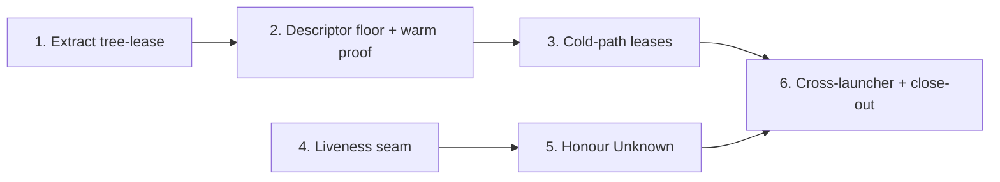

# Tree Leases on the Cold Path and Under Unknown Liveness Implementation Plan

## Overview

A live design daemon's vendored-runtime trees can be reclaimed in three ways.
The cold path never holds a lease. The warm path's first lease is probably lost
to the spawner's `dup2` onto fd 3. And `reclaim_unclaimed` and
`reap_superseded` treat `Liveness::Unknown` as free. This plan fixes all three
in two independent strands:

- **Lease strand:** extract the lease primitive into a `tree-lease` crate, move
  every lease above a descriptor floor, and hold the leases on the cold path.
- **Liveness strand:** add a liveness-probe seam to the resolver, then stop
  reclaiming on `Unknown`.

The cross-launcher criteria close the plan once both strands have landed.

## Current State Analysis

- **Cold path:** `accelerator cache ensure` prints `name\t<tree>\t<lease>` and
  exits, so the lease it took during materialisation is released
  (`cli/launcher/src/launch/cache.rs:105-116`,
  `cli/launcher/src/launch/outbound/resolve/tree/resolver.rs:318`).
  `design-adapters` parses `ResolvedTree.lease`
  (`cli/design-adapters/src/ensure.rs:102-118`), and nothing reads it.
  `ensure_runtime` uses only `.path` (`cli/design-cli/src/executor.rs:290-313`).
  `Ensured` is local to `resolve_runtime` and dropped before `act_on`.
- **Warm path:** the launcher holds `_tree_leases` across its `exec` into
  `accelerator-design` (`cli/launcher/src/main.rs:444`). `DaemonSpawner`'s
  `pre_exec` calls `dup2(read_fd, IDENTITY_FD)` with `IDENTITY_FD = 3`
  (`cli/design-adapters/src/process.rs:79,172`). That silently closes whatever
  the child inherited on fd 3, which is most likely the launcher's first lease.
  Nothing closes any other inherited descriptor.
- **Lease primitive:** `hold_shared_lease` and `SharedLease` live in
  `cli/launcher/src/launch/outbound/resolve/tree/lease.rs:33-72`. They are
  coupled to the launcher-only `TreeError::Lease` and `HeldLease`
  (`cli/launcher/src/launch/core/tree.rs:62-64,279`). The only dependency is
  `rustix`.
- **`Unknown` liveness:** `reclaim_unclaimed` (`resolver.rs:759-762`) and
  `reap_superseded` (`resolver.rs:691-700`) compare only against
  `Liveness::Held`. `reap_orphans` already falls through to the age check
  (`cli/launcher/src/launch/outbound/resolve/tree/reap.rs:152-166`).
- **Probe calls:** `probe_liveness` is called directly at `reap.rs:162`,
  `resolver.rs:693` and `resolver.rs:759`, with no injection seam.
- **Backstop rule:** `AGE_BACKSTOP` (1h) and `older_than_backstop` are private
  to `reap.rs:28,172-180`.
- **Construction sites:** `TreeResolver` is a struct of all-`pub` fields
  (`resolver.rs:100-120`) built by literal. Production builds it at
  `main.rs:330-342` and `:422-434`. Tests build it at
  `cli/launcher/tests/tree_resolution.rs:266-292`, `:1263`, `:1306` and
  `:1607`.

## Desired End State

- **`tree-lease` crate:** `cli/tree-lease` is a registered technical library
  that owns `hold_shared_lease`, `SharedLease`, `LeaseError` and
  `observed_held`. Every lease it hands out sits on a descriptor at or above
  `LOWEST_LEASE_DESCRIPTOR` (10), with `FD_CLOEXEC` cleared.
  `design-adapters` asserts at compile time that `IDENTITY_FD` sits below
  that floor.
  - `launcher` and `design-adapters` depend on it.
  - `launcher` no longer defines either item.
- **Live daemon holds its leases:** once the client has exited, every lease of
  the daemon's generations is observed held, whether the daemon was started
  warm or cold. Each lease becomes free once the daemon's process group is
  killed.
- **Lease failure:** a cold-path lease that cannot be taken is skipped with a
  `warning:` line on stderr, and the daemon still spawns.
- **Tree gone after leasing:** the executor re-runs `cache ensure` once. If a
  tree is still gone, it downgrades with `artifact-unavailable` and records no
  marker. A second ensure that fails is classified like any failed ensure. The
  executor touches only a lease path that is the tree's own `.lease` sibling,
  and it removes a lease file it created only once no other process holds
  that file.
- **Liveness seam:** `TreeResolver` carries a `LivenessProbe`, and the three
  reclaim paths consult it.
- **`Unknown` handling:**
  - `reclaim_unclaimed` reclaims an `Unknown` generation only once it is at
    least `AGE_BACKSTOP` old.
  - `reap_superseded` reclaims only a `Free` one. It resets the mtime of an
    `Unknown` one it leaves behind, so the backstop counts from that moment.
  - The three reclaim rules sit side by side in `reap.rs` as pure, named
    predicates.
- **Orphan sidecars:** `reap_orphans` removes a reclaimed generation's
  `.sealed`, `.sealed.sig` and `.lease` alongside its directory.
- **Done:** `mise run` exits 0.

Verify the end state by running `mise run` and walking the acceptance-criteria
map in Phase 6.

### Key Discoveries

- **Raising a descriptor:** rustix 1.1.4 exposes `fcntl_dupfd` only on
  `espidf`. On macOS and Linux the only call is `fcntl_dupfd_cloexec`
  (`F_DUPFD_CLOEXEC`), which sets `FD_CLOEXEC` on the duplicate, so
  `clear_cloexec` is what makes a raised lease inheritable.
- **Lock after raising:** a native `flock` belongs to the open file description,
  but Linux NFS emulates `flock` with POSIX locks, and there closing any
  descriptor for the file drops the process's lock. Raising first, dropping the
  low descriptor, and only then taking `LOCK_SH` holds under either model.
- **Real launchers cannot carry two digests:** they materialise only their
  compiled-in digest from a signed release. Two launchers can therefore only be
  modelled in-process with `ExpectedDigests::Fixed` (`resolver.rs:79-97`).
  `happy_harness` (`tree_resolution.rs:304`) provides the signed release
  through a mock server and `minisign`, and `minisign_or_skip!` skips when
  `minisign` is absent.
- **Executor end-to-end runs need no Node:** the requirements are all small.
  - **Driver tree:** only an executable `<driver>/node`. A `#!/bin/sh` stub
    passes the platform checks on macOS and on glibc Linux, and nothing probes
    `node` before the spawn.
  - **Daemon readiness:** the stub must write `<state>/server-info.json` with an
    integer `pid` (`cli/design-adapters/src/state.rs:47-62`). It must first
    drain fd 3, or the identity write hits `EPIPE`.
  - **State directory:** this is
    `<repo>/.accelerator/tmp/inventory-design-playwright/bundled`. The run needs
    `ACCELERATOR_PLUGIN_ROOT` set to any directory and a repo containing
    `.git`.
  - **Cold launcher:** reached through `ACCELERATOR_LAUNCHER_PATH`, which is
    tried first and needs only `is_file()`.
- **Daemon process group:** `setsid` makes the daemon's pid its pgid, so
  `killpg(pid, SIGTERM)` ends the daemon and its descendants.
- **Warm handover needs a fresh process:** to reproduce the warm-path clobber
  faithfully, the leases must be taken by a process whose only open
  descriptors are 0-2. That process must then `exec` the executor, as the
  launcher does. `Command` does not close inherited descriptors, and the test
  runner may itself have inherited some from mise, cargo, llvm-cov or an IDE.
  Phase 2's fixture binary therefore closes every descriptor above 2, found by
  listing `/dev/fd` (available on both macOS and Linux), before it takes a
  lease.
- **Lease descriptors leak between parallel tests:** `tree-lease` deliberately
  clears `FD_CLOEXEC`, and tests in one binary run as threads of one process.
  So a lease held in a test process passes to any child another test spawns at
  that moment. A long-lived lease holder is therefore its own fixture process,
  which closes the descriptors it inherited and then takes its own leases.
- **Fixture binary naming:** test fixture binaries are named
  `<crate-dir>-fixture[-qualifier]`, with source at
  `tests/fixtures/<crate_dir>_fixture[_qualifier].rs`, following
  `cli/vcs-adapters/Cargo.toml:28-37`. Their names avoid the `accelerator-`
  prefix, and staging copies only the names in `_CLI_RELEASE_BINARIES`
  (`tasks/build.py:39-64`), so no fixture is shipped. The launcher's
  `accelerator-fixture` predates the no-prefix rule recorded at
  `tasks/build.py:53-60`.
- **Closing inherited descriptors:** the listing of `/dev/fd` includes the
  descriptor opened to read it. Closing that number a second time aborts in
  debug builds on both platforms:
  - through `OwnedFd`, by std's IO-safety check;
  - on Linux, through `rustix::io::close` too, because the `linux_raw`
    backend's `decode_void` runs `debug_assert_eq!(ignore, 0)`
    (`rustix-1.1.4/src/backend/linux_raw/reg.rs:165-168`).

  Each fixture therefore:
  1. opens `/dev/fd` itself with `rustix::fs::open` (`OFlags::DIRECTORY`) and
     records that descriptor's number;
  2. reads it with `rustix::fs::Dir::new`, which takes ownership of that
     descriptor and reads through it. Never use `Dir::read_from`: it opens a
     second descriptor through `openat(fd, ".")`
     (`rustix-1.1.4/src/backend/linux_raw/fs/dir.rs:77-79`), and that one
     would be listed, not skipped, and closed twice. The listing therefore
     holds exactly one descriptor of its own, the recorded one;
  3. collects every number above 2 except its own;
  4. drops the listing;
  5. closes each collected number with `rustix::io::close`, inside an `unsafe`
     block whose `SAFETY:` line says why the number is open: it was listed,
     it is not the listing's own, and the fixture is single-threaded.
- **Claims on the hit path:** `materialise` returns early on a located
  generation (`resolver.rs:584-590`) without calling `write_claim`. So
  `cache ensure` does not always refresh the claim, and the work item's
  reasoning for accepting the gap between `ensure` exiting and the executor
  taking its leases is weaker than it states. The cold path therefore re-checks
  each tree after leasing it. That narrows the gap but does not close it: every
  reclaimer probes the lease, releases the probe and only then removes the
  generation, and `remove_dir_all` unlinks the top directory last. A lease
  taken inside that window still sees the directory. The launcher's `acquire`
  shares the same window.
- **The backstop counts from extraction:** a generation directory's mtime is
  set when it is extracted, and the rename into place (`resolver.rs:324`) does
  not change it. A superseded generation is usually days old, so leaving an
  `Unknown` one "for the age-gated reaper" would give no grace at all unless
  the deferral resets its mtime.
- **Dev-dependencies are unchecked:** `lint:crate-dependencies:check` checks
  normal and build dependencies only, so dev-dependencies are unconstrained.
- **`pup` context is generated:** `cli/.pup/accelerator_context.json` is
  gitignored, so moving `SharedLease` needs no hand edit there.

## What We're NOT Doing

- Version-aware daemon reuse, footprint reporting across sibling roots, or
  moving the tree root to `${CLAUDE_PLUGIN_DATA}`.
- Closing the lease descriptor in daemon descendants. If Phase 6 finds that
  descendants keep it, a follow-up item is raised for that.
- Releasing leases when the daemon fails to spawn. The executor exits on that
  branch, which releases them.
- Changing `probe_liveness`, the single-flight lock, or `cache ensure`'s output
  contract.
- An age check for `Free` generations in `reclaim_unclaimed`.
- Making `cache ensure` succeed where `flock` is unavailable. `materialise_fresh`
  takes a lease at `resolver.rs:318`, so on such a filesystem `cache ensure` may
  already fail. That is unchanged here.
- Refreshing the claim on `materialise`'s hit path, or holding the reclaimers'
  probe lock through removal. The cold path's re-check after leasing narrows
  the race that the missing refresh opens, and the remaining
  probe-then-remove window, which `acquire` shares, is accepted.
- Measuring `reclaim_unclaimed`'s `Unknown` backstop from a sign of use. The
  work item's table gates `Unknown` on the generation's age. Age counts from
  extraction, so a pointed-at generation older than an hour gets no grace
  there, and the claim window remains its real guard. Only generations that
  `repair` defers have their backstop restarted.
- A guaranteed backstop reset on network filesystems. `restart_backstop` is
  best-effort: where `utimensat` is rejected, a deferred `Unknown` generation
  keeps its extraction mtime, as it does today.
- Collecting a lone `.lease` that the launcher's own `acquire` miss path
  leaves behind. `reap_orphans` never classifies sidecars without a
  generation, and that predates this work. The executor's cold path removes
  only the lease file it created, and only when no one holds it.
- Faking a second real launcher binary. The cross-launcher criteria use the
  in-process two-digest fixture with a stand-in daemon, as the user decided.

## Implementation Approach

The work is test-first throughout. Each phase begins with the test that names
the behaviour, and each phase can be merged on its own with `mise run` green.



Phases 4-5 are independent of Phases 1-3 and may land in either order.

Decisions taken during planning:

| Decision | Choice | Consequence |
|---|---|---|
| Fd 3 clobber | Descriptor floor inside `tree-lease` | Fixes warm and cold alike, which exceeds the work item's warm-path scope bound. The deviation is recorded on 0330 in Phase 6. |
| Cold-path lease failure | Proceed unleased, with a `warning:` line | Behaviour on filesystems without `flock` is unchanged, the daemon still spawns, and the skip is diagnosable |
| Tree gone before its lease | Re-check after leasing; re-run `cache ensure` once, then downgrade without a marker | A reclaim race is a clean, retryable miss rather than a sticky `loader-unresolvable`, and no stray `.lease` is left |
| Sidecars of deferred generations | `reap_orphans` removes them | An `Unknown` superseded generation is cleaned up completely once it ages |
| Deferring an `Unknown` superseded generation | Reset its mtime to the injected clock's now, best-effort | The backstop counts from the deferral, so a live daemon on an old tree gets the full hour; a `Held` one is left alone |
| The retry after a gone tree | `ensure_and_pin`, at most two attempts | One named rule, with every path and lease from one attempt, and a failed second ensure classified like a first |
| `tree-lease` public API | Exempt, plus a `const` assert on `IDENTITY_FD` | The one cross-crate invariant is enforced at compile time where the descriptor layout lives |
| `LivenessProbe` home | Outbound adapter, as a test seam | `Liveness` stays where it is, and `launch::core` is untouched |
| Cross-launcher criteria | Split across suites | design-cli proves that the daemon holds its leases. The launcher's two-digest fixture proves that `prune` honours a held lease. |

---

## Phase 1: Extract `tree-lease`

### Overview

Move the shared-lease primitive into a leaf technical-library crate with its own
error type. Behaviour does not change: the descriptor floor arrives in Phase 2.

### Changes Required

#### 1. The new crate

**Files**:
- `cli/tree-lease/Cargo.toml`
- `cli/tree-lease/src/lib.rs`

**Changes**: Write the manifest from the `cli/process-probe/Cargo.toml`
template, with `rustix` and a `tempfile` dev-dependency. Move
`hold_shared_lease`, `SharedLease` and `clear_cloexec` here. Their logic is
unchanged, but their error construction is rewritten: `TreeError::Lease` and
the launcher's `lease(&str)` helper give way to `LeaseError`, which implements
`Display` and `Error` by hand rather than with a derive. `LeaseError` keeps the underlying `io::Error` and
returns it from `source()`. Move the unit tests below with the code. Keep a
`cfg(not(unix))` stub whose `hold_shared_lease` and `observed_held` return a
`LeaseError`.

Add `observed_held`, the work item's definition of "observed held" made
executable once, so that every suite which observes a lease shares one
contract:

| Lease file | Non-blocking exclusive `flock` | Result |
|---|---|---|
| absent | — | `Ok(false)` |
| present | `EWOULDBLOCK` | `Ok(true)` |
| present | succeeds | `Ok(false)`, lock released |
| present | any other error | `Err(LeaseError)` |

The launcher's `probe_liveness` stays where it is: it maps the last row to
`Unknown`, which reclamation needs and tests must not swallow.

```toml
[package]
name = "tree-lease"
version.workspace = true
edition.workspace = true
rust-version.workspace = true
license.workspace = true
publish.workspace = true

[package.metadata.accelerator]
role = "technical-library"

[lints]
workspace = true

[dependencies]
rustix = { workspace = true }

[dev-dependencies]
tempfile = { workspace = true }
```

```rust
#[derive(Debug)]
pub struct LeaseError {
    action: &'static str,
    path: PathBuf,
    cause: std::io::Error,
}

impl LeaseError {
    fn new(action: &'static str, path: &Path, cause: impl Into<std::io::Error>) -> Self;
}

impl std::fmt::Display for LeaseError {
    fn fmt(&self, formatter: &mut std::fmt::Formatter<'_>) -> std::fmt::Result {
        write!(formatter, "{} {}: {}", self.action, self.path.display(), self.cause)
    }
}

impl std::error::Error for LeaseError {
    fn source(&self) -> Option<&(dyn std::error::Error + 'static)> {
        Some(&self.cause)
    }
}

pub struct SharedLease {
    file: File,
}

pub fn hold_shared_lease(path: &Path) -> Result<SharedLease, LeaseError>;

pub fn observed_held(path: &Path) -> Result<bool, LeaseError>;

fn open_lease_file(path: &Path) -> Result<File, LeaseError>;

fn clear_cloexec(file: &File, path: &Path) -> Result<(), LeaseError>;
```

`open_lease_file` is the launcher's existing `OpenOptions` chain, extracted.
Every error is built with `LeaseError::new`. The existing
`#[allow(dead_code)]` on `SharedLease.file` moves with it. The pedantic
`missing_errors_doc` lint, which the workspace denies, requires a one-line
`# Errors` section naming `LeaseError` on `hold_shared_lease` and
`observed_held`. The moved doc is reworded so that it no longer cites
`TreeError::Lease`.

Tests move from `lease.rs:187-258`, and `the_single_flight_lock_is_exclusive`
stays behind. They observe held and free through `observed_held`:

- `a_held_lease_is_observed_held_and_a_released_one_free`
- `a_shared_lease_admits_a_concurrent_holder`
- `the_lease_descriptor_survives_exec`

Add tests:

- `an_unopenable_lease_is_a_lease_error`: the parent directory is absent.
- `an_absent_lease_file_is_not_observed_held`
- `observing_a_free_lease_leaves_it_free`: after `observed_held` returns
  `false`, a second call also returns `false`.

#### 2. Library-crate checklist (`tasks/README.md:789-853`)

| Item | Edit |
|---|---|
| Workspace membership | Add `"tree-lease"` to `cli/Cargo.toml` `members`, then run `cargo metadata --manifest-path cli/Cargo.toml --format-version 1` |
| Inherited fields + `[lints]` | Already in the manifest above |
| Role declaration | Add `"tree-lease": ("technical-library", None, None, None),` to `_EXPECTED_DECLARATIONS` in `tests/unit/tasks/test_crate_dependencies.py` |
| `pup.ron` rule | Add a `tree_lease_holds_leases_only` rule denying `^std::process(::\|$)`, `^reqwest(::\|$)` and `^hyper(::\|$)` over `^tree_lease($\|::)`, modelled on `remote_projection_extracts_json_only` (`cli/pup.ron:203-221`). Also add `tree_lease` to the crate alternation in `only_the_consent_policy_names_the_command_runner` (`cli/pup.ron:443`). |
| Probe pair | In `tests/integration/pup/test_import_rule.py`, add `test_tree_lease_rule_rejects_spawning` (reusing `_SPAWN_VIOLATION`) and `test_tree_lease_rule_permits_locking`. The compliant body imports `std::fs::OpenOptions`. Both drive `_write_shared_crate_probe(tmp_path, "tree-lease", ...)`. |
| Public API | Add a `tree-lease` entry to `_EXEMPT_MEMBERS` in `tasks/public_api.py` with the reason, worded like `process-probe`'s (`tasks/public_api.py:84-88`): a hold and an observe over `flock`, whose contract is the kernel lock held, covered by its own lock-observation tests and by every reclaimer that probes it. Phase 2 extends it when the floor constant arrives. |

ADR-0069 is accepted, and therefore immutable, so it is not edited. The
manifest's role and `_EXPECTED_DECLARATIONS` are the live register of crate
roles.

#### 3. Launcher switches over

**Files**:
- `cli/launcher/Cargo.toml`: add `tree-lease = { path = "../tree-lease" }`.
- `cli/launcher/src/launch/outbound/resolve/tree/lease.rs`:
  - Delete `SharedLease`, `hold_shared_lease`, `clear_cloexec` and their tests.
  - Add `impl HeldLease for tree_lease::SharedLease {}`, which the orphan rule
    permits because `HeldLease` is local.
  - Add `impl From<LeaseError> for TreeError`, producing `TreeError::Lease`
    from the error's `Display`, so callers use `?`. The orphan rule permits it
    because `TreeError` is local.
  - Remove `hold_shared_lease` and `SharedLease` from both `pub use` lists.
  - Delete the non-unix `SharedLease` stub.
- `cli/launcher/src/launch/outbound/resolve/tree/resolver.rs:27,318,527`: call
  `tree_lease::hold_shared_lease(..)?`. `acquire` keeps its
  `let Ok(lease) = ... else` shape.
- `cli/launcher/tests/tree_resolution.rs`: import `tree_lease::hold_shared_lease`
  in place of the launcher path, in `prune_spares_a_generation_whose_lease_is_still_held`
  and `a_repair_spares_a_superseded_generation_whose_lease_is_held`.

### Success Criteria

#### Automated Verification

- [x] `tree-lease` unit tests pass: `cargo test --manifest-path cli/Cargo.toml -p tree-lease`
- [x] Launcher tests pass: `cargo test --manifest-path cli/Cargo.toml -p accelerator`
- [x] Role and dependency rules hold: `mise run lint:crate-dependencies:check`
- [x] The probe pair passes and the rule fires: `mise run pup:check` and `uv run pytest tests/integration/pup/test_import_rule.py -k tree_lease`
- [x] Public-API coverage guard passes: `uv run pytest tests/unit/tasks/test_rust.py`
- [x] Dependency graph clean: `mise run deny:check`
- [x] `rg -n 'fn hold_shared_lease|struct SharedLease' cli/launcher` returns nothing
- [x] `mise run check` exits 0

#### Manual Verification

- [x] The diff of `resolver.rs` is limited to the import and error mapping

---

## Phase 2: Descriptor floor and warm-path proof

### Overview

Build the executor's end-to-end harness and prove, failing first, that a warm
daemon loses the lease on fd 3. Then move every lease above a descriptor floor
inside `tree-lease`.

### Changes Required

#### 1. Warm handover fixture

**File**: `cli/design-cli/tests/fixtures/design_cli_fixture_warm_handover.rs`,
registered in `cli/design-cli/Cargo.toml` with the one-line note that every
existing fixture `[[bin]]` carries: a black-box test entry point found through
`CARGO_BIN_EXE_*`, not a shipped artifact.

```toml
[[bin]]
name = "design-cli-fixture-warm-handover"
path = "tests/fixtures/design_cli_fixture_warm_handover.rs"
```

**Changes**: The fixture reproduces the launcher's warm handover in a process
whose only open descriptors are 0-2. It reads its arguments in this order:

1. The executor path.
2. The driver tree and the driver lease.
3. The browser tree and the browser lease.
4. The forwarded executor arguments.

It then:

1. Closes every inherited descriptor above 2, as Key Discoveries describes. If
   `/dev/fd` cannot be read, for example in a sandbox without `/proc`, it
   exits with a distinct status that names the reason. Before taking a lease,
   it exits with another distinct status if fd 3 is still open, so a red run
   cannot be caused by the host.
2. Calls `tree_lease::hold_shared_lease` on the driver lease, then the browser
   lease, in the launcher's order.
3. Sets `ACCELERATOR_TREE_DRIVER` and `ACCELERATOR_TREE_BROWSER`.
4. `exec`s the executor with the forwarded arguments.

A binary target sees only its package's normal dependencies, so
`tree-lease = { path = "../tree-lease" }` and `rustix = { workspace = true }`
go in design-cli's `[dependencies]`, each declared once. The `[[bin]]` note
also says the fixture is their only user. A composition root may depend on a technical library, and
`lint:crate-dependencies:check` confirms it. Staging copies only
`_CLI_RELEASE_BINARIES` (`tasks/build.py:39-64`), so the fixture is never
shipped.

#### 2. Executor runtime harness

**File**: `cli/design-cli/tests/executor_runtime.rs` (new). The helpers use
`rustix::process` (`getpgid`, `kill_process_group`, `Pid`, `Signal::TERM`),
which design-cli already depends on for its fixture, so no `libc` is added.

Its module doc states its scope: the lifecycle of leases and the daemon,
driven through a stub `node`, with no Playwright behaviour. Amend the
`executor_preflight.rs` module doc so that the two suites describe one split
between them: preflight stays pre-exec, and runtime covers the stubbed
post-exec lifecycle.

A `runtime_or_skip!` guard skips the suite with a message where
`design::runtime::platform::classify(&design_adapters::platform::observe())`
rejects the host, such as musl or a relocated loader. On those hosts the
executor downgrades before it spawns, so the test would fail for reasons
unrelated to leases. Like `minisign_or_skip!` (`tree_resolution.rs:67-75`),
the guard panics instead of skipping when `CI` is set, so a rejected CI host
fails loudly.

The `executor` helper reuses the pattern from `executor_preflight.rs:20-43`:
`env_clear`, `PATH`, `HOME`, `LLVM_PROFILE_FILE`. A `Runtime` fixture builds,
per test:

- **Repo:** `<work>/repo/.git`.
- **Plugin root:** `<work>/plugin` (any directory).
- **Trees:** `<work>/cache/driver-tree/node`, the stub below, and
  `<work>/cache/browser-tree/`.
- **Lease files:** each tree's `.lease` sibling, as the launcher lays them
  out (`layout.rs:104-106`): `<work>/cache/driver-tree.lease` and
  `<work>/cache/browser-tree.lease`.

Stub `node`, which plays both the daemon and the client roles:

```sh
#!/bin/sh
case "$2" in
  daemon)
    cat <&3 > /dev/null
    printf '{"pid":%s,"start_time":null,"start_time_source":"writer-unavailable"}' $$ > "$4/server-info.json.tmp"
    mv "$4/server-info.json.tmp" "$4/server-info.json"
    exec sleep 300 ;;
  *) exit 0 ;;
esac
```

Helpers:

- **Observing a lease:** `tree_lease::observed_held`. An absent lease file
  reads as not held, and any error other than `EWOULDBLOCK` fails the test.
- **`DaemonGroup::from_state(state_dir, leases)`:**
  - Parses `pid` from `server-info.json`.
  - Refuses any `pid <= 1`.
  - Confirms `getpgid(pid) == pid`, which `setsid` guarantees for the real
    daemon.
  - Every test builds it as soon as `server-info.json` exists, before any
    assertion.
- **`DaemonGroup::terminate`:** sends `killpg(pid, SIGTERM)`, then polls
  `observed_held` until every lease reads free, bounded at 60s as in
  `spawn_properties.rs:80`. It returns an error on timeout. Polling the leases
  instead of `kill(pid, 0)` works whether or not anything reaps the orphaned
  daemon, because a zombie has already closed its descriptors.
- **`Drop`:** a no-op once `terminate` has succeeded, so a pid that may since
  have been reused is never signalled. Otherwise, on the failed-assertion
  path, it signals only if `getpgid(pid) == pid` still holds. It does not
  require a held lease, because a red run's daemon is exactly one that holds
  none. A recycled pid that has become a session leader within a test's
  lifetime is a negligible risk. `Drop` sends `killpg` on a best-effort basis
  and never panics, which still leaves no stray `sleep 300`.

#### 3. Warm-path test (red first)

```rust
#[test]
fn a_warm_daemon_holds_every_lease_after_the_client_exits() -> Result<(), TestError>
```

The test runs `design-cli-fixture-warm-handover`
(`env!("CARGO_BIN_EXE_design-cli-fixture-warm-handover")`) with `ping` and
asserts:

- **Exit status:** 0, which is the client stub's status.
- **Leases held:** `observed_held` is true for both lease files after the
  fixture has exited.
- **Leases freed:** `DaemonGroup::terminate` returns `Ok`, so both leases read
  free within the bound.

Expected first run: the driver lease is not observed held, because fd 3 was
clobbered. Record the observed result in the PR description.

#### 4. The descriptor floor

**File**: `cli/tree-lease/src/lib.rs`

Test first:

```rust
#[test]
fn a_lease_never_sits_on_a_low_descriptor() {
    let dir = tempfile::tempdir().expect("tempdir");
    let lease = hold_shared_lease(&dir.path().join("gen.lease")).expect("hold");
    assert!(lease.file().as_raw_fd() >= LOWEST_LEASE_DESCRIPTOR);
}
```

The cargo test process has other descriptors open, so this unit test may
happen to pass before the change. The warm-path test is the deterministic red
for the floor.

Also extend `a_held_lease_is_observed_held_and_a_released_one_free` so that it
still holds once the lease has been moved.

Implementation, inside the `cfg(unix)` module:

```rust
/// Children may repurpose low fixed descriptors, which would silently close a
/// lease sitting there.
pub const LOWEST_LEASE_DESCRIPTOR: RawFd = 10;

pub fn hold_shared_lease(path: &Path) -> Result<SharedLease, LeaseError> {
    let raised = opened_above_floor(path)?;
    flock(raised.as_fd(), FlockOperation::LockShared)
        .map_err(|error| LeaseError::new("cannot take the lease", path, error))?;
    let file = File::from(raised);
    clear_cloexec(&file, path)?;
    Ok(SharedLease { file })
}

fn opened_above_floor(path: &Path) -> Result<OwnedFd, LeaseError> {
    let opened = open_lease_file(path)?;
    fcntl_dupfd_cloexec(opened.as_fd(), LOWEST_LEASE_DESCRIPTOR)
        .map_err(|error| LeaseError::new("cannot raise the lease descriptor", path, error))
}
```

The low descriptor cannot outlive `opened_above_floor`, so by structure the
lease is only ever locked on the surviving descriptor. That is the ordering
that holds where `flock` is emulated with POSIX locks. `clear_cloexec` undoes
the `CLOEXEC` that `F_DUPFD_CLOEXEC` sets, and
`the_lease_descriptor_survives_exec` asserts it.

Extend the `tree-lease` reason in `_EXEMPT_MEMBERS` here: its one cross-crate
constant, `LOWEST_LEASE_DESCRIPTOR`, is enforced by a compile-time assertion
in its consumer.

**File**: `cli/design-adapters/src/process.rs`

Add `tree-lease = { path = "../tree-lease" }` to `cli/design-adapters/Cargo.toml`,
and put this beside `IDENTITY_FD`:

```rust
const _: () = assert!(IDENTITY_FD < tree_lease::LOWEST_LEASE_DESCRIPTOR);
```

The crate that owns the child's descriptor layout then enforces the
invariant at compile time.

### Success Criteria

#### Automated Verification

- [x] The warm-path test fails before item 4 and passes after it: `cargo test --manifest-path cli/Cargo.toml -p accelerator-design --test executor_runtime`
- [x] `tree-lease` floor test passes: `cargo test --manifest-path cli/Cargo.toml -p tree-lease`
- [x] `IDENTITY_FD` floor assertion compiles: `cargo build --manifest-path cli/Cargo.toml -p design-adapters`
- [x] Spawner suite still passes: `cargo test --manifest-path cli/Cargo.toml -p design-adapters --test spawn_properties`
- [x] Launcher lease tests still pass: `cargo test --manifest-path cli/Cargo.toml -p accelerator --test tree_resolution`
- [x] `mise run check` exits 0

#### Manual Verification

- [x] The red run's failure names the driver lease, which confirms the fd 3
      hypothesis. If it names neither lease, stop and re-plan, because the
      cause is not the clobber.

---

## Phase 3: Cold-path leases

### Overview

The executor takes a lease on every tree `cache ensure` returns, and `run` owns
those leases through the daemon spawn and the client `exec`. A lease that
cannot be taken is skipped.

### Changes Required

#### 1. Cold-path end-to-end tests (red first)

**File**: `cli/design-cli/tests/executor_runtime.rs`

Fake launcher, written per test and reached through `ACCELERATOR_LAUNCHER_PATH`:

```sh
#!/bin/sh
[ "$1 $2" = "cache ensure" ] || exit 64
shift 2
printf '%s\n' "$@" >> "<work>/ensure-args"
call=$(( $(cat "<work>/ensure-calls" 2>/dev/null || echo 0) + 1 ))
echo "$call" > "<work>/ensure-calls"
for artifact in "$@"; do
  tree="<tree:$artifact:$call>"
  printf '%s\t%s\t%s\n' "$artifact" "$tree" "$tree.lease"
done
```

The test fills in `<tree:$artifact:$call>` when it writes the script. By
default it is `<cache>/$artifact-tree`, and overriding it per call is how a
test makes a tree vanish before it is leased. The lease is always the tree's
`.lease` sibling, as the launcher lays it out. A test makes a tree unleasable
by creating a directory at that lease path, so the open fails with `EISDIR`.

The fake launcher creates
no lease files, because the executor's open creates them, as the launcher's
does. Before Phase 3 the files are therefore absent, and they read as not
held, so the red runs fail on the property under test.

Tests:

- `a_cold_daemon_holds_every_lease_after_the_client_exits`: the cache root is
  empty, so no `ACCELERATOR_TREE_*` is set. It runs `executor ping` and asserts:
  - both leases are observed held after the executor exits;
  - `ensure-calls` reads 1;
  - `DaemonGroup::terminate` frees both.
- `a_driver_exported_without_its_browser_takes_the_cold_path_and_holds_both`:
  sets `ACCELERATOR_TREE_DRIVER` only. It asserts:
  - `ensure-args` names both trees;
  - both leases are observed held while the daemon runs.
- `an_unleasable_tree_is_skipped_and_the_others_held`: a directory sits at the
  browser's lease path. It asserts:
  - the executor exits 0;
  - `server-info.json` names a live pid;
  - the driver lease is observed held;
  - `ensure-calls` reads 1, so an unleasable tree triggers no retry;
  - stderr carries exactly one `warning:` line, naming the browser tree and
    its lease path once.
- `a_tree_reclaimed_before_its_lease_is_ensured_again`: on call 1 the driver's
  tree path does not exist; on call 2 it is the real tree. It asserts:
  - `ensure-calls` reads 2;
  - the daemon is live;
  - both leases are observed held.
- `a_tree_still_gone_after_ensuring_again_downgrades_without_a_marker`: the
  driver's tree path never exists. It asserts:
  - the executor reports the `artifact-unavailable` downgrade;
  - `ensure-calls` reads 2;
  - no downgrade marker has been written;
  - no daemon was started.
- `a_failed_second_ensure_is_classified_as_any_failed_ensure`: on call 1 the
  driver's tree path does not exist. On call 2 the fake launcher exits
  non-zero with a `cache-unwritable` cause envelope on stderr. It asserts that
  the reported reason and the marker are the same as `classify_cause` gives
  for that cause on a first ensure.

Before items 2-3 the last three tests fail as well. Today the executor spawns on
the missing driver, which surfaces as `loader-unresolvable`
(`design/src/executor/launch.rs:117-121`), and it never calls `ensure` a
second time.

#### 2. `TreeLeases` in `design-adapters`

**File**: `cli/design-adapters/src/ensure.rs`. `design-adapters` already
depends on `tree-lease` from Phase 2.

The tests go first, in a new integration binary,
`cli/design-adapters/tests/tree_leases.rs`. They live there rather than in
`ensure.rs`'s unit module, where the `ensure` tests spawn a fake-launcher
`sh`, which would inherit a held lease and race the "free after drop"
assertion. This binary spawns no children.

- `holding_the_leases_of_resolved_trees_pins_them`: each lease is observed held
  while the `TreeLeases` lives, and free once it is dropped.
- `an_unleasable_tree_is_listed_unleasable_and_the_rest_are_held`: a
  directory sits at one tree's lease path. That tree is listed in
  `unleasable` as `Unleasable::Lease`.
- `a_tree_gone_before_its_lease_is_listed_gone`: `tree.path` does not exist.
  Assert that no lease is held, that the lease file is absent afterwards, and
  that the tree is listed in `gone`.
- `a_tree_whose_cache_has_gone_is_listed_gone`: the tree's parent directory
  does not exist, so the lease cannot be opened either. Assert the tree is
  listed in `gone`, not in `unleasable`.
- `a_lease_file_another_holder_holds_outlives_its_gone_tree`: hold the lease
  from a second open file description first, then call `hold` on a tree whose
  path does not exist. Assert the lease file still exists and is still
  observed held.
- `an_unstattable_tree_is_listed_unleasable_not_gone`:
  - **Setup:** the tree and its sibling lease sit under a directory with mode
    `000`, so both the stat and the lease open fail with `EACCES`. A guard
    restores mode `0755` on `Drop`, before the `TempDir` drops, so cleanup
    also succeeds when an assertion fails.
  - **Assert:** the tree is listed in `unleasable` as `Unleasable::Lease`,
    and `gone` is empty. There is no file-system assertion: nothing under a
    mode-`000` directory can be stat'ed, created or unlinked, so one could
    not fail.
  - **Root:** skipped when `rustix::process::geteuid().is_root()`. For this,
    add `rustix = { workspace = true }` to design-adapters'
    `[dev-dependencies]`, which the dependency check leaves unconstrained.
- `a_lease_path_outside_the_tree_layout_is_left_untouched`: a
  `ResolvedTree` whose `tree.path` does not exist and whose `lease` names an
  unrelated existing file. Assert the file still exists with its contents,
  and that the tree is listed in `unleasable` as
  `Unleasable::OutsideTreeLayout`. This pins the "never removed" half of the
  rule.
- `a_lease_path_outside_the_tree_layout_is_never_created`: `tree.path`
  exists, and `lease` names a path outside the layout that does not exist.
  Assert that the path still does not exist afterwards, and that the tree is
  listed `Unleasable::OutsideTreeLayout`. An implementation that takes the
  lease before checking the layout fails here.

```rust
#[derive(Default)]
pub struct TreeLeases(#[allow(dead_code)] Vec<tree_lease::SharedLease>);

pub struct HeldTrees {
    pub leases: TreeLeases,
    pub unleasable: Vec<(ResolvedTree, Unleasable)>,
    pub gone: Vec<ResolvedTree>,
}

pub enum Unleasable {
    OutsideTreeLayout,
    Lease(tree_lease::LeaseError),
}

impl std::fmt::Display for Unleasable {
    fn fmt(&self, formatter: &mut std::fmt::Formatter<'_>) -> std::fmt::Result {
        match self {
            Self::OutsideTreeLayout => formatter.write_str("its lease path is not the tree's `.lease` sibling"),
            Self::Lease(error) => write!(formatter, "{error}"),
        }
    }
}

impl TreeLeases {
    #[must_use]
    pub fn hold(trees: &[ResolvedTree]) -> HeldTrees;
}
```

For each tree, `hold`:

1. **Checks the lease path.** It must be `tree.path` with `.lease` appended,
   which is the launcher's layout. Any other path is listed
   `Unleasable::OutsideTreeLayout` and is never created or removed.
   `LeaseError` stays constructible only inside `tree-lease`, because this
   check is the executor's policy, not a lease failure. The path comes from
   a subprocess's stdout, so this keeps the executor from writing or
   deleting outside the tree's own sidecar.
2. **Takes the lease**, then calls `symlink_metadata(tree.path)` whether the
   lease was taken or not:
   - **`NotFound`:** the tree is gone. `hold` drops any lease it took, then
     removes the lease file only if `observed_held` reads `Ok(false)`,
     ignoring `NotFound` on removal. It lists the tree as `gone`. Another
     daemon's lease is therefore never unlinked.
   - **Any other result, without the lease:** the tree is listed
     `Unleasable::Lease`. A tree that cannot be stat'ed lands here, because
     its sibling lease shares the same blocked parent.
   - **Any other result, with the lease taken:** the tree is treated as
     present, and its lease is kept. Because the lease is a sibling of the
     tree, no test can reach this branch. It is defence in depth that
     resolves uncertainty towards keeping, as every other rule here does.

This is the launcher's lease-then-recheck applied on the cold path.
`TreeLeases` follows the `RunLockGuard` shape (`cli/migrate/src/ports.rs:346`):
a value that exists only to be dropped.

Re-export `TreeLeases`, `HeldTrees` and `Unleasable` from
`cli/design-adapters/src/lib.rs`.

The executor relies on `cache ensure` printing each lease as its tree's
`.lease` sibling. `cache ensure` prints `sealed.path` and `sealed.lease_path`
(`cache.rs:110-115`). Add `every_sealed_tree_carries_its_lease_beside_it` to
`cli/launcher/tests/tree_resolution.rs`, which materialises and asserts that
`lease_path` equals `path` with `.lease` appended. The contract is
then pinned where it is produced, and a layout change in `layout.rs` fails
there rather than silently leaving every cold-path tree unleased.
The doc comment on `hold` states the one non-obvious point: a tree that cannot
be leased is skipped, because the daemon must still run where `flock` is
unavailable.

#### 3. The executor owns the leases

**File**: `cli/design-cli/src/executor.rs`

- **`Ensured`:** gains `leases: TreeLeases`, which is empty by default, so
  `Ensured` keeps its `#[derive(Default)]`. The unit-test literal at
  `executor.rs:643` gains `..Ensured::default()`.
- **`ensure_and_pin`** (new), extracted so that `ensure_runtime` stays under
  the denied pedantic `too_many_lines` limit, and so that the retry rule has a
  name:

  ```rust
  struct PinnedTrees {
      resolved: Vec<ResolvedTree>,
      leases: TreeLeases,
  }

  enum EnsureFailure {
      Failed(String),
      TreesReclaimed,
  }

  fn ensure_and_pin(launcher: &Path, trees: &[&str]) -> Result<PinnedTrees, EnsureFailure>
  ```

  The executor uses one verb for its side of the concept: it *pins* trees. In
  `tree-lease` and `TreeLeases::hold`, a lease is *held*.

  It loops at most twice. On each attempt it calls `run_ensure`, then
  `TreeLeases::hold` on the result:
  - **`EnsureOutcome::Failed(cause)`:** returns `EnsureFailure::Failed(cause)`
    on either attempt. `ensure_runtime` sends that through the existing
    `classify_cause` and marker arm (`executor.rs:314-325`), unchanged. A
    genuine failure is classified the same way whether it comes first or
    second.
  - **`gone` is empty:** prints one
    `warning: tree '<artifact>' runs unleased: <Unleasable>` line per
    `unleasable` tree, as `executor.rs:137` does, and returns
    `PinnedTrees { resolved, leases }` from this attempt.
  - **`gone` is not empty:** drops this attempt's whole `HeldTrees`, so no
    lease from it survives, and tries again. After the second attempt it
    returns `EnsureFailure::TreesReclaimed`.
- **`ensure_runtime`'s ensure step** calls `ensure_and_pin` in place of
  `run_ensure`:
  - `TreesReclaimed` returns
    `RuntimeOutcome::Downgrade(DowngradeReason::ArtifactUnavailable)` without
    writing a marker. A reclaim race is transient, so it must not suppress
    later attempts.
  - On success, the marker clearing, the driver lookup and `browser_tree` all
    read the returned `resolved`. Every path and lease therefore comes from
    the same attempt.
  - `leases` is stored in `ensured`.
- **`resolve_runtime`:** returns a named type,
  `PinnedResolution { resolution: Resolution, leases: TreeLeases }`, with
  `leases` taken from `ensured.into_inner().leases` after
  `availability::resolve` returns, since the thunks borrow `ensured`. The warm
  path and every downgrade yield the empty default.
- **`run`:** destructures
  `let PinnedResolution { resolution, leases: _leases } = resolve_runtime(...)`.
  It binds a name rather than `_`, so the leases live through `act_on` →
  `launch` → `ExecClient::run`, and the type name says why the binding
  exists. After a
  successful `exec` no destructor runs. On a downgrade or a failure, the leases
  drop when `run` returns, which the work item accepts.

### Success Criteria

#### Automated Verification

- [x] The six cold-path tests fail before items 2-3 and pass after: `cargo test --manifest-path cli/Cargo.toml -p accelerator-design --test executor_runtime`. The first three fail on a lease not observed held, and the last three on the missing second `ensure`.
- [x] `TreeLeases` tests pass: `cargo test --manifest-path cli/Cargo.toml -p design-adapters --test tree_leases`
- [x] Existing executor tests pass: `cargo test --manifest-path cli/Cargo.toml -p accelerator-design`
- [x] Dependency rules hold: `mise run lint:crate-dependencies:check` and `mise run deny:check`
- [x] `mise run check` exits 0

#### Manual Verification

- [ ] With a real installed plugin and an empty `ACCELERATOR_CACHE_DIR`, run
      one `inventory-design` crawl step. Then
      `lsof <cache>/trees/*.lease` lists the daemon's pid against both lease
      files. Where `lsof` is absent on Linux, use
      `ls -l /proc/<daemon pid>/fd | grep '\.lease'`.

---

## Phase 4: Liveness-probe seam

### Overview

Inject liveness into the resolver so that `Unknown` can be tested without an
NFS backend. Behaviour does not change.

### Changes Required

#### 1. The liveness seam

**File**: `cli/launcher/src/launch/outbound/resolve/tree/lease.rs`

The seam stays in the outbound adapter beside `Liveness`, as `StepObserver`
does. It is a test seam of the resolver, not a core port.

```rust
pub trait LivenessProbe {
    fn probe(&self, lease: &Path) -> Liveness;
}

pub struct FlockProbe;

impl LivenessProbe for FlockProbe {
    fn probe(&self, lease: &Path) -> Liveness {
        probe_liveness(lease)
    }
}
```

Export both through the `pub use` lists. The non-unix stub gets the same pair.

#### 2. Carry the probe

This step changes no behaviour. It adds the field and parameters, so the seam
tests compile and then fail on behaviour.

- **`TreeResolver`:** add `pub liveness: &'a dyn LivenessProbe` beside `clock`
  (`resolver.rs:100-120`).
- **Production literals:** `main.rs:330-342` and `:422-434` bind
  `let liveness = FlockProbe;` and pass `&liveness`.
- **Test literals:** add a `liveness` parameter to `Harness::resolver_with`, and
  have `Harness::resolver` pass `&FlockProbe`. The ad-hoc literals at
  `tree_resolution.rs:1263`, `:1306` and `:1607` pass `&FlockProbe`.

#### 3. Seam tests (red)

**File**: `cli/launcher/tests/tree_resolution.rs`

Add `struct FixedLiveness(Liveness)` implementing `LivenessProbe`. Each test
below fails at this point, because the reclaimers still call `probe_liveness`,
and that reads `Free` for a lease nobody holds.

- `an_injected_held_probe_spares_a_stale_sibling_in_prune`:
  1. Plant a sibling with `plant_sibling_generation`, holding no real lease.
  2. Run `prune(ARTIFACT, Some(ZERO))` with `FixedLiveness(Held)`.
  3. Assert the sibling remains.
- `an_injected_held_probe_spares_a_superseded_generation_in_repair`:
  1. Materialise.
  2. Run `repair(ARTIFACT, true)` with `FixedLiveness(Held)`.
  3. Assert the old generation remains.
- `an_injected_held_probe_spares_an_aged_orphan_in_prune`:
  1. Plant an unreferenced generation.
  2. Run `prune` with an aged `FixedClock` and `FixedLiveness(Held)`.
  3. Assert it remains.
- `an_injected_held_probe_spares_an_aged_orphan_while_materialising`:
  1. Plant an unreferenced generation.
  2. Materialise `ARTIFACT` with an aged `FixedClock` and
     `FixedLiveness(Held)`.
  3. Assert the planted generation remains. This covers the `reap_orphans`
     call in `materialise_with_waiter` (`resolver.rs:605`).

#### 4. Consult the probe

- **`reap_orphans`:** becomes
  `reap_orphans(paths, clock, liveness, keep_digests)`.
  `is_reclaimable_generation` takes `liveness` in place of calling
  `probe_liveness` (`reap.rs:41,152-166`). The `reap.rs` unit tests pass
  `&FlockProbe`.
- **`reap_superseded`:** becomes `reap_superseded(paths, liveness, generation)`.
  `repair` passes `self.liveness` (`resolver.rs:681-700`).
- **`reclaim_unclaimed`:** calls `self.liveness.probe(..)`
  (`resolver.rs:759`).
- **`materialise_with_waiter`:** its `reap_orphans` call (`resolver.rs:605`)
  passes `self.liveness`.

### Success Criteria

#### Automated Verification

- [x] The four seam tests compile after item 2, fail on their assertions before item 4, and pass after it: `mise exec -- cargo test --manifest-path cli/Cargo.toml -p accelerator --test tree_resolution`
- [x] `reap.rs` unit tests pass: `cargo test --manifest-path cli/Cargo.toml -p accelerator reap`
- [x] No reclaimer calls the probe directly: `rg -n 'probe_liveness\(' cli/launcher/src --glob '!**/lease.rs'` returns nothing
- [x] `mise run pup:check` passes, so `launch::core` still names no outbound type
- [x] `mise run check` exits 0

#### Manual Verification

- [x] None.

---

## Phase 5: Honour `Unknown`

### Overview

`reclaim_unclaimed` defers an `Unknown` generation to the age backstop, and
`reap_superseded` reclaims only a `Free` one. A generation `reap_superseded`
leaves behind has its mtime reset to now, so the backstop counts from the
deferral rather than from extraction. `reap_orphans` removes the sidecars of
each generation it reclaims, so deferred generations are cleaned up
completely once they age.

### Changes Required

#### 1. The rules, unit-tested first

**File**: `cli/launcher/src/launch/outbound/resolve/tree/reap.rs`

Each reclaimer gets one pure, named rule, and the three sit side by side. Each
rule takes the probed `Liveness` and an already-computed `aged` flag, so the
decision does no I/O. `reap_orphans` keeps a rule of its own, because
`reclaim_unclaimed`'s `Free => true` would drop the backstop that young
unreferenced generations need.

```rust
pub(super) const fn unclaimed_is_reclaimable(liveness: Liveness, aged: bool) -> bool {
    match liveness {
        Liveness::Held => false,
        Liveness::Free => true,
        Liveness::Unknown => aged,
    }
}

pub(super) enum SupersededDisposition {
    Reclaim,
    Defer,
    Keep,
}

pub(super) const fn superseded_disposition(liveness: Liveness) -> SupersededDisposition {
    match liveness {
        Liveness::Free => SupersededDisposition::Reclaim,
        Liveness::Unknown => SupersededDisposition::Defer,
        Liveness::Held => SupersededDisposition::Keep,
    }
}

const fn orphan_is_reclaimable(liveness: Liveness, aged: bool) -> bool {
    !matches!(liveness, Liveness::Held) && aged
}

pub(super) fn generation_is_aged(paths: &TreePaths, generation: &str, clock: &dyn Clock) -> bool {
    older_than_backstop(&paths.generation(generation), clock)
}

pub(super) fn restart_backstop(paths: &TreePaths, generation: &str, clock: &dyn Clock);
```

All three rules are `const fn`, which satisfies the nursery
`missing_const_for_fn` lint that the workspace denies. The superseded rule
returns a disposition rather than a `bool`, because `reap_superseded` acts
differently on each of the three outcomes.

`restart_backstop` sets the generation directory's mtime to
`clock.now_seconds()` by path, with
`rustix::fs::utimensat(CWD, path, .., AtFlags::empty())`. That needs ownership
but no read permission and no open. Age is measured against the injected
clock, so the mtime is also set from that clock. A failure is ignored, and the
generation then keeps its extraction mtime, which is the behaviour today. On
network filesystems that reject `utimensat`, the reset is therefore
best-effort, as What We're NOT Doing records.

`older_than_backstop` stays private. These unit tests go in the existing
`reap.rs` test module:

- **Rule cells:** one test for every cell of the three rules. They are red
  only by compilation until item 1 adds the rules.
- **Backstop boundary:** two tests that pin `generation_is_aged` against a
  planted generation's real mtime. They describe the existing `>=` boundary
  (`reap.rs:179`) rather than drive a change.
  - `a_generation_one_second_short_of_the_backstop_is_not_aged`: the clock
    reads `mtime + AGE_BACKSTOP - 1`.
  - `a_generation_exactly_at_the_backstop_is_aged`: the clock reads
    `mtime + AGE_BACKSTOP`.
- **`restarting_the_backstop_counts_from_the_injected_clock`:** back-date a
  planted generation two days, then call `restart_backstop` with
  `FixedClock(later)`, where `later = now + 86_400`. Assert the generation is
  not aged at `later + 60` and is aged at `later + AGE_BACKSTOP`. An mtime
  taken from the wall clock would already read as aged at `later + 60`, so
  the test pins the injected clock.

Also add `an_aged_orphan_is_reclaimed_with_its_sidecars`, which fails on its
assertion until item 3:

1. Plant an unreferenced, aged generation with `.sealed`, `.sealed.sig` and
   `.lease` sidecars.
2. Run `reap_orphans`.
3. Assert that the directory and all three sidecars are gone.

#### 2. Behaviour tests first

**File**: `cli/launcher/tests/tree_resolution.rs`

Clock helpers:

- `const BACKSTOP_SECONDS: u64 = 3600;`, because `AGE_BACKSTOP` is not
  reachable from the integration test.
- `fresh()`: `FixedClock(now)`, with `now` read from the wall clock after
  the generation is planted. The age is then a real few seconds, not a clock
  behind the mtime. The boundary is pinned by the unit tests above.
- `aged()`: `FixedClock(now + 2 * BACKSTOP_SECONDS)`.

- **`reclaim_unclaimed` table:** one test per cell. Each plants a sibling with no
  claim, sets `older_than` to zero, and runs `prune` with the given probe and
  clock. The `Held`/`fresh()` cell is
  `an_injected_held_probe_spares_a_stale_sibling_in_prune`, from Phase 4.

  | Test | Probe | Clock | Expect | Red before item 3 |
  |---|---|---|---|---|
  | `an_unclaimed_held_generation_is_kept_once_aged` | `Held` | `aged()` | kept | no |
  | `an_unclaimed_free_generation_is_reclaimed_while_young` | `Free` | `fresh()` | reclaimed | no |
  | `an_unclaimed_free_generation_is_reclaimed_once_aged` | `Free` | `aged()` | reclaimed | no |
  | `an_unclaimed_unknown_generation_is_kept_while_young` | `Unknown` | `fresh()` | kept | yes |
  | `an_unclaimed_unknown_generation_is_reclaimed_once_aged` | `Unknown` | `aged()` | reclaimed | no |

  "Kept" asserts that both the generation directory and its `.ref` remain.
  "Reclaimed" asserts that both are gone. The `Unknown`/`fresh()` row
  doubles as the prune entry-point criterion, because it calls the public
  `prune`. The rows that are not red are regression guards. They stop a
  change that treats `Unknown` as never reclaimable, or that leaves the
  `!= Held` test in place.
- **`reap_superseded`:** materialise, then run `repair(ARTIFACT, true)` with
  each probe. The `Held` case is
  `an_injected_held_probe_spares_a_superseded_generation_in_repair`, from
  Phase 4.

  | Test | Probe | Expect | Red before item 3 |
  |---|---|---|---|
  | `a_superseded_free_generation_is_reclaimed` | `Free` | reclaimed | no |
  | `a_superseded_unknown_generation_is_kept` | `Unknown` | kept | yes |

  `a_superseded_unknown_generation_is_kept` is also the `repair` entry-point
  criterion.
- **`a_kept_unknown_superseded_generation_is_reaped_once_aged`:**
  1. Run the `Unknown` repair with `fresh()`.
  2. Assert the superseded generation still exists.
  3. Run `prune(ARTIFACT, None)` with `FixedLiveness(Unknown)` and `aged()`.
  4. Assert that the superseded generation and its sidecars are gone. They are
     removed by `reap_orphans`, because no pointer names the generation.
- **`an_old_unknown_superseded_generation_is_kept_for_a_full_backstop`:**
  1. Materialise, then back-date the generation's mtime two days.
  2. Run the `Unknown` repair with `fresh()`.
  3. Assert that the superseded generation still exists.
  4. Run `prune(ARTIFACT, None)` with `FixedLiveness(Unknown)` and
     `FixedClock(now + BACKSTOP_SECONDS - 60)`.
  5. Assert that the superseded generation still exists.

  Without the reset, step 4 reaps it at once, because its age counts from
  extraction. Before committing, confirm that this test goes red at step 5
  when `Defer` returns without calling `restart_backstop`.
- **`a_held_superseded_generation_keeps_its_extraction_mtime`:**
  1. Materialise, then back-date the generation's mtime two days.
  2. Run the repair with `FixedLiveness(Held)`.
  3. Assert that the mtime is unchanged.

  A generation that a daemon holds is reaped as soon as the daemon releases
  it, as it is today.

#### 3. Apply the rules

**File**: `cli/launcher/src/launch/outbound/resolve/tree/reap.rs`

- **`is_reclaimable_generation`:** after the `referenced` check, return
  `orphan_is_reclaimable(liveness.probe(..), generation_is_aged(paths, name, clock))`.
  `older_than_backstop` then has one caller, and every reclaimer speaks of
  "aged". Drop its now-unused `path` parameter (`reap.rs:155`).
- **`reap_orphans`:** when it removes a `Residue::Generation`, also remove
  `sidecars_of(paths, name)`.

**File**: `cli/launcher/src/launch/outbound/resolve/tree/resolver.rs`

- **`reclaim_unclaimed`:** replace the `== Held` check with
  `reap::unclaimed_is_reclaimable(self.liveness.probe(..), reap::generation_is_aged(paths, &generation, self.clock))`.
  Delete the comment at `:758`, because the rule's name now carries it.
- **`reap_superseded`:** becomes
  `reap_superseded(paths, liveness, clock, generation)`, and `repair` passes
  `self.clock`. It matches on
  `reap::superseded_disposition(liveness.probe(&paths.lease(generation)))`,
  so the rule is its only production caller:
  - `Reclaim` removes the generation and its sidecars, as now;
  - `Defer` calls `reap::restart_backstop` and returns;
  - `Keep` returns, leaving the mtime alone.

  Update the `repair` doc
  comment (`resolver.rs:631-633`) to say that a superseded generation whose
  holder cannot be determined is kept for a full `AGE_BACKSTOP` from that
  moment, then left to the age-gated reaper.

### Success Criteria

#### Automated Verification

- [x] `an_aged_orphan_is_reclaimed_with_its_sidecars` fails on its assertion before item 3, and every `reap.rs` unit test passes after it: `cargo test --manifest-path cli/Cargo.toml -p accelerator reap`
- [x] These fail before item 3: the two rows marked red, `a_kept_unknown_superseded_generation_is_reaped_once_aged` and `an_old_unknown_superseded_generation_is_kept_for_a_full_backstop`. `a_held_superseded_generation_keeps_its_extraction_mtime` is a regression guard. Every Phase 5 test passes after it: `mise exec -- cargo test --manifest-path cli/Cargo.toml -p accelerator --test tree_resolution`
- [x] `mise run check` exits 0

#### Manual Verification

- [x] None. `Unknown` cannot be produced on a local filesystem.

---

## Phase 6: Cross-launcher criteria and close-out

### Overview

Prove that a second launcher's `prune` honours a lease held by a live detached
process, using the two-digest fixture. Map every acceptance criterion to its
tests, answer the descendant question, and update the work item.

### Changes Required

#### 1. Two-digest launcher fixture

**File**: `cli/launcher/tests/tree_resolution.rs`

- `Harness::resolver_expecting(digest, clock)` builds a resolver over the same
  `cache` and server, with `ExpectedDigests::Fixed` mapping `ARTIFACT` to
  `digest`, a distinct `launcher_id`, and `&FlockProbe`. It takes no liveness
  parameter, so these tests always exercise the real `flock` inheritance.
- `first` is `happy_harness`'s own resolver: it expects `archive_sha` and
  materialises for real.
- `second` expects `"e".repeat(64)` and never materialises.

#### 2. Stand-in daemon

**File**: `cli/launcher/tests/fixtures/launcher_fixture_lease_holder.rs`,
registered in `cli/launcher/Cargo.toml` as
`[[bin]] name = "launcher-fixture-lease-holder"`. It carries the same
one-line "test entry point, not a shipped artifact" note as
`accelerator-fixture` (`cli/launcher/Cargo.toml:26-27`).

The fixture stands in for a detached daemon. It takes its own leases, so the
test process never holds a long-lived lease with `FD_CLOEXEC` cleared while
other tests spawn children. It:

1. Calls `rustix::process::setsid`, as `DaemonSpawner` does.
2. Closes every inherited descriptor above 2, as Key Discoveries describes.
   A lease another test held at spawn time therefore cannot be pinned by this
   holder. If `/dev/fd` cannot
   be read, it exits with a distinct status that names the reason, instead of
   silently keeping what it inherited.
3. Calls `tree_lease::hold_shared_lease` on each lease path in its arguments.
   This gives the same floor-raised descriptors with `FD_CLOEXEC` cleared that
   the executor's daemon inherits.
4. Writes `ready` to stdout, then sleeps for 300s.

`spawn_lease_holder(leases: &[PathBuf]) -> LeaseHolder` spawns the fixture,
keeps its `Child`, and reads `ready`. `LeaseHolder::terminate`:

1. Builds the pid with `Pid::from_raw(i32::try_from(child.id())?)`, which
   returns an `Option`.
2. Calls `rustix::process::kill_process_group(pid, Signal::TERM)`.
3. Calls `child.wait()`. That reaps the direct child, so no zombie can stall
   the wait.

`Drop` is a no-op once `terminate` has succeeded. Otherwise it does the same
on a best-effort basis and never panics. The launcher already depends on
`rustix`, so no `libc` is added.

#### 3. Tests

These tests characterise a contract that Phases 1-5 have already established,
so they pass on first run. Before committing, confirm that each one can fail:
have `spawn_lease_holder` pass no lease paths, and check that the spares test
goes red.

- `a_second_launcher_spares_generations_a_live_daemon_holds`:
  1. `first` materialises.
  2. `spawn_lease_holder` takes the generation's lease.
  3. Assert `tree_lease::observed_held` on the lease. The test process itself
     holds no lease, so the holder is the one holding it.
  4. `second.prune(ARTIFACT, Some(ZERO))` runs.
  5. Assert the generation and its pointer remain.
- `a_second_launcher_reclaims_generations_no_daemon_holds`:
  1. `first` materialises.
  2. Poll `observed_held` until the lease reads free, bounded at 60s. A
     `minisign` child that a parallel test spawned inside `materialise_fresh`'s
     lease window (`resolver.rs:318`) can hold the lease briefly.
  3. `second.prune(ARTIFACT, Some(ZERO))` runs.
  4. Assert both are gone.
- `a_second_launcher_reclaims_once_the_daemon_group_has_exited`: as the first
  test, then `terminate()`, then the same bounded poll, then prune again.
  Assert both are gone.

#### 4. Acceptance-criteria map

Add the table below to the PR description, and tick the work item's criteria
against it.

| Criterion | Proven by |
|---|---|
| `tree-lease` exists; both depend; launcher no longer defines | Phase 1 checks |
| Cold invocation: leases observed held after client exit (empty root, driver without browser) | `a_cold_daemon_holds_every_lease_after_the_client_exits`, `a_driver_exported_without_its_browser_takes_the_cold_path_and_holds_both` |
| Warm invocation: leases observed held after client exit | `a_warm_daemon_holds_every_lease_after_the_client_exits` |
| Cross-launcher `prune` spares a live daemon's generations (warm, cold) | The warm/cold daemon-holds tests prove a live daemon holds each lease, and `a_second_launcher_spares_generations_a_live_daemon_holds` proves a second launcher spares a held lease |
| Ensured but no daemon: removed | `a_second_launcher_reclaims_generations_no_daemon_holds` |
| Daemon group terminated: removed (warm, cold) | The warm/cold tests' post-`killpg` free assertions, plus `a_second_launcher_reclaims_once_the_daemon_group_has_exited` |
| `reclaim_unclaimed` table | Phase 5's five table tests, plus `an_injected_held_probe_spares_a_stale_sibling_in_prune` |
| `repair` entry point passes the probe through | `a_superseded_unknown_generation_is_kept` |
| `reap_superseded` Held/Unknown kept, Free reclaimed; later `reap_orphans` | `an_injected_held_probe_spares_a_superseded_generation_in_repair`, Phase 5 superseded tests, `a_kept_unknown_superseded_generation_is_reaped_once_aged`, `an_old_unknown_superseded_generation_is_kept_for_a_full_backstop` |
| `prune` entry point passes the probe through | `an_unclaimed_unknown_generation_is_kept_while_young` |
| `mise run` exits 0 | Below |

#### 5. Descendant question

Use `mise run test:integration:design-automation`, or a manual crawl on a host
with the real runtime:

1. While a crawl has launched Chromium, run
   `lsof -p <chrome pids> | grep '\.lease'`, or on Linux without `lsof`,
   `ls -l /proc/<chrome pid>/fd | grep '\.lease'`.
2. Record the answer in work item 0330's Open Questions.
3. If any browser process holds a lease, use `/accelerator:create-work-item` to
   create the follow-up item. Then add it to 0330's `blocks` and `relates_to`.

#### 6. Work item update

In `meta/work/0330-tree-leases-are-not-held-on-the-cold-path-or-honoured-when.md`,
use `/accelerator:update-work-item` to:

- **Record the scope deviation:** under Drafting Notes, record that the warm-path
  fix went beyond clearing `FD_CLOEXEC`. `tree-lease` raises every lease above
  `LOWEST_LEASE_DESCRIPTOR` because `DaemonSpawner` `dup2`s its identity pipe
  onto fd 3, and the user approved this during planning.
- **Record the test split:** note that the cross-launcher criteria are proven by
  the split described in the map above.
- **Correct the accepted-gap assumption:** `cache ensure`'s hit path does not
  refresh the claim (`resolver.rs:584-590`). The gap between `ensure` exiting
  and the executor's lease is narrowed by the cold path re-checking each tree
  after leasing it, and by one further `ensure` when a tree has gone, not by
  the claim. The reclaimers' probe-then-remove window remains, and it is shared
  with the launcher's `acquire`. Record it as accepted.
- **Record the backstop limits:** record two limits.
  - A superseded generation that `repair` keeps as `Unknown` has its mtime
    reset, on a best-effort basis, so it gets a full `AGE_BACKSTOP` from the
    deferral.
  - `reclaim_unclaimed`'s `Unknown` gate still counts from extraction, as the
    work item's table specifies, so the claim window is what protects a
    pointed-at generation there.

### Success Criteria

#### Automated Verification

- [x] The three cross-launcher tests pass: `mise exec -- cargo test --manifest-path cli/Cargo.toml -p accelerator --test tree_resolution second_launcher`
- [x] With no lease paths passed to the holder, `a_second_launcher_spares_generations_a_live_daemon_holds` fails. Revert that before committing.
- [x] `mise run` exits 0 end-to-end

#### Manual Verification

- [ ] The descendant question is answered and recorded on 0330
- [x] 0330 records the scope deviation, the test split and the corrected
      accepted-gap assumption
- [x] Every acceptance criterion on 0330 is ticked against the map

---

## Testing Strategy

### Unit Tests

- **`tree-lease`:**
  - held/free observation and the `observed_held` contract;
  - concurrent shared holders;
  - `CLOEXEC` cleared;
  - descriptor ≥ `LOWEST_LEASE_DESCRIPTOR`;
  - the open failure path.
- **`reap.rs`:**
  - every cell of the three reclaim rules;
  - the backstop boundary at `AGE_BACKSTOP - 1` and `AGE_BACKSTOP`;
  - `restart_backstop` making an old generation young;
  - orphan sidecar removal;
  - the existing orphan tests, re-run through the injected probe.

### Integration Tests

- **`design-cli/tests/executor_runtime.rs`:** the real executor binary, real
  `DaemonSpawner` and real `ExecClient`, with stub `node` and a fake launcher.
  Covers warm, cold, driver-without-browser, unleasable and reclaimed trees,
  and a failed second ensure.
- **`design-adapters/tests/tree_leases.rs`:** `TreeLeases::hold`, run in a
  binary that spawns no children. It pins every leasable tree, skips an
  unleasable one, reports a gone tree, never unlinks a lease file someone
  holds, never reports an unreadable tree as gone, and never touches a lease
  path outside the tree layout.
- **`launcher/tests/tree_resolution.rs`:**
  - the liveness seam;
  - the `Unknown` table;
  - `repair` superseded handling;
  - the two-digest cross-launcher fixture with a stand-in daemon.
- **Flake discipline:**
  - Every wait on a detached process is bounded at 60s, following
    `spawn_properties.rs:73-91`.
  - A wait for a daemon's exit polls its leases, not its pid, so an orphan
    that nothing reaps cannot stall it. A direct child is `wait`ed.
  - Every `Drop` kills on a best-effort basis and never panics.
  - No test process holds a long-lived lease with `FD_CLOEXEC` cleared while
    it spawns. Long-lived holders are fixture processes, and they close the
    descriptors they inherited before taking their own leases.
  - `materialise` still holds a transient lease in-process, which a parallel
    test's `minisign` child can inherit briefly. Each reclaim assertion
    therefore polls the lease free, with a bound, before it prunes.
  - `tree_resolution` criteria run under `mise exec --`, so a missing
    `minisign` cannot turn a red run into a skip.

### Manual Testing Steps

Use a new, empty scratch directory as `ACCELERATOR_CACHE_DIR` for every step,
never a real shared root, because step 2 reclaims every unleased tree in it.

1. Run an `inventory-design` crawl, then confirm the daemon holds the leases
   with `lsof <root>/trees/*.lease`, or `/proc/<pid>/fd` on Linux.
2. Point a second plugin version at the same scratch root and run
   `accelerator cache prune --older-than 0`. Confirm the first version's
   generations survive while its daemon runs.
3. Stop the daemon with `daemon-stop`, or by `kill`ing its process group. Run the
   prune again and confirm the generations are reclaimed.
4. Answer the descendant question as described in Phase 6.

## Performance Considerations

- **Cold path cost:** two `open` + `flock` + `fcntl` calls per invocation,
  which is negligible beside `cache ensure`'s subprocess.
- **Lease descriptors:** each lease costs one descriptor at or above 10 in the
  executor, client and daemon. That is two descriptors on the default path.

## Migration Notes

None. A daemon started by a launcher without this fix holds no cold-path lease.
Its trees stay exposed to a fixed launcher's `prune` on a shared root, which
the work item's Assumptions accept.

## References

- Work item: `meta/work/0330-tree-leases-are-not-held-on-the-cold-path-or-honoured-when.md`
- Research: `meta/research/codebase/2026-10-12-0330-tree-leases-cold-path-and-unknown-liveness.md`
- Contract origin: `meta/plans/2026-08-11-0196-design-vendored-runtime-distribution.md:1700-1738`
- Decisions: `meta/decisions/ADR-0061-signed-content-addressed-tree-generations.md`, `meta/decisions/ADR-0064-producer-signed-tree-attestation-over-a-compiled-in-digest.md`, `meta/decisions/ADR-0069-crate-dependency-rules-for-the-hexagonal-cli-workspace.md`
- Template crate: `cli/process-probe/`; template rule and probe pair: `cli/pup.ron:203-221`, `tests/integration/pup/test_import_rule.py:916-993`
- Spawner and stub pattern: `cli/design-adapters/src/process.rs:139-221`, `cli/design-adapters/tests/spawn_properties.rs`
