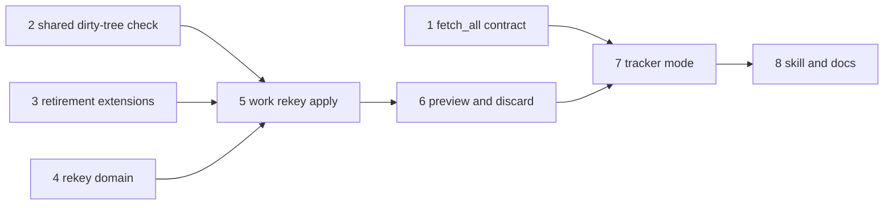
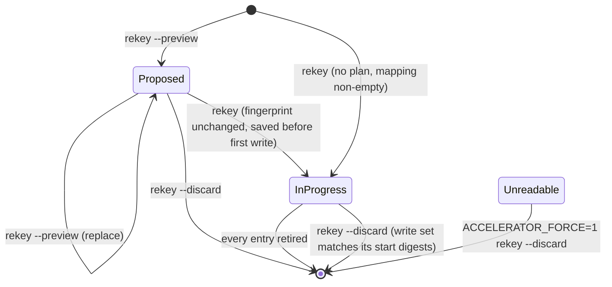

# Work Item Re-Key Command Implementation Plan

## Overview

`accelerator work rekey` converges every work item onto the current
`work.id_pattern`, whatever shape its `id` has, by composing 0230's ID
retirement. A persisted **run plan** binds a preview to its apply, makes
an interrupted run finishable, and can be discarded once a VCS revert has
undone it. One **identity-run lock** serialises rekey against every command
that retires or allocates IDs. `/rekey-work-items` wraps the command with
preview and confirmation. Along the way the dirty-tree refusal is lifted out
of `migrate` into the `vcs` platform domain, its override is renamed to
`ACCELERATOR_FORCE`, and `fetch_all` gains a current-key contract
obligation.

Each phase is test-first, leaves `mise run` green, and merges on its own.

## Current State Analysis

0230 supplies the per-item half: `plan_retirement`
(`cli/work/src/retirement.rs:348-444`) diffs the whole corpus for one
`old → new` pair, and `finish_retirement`
(`cli/work-adapters/src/retirement.rs:516-539`) applies it with per-file
locks, recovery copies and a compensating rollback, re-planning once. The
run-level half is absent:

- **Destination.** `plan_retirement` and `retired_content` always target
  `<work_dir>/<new>-<slug>.md` (`retirement.rs:377-381`, `:455-459`);
  `path_spellings` (`:327-341`) handles only drafts → root.
- **Self-alias.** `append_alias` (`:589-624`) never removes `new_id` from
  `aliases`.
- **Allocation.** `next_number::allocate` seeds `highest = 0` and scans only
  current-pattern filenames (`cli/work/src/next_number.rs:100-114`); it
  needs a regex-backed `IdScanner` the `work` domain cannot build.
- **Sequence numbers.** Nothing extracts a sequence number from an `id` of
  arbitrary shape; `work` forbids `regex` (`cli/pup.ron:151-167`).
- **`date`.** `ItemIdentity` (`cli/work/src/identity.rs:5-11`) carries no
  `date`; `frontmatter_of` (`cli/work/src/work_item_files.rs:59-73`) is
  private.
- **Dirty-tree check.** `Preflight` (`cli/migrate/src/preflight.rs`) is in a
  product context `work` cannot reach (`tasks/lint/crate_dependencies.py:86-93`).
  The probe-failure-as-clean policy is buried in `VcsWorkingCopy::observe`
  (`cli/migrate-adapters/src/working_copy.rs:41-51`), and `InProcessProbe`
  answers `Ok(default)` for a repository with no VCS
  (`cli/vcs-adapters/src/library.rs:557-570`).
- **Tracker refresh.** `gather` (`cli/work-adapters/src/sync/fetch.rs:242-249`)
  swallows every read error (`:236`, `:261-268`, `:276-284`, `:364-371`)
  and needs a baseline and bodies, so rekey cannot reuse it.
- **Contract.** Linear, Jira and `RecordingTracker` already keep a moved key
  out of `found`, but `FetchOutcome` (`cli/tracker/src/lib.rs:270-323`) does
  not oblige it and no contract property pins it.

## Desired End State

- `accelerator work rekey [--preview | --discard] [--per-item-reads]`
  exists, and every acceptance criterion in
  `meta/work/0302-work-item-re-key-command.md` has a named test (see
  Acceptance-Criteria Traceability).
- The run plan lives at `.accelerator/state/rekey/run-plan.json` behind a
  verified ignore-everything `.gitignore`.
- `work sync`, `work promote`, `work create`, `work create-batch`,
  `work next-number` and `work update --push` hold the identity-run lock for their whole run and
  refuse, before any read or write, while a run plan is in progress or
  unreadable. The `sync-work-items`, `create-work-item`, `extract-work-items`
  and `refine-work-item` skills route that refusal to `/rekey-work-items`.
- `accelerator migrate` and `work rekey` share one scoped dirty-tree
  observation in `vcs` and one override, `ACCELERATOR_FORCE`, which forces
  only on `1` or `true` and says on stderr what it bypassed; `migrate` still
  honours `ACCELERATOR_MIGRATE_FORCE` with a stderr deprecation notice.
- `fetch_all` documents the current-key obligation and every adapter passes a
  contract property for it.
- `/rekey-work-items` previews, asks, then applies or discards.

Verify with `mise run` exiting 0.

### Key Discoveries

- Resume works by re-planning: `plan_retirement` treats an item with
  `id == new` and `old` in `aliases` as an interrupted target
  (`retirement.rs:281-284`, `:357-384`). Recording the whole mapping before
  the first write is therefore sufficient recovery.
- `refuse_collisions` (`retirement.rs:471-500`) already exempts the retiring
  item's own `id` and aliases, so `ACC-0042 → 0042` with `aliases: ["0042"]`
  plans cleanly.
- `shape_of` (`retirement.rs:286-292`) classifies `ACC-0042` as
  `Distinctive` via `corpus::is_tracker_key`, so prefixed local IDs get prose
  rewriting with no change. The token boundary in
  `corpus::references` already leaves `PP-7601` alone.
- `WorkItemIdScheme::canonicalise_id` (`cli/corpus/src/work_item_id.rs:189-213`)
  renders a digit string in the current shape, but only under `scheme.key`.
  "Is `x` in target shape" is therefore a key-parametrised render: `x`'s own
  project key (the `is_project_prefixed` prefix: a letter, then letters or digits; none for a bare pattern) with `sequence_of(x)` padded to
  the target width equals `x`, ignoring case, with no regex.
- `BaselineStore::rename` writes nothing for an absent entry
  (`cli/work-adapters/src/sync/baseline_store.rs:95-103`), so retirement on
  a never-synced repository leaves no baseline.
- `last-sync.json` is tracked: the integration `.gitignore` excludes only
  `site.json`, `.refresh-meta.json` and `.lock/`. Any retirement of a synced
  item dirties it, so it belongs in the write set.
- Retirement compares IDs ignoring ASCII case (`same_id`,
  `retirement.rs:277`). An entry whose `old` and `new` differ only in case is
  a self-retirement: on a case-insensitive filesystem `create_new` fails,
  and on resume the item is both retiring item and interrupted target, so
  `finish_retirement` would `Remove` its only file.
- `next_number::allocate` reads filenames only, so a fresh target held only
  in the run plan is invisible to `work create`. Allocation scans per
  project key (`compile_scan_regex(pattern, project)`), so `ACC-0001` and
  `XYZ-0001` legitimately coexist under `{key}-{number:04d}`.
- Locks are `mkdir` lockdirs that block up to a 300 s ceiling
  (`cli/store/src/lock.rs:64`) and are not re-entrant. `LockName` has four
  variants (`cli/corpus/src/lock.rs:12-17`). Plain `work create` allocates
  under `LockName::Create` only (`create.rs:198-209`), and local-ownership
  `sync_author` takes no retirement lock (`sync_author.rs:259-275`).
- `SyncApplier::pull` writes `request.file_path` unconditionally and then
  read-modify-writes `last-sync.json` (`sync/apply.rs:236-254`), outside any
  lock.
- Retirement copies only dirty files into `retirement-recovery/`
  (`retirement.rs:420-428`), and applies rewrites before creating the target
  (`work-adapters/src/retirement.rs:163-187`). On a clean tree an interrupted
  entry leaves no recovery directory. The parent `retirement-recovery/`
  persists after the first retirement, and COMPLETED children are kept until
  `work sync` sweeps them.
- `FileRetirementRecords::prepare` (`cli/work-adapters/src/retirement_records.rs:64-84`)
  is the write-then-verify `*\n` ignore pattern to copy;
  `outstanding()` returns empty for a missing directory and creates nothing.
- `run_sync` reaches no remote and creates no directory before
  `cli/work-cli/src/sync.rs:1439`; `repo_root` is known from `:1389`.
- `work` and `vcs` are pinned by `cargo-public-api` (`tasks/public_api.py:15-30`).
- The migrate golden `stdout`/`stderr` fixtures are provenance-only and
  `regenerate.sh` can no longer run (`cli/migrate-cli/tests/fixtures/README.md:21`);
  they are hand-edited.
- The work item's ACs abbreviate draft IDs (`draft-k3x9`, `draft-a1b2`);
  `DraftId` requires six Crockford characters (`cli/work/src/draft_id.rs:13-28`).
  Tests use `draft-k3x9mq` and `draft-a1b2cd`; every ordering conclusion is
  unchanged (`"PP-761" < "draft-a1b2cd"` byte-wise).

## Decisions

| Question | Decision | Why |
|---|---|---|
| Undated or unparseable `date` | Sorts after every dated item, then old `id` byte-wise | Allocation never fails on a missing date |
| `locate` answers `NotFound` under `{tracker}` | Target the stored `external_id` | Deletion is `work sync`'s concern, as the story's stale-key assumption says |
| No VCS for `work rekey` | Unprobeable, so refused unless `ACCELERATOR_FORCE` | An apply must be undoable through VCS |
| Serialisation | A dedicated identity-run lock, taken first and held for the whole command by `work sync`, `work promote`, `work create` (with or without `--push`, not `--dry-run`), `work create-batch`, `work next-number`, `work update --push` and `work rekey`; global order identity run → `BatchJournal` → `Retirement` → `Create` → `ForFile`, written into the `corpus::lock` module doc. Rekey also holds `Create` for its whole run | One lock closes the allocator race, the sync pull race, the baseline race and rekey-vs-rekey races together; holding `Create` makes an older binary's `work create`, which predates the identity-run lock, wait instead of racing |
| Identity-run lock adapter | `IdentityRunLock::new(state_dir)` in `work-adapters`, modelled on `migrate-adapters`' `FileRunLock`: lockdir `.accelerator/state/locks/identity-run.lockdir`, parent created on demand through one shared `prepare_ignored_dir` helper (also used by the run-plan store and retirement records). `LockdirLock`, `LockName` and their ~15 construction sites are untouched | Outside every corpus root, so it never shows as dirty and exists before the work directory does; only guarded roots and `rekey::run` need the state directory |
| Held locks in dirty checks | Rekey's working-copy and revert checks drop any path under a `*.lockdir/` directory and any `TEMP_PREFIX` atomic-write temporary, as `migrate` exempts its held lockdir (`migrate/src/manifest.rs:63`) | The retirement lockdir stays in the work directory, and a killed run can leave `ForFile` lockdirs and temporaries beside corpus files; none holds user content |
| Run-plan guard | Every non-rekey holder reads the run-plan status once, immediately after taking the identity-run lock and before any read or write, and refuses on in progress or unreadable. Retiring and allocating use cases (`allocate_id`, `create_local_item`, the sync run, `promote`) take `&IdentityRunGuard`, as `execute` takes `&RetirementLockGuard` | Refusal happens at the command root with nothing read or written; the type stops a future writer skipping the lock |
| Cost of serialisation | A command that finds the identity-run lock held prints `waiting for accelerator work <command> (pid <n>) to finish` to stderr (from a `command` file inside the lockdir, written after acquiring and removed with it; `waiting for another accelerator command to finish` when absent), then waits up to a 60 s ceiling. On timeout it re-reads the run-plan status: in progress behind a running `work rekey` → `E_REKEY_IN_PROGRESS` saying the re-key is running (pid), in progress otherwise → `E_REKEY_IN_PROGRESS`, unreadable → `E_REKEY_PLAN_UNREADABLE`, otherwise `E_IDENTITY_RUN_BUSY` (exit 1) naming the holder | 60 s stays under the Bash tool's 120 s default, so skills see the code rather than a tool timeout, as `FileRunLock` keeps a 2 s ceiling for the same reason; a wait is never silent |
| Allocation by skills | `work next-number` refuses during a rekey; a number it returned before a rekey started and a skill writes after is caught by retirement's `create_new` as `E_REKEY_ENTRY_REFUSED` | The skill writes outside the CLI, so this narrow window is accepted; it stops a run, never duplicates |
| `work create --push` during a rekey | Refuses, writes nothing | Deliberate exception to its save-intent contract, consistent with refusing plain `work create`; documented in `exit_codes.rs` |
| Discarding a plan | One verb, `--discard`: removes a proposed plan; removes an in-progress plan only when every write-set path matches the digest (or absence) recorded for it; removes an unreadable plan only under `ACCELERATOR_FORCE`. The unforced refusal of an unreadable plan prints the partly-applied evidence, so the user decides with it in hand. A forced discard never deletes: it moves the plan to `run-plan.discarded-<UTC timestamp>.json` beside it and prints the mapping (or the file path, if unreadable) | Digests are the direct evidence that nothing the run wrote survives, independent of what has since been committed; an unreadable plan has no digests, so only the user can vouch for it, and a moved-aside plan keeps the mapping recoverable |
| Write set on resume | `finish_retirement_with`'s `before_apply` hook hands rekey the exact plan about to be applied (retries included); rekey adds any touched path not yet in the write set, with its current digest or absence and the base observed at that resume, and saves the plan before writing. Recorded entries are never replaced | A file committed after a halt that names an old ID is rewritten on resume; recording it keeps `--discard`'s evidence complete |
| `work next-number` intent | Stays `Intent::Read`; its module contract becomes "writes nothing in the corpus; takes the identity-run lock under `.accelerator/state/`" | The lock is not user content, so the personal-file write gate does not apply |
| Lost run plan | Primary guard: the dirty-tree refusal (an uncommitted half-run is dirty). Secondary, after the sync guards: refuse when an item's `aliases` hold another item's `id` (ignoring case), or a `retirement-recovery/` child is marker-less or `RESTORE-PENDING` | A committed half-run with a lost plan is detected only when an alias or recovery copy remains; the parent directory and COMPLETED children are ignored |
| Run-plan schema | Reader finishes plans of any schema up to its own; a newer schema refuses as unreadable naming the file and version | An upgrade mid-run keeps the run finishable; a downgrade cannot misread a plan |
| Multiple project keys | Under a `{key}` pattern, `<KEY>-<digits at width>` is on target whatever its key, unless it is the item's tracker key. A kept number keeps its own project key (the `is_project_prefixed` prefix, so `AB1-` counts) when it has one and is not a tracker key; only bare and tracker-classified IDs move to `work.key`. Fresh numbers go to `work.key` only, above that key's floor | `work create --project` makes multi-key corpora legitimate; a converged multi-key corpus must be a fixed point under any width change |
| Retrieval strategy surface | `work rekey --per-item-reads`, as `work sync` | No new configuration key; ignored with a stderr note when no `{tracker}` mapping is computed |
| `PerItem` refresh | `locate` per key | `locate` is the authority on moves (`tracker/src/lib.rs:665-670`) |
| Rate limits | No ceiling; a 429 is `Retryable`, so exit 70 | Bounding calls would change the one-run promise |
| Preview line order | Old `id` ascending, byte-wise; unchanged items omitted | Deterministic and independent of target |
| Fingerprint | Item set, and per item path, `id`, `aliases`, `external_id`; plus the resolved scheme (`id_pattern`, `key`) | Pins the mapping and its inputs; body edits are caught by the dirty-tree refusal and by retirement's plan-time byte check |
| Apply re-checks | Collisions and `target-exists` re-run under the lock before a proposed plan starts | A file that appeared since preview refuses cleanly instead of mid-run |
| ID comparison | ASCII-case-insensitive for every identity comparison in `work::rekey`: on target, unmoved, collisions, floor, partly applied | Matches retirement's `same_id` and `holder_of`; a case-only entry is a self-retirement |
| Kept numbers above the cap | Refused as `E_REKEY_NUMBER_SPACE_EXHAUSTED` naming the item | `canonicalise_id` pads but never truncates |
| Retirement lock | Held by rekey for the whole run, inside the identity-run lock and with `Create`; every run-plan read-decide-write happens under both | `execute` needs a `RetirementLockGuard`; deliberate divergence from 0230's "never a whole pass" |
| Refusal exit code | `4` with an `E_REKEY_*` code, including local retirement failures | Nothing remote is mutated, so `70`/`71` do not apply; the `4` band is widened to "stopped pending a human" |
| Dirty-tree scope | `GUARDED_SCOPES` plus every configured corpus root, repo-relative | Retirement rewrites every corpus root; a custom `paths.*` outside `meta/` must still be undoable |
| `ACCELERATOR_FORCE` values | `1` or `true`, ignoring case; any bypass prints what it skipped to stderr | A generic name is exported and forgotten; `0` must not force. The deprecated name keeps its non-empty rule |

## What We're NOT Doing

- Rewriting references outside the configured corpus roots or in remote issue
  bodies.
- Rewriting references to IDs that were aliases before the run, or promoting
  prose to typed links (0343).
- Deciding whether bare numbers in prose name work items (0345).
- Removing `ACCELERATOR_MIGRATE_FORCE` (0346).
- Batching retirements over one corpus walk: each entry still re-walks via
  `finish_retirement`.
- A tracker-call ceiling for the `{tracker}` refresh.
- Re-keying an item whose `id` already equals its refreshed key but whose
  `external_id` is stale; that is a link repair for `work sync`.
- Guarding plain `work update` (without `--push`) or other writers that
  neither retire nor allocate IDs; their edits surface as dirty paths.
- Excluding an older plugin binary's `work sync` during a rekey: its pulls
  write outside any lock and predate the identity-run lock, so one can
  recreate a retired file. The CHANGELOG says to upgrade every session
  before re-keying.
- Detecting a half-run that was committed and then lost its run plan when
  no alias or recovery copy remains: an entry interrupted after its
  rewrites but before its target was created, or after its old file was
  removed but before its baseline entry was renamed.
- Counting aliases when `work create` allocates; an ID minted onto an
  existing alias surfaces as `E_REKEY_PARTLY_APPLIED`, whose remedy names
  that cause too.

## Implementation Approach

The pure decisions — classification, ordering, allocation, collisions,
fingerprint, run-plan state transitions, preview lines, and every outcome
with its keyword and exit code — live in a new `work::rekey` module.
`work-adapters::rekey` holds the run-plan store, the tracker refresh, the
guard reads, the executor, and the `run` use case that owns the run-plan
state machine over `RekeyPorts`, as `work_adapters::promotion::promote` does
for promotion. `work-cli::rekey` resolves configuration and force, wires the
ports, and renders. The dirty-tree observation goes to `vcs` as a pure
function over `Result<WorkingCopyState, kernel::Error>`; each context's
adapter chooses the probe-failure policy.

Apply ships before preview so every phase leaves a complete command: Phase 5
delivers `work rekey` that computes, records and applies, finishes an
interrupted run, and discards one a VCS revert has undone, with the
identity-run lock on every guarded command; Phase 6 adds `--preview`,
discarding a proposed plan, and the proposed-plan binding; Phase 7 opens
`{tracker}`.



Phases 1-4 are independent of one another.

### Run-plan lifecycle



Every transition takes the identity-run and retirement locks, re-loads the
plan, decides, then writes or removes it. A refused run, including one
exiting 70, leaves the plan as it found it. An unreadable plan (malformed,
or a newer schema) behaves as in progress for every guard.

### Exit codes and keywords

Every refusal prints `Error: <code>: <what>. <remedy>.` to stderr. Skills
and the frozen-code test match the code.

| Code | Raised by | Exit | Remedy printed |
|---|---|---|---|
| `E_REKEY_IN_PROGRESS` | `--preview`, `work sync`, `work promote`, `work create`, `work create-batch`, `work next-number`, `work update --push` | 4 | Run `work rekey` to finish it; to undo it instead, run `work rekey --discard`, which lists the paths to restore. After a lock timeout behind a running re-key: a re-key is running (pid `<n>`); re-run once it finishes |
| `E_REKEY_PLAN_UNREADABLE` (newer schema) | every command that takes the identity-run lock | 4 | Upgrade accelerator to a version that reads schema `<n>`, then run `work rekey` or `work rekey --discard` there |
| `E_REKEY_PLAN_UNREADABLE` (malformed) | every command that takes the identity-run lock | 4 | The run's state cannot be verified; `work rekey --discard` prints the evidence of any half-applied entry; if none was applied, or after restoring one, `ACCELERATOR_FORCE=1 accelerator work rekey --discard` sets the plan aside |
| `E_REKEY_NOT_REVERTED` | `--discard` on an in-progress plan whose write-set paths differ from their recorded states | 4 | Run `work rekey` to finish it; or restore each path listed under "restore" from the revision printed beside it (where that path was first recorded) and delete those under "remove", then re-run `--discard`; a path edited on purpose since the run started needs `ACCELERATOR_FORCE=1 … --discard` |
| `E_REKEY_PARTLY_APPLIED` | a fresh mapping over a corpus that shows a half-applied run | 4 | Either an earlier re-key was interrupted (restore every corpus root to the revision before the commit that introduced the named alias, or finish the named entry by hand: keep the new file, remove the old and, for a synced item, move its `last-sync.json` entry from the old ID to the new) or an ID was created onto an existing alias (rename one item); restore from a named `RESTORE-PENDING` directory before removing it |
| `E_REKEY_SYNC_UNFINISHED` | unfinished retirement or `retiring` promotion record | 4 | Run `work sync` |
| `E_REKEY_PENDING_PUSH` | marker on a re-keyed item, or unreadable marker | 4 | Run `work sync` to settle the push |
| `E_REKEY_ID_COLLISION` | target held or duplicated | 4 | Rename or merge one of the named items |
| `E_REKEY_UNCLASSIFIABLE_ID` | numeric pattern, `id` of no known shape | 4 | Give the item a numeric or tracker-shaped `id` |
| `E_REKEY_NUMBER_SPACE_EXHAUSTED` | fresh numbers past the cap | 4 | `<n>` fresh numbers are needed and `<m>` remain under `<pattern>`; widen `work.id_pattern` or archive completed items |
| `E_REKEY_NUMBER_SPACE_EXHAUSTED` | a kept number past the cap | 4 | `<item>` keeps number `<n>`, wider than `<pattern>` allows; widen `work.id_pattern` |
| `E_REKEY_TARGET_EXISTS` | a non-item file occupies a target path | 4 | Move the named file |
| `E_REKEY_PREVIEW_STALE` | item set, identity fields or scheme changed since preview | 4 | Re-run `work rekey --preview`; the message says whether the scheme or which items changed |
| `E_REKEY_DIRTY_WORKING_COPY` | scoped dirty paths | 4 | Commit or revert the named paths, or set `ACCELERATOR_FORCE=1` for this one invocation |
| `E_REKEY_WORKING_COPY_UNPROBEABLE` | probe failed or no VCS | 4 | Fix the repository, or set `ACCELERATOR_FORCE=1` knowing nothing can undo the run |
| `E_REKEY_ENTRY_REFUSED` | retirement refused mid-run | 4 | Resolve the named conflict and re-run `work rekey`; to undo it instead, run `work rekey --discard`, which lists the paths to restore |
| `E_REKEY_ENTRY_ROLLED_BACK` | entry rolled back twice | 4 | Re-run `work rekey` to resume |
| `E_REKEY_RESTORE_INCOMPLETE` | restore incomplete | 4 | Restore from the named recovery directory, then re-run `work rekey` |
| `E_REKEY_STATE_UNWRITABLE` | the run plan cannot be saved or removed | 1 | Check permissions on `.accelerator/state/rekey/` and re-run |
| `E_IDENTITY_RUN_BUSY` | any identity-run holder, after the 60 s ceiling with no plan in progress or unreadable | 1 | `accelerator work <command>` (pid `<n>`) is still running; re-run once it finishes |
| `E_REKEY_TRACKER_UNREACHABLE` | `{tracker}` refresh read failed | 70 | Retry when the tracker is reachable |
| (selection codes) | `{tracker}` tracker cannot be selected or configured | 72-74 | As `work promote` prints |

Mid-run codes (`ENTRY_REFUSED`, `ENTRY_ROLLED_BACK`, `RESTORE_INCOMPLETE`)
keep earlier entries and leave the plan in progress; every other code writes
nothing. Plan-time `RetirementRefusal`s from `write_set` map as `IdTaken` and
`KeyLinked` → `ID_COLLISION`, `TargetExists` → `TARGET_EXISTS`, and any other
→ `PREVIEW_STALE` naming the item. Rekey uses its own codes rather than retirement's
`retirement-failed`/`retirement-incomplete`, which are frozen at 71 with a
remote-mutation meaning.

---

## Phase 1: `fetch_all` Current-Key Contract

### Overview

Document that `fetch_all` reports an issue as found only under the key the
tracker holds it under when it answers, and pin it with a contract property
every adapter passes.

### Changes Required

#### 1. Failing tests first

`cli/tracker-test-support/tests/contract.rs`:
- `a_recording_tracker_finds_a_moved_issue_only_under_its_current_key`

`cli/jira-client/tests/contract_offline.rs`:
- `a_moved_issue_is_found_only_under_its_current_key` — `search/jql` answers
  `OPS-5` for a request naming `PP-76`; `GET /rest/api/3/issue/PP-76`
  answers the moved issue.

`cli/linear-client/tests/contract_offline.rs`:
- `a_moved_issue_is_found_only_under_its_current_key` — the team listing
  holds `ENG-42`; the scripted `locate` answers `ENG-42` for `PP-760`.

`cli/tracker-test-support/src/contract.rs` (unit):
- `gated_calls` lists the new gated entry point.
- `a_subject_with_no_moved_issue_is_reported_skipped`

#### 2. Contract property

**File**: `cli/tracker-test-support/src/contract.rs`

```rust
pub trait ContractSubject {
    fn moved_issue(&self) -> Option<(ExternalId, ExternalId)> {
        None
    }
}

pub fn a_moved_issue_is_found_only_under_its_current_key(
    subject: &dyn ContractSubject,
) -> Result<(), ContractGateError>;

pub fn a_moved_issue_is_found_only_under_its_current_key_property(
    subject: &dyn ContractSubject,
);
```

The property asserts `old` is absent from `fetch_all(&[old]).found`, and
`locate(&old)` is `Found` with `issue.key == new`. A subject answering
`None` (live subjects, which cannot move issues on demand) is reported as
skipped by `run_all` and `timed_conformance`, never as passed, so committed
live evidence does not claim it. Add the gated form to `run_all` and update
its count.

`RecordingTracker`, the offline Jira subject and the offline Linear subject
implement `moved_issue`.

#### 3. Port documentation

**File**: `cli/tracker/src/lib.rs`

On `FetchOutcome.found` and `RemoteTracker::fetch_all`: an id is in `found`
only when the tracker holds the issue under exactly that id at the time of
the read; an id differing only in case may be reported `absent`, and the
caller's `locate` then finds it unmoved. An issue moved to another key
reports its old key as `absent` or
`indeterminate`, so the caller reaches `locate`. Point to it from the
`FetchOutcome` struct doc beside the totality obligation.

### Success Criteria

#### Automated Verification

- [ ] `cd cli && cargo test -p tracker-test-support`
- [ ] `cd cli && cargo test -p jira-client --test contract_offline`
- [ ] `cd cli && cargo test -p linear-client --test contract_offline`
- [ ] `mise run test:integration:tracker-contract`
- [ ] `mise run` exits 0

#### Manual Verification

- [ ] The rendered `fetch_all` rustdoc reads as an obligation on implementers.

---

## Phase 2: Shared Dirty-Tree Observation and `ACCELERATOR_FORCE`

### Overview

Move the scoped dirty-path observation into `vcs`, make the probe-failure
policy each caller's choice, and rename `migrate`'s override.

### Changes Required

#### 1. Failing tests first

`cli/vcs/src/guarded_working_copy.rs` (unit):
- `only_dirty_paths_under_a_guarded_scope_are_reported`
- `a_legacy_config_file_is_reported_by_prefix` — `.claude/accelerator.md`.
- `a_sibling_path_outside_every_guarded_scope_is_not_reported` —
  `.claude/settings.json`.
- `a_failed_probe_is_unprobeable_naming_the_failure`
- `only_one_or_true_forces_ignoring_case` — `0`, `false`, empty and unset do
  not.

`cli/migrate-adapters/tests/working_copy.rs`:
- `migrate_guards_the_same_scopes_as_vcs` — `migrate::preflight::SCOPES`
  equals `vcs::GUARDED_SCOPES`.
- The existing `an_unreadable_repository_has_no_run_base_and_no_changes`
  keeps passing.

`cli/migrate-cli/tests/dirty_tree_preflight.rs`:
- `accelerator_force_applies_over_a_dirty_tree`
- `the_deprecated_migrate_force_still_applies_over_a_dirty_tree`
- `the_deprecated_migrate_force_prints_a_notice_suggesting_a_per_invocation_accelerator_force`
- `the_notice_prints_when_both_variables_are_set`
- `accelerator_force_zero_does_not_force_migrate`
- `the_refusal_names_accelerator_force`
- `the_stale_run_explanation_names_both_variables`
- `forcing_past_a_dirty_tree_says_what_it_skipped`

`cli/migrate-cli/tests/guarded_resume.rs`:
- The existing `an_unreadable_jj_working_copy_is_warned_about_and_treated_as_clean`
  keeps passing.

#### 2. `vcs` domain

**File**: `cli/vcs/src/guarded_working_copy.rs` (new), exported from
`cli/vcs/src/lib.rs`. One single-item `use` per line (`cli/pup.ron:283-285`).

```rust
pub const GUARDED_SCOPES: [&str; 3] =
    ["meta/", ".claude/accelerator", ".accelerator/"];

pub const FORCE_VARIABLE: &str = "ACCELERATOR_FORCE";

pub enum GuardedObservation {
    Observed(WorkingCopyState),
    Unprobeable { reason: String },
}

pub fn observe_guarded(
    probed: Result<WorkingCopyState, kernel::Error>,
    scopes: &[&str],
) -> GuardedObservation;

pub fn forces(value: Option<&str>) -> bool;
```

`Observed` carries the existing `WorkingCopyState` with its dirty paths
filtered to the scopes. Scope matching stays a plain string prefix, so
`.claude/accelerator` keeps covering `.claude/accelerator.md` and
`.claude/accelerator.local.md`. `forces` accepts `1` or `true`, ignoring
case.

`GUARDED_SCOPES` and `FORCE_VARIABLE` are accelerator policy in a platform
crate. They sit here because `vcs` is the only crate both `migrate-cli` and
`work-cli` already depend on that owns working-copy concepts; callers pass
scopes in, so `observe_guarded` itself stays generic.

#### 3. `migrate` onto it

**File**: `cli/migrate-adapters/src/working_copy.rs`
**Changes**: `VcsWorkingCopy::observe` calls `observe_guarded`; on
`Unprobeable` it logs the existing warning and returns no run base and no
changes. `migrate` keeps its own `SCOPES` (its domain may not import `vcs`,
`cli/pup.ron:550-565`); the adapter test above pins the two equal.

**File**: `cli/migrate-cli/src/main.rs`
**Changes**: `force_requested` reads `FORCE_VARIABLE` through `forces`, then
`ACCELERATOR_MIGRATE_FORCE` under its existing non-empty rule. Whenever the
deprecated name is non-empty, whether or not the new one is set, it prints to
stderr:

```text
warning: ACCELERATOR_MIGRATE_FORCE is deprecated and will be removed in a future release; use ACCELERATOR_FORCE=1 on the one command instead
```

The notice suggests a per-invocation setting so an exported override does not
silently disarm `work rekey`. When force skips a dirty-tree refusal,
`migrate` prints the skipped paths to stderr; the hand-edited golden
`stderr` fixtures gain that line, and
`skills/config/migrate/SKILL.md` is checked to treat stderr as advisory.

**Files**: `cli/migrate-cli/src/cli.rs:16`, `cli/migrate-cli/src/render.rs:14,16,18,315`
**Changes**: name `ACCELERATOR_FORCE`; `after_help` lists both, the old one
as deprecated; `STALE_RUN_EXPLANATION` names both variables until 0346.

**Files**: the inline expected strings in `cli/migrate-cli/tests/*.rs` and the
golden `stdout`/`stderr` files listed by the research
(`tests/fixtures/{0001..0007,all-pending,interactive/*,decisions-file/*,manifest-states/*}`),
edited by hand; `tests/common/mod.rs:78` also removes `ACCELERATOR_FORCE`.

#### 4. Docs

- `skills/config/migrate/SKILL.md:31,101,263,277`
- `docs-site/src/content/docs/migrations.md:18`
- `CHANGELOG.md` `## [Unreleased]` → `### Changed`: `ACCELERATOR_FORCE`
  replaces `ACCELERATOR_MIGRATE_FORCE`, which `migrate` still honours with a
  deprecation notice.

### Success Criteria

#### Automated Verification

- [ ] `cd cli && cargo test -p vcs`
- [ ] `cd cli && cargo test -p migrate-adapters -p accelerator-migrate`
- [ ] `mise run public-api:update && mise run public-api:check`
- [ ] `mise run pup:check`
- [ ] `mise run` exits 0

#### Manual Verification

- [ ] In a scratch repository with a dirty `meta/` file,
      `ACCELERATOR_MIGRATE_FORCE=1 accelerator migrate` applies and prints
      the notice; `ACCELERATOR_FORCE=1` applies silently.

---

## Phase 3: Retirement Extensions

### Overview

Let retirement land in `drafts/`, strip the new `id` from `aliases`, and name
the retirement kinds rekey builds.

### Changes Required

#### 1. Failing tests first

`cli/work/src/retirement.rs` (unit):
- `retiring_onto_a_draft_id_lands_in_the_drafts_directory`
- `a_link_to_a_file_retired_into_drafts_gains_the_drafts_segment`
- `retired_content_matches_the_plan_for_a_draft_destination`
- `an_interrupted_retirement_into_drafts_resumes`
- `the_new_id_is_removed_from_inline_aliases` — `ACC-0042`,
  `aliases: ["0042"]`, retired onto `0042`, reads `aliases: ["ACC-0042"]`.
- `the_new_id_is_removed_from_block_aliases`
- `the_new_id_is_removed_from_aliases_ignoring_case` — `aliases: ["acc-0042"]`
  retired onto `ACC-0042`.
- `retiring_into_a_drafts_directory_that_does_not_exist_creates_it`
- `renumbering_sets_no_external_id`
- `retiring_into_a_draft_sets_no_external_id`
- `prose_naming_a_prefixed_local_id_is_rewritten` — `ACC-0042 → 0042`.
- `prose_naming_a_bare_numeric_id_is_left_and_typed_links_rewritten`

`cli/work-adapters/tests/retirement.rs`:
- `a_retirement_without_a_baseline_skips_the_baseline_rename`
- `a_completed_retirement_without_a_baseline_is_not_outstanding`

#### 2. Changes

**File**: `cli/work/src/retirement.rs`

```rust
impl<'a> Retirement<'a> {
    pub fn renumbering(old_id: &'a str, new_id: &'a str) -> Self;
    pub fn into_draft(old_id: &'a str, draft: &'a DraftId) -> Self;
}
```

- Refactor first, under the existing tests: extract one
  `destination_of(retirement, from, work_dir)` returning the destination and
  its path spellings, called by both `plan_retirement` and
  `retired_content`; generalise `append_alias` into
  `rewrite_aliases(lines, range, transform)`, which parses either the inline
  or the block form, applies a pure transform, and writes it back in the
  original form.
- `destination_of` uses `file_for(&home_of(new_id, work_dir), ..)` and adds
  `(old_name, "drafts/<new_name>")` when the destination is in `drafts/`.
- `retired_item_content` transforms aliases by removing every alias equal to
  `new_id` (ignoring case) and appending `old_id`.

**File**: `cli/work-adapters/src/retirement.rs`
**Changes**: `RetirementPorts.baseline` and `apply_retirement`'s `baseline`
parameter become `Option<&BaselineStore>`. `Step::RenameBaseline` is skipped
when it is `None`, and `retirement_outstanding` treats `None` as no baseline
entry left to rename. Existing callers pass `Some`, so local-only rekey
states its lack of a baseline in the types rather than through a store
pointed at an empty path.

### Success Criteria

#### Automated Verification

- [ ] `cd cli && cargo test -p work retirement`
- [ ] `cd cli && cargo test -p work-adapters --test retirement`
- [ ] `mise run public-api:update && mise run public-api:check`
- [ ] `mise run` exits 0

#### Manual Verification

- [ ] None beyond automated; promotion behaviour is pinned by existing tests.

---

## Phase 4: Rekey Domain

### Overview

The pure model: what each item becomes, in what order fresh numbers are
handed out, what collides, and the run plan with its fingerprint and preview.

### Changes Required

#### 1. Failing tests first

`cli/work/src/rekey/creation_date.rs`:
- `a_date_only_value_orders_as_midnight_utc`
- `an_offset_timestamp_is_normalised_to_utc`
- `a_missing_or_unparseable_date_orders_after_every_dated_item`

`cli/work/src/rekey/sequence.rs`:
- `a_bare_numeric_id_yields_its_sequence_number` — `0042` → 42.
- `a_prefixed_id_yields_its_sequence_number` — `ACC-0042` → 42.
- `an_id_of_no_numeric_shape_yields_none`
- `an_id_is_in_target_shape_only_when_it_renders_back_to_itself_ignoring_case`
  — `acc-0042` is on target under `ACC-{number:04d}`.
- `an_id_under_another_project_key_is_in_target_shape` — `XYZ-0001` under
  `{key}-{number:04d}` with `work.key: "ACC"`.
- `an_id_under_another_key_at_the_wrong_width_is_not_in_target_shape` —
  `PP-760`.

`cli/work/src/rekey/classify.rs`:
- `a_tracker_key_is_an_id_equal_to_its_external_id_ignoring_case`
- `a_prefixed_id_differing_from_its_external_id_keeps_its_number` —
  `ACC-0042` with `external_id: "PP-760"`.
- `a_tracker_shaped_id_without_an_external_id_keeps_its_number` —
  `PP-760` → `Sequenced(760)`.
- `an_unsynced_tracker_shaped_id_keeps_its_own_key_under_a_key_pattern` —
  `PP-760` with no `external_id` under `{key}-{number:04d}` → `PP-0760`.

Throughout Phases 4 and 5, a `PP-760` or `PP-761` fixture that takes a fresh
number is synced: it carries `external_id` equal to its `id`, as the work
item's ACs say.
- `a_draft_id_takes_a_fresh_number`
- `an_unclassifiable_id_is_refused_naming_the_item`
- `a_tracker_key_in_target_shape_still_takes_a_fresh_number` — `PP-7600`
  with `external_id: "PP-7600"` under `{key}-{number:04d}`.

`cli/work/src/rekey/mapping.rs` (numeric patterns):
- `a_legacy_numeric_id_is_rerendered_under_a_key` — `0042` → `ACC-0042`.
- `a_prefixed_id_is_rerendered_bare` — `ACC-0042` → `0042`.
- `fresh_numbers_start_above_every_kept_number` — `ACC-0041`, `0042`,
  synced `PP-760` → `ACC-0042`, `ACC-0043`.
- `fresh_numbers_start_above_every_id_and_alias_in_target_shape`
- `fresh_numbers_start_above_a_bare_alias_that_canonicalises_into_target_shape`
  — alias `0045` under `ACC-{number:04d}`.
- `fresh_numbers_follow_date_order` — synced `PP-760` (2026-02-01),
  `draft-k3x9mq` (2026-01-01).
- `equal_dates_fall_back_to_old_id_byte_order` — `PP-761` before
  `draft-a1b2cd`.
- `undated_items_take_fresh_numbers_after_dated_ones`
- `a_mixed_corpus_converges_onto_the_pattern` — `0041`, synced `PP-760`,
  `draft-k3x9mq` all match `ACC-NNNN`.
- `an_item_already_on_its_target_is_not_an_entry`
- `an_item_differing_from_its_target_only_in_case_is_not_an_entry`
- `fresh_numbers_past_the_cap_are_refused`
- `a_kept_number_past_the_cap_is_refused_naming_the_item` — `PP-12345`
  under `{number:04d}`.
- `a_renumbering_entry_carries_a_renumbered_target`
- `a_multi_project_corpus_is_a_fixed_point` — `ACC-0001`, `XYZ-0001`,
  `AB1-0001`.
- `a_width_change_keeps_each_items_project_key` — `ACC-001`, `XYZ-001`
  under `{key}-{number:04d}` → `ACC-0001`, `XYZ-0001`.
- `a_bare_kept_number_moves_to_the_default_key` — `0042` → `ACC-0042`.
- `fresh_numbers_go_to_the_default_key_above_its_own_floor` — `ACC-0003`,
  `XYZ-0009`, a draft → `ACC-0004`.

`cli/work/src/rekey/collision.rs`:
- `a_target_held_as_another_items_id_is_refused_naming_both` — `0042` and
  `ACC-0042`.
- `a_target_held_as_another_items_alias_is_refused_naming_both` —
  `ACC-0050` with `aliases: ["ACC-0042"]`.
- `two_items_sharing_a_target_are_refused_naming_both` — `ACC-0042`,
  `XYZ-0042` under `{number:04d}`.
- `an_items_own_id_and_aliases_never_collide_with_its_target`
- `a_target_linked_by_another_items_external_id_is_refused`
- `a_target_held_ignoring_case_is_refused` — `acc-0042` against target
  `ACC-0042`.

`cli/work/src/rekey/run_plan.rs`:
- `preview_lines_are_ordered_by_old_id_byte_wise` — `0041 → ACC-0041`,
  `draft-k3x9mq → ACC-0042`.
- `the_fingerprint_names_each_item_whose_path_id_aliases_or_external_id_changed`
  (one case per field).
- `the_fingerprint_names_an_added_item_and_a_removed_item`
- `a_changed_scheme_is_stale_as_a_scheme_change`
- `a_body_only_edit_leaves_the_fingerprint_unchanged`
- `starting_a_proposed_plan_records_its_write_set_with_start_states`
- `a_write_set_restored_to_its_start_states_has_no_changes`
- `a_write_set_path_differing_from_its_start_digest_is_changed`
- `a_new_file_where_the_start_state_was_absent_is_changed`
- `extending_never_replaces_a_recorded_start_state`
- `restore_paths_are_grouped_by_the_base_they_were_recorded_against`
- `the_schema_round_trips`
- `an_older_schema_plan_is_read` — a committed schema-1 fixture, kept as the
  schema moves.
- `a_newer_schema_plan_is_unreadable_naming_the_version`

`cli/work/src/rekey/outcome.rs`:
- `every_outcome_has_a_distinct_code_except_the_two_number_space_cases`
- `every_outcome_renders_its_code_prefix_and_remedy` — iterates every
  variant and every remedy form (both `PlanUnreadable` causes); the line
  starts `Error: <code>:` and contains the table's remedy.
- `a_malformed_plan_remedy_never_suggests_finishing_or_deleting_files`

`cli/work/src/rekey/partly_applied.rs`:
- `an_item_whose_alias_is_another_items_id_is_partly_applied_naming_both`
- `an_alias_matching_another_items_id_ignoring_case_is_partly_applied`
- `a_clean_corpus_is_not_partly_applied`
- `a_corpus_after_a_completed_rekey_is_not_partly_applied`

`cli/work/src/next_number.rs`:
- `allocation_above_a_floor_starts_after_it`
- The existing `allocate` tests keep passing.

`cli/work-cli/tests/keyword_exit_codes.rs`:
- `every_rekey_outcome_maps_to_its_frozen_code` — a `FROZEN_NOT_REKEYED`
  table with a length assertion, iterating every `NotRekeyed` variant. Phase
  4 freezes the full table above. Phase 5's provisional
  `E_REKEY_TRACKER_PATTERN_PENDING` is not a `NotRekeyed` variant and never
  enters the table.

#### 2. Module

**File**: `cli/work/src/rekey/mod.rs` (new), plus the files above; `pub mod
rekey;` in `cli/work/src/lib.rs`.

```rust
pub struct CreationDate(Option<i64>);

pub struct RekeyCandidate {
    pub identity: ItemIdentity,
    pub created: CreationDate,
}

pub enum Classification {
    TrackerKey,
    Draft,
    Sequenced(u64),
    Unclassifiable,
}

pub fn sequence_of(id: &str) -> Option<u64>;

pub fn classify(identity: &ItemIdentity) -> Classification;

pub enum RekeyTarget {
    Renumbered(String),
    TrackerKey(TrackerKey),
    Draft(DraftId),
}

pub struct RekeyEntry {
    pub old: String,
    pub target: RekeyTarget,
}

impl RekeyEntry {
    pub fn retirement(&self) -> Retirement<'_>;
}

pub struct UnreadablePlan {
    pub path: PathBuf,
    pub cause: Unreadability,
}

pub enum Unreadability {
    Malformed(String),
    NewerSchema(u32),
}

pub enum NotRekeyed {
    InProgress,
    PlanUnreadable(UnreadablePlan),
    NotReverted(Unreverted),
    PartlyApplied { items: Vec<PathBuf>, recoveries: Vec<PathBuf> },
    SyncUnfinished(Vec<SyncBlocker>),
    PendingPush(Vec<PathBuf>),
    Collision { first: PathBuf, second: PathBuf, target: String },
    Unclassifiable(PathBuf),
    FreshNumbersExhausted { needed: u64, remaining: u64 },
    KeptNumberAboveCap { item: PathBuf, number: u64 },
    TargetExists(PathBuf),
    PreviewStale(Staleness),
    DirtyWorkingCopy(Vec<String>),
    WorkingCopyUnprobeable(String),
    EntryRefused { old: String, refusal: RetirementRefusal },
    EntryRolledBack { old: String, cause: RetirementCause },
    RestoreIncomplete { old: String, recovery: PathBuf },
    StateUnwritable(String),
    IdentityRunBusy(Option<Holder>),
    TrackerUnreachable(String),
    TrackerUnselectable(SelectionError),
}

impl NotRekeyed {
    pub const fn code(&self) -> &'static str;
    pub const fn exit_code(&self) -> u8;
}

pub fn numeric_mapping(
    scheme: &WorkItemIdScheme,
    candidates: &[RekeyCandidate],
) -> Result<Vec<RekeyEntry>, NotRekeyed>;

pub fn partly_applied(items: &[ItemIdentity]) -> Vec<PathBuf>;

pub struct IdentityFingerprint { /* scheme, items keyed by path */ }

pub enum Staleness {
    SchemeChanged,
    ItemsChanged(Vec<PathBuf>),
}

impl IdentityFingerprint {
    pub fn of(scheme: &WorkItemIdScheme, items: &[ItemIdentity]) -> Self;
    pub fn staleness_since(&self, earlier: &Self) -> Option<Staleness>;
}

pub enum StartState {
    Absent,
    Content(Digest),
}

pub struct Base(Vec<String>);

pub struct Recorded {
    pub state: StartState,
    pub base: Option<Base>,
}

pub struct WriteSet(BTreeMap<String, Recorded>);

pub struct Unreverted {
    pub restore: BTreeMap<Option<Base>, Vec<String>>,
    pub remove: Vec<String>,
}

impl WriteSet {
    pub fn unreverted(&self, now: &BTreeMap<String, StartState>) -> Unreverted;
    pub fn extended_with(
        self,
        additions: impl IntoIterator<Item = (String, Recorded)>,
    ) -> Self;
}

pub enum RunPlan {
    Proposed(ProposedPlan),
    InProgress(InProgressPlan),
}

impl ProposedPlan {
    pub fn new(fingerprint: IdentityFingerprint, entries: Vec<RekeyEntry>) -> Self;
    pub fn preview_lines(&self) -> Vec<String>;
    pub fn started(self, write_set: WriteSet) -> InProgressPlan;
}

impl InProgressPlan {
    pub fn new(fingerprint: IdentityFingerprint, entries: Vec<RekeyEntry>, write_set: WriteSet) -> Self;
    pub fn entries(&self) -> &[RekeyEntry];
    pub fn write_set(&self) -> &WriteSet;
    pub fn extended_with(
        self,
        additions: impl IntoIterator<Item = (String, Recorded)>,
    ) -> Self;
}
```

Fields are private; only an in-progress plan carries a write set, and every
write-set path carries its state when the plan started: absent, or a
SHA-256 of its bytes, computed in `work-adapters` (which already depends on
`sha2`) and held by the domain as an opaque `Digest(String)`. `--discard`
compares those against the current bytes, so the check does not depend on
what has since been committed. `unreverted` puts a changed path whose start
state was content under `restore`, grouped by the base it was recorded
against, and one whose start state was absent under `remove`. Each entry's
`base` is the list of VCS base commits observed when that path was recorded
(at the start, or at the resume that added it), or `None` when the check was
bypassed or there is no VCS; the remedy renders it as "restore from <c>" or
"restore from the parents <a>, <b>", and for `None` says the content is that
of the file at the time the run first touched it. `extended_with` only adds
paths not already present; a recorded entry is never replaced. Fingerprint
and write-set paths serialise repo-relative with `/` separators.
`TrackerUnselectable` wraps `promote`'s existing selection error, so its
code and exit code come from one place; `IdentityRunBusy` is
`E_IDENTITY_RUN_BUSY`, shared with the guarded commands. `RekeyEntry::retirement`
maps `Renumbered` to `Retirement::renumbering`, `TrackerKey` to
`Retirement::onto` and `Draft` to `Retirement::into_draft`, so neither
`execute` nor a resume ever consults the pattern or the shape of an ID.
`partly_applied` finds an item whose `aliases` hold another item's `id`.
`exit_code` uses the existing named `u8` constants (`AWAITING_HUMAN`,
`RETRYABLE`, `ERROR`) as `promotion.rs` does. Classification order is: an
`id` equal to its `external_id` (ignoring case) is a tracker key; a draft is
a draft; an `id` in target shape under any project key is on target and not
an entry; otherwise its sequence number is kept or it is unclassifiable.
Fresh numbers are rendered under `work.key` and start above the highest
number held, as an `id` or alias, under that key or bare.
`SyncBlocker` (an unfinished retirement or a `retiring` promotion, naming
its old ID or draft) is a domain value here so `NotRekeyed` can carry it.

**File**: `cli/work/src/rekey/creation_date.rs`
**Changes**: `CreationDate::of(&WorkItemFile)`; `work_item_files.rs` exposes
`frontmatter_of` as `pub(crate)`.

**File**: `cli/work/src/next_number.rs`
**Changes**: `pub fn allocate_above(scheme, floor, count) -> Result<Vec<String>, AllocationError>`;
`allocate` computes its highest filename number and delegates.

`run_plan.rs` holds `RUN_PLAN_SCHEMA = 1`. Its entries are the extension
point 0343's normalisation pass joins; the schema number moves when it does,
and older schemas stay readable as a subset.

### Success Criteria

#### Automated Verification

- [ ] `cd cli && cargo test -p work rekey`
- [ ] `cd cli && cargo test -p work next_number`
- [ ] `cd cli && cargo test -p accelerator-work --test keyword_exit_codes`
- [ ] `mise run public-api:update && mise run public-api:check`
- [ ] `mise run pup:check`
- [ ] `mise run` exits 0

#### Manual Verification

- [ ] None; the module has no caller yet.

---

## Phase 5: `work rekey` Apply and Resume (numeric patterns)

### Overview

`work rekey` with no run plan computes the mapping, refuses on anything that
needs a human, records the plan in progress, and retires each entry under one
retirement lock. With a plan in progress it finishes it first; `--discard`
removes one whose write set is back to its start digests. Every guarded command
takes the new identity-run lock for its whole run and refuses while a plan
is in progress, and the skills that drive them route the refusal to
`work rekey`. Under `{tracker}` the command exits 4 with a provisional
`E_REKEY_TRACKER_PATTERN_PENDING` ("not yet supported under `{tracker}`"),
rendered by `work-cli` outside `NotRekeyed` and the frozen table, until
Phase 7 deletes it.

### Changes Required

#### 1. Failing tests first

`cli/work-adapters/tests/rekey_run_plan_store.rs`:
- `a_missing_directory_loads_as_no_plan_and_creates_nothing`
- `saving_writes_a_verified_ignore_everything_rule`
- `saving_replaces_the_file_atomically`
- `a_malformed_plan_is_unreadable_naming_the_file`
- `a_plan_of_a_newer_schema_is_unreadable_naming_the_version`
- `a_saved_plan_round_trips`
- `status_reports_absent_proposed_in_progress_and_unreadable` — a projection
  of `load`, so the two cannot disagree.

`cli/work-adapters/tests/identity_run.rs` (a recording fake
`IdentityRunPort`; real waiting is `identity_run_lock.rs`'s concern):
- `identity_run_is_acquired_before_the_plan_status_is_read`
- `a_non_rekey_command_is_refused_while_a_plan_is_in_progress`
- `a_non_rekey_command_is_refused_while_a_plan_is_unreadable`
- `a_non_rekey_command_begins_with_a_proposed_plan`
- `a_held_lock_prints_a_waiting_line_naming_its_holder` — with a holder
  command, and the generic line when the holder is unknown.
- `a_timeout_with_a_plan_in_progress_is_rekey_in_progress`
- `a_timeout_behind_a_running_rekey_says_the_rekey_is_running`
- `a_lock_io_failure_is_not_reported_as_busy`
- `only_begin_mints_an_identity_run_guard` — a compile-fail doc test on the
  crate-private constructor.
- `a_timeout_with_an_unreadable_plan_is_plan_unreadable`
- `a_timeout_without_a_plan_is_identity_run_busy`
- `the_lock_is_released_when_the_guard_drops`

`cli/work-adapters/tests/identity_run_lock.rs`:
- `the_lockdir_lives_under_the_state_directory`
- `the_lock_creates_its_parent_and_ignore_rule`
- `the_command_file_lives_inside_the_lockdir_and_goes_with_it` — on release
  and on stale-holder reclaim.
- `try_acquire_reports_the_holder_without_blocking`
- `acquire_within_times_out_at_its_ceiling`

`cli/work-adapters/tests/ignored_dir.rs`:
- `concurrent_prepares_both_verify` — two threads call
  `prepare_ignored_dir` on one directory.
- `an_existing_rule_is_left_untouched`
- `prepare_ignored_dir_writes_and_verifies_the_rule` — the existing
  retirement-records tests keep passing on the extracted helper.

`cli/work-adapters/tests/rekey_guards.rs`:
- `an_outstanding_retirement_record_blocks_naming_its_old_id`
- `a_malformed_retirement_record_blocks`
- `a_retiring_promotion_record_blocks_naming_its_draft`
- `a_pending_push_marker_on_a_rekeyed_item_blocks_naming_it` — by `id`,
  by draft id, and by title slug.
- `a_pending_push_marker_on_an_untouched_item_does_not_block`
- `an_unreadable_marker_blocks_naming_its_file`
- `a_marker_less_recovery_child_is_partly_applied`
- `a_restore_pending_recovery_child_is_partly_applied`
- `a_completed_recovery_child_is_ignored`
- `a_bare_recovery_parent_is_ignored`
- `recovery_children_are_judged_the_same_without_an_integration`

`cli/work-adapters/tests/rekey_working_copy.rs` (real git and jj through
`vcs_test_support::hermetic::Hermetic`, baseline committed first; a scripted
`RepositoryProbe` for the failure cases):
- `scoped_dirty_paths_refuse`
- `a_dirty_path_under_a_configured_corpus_root_outside_meta_refuses`
- `a_failed_probe_refuses_naming_it`
- `a_repository_without_version_control_refuses` — under
  `assert_no_repository_ancestor`.
- `an_in_progress_plan_exempts_its_write_set_but_not_other_paths`
- `a_write_set_target_in_a_directory_the_run_created_is_exempt`
- `the_run_plan_directory_is_ignored_by_git_and_jj`
- `the_check_passes_while_rekey_holds_its_locks` — the real identity-run and
  retirement lockdirs held during the check.
- `a_stale_for_file_lockdir_and_an_atomic_temporary_are_not_dirt`

`cli/work-adapters/tests/rekey_execute.rs`:
- `the_write_set_holds_every_from_to_and_rewritten_path`
- `the_write_set_holds_the_sync_baseline_when_an_integration_is_configured`
- `every_entry_is_retired_and_the_plan_removed`
- `an_interrupted_run_finishes_without_duplicating_an_item` — the AC's
  partial state: `ACC-0043-<slug>.md` created, some `work-item:PP-760`
  rewritten, `PP-760-<slug>.md` still present.
- `the_write_set_records_each_paths_start_digest_or_absence`
- `a_run_killed_at_every_write_converges_like_an_uninterrupted_run` —
  a `Halting` set of ports sharing one mutation counter across
  `AtomicWrite`, `ExclusiveCreate`, `FileRemove`, `RecoveryCopies` and the
  plan store's save and remove, which panics at mutation N; the test first
  asserts the counter's total equals an uninterrupted run's mutation count.
  The run
  is caught with `catch_unwind`, so no rollback runs, as in a killed
  process. The test asserts the corpus at the halt point, resumes with
  ordinary ports, and compares the result with an uninterrupted run, for
  every N including after save and before the first write, between
  entries, between a target's create and the old file's remove, and after
  the last entry before removal. Unwinding releases lockdirs, unlike a real
  kill; stale-lockdir reclaim is the store crate's tested behaviour.
  `Halting` lives in shared test support.
- `a_completed_entry_without_an_integration_is_skipped_on_resume`
- `a_referrer_committed_after_a_halt_joins_the_write_set_before_it_is_rewritten`
  — the plan is saved with the new path and its current digest before the
  resume writes it.
- `a_resume_after_a_completed_synced_entry_is_not_refused_as_dirty`
- `a_completed_entry_is_skipped_on_resume`
- `a_refused_entry_stops_the_run_and_leaves_the_plan_in_progress`
- `a_rolled_back_entry_leaves_the_plan_in_progress`
- `an_incomplete_restore_leaves_the_plan_in_progress_naming_the_recovery_directory`
- `a_target_path_occupied_by_a_non_item_file_refuses_before_any_write`

`cli/work-adapters/tests/rekey_run.rs` (the use case over `RekeyPorts`):
- `discard_removes_an_in_progress_plan_whose_write_set_matches_its_start_digests`
- `discard_refuses_an_in_progress_plan_whose_write_set_changed_naming_the_paths_and_both_remedies`
- `discard_refuses_a_committed_half_run` — the half-applied state committed
  with git and with jj; the write set is clean against VCS but not against
  its start digests.
- `discard_refuses_an_unreadable_plan_unless_forced_printing_partly_applied_evidence`
- `forced_discard_of_an_unreadable_plan_sets_it_aside_naming_the_file`
- `not_reverted_lists_paths_to_restore_and_to_remove_and_names_the_base_revision`
- `discard_with_no_plan_exits_0`
- `forced_discard_of_a_changed_plan_sets_it_aside_and_prints_the_mapping_and_the_unreverted_paths`
- `a_resumed_path_is_listed_under_the_base_of_its_resume`
- `rekey_holds_the_create_lock_for_its_whole_run`
- `a_fresh_mapping_over_a_partly_applied_corpus_refuses_naming_both_items`
- `a_fresh_mapping_over_a_restore_pending_recovery_child_refuses_naming_it`
- `an_unfinished_sync_retirement_is_reported_as_sync_unfinished_not_partly_applied`
- `a_plan_written_while_the_lock_is_acquired_is_seen` — a fake lock port
  that writes an in-progress plan through the store during `acquire`; the
  run then finishes that plan rather than computing a fresh mapping.

`cli/work-cli/src/rekey.rs` (in-process; `rekey::run` takes `RekeyPorts`,
so tests inject a scripted `RepositoryProbe`; the `Repo` helper uses
`Hermetic` git with a committed baseline; no test bypasses the working-copy check
unless forcing is what it tests):
- `a_legacy_item_is_rerendered_under_a_key` — AC `0042` → `ACC-0042`.
- `a_kept_number_and_a_fresh_number_converge` — `ACC-0041`, `0042`,
  synced `PP-760`.
- `a_synced_item_named_in_prose_takes_a_fresh_number_and_the_prose_follows`
- `a_draft_named_in_prose_is_rewritten_and_a_longer_token_is_left` —
  `PP-7601` unchanged.
- `a_prefixed_id_returns_to_bare_numeric_with_a_clean_alias_list`
- `prose_naming_a_prefixed_id_names_the_bare_id`
- `colliding_targets_refuse_naming_both_and_write_nothing` (three AC cases)
- `a_draft_with_a_created_pending_push_refuses_naming_it`
- `an_unfinished_sync_retirement_refuses_naming_it_and_suggests_work_sync`
- `a_dirty_working_copy_refuses_naming_the_paths_and_accelerator_force`
- `a_failed_probe_refuses_and_forcing_applies` — `WorkingCopyCheck::Bypassed` passed in.
- `forcing_applies_over_a_dirty_working_copy_and_says_what_it_skipped`
- `the_run_plan_does_not_make_the_working_copy_dirty`
- `an_interrupted_run_finishes_on_the_next_run` and
  `an_interrupted_run_refuses_on_an_edit_outside_its_write_set`
- `a_malformed_run_plan_refuses_naming_the_file_and_the_discard_remedy`
- `discard_after_a_vcs_revert_lets_sync_run_again`
- `discard_refuses_an_in_progress_plan_with_its_write_set_changed_and_says_run_work_rekey`
  — the amended AC, at CLI level in the phase that ships it.
- `discard_with_no_plan_exits_0_through_the_cli`
- `rekey_in_a_repository_without_a_work_directory_creates_it_and_rekeys_to_nothing`
- `a_multi_project_corpus_rekeys_to_nothing`
- `a_rekeyed_corpus_rekeys_to_nothing`
- `no_tracker_is_resolved_under_a_numeric_pattern` — a `StubRegistry` whose
  tracker records no call.
- `the_tracker_pattern_is_refused_until_supported`

`cli/work-cli/src/sync.rs`, `promote.rs`, `create.rs`, `create_batch.rs`,
`next_number.rs`, `update.rs` (in-process; every refusal test also asserts
no tracker call and an unchanged `meta/` tree):
- `sync_refuses_while_a_rekey_is_in_progress_and_says_run_work_rekey`
- `sync_refuses_while_a_run_plan_is_unreadable`
- `sync_holds_the_identity_run_lock_across_its_pulls` — a `RecordingTracker`
  whose `fetch_all` asserts the identity-run lockdir exists.
- `promote_refuses_while_a_rekey_is_in_progress_even_with_an_unconfigured_tracker`
- `create_refuses_while_a_rekey_is_in_progress_and_writes_nothing`
- `create_push_refuses_while_a_rekey_is_in_progress_and_writes_nothing`
- `create_dry_run_is_not_guarded`
- `create_in_a_repository_without_a_work_directory_still_succeeds`
- `create_batch_refuses_while_a_rekey_is_in_progress`
- `create_batch_takes_the_identity_run_lock_exactly_once` — a fake lock that
  panics on a second identity-run acquire, over a two-entry manifest.
- `next_number_refuses_while_a_rekey_is_in_progress` — under a numeric
  pattern and under `{tracker}`.
- `next_number_still_runs_with_an_insecure_personal_file` — it stays a
  reader.
- `update_push_refuses_while_a_rekey_is_in_progress`
- `update_push_takes_the_identity_run_lock_before_the_file_lock` — a
  recording fake that panics if the identity-run lock is requested while a
  `ForFile` lock is held; the refused update leaves the file unread and
  unlocked.
- `update_without_push_is_not_guarded`
- `a_proposed_rekey_plan_does_not_block_sync` (lands with Phase 6's
  proposed state; Phase 5 asserts the in-progress case only)

`cli/work-cli/tests/cli_rekey.rs` (subprocess; the harness removes
`ACCELERATOR_FORCE` and `ACCELERATOR_MIGRATE_FORCE`):
- `a_rekeyed_items_old_id_resolves_to_its_new_path`
- `a_numeric_rekey_reaches_no_network` — `RefusingProxy` contacts zero.
- `accelerator_force_one_applies_over_a_dirty_working_copy`
- `accelerator_force_zero_does_not_force`
- `the_deprecated_migrate_force_does_not_override_rekey`

`cli/work-cli/tests/cli_surface.rs`, `personal_file.rs`:
- `rekey` in `SUBCOMMANDS`; golden regenerated.
- `rekey` in the writer list of `every_writer_refuses_and_writes_nothing`.

#### 2. Adapters

**File**: `cli/work-adapters/src/rekey/mod.rs` (new) with:

```rust
pub struct FileRunPlanStore<'a> { /* state_dir/rekey, writer */ }

pub trait RunPlanStore {
    fn load(&self) -> Result<Option<RunPlan>, UnreadablePlan>;
    fn save(&self, plan: &RunPlan) -> Result<(), NotRekeyed>;
    fn remove(&self) -> Result<(), NotRekeyed>;
    fn set_aside(&self) -> Result<PathBuf, NotRekeyed>;
}

impl RunPlanStore for FileRunPlanStore<'_> { /* writes through AtomicWrite, removes and renames through FileRemove */ }

impl FileRunPlanStore<'_> {
    pub fn status(&self) -> RekeyStatus;
}

impl RunPlanStatus for FileRunPlanStore<'_> {
    fn gate(&self) -> RunPlanGate;
}

pub enum RekeyStatus {
    Absent,
    Proposed,
    InProgress,
    Unreadable(UnreadablePlan),
}

pub struct SyncState<'a> {
    pub records: &'a dyn RetirementRecords,
    pub integration_dir: Option<&'a Path>,
}

pub fn unfinished_sync_work(
    sync: &SyncState<'_>,
    entries: &[RekeyEntry],
    candidates: &[RekeyCandidate],
) -> Vec<SyncBlocker>;

pub fn guarded_working_copy(
    root: &Path,
    repository: &dyn RepositoryProbe,
    scopes: &[String],
    exempt: &WriteSet,
) -> Result<Base, NotRekeyed>;

pub fn write_set(
    entries: &[RekeyEntry],
    ports: &RetirementPorts<'_>,
) -> Result<WriteSet, NotRekeyed>;

pub fn current_states(
    write_set: &WriteSet,
    reader: &dyn FileReader,
) -> Result<BTreeMap<String, StartState>, NotRekeyed>;

pub fn execute(
    plan: InProgressPlan,
    base: Option<Base>,
    store: &dyn RunPlanStore,
    ports: &RetirementPorts<'_>,
    lock: &RetirementLockGuard,
) -> Result<InProgressPlan, NotRekeyed>;

pub struct RekeyPorts<'a> { /* identity-run lock, run-plan store, retirement ports, records, probe, reader, key refresh */ }

pub enum RekeyAction {
    Apply,
    Preview,
    Discard,
}

pub enum WorkingCopyCheck {
    Enforced,
    Bypassed,
}

pub struct RekeyRequest {
    pub action: RekeyAction,
    pub check: WorkingCopyCheck,
}

pub fn run(
    request: RekeyRequest,
    ports: &RekeyPorts<'_>,
) -> Result<RekeyReport, NotRekeyed>;
```

**File**: `cli/work-adapters/src/identity_run.rs` (new)

```rust
pub struct IdentityRunGuard { /* HeldIdentityRun; constructed only by begin_* */ }

pub struct HeldIdentityRun { /* released on drop */ }

pub struct Holder {
    pub pid: u32,
    pub command: Option<String>,
}

pub enum IdentityRunAttempt {
    Acquired(HeldIdentityRun),
    HeldBy(Option<Holder>),
}

pub enum IdentityRunLockError {
    Timeout(Option<Holder>),
    Lock(StoreError),
}

pub trait IdentityRunPort {
    fn try_acquire(&self, command: &str) -> Result<IdentityRunAttempt, StoreError>;
    fn acquire_within(&self, command: &str, ceiling: Duration)
        -> Result<HeldIdentityRun, IdentityRunLockError>;
}

pub enum RunPlanGate {
    Clear,
    InProgress,
    Unreadable(UnreadablePlan),
}

pub trait RunPlanStatus {
    fn gate(&self) -> RunPlanGate;
}

pub enum IdentityRunRefusal {
    Busy(Option<Holder>),
    Lock(StoreError),
    RekeyInProgress,
    RekeyRunning(Holder),
    RekeyPlanUnreadable(UnreadablePlan),
}

impl From<IdentityRunRefusal> for NotRekeyed { /* one renderer */ }

pub fn begin_identity_run(
    lock: &dyn IdentityRunPort,
    plan: &dyn RunPlanStatus,
    command: &str,
    waiting: &dyn Fn(Option<&Holder>),
) -> Result<IdentityRunGuard, IdentityRunRefusal>;

pub fn begin_rekey_run(
    lock: &dyn IdentityRunPort,
    waiting: &dyn Fn(Option<&Holder>),
) -> Result<IdentityRunGuard, NotRekeyed>;
```

`identity_run` owns `RunPlanGate` and depends only on the `RunPlanStatus`
port; `FileRunPlanStore` implements it by projecting its status, so
`identity_run` does not depend on `rekey`. Retiring and allocating use
cases (`allocate_id`, `create_local_item`, the sync run, `promote`) gain an
`&IdentityRunGuard` parameter, as `execute` takes `&RetirementLockGuard`.
The port returns only a raw `HeldIdentityRun`; `IdentityRunGuard` has a
crate-private constructor called only by `begin_identity_run` and
`begin_rekey_run`, as `acquire_retirement_lock` alone mints
`RetirementLockGuard`, so holding a guard proves the gate was checked. The
lock is taken exactly once per command: at the root for guarded commands,
and at the top of `rekey::run` for rekey, so its lock-race tests can inject
a fake port.

`begin_*` first calls `try_acquire`. On `HeldBy`, it calls `waiting` once,
which prints the waiting line from the `Holder`, then `acquire_within` with
the 60 s ceiling. On `Timeout`, `begin_identity_run` re-reads the gate:
`InProgress` with a holder whose command is `rekey` → `RekeyRunning` ("a
re-key is running (pid <n>); re-run once it finishes"), `InProgress`
otherwise → `RekeyInProgress`, `Unreadable` → `RekeyPlanUnreadable`, `Clear`
→ `Busy`. `Lock` maps to the command's internal error. `begin_rekey_run`
maps a timeout to `IdentityRunBusy` and `Lock` to `StateUnwritable`.

**File**: `cli/work-adapters/src/identity_run_lock.rs` (new)
**Changes**: `IdentityRunLock::new(state_dir)` implements `IdentityRunPort`
over `<state>/locks/identity-run.lockdir` through `store::lock`, as
`migrate-adapters`' `FileRunLock` does. `prepare_ignored_dir(locks)` runs
before the first attempt. After acquiring, it writes a `command` file
(`<command>`) inside the lockdir beside the `owner.<nonce>` sentinel;
`store::lock`'s `sole_sentinel` reads only `owner.`-prefixed names and both
release and stale-holder reclaim remove the whole lockdir, so the file lives
exactly as long as the lock. `Holder` comes from `holder_pid` and that file;
a missing file reads as `command: None`.

**File**: `cli/work-adapters/src/ignored_dir.rs` (new)
**Changes**: `prepare_ignored_dir(dir)` is extracted from
`FileRetirementRecords::prepare` and shared by the run-plan store, the
retirement records and the identity-run lock. It creates `dir`, leaves an
existing `.gitignore` alone when it already holds `*\n`, and otherwise
writes it through `AtomicWrite` before verifying, so two commands starting
together never see a truncated rule.

**File**: `cli/corpus/src/lock.rs`
**Changes**: the module doc's global order becomes identity run (taken
before any corpus lock) → batch journal → retirement → create → per-file.
`LockName` and `LockdirLock` are unchanged.

- `FileRunPlanStore::save` uses `prepare_ignored_dir` for the ignore rule
  and writes the plan through `AtomicWrite`; an I/O failure in `save` or
  `remove` is `StateUnwritable`. `status` is `load` projected, so one parser
  and one schema rule serve both. `set_aside` renames the plan to
  `run-plan.discarded-<UTC timestamp>.json` in the same ignored directory.
- `begin_identity_run` takes the identity-run lock and then reads the gate;
  a proposed or absent plan is `Clear`. `acquire_retirement_lock` is
  unchanged.
- `run` creates the work directory (`create_dir_all`, as
  `sync_author.rs:257` does) after the identity-run lock and before taking
  `Retirement` and then `Create`, which live in it, and holds both for the
  whole run.
- `guarded_working_copy` calls `facts_at`; `None` is unprobeable, otherwise
  `observe_guarded` over `scopes`, which the caller builds as
  `GUARDED_SCOPES` plus every configured corpus root, repo-relative. It
  drops every path under a `*.lockdir/` directory and every file whose name
  starts with `kernel::TEMP_PREFIX`, then the write-set exemption, and
  returns the observed base commits. `Unprobeable` refuses. The caller skips
  the call when forced, prints what it skipped, and records `None` as the
  base.
- `write_set` plans each entry against one corpus snapshot and unions
  `from`, `to` and rewrites, repo-relative, plus the integration's
  `last-sync.json` when an integration is configured, recording each path's
  start state (SHA-256 of its bytes, or absent) through `sha2`; a refusal
  here refuses the run.
- `current_states` reads the same paths now; `--discard` refuses with the
  `restore` lists (each under its base) and the `remove` list that
  `unreverted` reports.
- `execute` takes the plan by value and returns the final plan. It skips an
  entry when `retirement_outstanding` is false; otherwise it calls
  `finish_retirement_with(entry.retirement(), ports, lock, before_apply)`.
  `before_apply` receives exactly the `RetirementPlan` about to be applied,
  including after a rollback re-plan; rekey's hook adds every touched path
  not yet in the write set, recorded against the run's current base, and
  saves the extended plan through `store` before any write. Entries run in
  order. `FinishFailure::Refused` maps to `EntryRefused`.

**File**: `cli/work-adapters/src/retirement.rs`
**Changes**: `finish_retirement_with` gains the `before_apply` hook;
`finish_retirement` delegates with a no-op hook, so promotion and sync are
unchanged. Test: `before_apply_sees_the_plan_applied_including_after_a_rollback_replan`.
- `run` owns the state machine below. It begins with `begin_rekey_run` and
  the retirement lock, then loads the plan under both. Every mapping path
  (fresh apply, preview, and from Phase 6 proposed apply) shares one
  `preflight` pipeline; each branch chooses only where the entries come
  from (computed or stored) and whether dirty paths refuse or warn.
- Partly-applied detection runs after the sync guards and combines
  `work::rekey::partly_applied` with every `retirement-recovery/` child that
  is marker-less or `RESTORE-PENDING`; the parent directory and COMPLETED
  children are ignored.
- `RekeyPorts` carries a lazy `KeyRefresh` port; its production
  implementation resolves the tracker on first use, so finishing or
  discarding a plan never needs tracker configuration. `RekeyReport` says
  whether a mapping was computed.

#### 3. Composition

**File**: `cli/work-cli/src/cli.rs`
**Changes**: `Rekey(Box<RekeyArgs>)` with `#[arg(long)] discard: bool`. The
variant doc lists the exit codes.

**File**: `cli/work-cli/src/rekey.rs` (new); `mod rekey;` and dispatch in
`main.rs` through `composed_here(Intent::Write)`. `main.rs` reads
`ACCELERATOR_FORCE` through `vcs::forces` and passes the resulting `WorkingCopyCheck` into
`rekey::run`, so in-process tests never touch the environment.

```text
every request: identity-run lock -> retirement lock -> create lock -> load
--discard: none -> 0
           in progress -> unreverted? refuse naming restore/remove/base
                                      (forced: set aside, print the mapping
                                       and the restore/remove lists)
                       -> remove
           unreadable  -> print partly-applied evidence
                       -> not forced? refuse
                       -> set aside, print its path
apply:     unreadable  -> refuse
           in progress -> working copy (exempt write set) -> execute -> remove
           none        -> preflight(computed) -> empty? exit 0
                       -> write set -> save in progress -> execute -> remove
preflight: sync guards -> partly applied -> mapping -> pending pushes
           -> working copy (refuse, or warn on preview)
```

- `rekey.rs` resolves configuration, builds `RekeyPorts`, maps the
  `RekeyArgs` flags to one `RekeyRequest`, and renders. It holds no
  run-plan decisions.
- Candidates come from `FilesystemWorkItemFiles::files()` with
  `CreationDate::of`.
- Without `work.integration`, `IdentityWorkspace::open_local` builds
  `RetirementPorts` with `baseline: None`, and `SyncState` has no
  integration directory. `IdentityWorkspace::open` is unchanged.
- When forced, every `work rekey` invocation, refusals included, prints a
  stderr note that `ACCELERATOR_FORCE` is set and what it will skip.
- Each applied entry prints `<old> → <new>\t<path>`, the preview grammar
  plus the new path.
- Refusals print `Error: <code>: <what>. <remedy>.` from the table above.

**Files and exact guard sites** (each calls `begin_identity_run`, holds the
guard until the command returns, and passes it to the use case):
- `sync.rs`: after `:1389`, before any tracker read.
- `promote.rs`: `try_run`, straight after `discover_root` and
  `resolve_work_dir`, before `tracker_owned_draft` (`:181`).
- `create.rs`: `run_with`, after the `--dry-run` return; never in
  `create_item`, which `create-batch` reuses.
- `create_batch.rs`: top of `run_with`, before the manifest is read and
  before `BatchWorkspace::open`.
- `next_number.rs`: straight after `resolve_work_dir`, before the
  ownership branch that returns to `mint_drafts` (`:121-123`) and before
  `FilesystemLister::filenames()` (`:125`), so both the `{tracker}` and
  the allocating paths are guarded. Its module contract changes from
  "never writes a file" to "writes nothing in the corpus; takes the
  identity-run lock under `.accelerator/state/`"; its dispatch stays
  `Intent::Read`.
- `update.rs`: at the top of `try_run` when `args.push` is set, before the
  `ForFile` acquire (`:308`) and the file read, with the state directory
  from `discover_root`; plain `work update` is unguarded.

`IdentityRunRefusal` converts into `NotRekeyed`, so one renderer prints
`E_REKEY_IN_PROGRESS → 4`, `E_REKEY_PLAN_UNREADABLE → 4` or
`E_IDENTITY_RUN_BUSY → 1` for every command; `Lock` keeps each command's
existing internal-error outcome. Nothing has been read or written when it
refuses.

**File**: `cli/work-cli/src/exit_codes.rs`
**Changes**: the `4` band reads "the run stopped pending a human: items
await one, or a pre-flight refusal wrote nothing". A `work rekey` paragraph
lists every code in the table above. `work sync`, `work promote`,
`work create`, `work create-batch`, `work next-number` and
`work update --push` gain `E_REKEY_IN_PROGRESS → 4`,
`E_REKEY_PLAN_UNREADABLE → 4` and `E_IDENTITY_RUN_BUSY → 1`; the
`work create --push` paragraph records the refusal as a deliberate
exception to its save-intent contract.

**Files**: `skills/work/sync-work-items/SKILL.md`,
`skills/work/create-work-item/SKILL.md`,
`skills/work/extract-work-items/SKILL.md`,
`skills/work/refine-work-item/SKILL.md`
**Changes**: every branch that handles a non-zero exit from `work sync`,
`work create`, `work create-batch` or `work next-number` first checks for
the rekey codes. `E_REKEY_IN_PROGRESS`: tell the user to finish or discard
the re-key with `accelerator work rekey`. `E_REKEY_PLAN_UNREADABLE`: relay
the printed remedy as is, never suggesting a finish. `E_IDENTITY_RUN_BUSY`:
another identity command is running; retry once it ends. Nothing was
written in any case. Phase 8 points them at `/rekey-work-items`.

**Files**: `skills/work/{create-work-item,extract-work-items,refine-work-item}/evals/evals.json`
and their `benchmark.json`
**Changes**: one eval each, `routes_an_in_progress_rekey`, scripting an
`E_REKEY_IN_PROGRESS` exit (from `work create` or `work next-number`) and
asserting the skill names `work rekey` and writes nothing; benchmarks
re-run. `sync-work-items` has no eval suite; its branch is covered by
review.

### Success Criteria

#### Automated Verification

- [ ] `cd cli && cargo test -p work-adapters --test rekey_run_plan_store --test identity_run --test rekey_guards --test rekey_working_copy --test rekey_execute --test rekey_run`
- [ ] `cd cli && cargo test -p work-adapters --test identity_run_lock --test ignored_dir --test retirement_records`
- [ ] `mise run test:unit:tasks` (the three re-run benchmarks)
- [ ] `mise run test:integration:skill-invocation` (four skills gain the re-key branch)
- [ ] `cd cli && cargo test -p accelerator-work rekey`
- [ ] `cd cli && cargo test -p accelerator-work --test cli_rekey --test cli_surface --test personal_file --test keyword_exit_codes --test exit_codes_parity`
- [ ] `mise run public-api:update && mise run public-api:check`
- [ ] `mise run pup:check`
- [ ] `mise run` exits 0

#### Manual Verification

- [ ] In a scratch repository on `{number:04d}` holding `0041`-`0043`, switch
      to `{key}-{number:04d}` with `work.key: "ACC"`, run `work rekey`, and
      confirm the renames, aliases and typed links; run it again and confirm
      nothing changes.
- [ ] Kill a run mid-way (a large corpus and `SIGINT`), re-run, and confirm it
      finishes with no duplicate item.
- [ ] Kill a run mid-way, restore the paths `work rekey --discard` names
      (with git, also delete the named new files), re-run `--discard`, and
      confirm `work sync` runs again.
- [ ] Kill a run mid-way, commit the half-applied state, and confirm
      `work rekey --discard` refuses naming the changed paths.
- [ ] Start `work sync` against a slow tracker, run `work create` in another
      terminal, and confirm it prints the waiting line and proceeds once
      the sync finishes.

---

## Phase 6: Preview, Discard and Proposed-Plan Binding

### Overview

`--preview` records a proposed plan without touching `meta/`; bare
`work rekey` executes a proposed plan exactly, or refuses when the corpus
identities have moved; `--discard` also removes a proposed plan
unconditionally. With a plan in progress, `--preview` prints its remaining
entries read-only and refuses.

### Changes Required

#### 1. Failing tests first

`cli/work-cli/src/rekey.rs` (in-process):
- `preview_prints_one_line_per_changing_item_and_changes_nothing_under_meta`
  — `ACC-0040`, `0041`, `draft-k3x9mq` print exactly `0041 → ACC-0041` and
  `draft-k3x9mq → ACC-0042`.
- `preview_on_a_dirty_working_copy_still_records_a_proposed_plan_and_warns`
  — stderr names the dirty paths; exit 0.
- `preview_replaces_a_proposed_plan_with_the_new_mapping`
- `preview_of_nothing_records_no_plan`
- `preview_applies_every_refusal_except_the_dirty_tree`
- `apply_executes_a_proposed_plan_as_previewed`
- `apply_executes_the_stored_mapping_after_a_committed_date_change` — the
  change would reorder fresh allocation; the applied IDs still match the
  preview lines.
- `apply_refuses_a_stale_preview_naming_the_changed_items_and_says_re_preview`
- `apply_refuses_when_an_item_holding_a_previewed_target_was_added`
- `apply_refuses_when_the_scheme_changed_since_preview`
- `apply_refuses_a_non_item_file_at_a_previewed_target_before_any_write`
- `apply_on_a_dirty_working_copy_leaves_the_proposed_plan_unchanged`
- `an_interrupted_apply_of_a_proposed_plan_resumes_without_a_fingerprint_check`
- `discard_removes_a_proposed_plan_and_changes_nothing_under_meta`
- `preview_refuses_while_a_plan_is_in_progress_printing_its_remaining_entries_and_says_run_work_rekey`
- `a_previewed_plan_does_not_make_apply_see_a_dirty_working_copy` — a
  committed `Hermetic` repository with no prior `rekey/` directory.
- `a_forced_preview_notes_that_apply_will_skip_the_working_copy_check`
- `a_refused_run_leaves_the_plan_as_it_found_it` (one case per refusal)

`cli/work-adapters/tests/rekey_run.rs`:
- `discard_does_not_remove_a_plan_started_while_its_lock_was_acquired` — the
  fake lock port writes an in-progress plan during `acquire`.
- `preview_does_not_replace_a_plan_started_while_its_lock_was_acquired`
- `a_proposed_apply_runs_the_same_preflight_as_a_fresh_apply`

`cli/work-cli/src/sync.rs`:
- `a_proposed_rekey_plan_does_not_block_sync`

`cli/work-cli/src/cli.rs` (unit):
- `preview_and_discard_are_mutually_exclusive`

`cli/work-cli/tests/cli_surface.rs`: golden regenerated.

#### 2. Changes

**File**: `cli/work-cli/src/cli.rs`
**Changes**: `RekeyArgs` gains `preview`, `conflicts_with = "discard"`;
`rekey.rs` maps the flags to one `RekeyRequest`.

**File**: `cli/work-adapters/src/rekey/mod.rs` (`run`)

```text
--discard: proposed -> remove
--preview: in progress -> print remaining entries, refuse
           unreadable  -> refuse
           -> preflight(computed, warn) -> empty? remove any proposed, exit 0
           -> save proposed, print lines
apply, proposed: fingerprint -> preflight(stored, refuse)
           -> collisions and target-exists against the current corpus
           -> write set -> save started (in progress) -> execute -> remove
```

Applying a proposed plan neither recomputes the mapping nor resolves a
tracker. The in-progress plan is on disk before the first write.

### Success Criteria

#### Automated Verification

- [ ] `cd cli && cargo test -p accelerator-work rekey`
- [ ] `cd cli && cargo test -p work-adapters --test rekey_run`
- [ ] `cd cli && cargo test -p accelerator-work --test cli_surface --test cli_rekey`
- [ ] `mise run` exits 0

#### Manual Verification

- [ ] Preview, edit an item's `aliases`, apply: the refusal names the item and
      says to re-preview.

---

## Phase 7: `{tracker}` Mode

### Overview

Under `{tracker}`, a refresh of every synced item's `external_id` precedes
targeting whenever the mapping is computed (preview, or apply with no plan).
Synced items target their current key, unsynced items become drafts, drafts
are left. Any read the refresh cannot complete exits 70 and writes nothing.

### Changes Required

#### 1. Failing tests first

`cli/work-adapters/tests/rekey_refresh.rs` (with `RecordingTracker`):
- `bulk_found_keys_are_unmoved_and_need_no_locate`
- `bulk_absent_and_indeterminate_keys_are_located`
- `a_located_move_yields_the_current_key`
- `a_case_only_difference_is_not_a_move`
- `a_not_found_key_keeps_its_stored_value`
- `a_fetch_all_error_is_unreachable`
- `a_failed_locate_after_a_bulk_read_is_unreachable`
- `a_total_transport_failure_is_unreachable`
- `per_item_reads_locate_every_key`
- `a_failed_per_item_locate_is_unreachable`

`cli/work/src/rekey/mapping.rs`:
- `a_synced_legacy_item_targets_its_external_id`
- `a_synced_item_whose_issue_moved_targets_the_new_key_and_carries_it`
- `an_unmoved_synced_item_is_not_an_entry`
- `an_unsynced_item_becomes_a_draft_with_a_minted_id`
- `an_existing_draft_is_not_an_entry`
- `an_id_equal_to_its_key_ignoring_case_is_not_an_entry`
- `a_tracker_target_held_as_another_items_id_is_refused_naming_both`
- `a_tracker_target_held_as_another_items_alias_is_refused_naming_both`
- `two_items_sharing_an_external_id_are_refused_naming_both`
- `a_moved_key_equal_to_another_items_id_is_refused_naming_both`
- `a_not_found_key_keeps_its_stored_value`

`cli/work-cli/src/rekey.rs` (in-process, `StubRegistry`):
- `a_legacy_item_is_renamed_to_its_tracker_key_and_numeric_prose_is_left`
- `a_legacy_item_follows_a_moved_key`
- `a_synced_item_follows_a_moved_key`
- `an_unmoved_synced_item_is_unchanged`
- `an_unsynced_legacy_item_becomes_a_draft`
- `an_existing_draft_is_unchanged_and_no_issue_is_created`
- `a_draft_with_an_attempted_marker_does_not_block_others`
- `an_unreachable_tracker_exits_70_and_writes_nothing`
- `a_failed_locate_after_a_bulk_read_exits_70`
- `an_unreachable_tracker_on_preview_records_no_plan`
- `a_refusal_exiting_70_leaves_the_plan_as_it_found_it`
- `applying_a_proposed_plan_makes_no_tracker_call` — the issue moves to
  `ENG-42` after preview; `id` is `PP-760`.
- `the_confirmed_ids_equal_the_previewed_lines_after_a_later_move`
- `finishing_an_in_progress_plan_makes_no_tracker_call`
- `a_rekeyed_corpus_under_the_tracker_pattern_rekeys_to_nothing`
- `colliding_tracker_targets_refuse_and_write_nothing`
- `an_unconfigured_tracker_exits_with_its_selection_code` — mirrors the
  72-74 cases in `promote.rs`.
- `finishing_an_in_progress_plan_needs_no_tracker_configuration`
- `per_item_reads_under_a_numeric_pattern_is_ignored_with_a_note`
- Delete `the_tracker_pattern_is_refused_until_supported`; the
  `{tracker}` tests above replace it.

`cli/work-cli/tests/cli_surface.rs`: golden regenerated.

#### 2. Changes

**File**: `cli/work-adapters/src/rekey/refresh.rs` (new)

```rust
pub fn refresh_external_ids(
    keys: &[ExternalId],
    tracker: &dyn RemoteTracker,
    strategy: RetrievalStrategy,
) -> Result<RefreshedKeys, NotRekeyed>;
```

It stops at the first failed read and returns `TrackerUnreachable`. A move
is decided by `is_move`, lifted from `fetch.rs:172-174` into
`work::sync` so sync and rekey share one rule.

**File**: `cli/work/src/rekey/mapping.rs`

```rust
pub struct RefreshedKeys(BTreeMap<String, TrackerKey>);

impl RefreshedKeys {
    pub fn current_key_for(&self, stored: &TrackerKey) -> TrackerKey;
}

pub fn tracker_mapping(
    candidates: &[RekeyCandidate],
    refreshed: &RefreshedKeys,
    draws: &mut dyn SuffixDraws,
) -> Result<Vec<RekeyEntry>, NotRekeyed>;
```

`current_key_for` falls back to the stored key, so "not found" and
"unmoved" agree and only an item with no `external_id` becomes a draft.
`tracker_mapping` runs the same collision rule as `numeric_mapping`. A
tracker target is `RekeyTarget::TrackerKey`, a draft target
`RekeyTarget::Draft`.

**File**: `cli/work-cli/src/cli.rs`
**Changes**: `RekeyArgs` gains `per_item_reads: bool`, documented as for
`work sync` and as applying only when a `{tracker}` mapping is computed.

**File**: `cli/work-cli/src/rekey.rs`
**Changes**: delete the provisional `E_REKEY_TRACKER_PATTERN_PENDING`
refusal and its `exit_codes.rs` line. Wire the production `KeyRefresh`:
on first use it resolves the tracker, mapping selection errors to
`NotRekeyed::TrackerUnselectable` with `promote.rs`'s 72-74 codes, then
refreshes. `run` calls it only when it computes a `{tracker}` mapping, so
finishing, applying a proposed plan, or discarding never resolve a tracker.
Draft IDs come from `RandomSuffixDraws`. When `RekeyReport` says no
`{tracker}` mapping was computed and `--per-item-reads` was given, print a
stderr note that it was ignored.

### Success Criteria

#### Automated Verification

- [ ] `cd cli && cargo test -p work-adapters --test rekey_refresh`
- [ ] `cd cli && cargo test -p work rekey`
- [ ] `cd cli && cargo test -p accelerator-work rekey`
- [ ] `cd cli && cargo test -p accelerator-work --test cli_surface`
- [ ] `mise run public-api:update && mise run public-api:check`
- [ ] `mise run` exits 0

#### Manual Verification

- [ ] In a scratch repository on `{tracker}` with Linear, move an issue to
      another team, run `work rekey --preview`, and confirm the line names
      the new key.
- [ ] Repeat with networking disabled and confirm exit 70 and no run plan.

---

## Phase 8: `/rekey-work-items` Skill and Documentation

### Overview

The skill previews, asks, then applies or discards. Docs stop saying legacy
items keep their IDs forever.

### Changes Required

#### 1. Failing checks first

- `skills/work/rekey-work-items/evals/evals.json` with evals
  `shows_preview_and_asks`, `discards_on_decline`, `applies_on_confirm`,
  `surfaces_a_stale_preview`, `finishes_an_interrupted_run`,
  `undoes_an_interrupted_run_after_the_user_restores`,
  `keeps_a_dirty_preview_and_stops`, `surfaces_an_inherited_force`,
  `never_offers_undo_of_an_in_progress_plan_under_an_inherited_force`,
  `never_offers_undo_after_a_forced_apply_is_refused`,
  `never_offers_to_finish_an_unreadable_plan`;
  assertions `asks_confirmation`, `no_file_write_before_confirm`,
  `runs_discard_on_decline`, `never_sets_accelerator_force`,
  `mentions_the_force_bypass_before_asking`.
- `tests/unit/tasks/test_evals_structure.py::test_the_real_skills_tree_passes`
  fails until `benchmark.json` exists. The green step runs the evals and
  commits `skills/work/rekey-work-items/evals/benchmark.json` covering every
  eval id with `with_skill.pass_rate.mean >= 0.9`.
- `tests/unit/tasks/test_skill_frontmatter_validation.py`: add the skill to
  `IN_SCOPE_PRODUCERS` and correct the count comment.
- `tasks/lint/skill_permissions.py`: `EXPECTED_INJECTION_SKILLS = 44`.

#### 2. Skill

**File**: `skills/work/rekey-work-items/SKILL.md` (new)

- Frontmatter: `name: rekey-work-items`, a description naming
  `work.id_pattern` changes, `argument-hint: "[--per-item-reads]"`,
  `allowed-tools` `Bash(accelerator config *)`, `Bash(accelerator work *)`,
  `Bash(accelerator corpus frontmatter validate *)`.
- Injections: `config context --skill rekey-work-items --fail-safe`,
  `config agents --fail-safe`, labelled reads of `work integration`,
  `work key`, `work id_pattern` and `path work`; `config instructions
  rekey-work-items --fail-safe` as the last line.
- Steps:
  1. Run `accelerator work rekey --preview [--per-item-reads]`. Whenever
     stderr carries the `ACCELERATOR_FORCE` note, on any exit, show it
     before any question: the next apply or discard will skip its safety
     check.
     `E_REKEY_IN_PROGRESS`: an earlier run is unfinished; show the remaining
     entries it printed and `AskUserQuestion` with **Finish it** (run
     `accelerator work rekey`, then step 3's outcomes) and **Undo it**.
     If the force note was shown on any exit in this run of the skill, do
     not offer Undo here or from the outcome table: say the override would
     discard without checking the restore, and ask the user to unset
     `ACCELERATOR_FORCE` and run `/rekey-work-items` again.
     Undo: run `accelerator work rekey --discard`. If it refuses with
     `E_REKEY_NOT_REVERTED`, show the paths to restore (and the revision
     it names) and the paths to remove; the skill does not restore. Wait
     for the user to say it is done, then run `--discard` again; if it
     refuses again, show only the paths still listed and repeat.
     `E_REKEY_PLAN_UNREADABLE`: relay the printed remedy and any
     partly-applied evidence; never offer Finish it. No lines: report
     nothing to re-key and stop. Another exit 4: surface the code and its
     printed remedy. Exit 70: the tracker was unreachable; nothing was
     recorded. Exit 1 with `E_IDENTITY_RUN_BUSY` or
     `E_REKEY_STATE_UNWRITABLE`: relay the printed remedy and stop.
  2. Print the mapping and any force note. With no dirty-path warning,
     `AskUserQuestion` with **Yes, re-key** and **No, discard**. With a
     dirty-path warning, name the paths, say the apply will refuse until
     they are committed, and ask **Keep the plan and stop** or **Discard**.
  3. Yes: `accelerator work rekey`, then act on the outcome table below.
  4. No or Discard: `accelerator work rekey --discard`; report nothing
     changed. Keep the plan and stop: say that once the paths are
     committed or reverted, `/rekey-work-items` re-previews and asks again,
     or `accelerator work rekey` applies this plan if no identity changed
     meanwhile.
  5. Validate each re-keyed item with
     `accelerator corpus frontmatter validate --file <path>` in a `bash`
     fence, using the path each applied line prints.
- Outcome table, as `sync-work-items` has: `E_REKEY_PREVIEW_STALE` → the
  corpus changed, offer to re-run the skill; `E_REKEY_DIRTY_WORKING_COPY`
  and `E_REKEY_WORKING_COPY_UNPROBEABLE` → name the paths or failure, say
  the plan is kept (proposed or in progress, as it was), and stop;
  `E_REKEY_ENTRY_ROLLED_BACK` → re-run to resume; `E_REKEY_ENTRY_REFUSED`
  and `E_REKEY_RESTORE_INCOMPLETE` → relay the remedy and offer the Undo
  flow (unless the force note was shown); `E_REKEY_NOT_REVERTED` → the
  Undo flow (same condition); `E_REKEY_PLAN_UNREADABLE`
  and `E_IDENTITY_RUN_BUSY` → relay the printed remedy.
- The skill never sets `ACCELERATOR_FORCE`; overriding a working-copy
  refusal is the user's decision, made outside the skill.
- `sync-work-items`, `create-work-item`, `extract-work-items` and
  `refine-work-item` point their `E_REKEY_IN_PROGRESS` branch at
  `/rekey-work-items`; the three `routes_an_in_progress_rekey` evals expect
  `/rekey-work-items` and their benchmarks are re-run.
- Neutral VCS wording only (`tasks/lint/git_tokens.py`).

#### 3. Docs

- `docs-site/src/content/docs/guides/sync-work-items.mdx:186-187` and
  `guides/configuration-cookbook.md:184-185`: legacy items keep their IDs
  until `/rekey-work-items` converges them.
- `docs-site/src/content/docs/skills/work-items.md`: the flow diagram and
  "Managing the backlog" name the skill.
- `docs-site/src/content/docs/guides/which-skill.md`: a "Re-key work items
  after changing the ID pattern" row; correct the skill count.
- `skills/config/configure/SKILL.md:676-679`: add the skill to the list.
- `CHANGELOG.md` `### Added`: `work rekey [--preview | --discard]
  [--per-item-reads]` and `/accelerator:rekey-work-items`; `### Changed`:
  `work sync`, `work promote`, `work create`, `work create-batch`,
  `work next-number` and `work update --push` serialise on one lock (a
  waiting command says so and gives up after 60 s), refuse during a
  re-key, and `work next-number` now writes a lock under
  `.accelerator/state/locks/`; upgrade every session before re-keying,
  since an older binary's `work sync` does not take the lock.

### Success Criteria

#### Automated Verification

- [ ] `mise run test:unit:tasks` (including `test_evals_structure`)
- [ ] `mise run test:integration:conformance`
- [ ] `mise run test:integration:skill-invocation`
- [ ] `mise run docs:check`
- [ ] `mise run` exits 0

#### Manual Verification

- [ ] Run `/rekey-work-items` in a scratch repository after a pattern switch:
      confirm the preview, decline, confirm nothing changed and no run plan
      remains; run again, confirm, and check the IDs match the preview.

---

## Testing Strategy

### Unit Tests

- `work::rekey`: classification, sequence extraction, case-insensitive
  target shape, ordering (dated, equal-dated, undated), floor, cap for fresh
  and kept numbers, collisions in both modes, fingerprint per field and per
  membership and scheme, preview order, run-plan transitions, partly-applied
  detection, and every `NotRekeyed` code.
- `work::retirement`: drafts destination, path spellings, self-alias removal
  ignoring case.
- `vcs::guarded_working_copy`: scope prefix, probe failure, force values.

### Integration Tests

- Adapter tests over temp directories for the store, the identity-run
  guard, sync and recovery guards, working copy and start-digest checks (real git
  and jj), write set, executor, the `run` state machine and refresh.
- Kill-simulated resume: the `Halting` ports panic at every mutation index
  with no rollback, and a second run must converge like an uninterrupted
  one.
- The identity-run lock: each guarded command refuses under an in-progress
  plan before reading or writing, and a second holder waits.
- In-process `work-cli` tests with `StubRegistry` for every story AC that
  needs a fake tracker.
- Subprocess tests for `work resolve` after a re-key, the no-network numeric
  run (`RefusingProxy`), CLI surface and personal-file gate.
- The `fetch_all` contract property on every adapter.

### Acceptance-Criteria Traceability

| AC (abridged) | Phase | Test |
|---|---|---|
| `{tracker}` `0042` → `PP-760`, typed links follow, numeric prose left | 7 | `a_legacy_item_is_renamed_to_its_tracker_key_and_numeric_prose_is_left` |
| `{key}` synced `PP-760` in prose → next `ACC-`, prose follows | 5 | `a_synced_item_named_in_prose_takes_a_fresh_number_and_the_prose_follows` |
| `{tracker}` `0042` whose issue moved → `ENG-42` | 7 | `a_legacy_item_follows_a_moved_key` |
| `{tracker}` unreachable → 70, nothing written | 7 | `an_unreachable_tracker_exits_70_and_writes_nothing` |
| Bulk leaves key `absent`/`indeterminate`, `locate` fails → 70 | 7 | `a_failed_locate_after_a_bulk_read_exits_70` |
| `{key}` unreachable tracker, no call, `PP-760` → `ACC-0042` | 5 | `no_tracker_is_resolved_under_a_numeric_pattern`, `a_numeric_rekey_reaches_no_network` |
| `fetch_all` contract on a moved issue | 1 | `a_moved_issue_is_found_only_under_its_current_key` (each adapter) |
| `{key}` `0042` → `ACC-0042` | 5 | `a_legacy_item_is_rerendered_under_a_key` |
| `ACC-0041`, `0042`, `PP-760` → `ACC-0042`, `ACC-0043` | 5 | `a_kept_number_and_a_fresh_number_converge` |
| `{number:04d}` `ACC-0042` with alias `0042` → `0042`, aliases `["ACC-0042"]` | 5 | `a_prefixed_id_returns_to_bare_numeric_with_a_clean_alias_list` |
| `ACC-0042` in prose → `0042` | 5 | `prose_naming_a_prefixed_id_names_the_bare_id` |
| Mixed `0041`, `PP-760`, draft → all `ACC-NNNN` | 4 | `a_mixed_corpus_converges_onto_the_pattern` |
| Date order: draft before `PP-760` | 4 | `fresh_numbers_follow_date_order` |
| Equal dates: byte-wise old `id` | 4 | `equal_dates_fall_back_to_old_id_byte_order` |
| Draft in prose rewritten, `PP-7601` left | 5 | `a_draft_named_in_prose_is_rewritten_and_a_longer_token_is_left` |
| Preview prints exactly two lines, records proposed, `meta/` unchanged | 6 | `preview_prints_one_line_per_changing_item_and_changes_nothing_under_meta` |
| Dirty preview still prints and records | 6 | `preview_on_a_dirty_working_copy_still_records_a_proposed_plan_and_warns` |
| `{tracker}` unreachable preview → 70, no plan | 7 | `an_unreachable_tracker_on_preview_records_no_plan` |
| Skill shows preview and asks | 8 | eval `shows_preview_and_asks` |
| Skill decline → no change, plan discarded | 8 | eval `discards_on_decline` |
| Skill confirm → IDs equal previewed lines after a move | 7, 8 | `the_confirmed_ids_equal_the_previewed_lines_after_a_later_move`, eval `applies_on_confirm` |
| Proposed plan applied with no tracker call | 7 | `applying_a_proposed_plan_makes_no_tracker_call` |
| Stale fingerprint → names items, re-preview, writes nothing | 6 | `apply_refuses_a_stale_preview_naming_the_changed_items_and_says_re_preview` |
| Re-preview replaces the proposed plan | 6 | `preview_replaces_a_proposed_plan_with_the_new_mapping` |
| Proposed plan + dirty → refuses, plan unchanged | 6 | `apply_on_a_dirty_working_copy_leaves_the_proposed_plan_unchanged` |
| Run plan never makes the tree dirty | 5, 6 | `the_run_plan_does_not_make_the_working_copy_dirty`, `a_previewed_plan_does_not_make_apply_see_a_dirty_working_copy` |
| Interrupted run finishes, no duplicate, plan removed | 5 | `an_interrupted_run_finishes_on_the_next_run` |
| Interrupted run + outside edit → refuses naming it | 5 | `an_interrupted_run_refuses_on_an_edit_outside_its_write_set` |
| Preview while in progress → refuses | 6 | `preview_refuses_while_a_plan_is_in_progress_printing_its_remaining_entries_and_says_run_work_rekey` |
| Discard proposed | 6 | `discard_removes_a_proposed_plan_and_changes_nothing_under_meta` |
| Discard while in progress (write set changed since start, as amended) → refuses | 5 | `discard_refuses_an_in_progress_plan_with_its_write_set_changed_and_says_run_work_rekey` |
| Discard while in progress, write set back to its start state → removed | 5 | `discard_removes_an_in_progress_plan_whose_write_set_matches_its_start_digests` |
| Discard with no plan → 0 | 5 | `discard_with_no_plan_exits_0_through_the_cli` |
| `0042` vs `ACC-0042` collision | 5 | `colliding_targets_refuse_naming_both_and_write_nothing` |
| Target held as alias collision | 5 | same |
| `ACC-0042` and `XYZ-0042` collision | 5 | same |
| Draft with `created` marker → refuses | 5 | `a_draft_with_a_created_pending_push_refuses_naming_it` |
| Unfinished sync retirement → refuses, suggests `work sync` | 5 | `an_unfinished_sync_retirement_refuses_naming_it_and_suggests_work_sync` |
| `{tracker}` draft with `attempted` marker left, `0042` re-keyed | 7 | `a_draft_with_an_attempted_marker_does_not_block_others` |
| `work sync` during rekey → refuses | 5 | `sync_refuses_while_a_rekey_is_in_progress_and_says_run_work_rekey` |
| Dirty → refuses naming paths | 5 | `a_dirty_working_copy_refuses_naming_the_paths_and_accelerator_force` |
| Failed probe → refuses; force applies | 5 | `a_failed_probe_refuses_and_forcing_applies` |
| `ACCELERATOR_FORCE` for rekey and migrate | 2, 5 | `accelerator_force_applies_over_a_dirty_tree`, `accelerator_force_one_applies_over_a_dirty_working_copy` |
| `ACCELERATOR_MIGRATE_FORCE` for migrate | 2 | `the_deprecated_migrate_force_still_applies_over_a_dirty_tree` |
| Deprecation notice | 2 | `the_deprecated_migrate_force_prints_a_notice_suggesting_a_per_invocation_accelerator_force` |
| Only deprecated name → rekey refuses | 5 | `the_deprecated_migrate_force_does_not_override_rekey` |
| Failed probe → migrate treats as clean | 2 | `an_unreadable_jj_working_copy_is_warned_about_and_treated_as_clean` |
| `{tracker}` unsynced `0042` → draft | 7 | `an_unsynced_legacy_item_becomes_a_draft` |
| `{tracker}` unmoved synced item unchanged | 7 | `an_unmoved_synced_item_is_unchanged` |
| `{tracker}` synced `PP-760` moved → `ENG-42` | 7 | `a_synced_item_follows_a_moved_key` |
| `{tracker}` existing draft unchanged, no issue created | 7 | `an_existing_draft_is_unchanged_and_no_issue_is_created` |
| Re-keyed corpus → nothing changes | 5, 7 | `a_rekeyed_corpus_rekeys_to_nothing`, `a_rekeyed_corpus_under_the_tracker_pattern_rekeys_to_nothing` |
| `work resolve` on old ID → new path | 5 | `a_rekeyed_items_old_id_resolves_to_its_new_path` |

## Performance Considerations

- Each entry re-walks the corpus through `finish_retirement`, as 0230 does
  per promotion: about 1,000 files per entry in this repository. A first
  re-key of ~300 items reads ~300,000 files; acceptable for a one-off
  command, and the batching 0230 deferred stays deferred.
- `write_set` plans every entry over one in-memory snapshot: one walk plus
  `entries × files` reference scans.
- The `{tracker}` bulk refresh is one `fetch_all` plus one `locate` per moved
  or unseen key; per-item reads make one `locate` per synced item.

## Migration Notes

- `.accelerator/state/rekey/` creates its own `.gitignore`; existing
  repositories need no migration.
- `ACCELERATOR_MIGRATE_FORCE` keeps working for `migrate` with a notice until
  0346 removes it.

## Required Work Item Amendment

The ACs abbreviate draft IDs to four characters (`draft-k3x9`,
`draft-a1b2`), which `DraftId::parse` rejects. Amend them to six-character
IDs (`draft-k3x9mq`, `draft-a1b2cd`); no expected outcome changes. Applied.

The scope bullet and the AC "Given a run plan in progress, when
`work rekey --discard` runs, then it exits non-zero …" become "Given a run
plan in progress whose write set differs from its state when the run
started …". When every write-set path is back to its start state, after a
restore or a halt before the first write, `--discard` removes the plan; this
is the only way out of a run that cannot finish. The amendment lands before
Phase 5, which ships and tests it. Applied to the work item, with a second
AC for the restored case.

## References

- Work item: `meta/work/0302-work-item-re-key-command.md`
- Research: `meta/research/codebase/2026-10-15-0302-work-item-re-key-command.md`
- Review: `meta/reviews/work/0302-work-item-re-key-command-review-1.md`
- Retirement precedent: `meta/plans/2026-09-26-0230-tracker-owned-work-item-id-generation.md`
- Decisions: `meta/decisions/ADR-0070-tracker-owned-work-item-identity.md`,
  `meta/decisions/ADR-0044-remote-work-item-identity-in-external-id.md`
- Downstream: `meta/work/0343-alias-normalisation-for-re-keyed-work-items.md`,
  `meta/work/0346-remove-deprecated-accelerator-migrate-force.md`
- Code: `cli/work/src/retirement.rs:348-671`,
  `cli/work-adapters/src/retirement.rs:403-539`,
  `cli/work-adapters/src/retirement_records.rs:64-164`,
  `cli/migrate/src/preflight.rs`, `cli/migrate-adapters/src/working_copy.rs`,
  `cli/tracker/src/lib.rs:270-323,594-805`,
  `cli/tracker-test-support/src/contract.rs`,
  `cli/work-cli/src/promote.rs:171-268`, `cli/work-cli/src/sync.rs:1344-1684`
