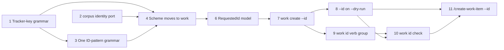

# Explicit Work Item ID on accelerator work create Implementation Plan

## Overview

Add `--id <ID>` to `accelerator work create` and `/create-work-item` so a
caller can name a new item's ID while keeping the CLI's atomic write, `NNNN`
substitution and tracker push. Five refusals guard it, in a fixed order, each
with its own `E_` identifier.

Building that on today's ID code would add a fifth pattern walker and a third
canonicaliser, so the plan consolidates first. Work-item identity moves out of
the general-purpose `corpus` crates into `work`. One regex-free grammar,
`work::id_pattern`, validates patterns and reads and renders IDs for every
consumer. `corpus` keeps two general ports: `IdConvention` for slugs and
clusters, and `LinkageIds` for linkage. Per-key scans ignore letter case
everywhere, every collision check shares one taken rule, and `work rekey`
reads IDs with literal pattern text. The ID verbs move under one `work id`
group, and a new `work id check` settles a requested ID, which
`/create-work-item` calls before composing.

Each phase is test-first, leaves `mise run` green, and merges on its own.
New public functions that return `Result` carry the `# Errors` section
pedantic clippy's `missing_errors_doc` requires, naming their error variants
as `work`'s existing ones do; that is the documentation the comment policy
allows them.

## Current State Analysis

- **Work-item identity lives in the platform crates.**
  `cli/corpus/src/work_item_id.rs` holds `WorkItemIdScheme`, `IdOwnership`,
  `IdScan`, `IdScanner`, `WorkItemIdCanonicaliser`, the draft-ID and
  tracker-key grammars, `references_key` and `validate_id_pattern`.
  `cli/corpus-adapters/src/work_item_pattern.rs` holds the regex pattern
  compiler, `parse_full_id`, `canonicalise_id`, `pattern_max_number` and
  `PatternError`, and `scanner.rs` holds `RegexScanner`. ADR-0069 classes
  `corpus` as a platform context and `work` as a product context, which no
  other context may depend on.
- **Inside `corpus`, few operations need identity.** `slug` uses only
  `IdScanner::scan(..).match_end` and `is_canonical_id_token`
  (`slug.rs:51,127,139`). `cluster` uses only `canonicalise_id` and
  `extract_id` (`cluster.rs:201,254-260,284`). `linkage::resolve_path_target`
  and `extract_bare_ids` hard-code the legacy 4-digit ID
  (`linkage.rs:220-223,501-517`), reached through `parse_document` by `migrate`
  m0007 and `corpus-cli`. `corpus_adapters::assemble` has no caller outside its
  own tests.
- **Three consumers may not depend on `work`.** `tracker-support` calls
  `is_tracker_key` (`identifier.rs:76`). `migrate` calls `references_key`
  (`m0009.rs:62`) and `resolve_path_target` (`m0007/linkage_value.rs:87`).
  `migrate-adapters` holds a `WorkItemIdCanonicaliser` (`context.rs:30`) and
  calls `resolve_path_target` (`corpus_index.rs:37`). The visualiser and
  `corpus-cli` are composition roots and may.
- **The grammar is written many times:**
  - four pattern-token walkers: `tokens_of`, `compile`/`find_token`,
    `build_full_id_regex` and `work::resolve::segments`;
  - five `{number}` width readers, defaulting to 0 or 4;
  - two canonicalisers that disagree: `WorkItemIdScheme::canonicalise_id`
    keeps `PROJ-42` and drops literal pattern text, while
    `corpus_adapters::canonicalise_id` renders `PROJ-0042`;
  - two error types sharing four variants, four copies of the
    draft-or-tracker-key predicate, two re-renderers under another key, and
    four scheme-from-config resolvers.
- **Reading the scheme swallows or untypes its errors.** `work-cli`'s
  `resolve_scheme` (`config.rs:53-91`) returns `kernel::Error` strings and
  prints the `work.default_project_code` deprecation itself. `work list` falls
  back to the default scheme on any error (`list.rs:579`).
- **Allocation is the only route to an ID.** `create_local_item`
  (`cli/work-adapters/src/creation.rs:629-705`) takes an
  `allocate: &dyn Fn(&CreateLockGuard) -> Result<String, String>` closure and
  calls it under the create lock. The closure runs before `refuse_to_overwrite`,
  `push_legacy_item` and the atomic write. `create_item`
  (`cli/work-cli/src/create.rs:522-549`) always passes `allocate_local_id`,
  which calls `allocate_id` (`create.rs:206-224`).
- **Whatever string the closure returns lands verbatim** in the filename
  (`target_for`, `creation.rs:288-290`), the `id` field (`compose_frontmatter`)
  and every `NNNN` in the body (`resolve_body`, `create.rs:265-282`).
- **`creation_context` has a side effect before its first refusal.** It
  resolves the scheme, then calls `create_dir_all(work_dir)`, then refuses
  `--project` under `{tracker}` with `E_PATTERN_KEY_UNUSED`
  (`create.rs:449-489`).
- **The dry-run returns before anything else.** `run_with`'s first statement
  reads `work.integration` and returns `preview_push` (`create.rs:651-657`). It
  never resolves the scheme, takes no lock and runs no re-key guard
  (`create_dry_run_is_not_guarded`, `create.rs:1044-1060`).
- **Every filename scan is per key and case-sensitive.** `allocate_id` and
  `work next-number` (`cli/work-cli/src/next_number.rs:139-150`) each compile
  `compile_scan_regex(pattern, key)` through `RegexScanner::compile`, a plain
  `Regex::new` (`cli/corpus-adapters/src/scanner.rs:25-27`). The visualiser
  builds the same scanner for slugs, IDs and clusters
  (`visualiser/server/src/config.rs:96`).
- **No exact-shape check exists.** `parse_full_id` accepts any width,
  `is_canonical_id_token` checks the key case-sensitively, and both
  canonicalisers normalise instead of refusing.
- **The `work` domain already walks patterns without regex.** `segments` and
  `match_full_id` in `cli/work/src/resolve.rs:49-166` tokenise a pattern into
  literal, key and number segments. The `work` crate may not import `regex`
  (`cli/pup.ron`, `work_domain_imports_only_permitted`).
- **Re-key reads only digits or a tracker-style key.** `rekey::sequence_of`,
  `project_key_of` and `is_in_target_shape` (`rekey/sequence.rs:13-45`) read
  an all-digit ID or `<key>-<digits>`, so an ID such as `v001` or `PP_0001` is
  unclassifiable. A run plan's `renumbered` targets are decoded raw
  (`work-adapters/src/rekey/run_plan_store.rs:313`), and `retirement::file_for`
  joins an ID into a path (`retirement.rs:373`).
- **The identity set exists, compared whole.** `FilesystemWorkItemFiles::files()`
  lists every `.md` file at the top level and in `drafts/`, matching the
  extension case-sensitively and dropping a file it cannot read
  (`filesystem.rs:64-94`). `identities(..)` gives
  `ItemIdentity { path, id, aliases, external_id }` from them.
  `identity::holder_of` (`identity.rs:93`) and every other matcher compare
  whole strings ignoring ASCII case, so `PP-42` and `PP-0042` never collide.
- **The skill has no argument parsing.** `/create-work-item` sends its whole
  argument to `accelerator work resolve` (`skills/work/create-work-item/SKILL.md:77-153`)
  and treats any exit 1 as a topic. It projects the ID with `work next-number`
  (`SKILL.md:443-469`). Its push-gate dry-run carries only the positionals,
  `--push --dry-run` and `--body-file` (`SKILL.md:525-528`). Any other
  non-zero exit from that dry-run "saves locally" (`SKILL.md:550-552`).
- **The ID verbs are flat.** `work canonicalise-id` normalises leniently
  (`04000` → `4000`, no range check), and `update-work-item` uses it for
  `parent` (`skills/work/update-work-item/SKILL.md:161`). `work next-number`
  serves `create-work-item`, `extract-work-items`, `refine-work-item` and
  `configure`, and records `next-number` as its identity-run holder
  (`next_number.rs:127`). `accelerator corpus` already groups its verbs by
  noun (`adr`, `metadata`, `linkage`, `frontmatter`).

## Desired End State

- `corpus` and `corpus-adapters` hold no work-item identity. `work::id_pattern`
  is the one grammar: it validates a pattern, reads an ID from a value or a
  filename, and renders one. `corpus::IdConvention` is the port `slug` and
  `cluster` use, implemented by `work::id_scheme::WorkItemIdScheme`;
  `corpus::LinkageIds` is the port `linkage` uses, implemented by the frozen
  `work::legacy_ids::LegacyNumericIds`. `tracker::is_tracker_key` is the one
  tracker-key grammar.
- One canonicaliser: `PROJ-42` canonicalises to `PROJ-0042` for the CLI,
  clusters, filters and resolution alike.
- A pattern or key is validated once, when the scheme is read, so every
  command and the visualiser refuse a malformed or hostile one, naming the
  setting, before writing or serving anything.
- One taken rule: create, re-key and retirement treat an ID held at another
  width or key case as taken.
- `work rekey` re-keys IDs rendered with literal pattern text, and refuses a
  run plan whose targets would leave the work directory.
- `accelerator work create "<title>" <kind> <priority> --id 0400` writes
  `0400-<slug>.md` with `id: "0400"` and H1 `# 0400: <title>`, or exits 1 with
  one of five `E_ID_*` refusals and writes nothing.
- Under `--push`, every `--id` check passes before any tracker request.
  Under `--dry-run` with `--id`, the same checks run before the preview, and
  an `--id` refusal carries the real create's code.
- `work create`, `work id next` and the visualiser count `pp-0500` in `PP`'s
  sequence.
- `work canonicalise-id` and `work next-number` are `work id canonicalise`
  and `work id next`, unchanged in behaviour. `work id check <ID>` prints
  `exact\t<id>`, `other-key\t<id>\t<key>` or `corrected\t<id>[\t<key>]`, or refuses as
  `work create --id` would, writing nothing.
- `/create-work-item --id <ID> <topic>` settles the ID with `work id check`
  before composing, proposes a corrected form for confirmation, and passes
  the settled ID via `--id` on the push-gate dry-run and the real create.

Verify with `mise run` (the full local CI mirror) and the recorded
`/create-work-item` eval benchmark.

### Key Discoveries

- The `allocate` closure seam (`creation.rs:629-636`) is the collision
  check's home. A refusal there precedes `push_legacy_item`, so it sends
  nothing.
- `segments` (`resolve.rs:59-106`) is the seed of the one grammar. Every width
  reader except `canonical_digit_width` treats a bare `{number}` as width 4:
  `compile` (`work_item_pattern.rs:210-211`), `pattern_cap`
  (`next_number.rs:47-52`) and `number_width` (`work_item_id.rs:413-428`).
- `corpus::canonical_draft_id` (`work_item_id.rs:298-305`) is exactly 0319's
  reserved draft form, and all of `work::draft_id::DraftId::parse`
  (`draft_id.rs:21`).
- `holder_of`'s four callers are all collision checks: sync authoring
  (`sync_author.rs:89`), draft minting (`draft_id.rs:73`), retirement
  (`retirement.rs:614`) and re-key (`rekey/collision.rs:41`). Draft IDs and
  tracker keys never read as IDs under a numbered pattern.
- `RecordingTracker` records `Call::PreviewCreate` as well as `Call::Create`
  (`cli/tracker-test-support/src/lib.rs:48-79`), so `tracker.calls().is_empty()`
  proves "no request of any kind" on both paths.
- The lock-race test model is
  `a_draft_written_while_a_create_waits_for_the_lock_is_e_draft_exists`
  (`create.rs:1507-1536`). The "did not block" model is
  `update_push_takes_the_identity_run_lock_before_the_file_lock`
  (`cli/work-cli/src/update.rs:549-575`).
- The public APIs of `corpus`, `work`, `tracker`, `tracker-support` and
  `migrate` are pinned (`tasks/public_api.py:15-33`). `corpus-adapters`,
  `work-adapters` and `accelerator-work` are not.
- ADR-0069 is enforced twice. `tasks/lint/crate_dependencies.py` judges
  manifest edges by context kind: a product context admits no dependant, and
  dev-dependencies are not judged. `cli/pup.ron` judges `use` paths: `work`
  may import `corpus` and `tracker`, `migrate` only `corpus`, and `corpus`
  only `kernel::Error`.
- The relocation has precedents. `tracker::supports_tracker_owned_ids`
  (`tracker/src/lib.rs:905-907`) already holds tracker-ID policy for `work`.
  `migrate-cli` already injects a `work-adapters` capability through a
  migrate-owned port (`SyncBaselines`, `migrate-cli/src/sync_baselines.rs`).
- The visualiser composes `RawWorkItemConfig` in the serving process
  (`compose.rs:197-221`, `main.rs:80-104`). No file or process boundary
  carries `scan_regex`, and the frontend reads only `{ key }`.
- Skill evals run outside CI through skill-creator. CI checks only that
  `benchmark.json` has a `with_skill` run for every eval ID, with
  `run_summary.with_skill.pass_rate.mean >= 0.9`
  (`tests/unit/tasks/test_evals_structure.py`). The next free eval ID is 39.

## Decisions

| Question | Decision | Why |
|---|---|---|
| Where work-item identity lives | `work` and `work-adapters`; `corpus` keeps two general ports | ADR-0069: `corpus` is platform, `work` product; moving consolidates four walkers, five width readers and two canonicalisers |
| The slug and cluster port | `corpus::IdConvention`: `slug_start`, `is_id`, `identity_key`, `id_in_filename`, with one invariant: every operation gives the same `identity_key` for one item; `WorkItemIdScheme` implements it | The four operations `slug` and `cluster` use; named for what they do, since `corpus` already uses "anchored" for something else |
| The linkage port | `corpus::LinkageIds`: `id_in_filename`, `is_bare_id`; only `work::legacy_ids::LegacyNumericIds` implements it, frozen at today's rules | Linkage needs two reads, not four; m0007's and `corpus linkage extract`'s output stays exactly as today |
| Join key | `WorkItemIdScheme::identity_key`: number padded; a key equal to `work.key` ignoring case folded to its spelling, other keys to ASCII upper case; under `{tracker}` only tracker-owned tokens and bare digits; under keyless patterns foreign-keyed IDs padded, not refused; under a `{key}` pattern a bare-digit legacy ID rendered with `work.key`. Every visualiser join and `filter`'s parent comparison use it | Three routes built join keys differently; the CLI's canonical form and a matching key are different jobs |
| The visualiser's displayed ID | `normalise_id`, today's rule with the key widened to rule 5; the join key is a second index field, never served as an item's ID; a cluster's `clusterKey` is the join key | An ID shows as written, so display, facets and `[[WORK-ITEM-42]]` links keep today's form; items with a letter-and-digit key, such as `X1-0400`, now show theirs; `clusterKey` is documented as the canonical cluster identity |
| Document-type vocabulary | `DocTypeKey::WorkItems`, `TypedRef::WorkItem` and the frontmatter schema rows stay in `corpus` | They describe document types, not identity |
| Tracker-key grammar | `tracker::is_tracker_key` | `tracker-support` may not depend on `work`; `tracker` already holds `supports_tracker_owned_ids` |
| `migrate`'s identity needs | One required migrate-owned `WorkItemIdentity` port in `Capabilities`, wired at `migrate-cli` over `work`: `canonicalise` (the live grammar, key read only under `{key}`), `references_key` (today's tolerant scan, frozen) and `legacy_linkage` | Product contexts may not depend on each other; the `SyncBaselines` precedent; m0009 keeps its tolerance, and m0002 refuses only a pattern every command refuses |
| Pattern grammar | `work::id_pattern`: validated `IdPattern` and `IdKey`; `IdPattern::parse` enforces rules 1 to 5 with today's messages, plus literal text limited to ASCII letters, digits, `.`, `_` and `-`, no literal digit beside a token, a width cap of 19, and one `{number}` and one key token; a value over 255 bytes is never an ID, and a filename's walk covers its first 255 bytes | One definition for every reader, writer and validator; IDs are filename-safe and inert in any shell quoting; the bounds keep every walk O(n²) over at most 255 bytes |
| Grammar errors | `PatternError` from `IdPattern::parse` alone; `KeyError` from `IdKey::parse`; `MissingKey` from `render`; `TrackerIntegrationError` from `check_tracker_integration`; `work_adapters::config::SchemeError` from reading config, naming the setting and value; every quoted config substring escaped by one helper | Each error type holds only what its source can fail at |
| Canonicalisation | One `WorkItemIdScheme::canonicalise` with the CLI's semantics: renders full IDs through the pattern, strips quotes, passes through under `{tracker}` | The two canonicalisers disagreed on `PROJ-42` and on literal text; canonical means one form |
| Scheme from config | `work_adapters::config`'s steps: `read_scheme` (parses `work.key` only under `{key}`, returns the deprecation notice), `require_key`, `check_tracker_integration`; writers use all three as `resolve_scheme`, the visualiser the first two, `work list` and `work id canonicalise` the first | Four resolvers disagreed; steps let each consumer take exactly the checks its job needs |
| Malformed pattern or key | Refused when the scheme is read, by every command and the visualiser: `E_WORK_ID_PATTERN_INVALID` or the new `E_WORK_KEY_INVALID`, naming the setting and value, a hostile character shown escaped | The caller's ID is not at fault; a hostile literal or key never reaches a path or a terminal raw |
| Holder readings | `WorkItemIdScheme::read_held` and `read_held_prefix`: `IdParts::parse` or `parse_prefix` under the pattern, a bare-digit legacy ID under `work.key` for a `{key}` pattern, a tracker key or draft ID whole under `{tracker}`, where holders compare whole, never by number; the taken rule, the taken check's both halves, allocation, `id_in_filename` and re-key read through them; no scanner type remains | One reading for every holder; with no literal digit beside a token, every value has one split, and re-key's fallback never misreads a CLI-written ID |
| The listing | `WorkItemListing { files, unreadable }`: `files` as today; only the taken check reads `unreadable`; `.md` matched ignoring case by every listing | No consumer changes; an unreadable holder still takes its ID |
| Key case in scans | ASCII case ignored for every consumer, the visualiser included | `pp-0500` belongs to `PP`'s sequence everywhere |
| The taken rule | `WorkItemIdScheme::holds(held, id)`: the held value reads as an ID with the same key, ignoring case, and number; under a `{key}` pattern a bare-digit legacy ID reads under `work.key`. `identity::holder_of_under` and `linker_of_under` use it for any candidate that reads as an ID, and compare whole strings otherwise | One rule for create, re-key and retirement; draft minting and sync authoring keep comparing whole tokens; a `work.key` equal to the tracker's key, with overlapping numbers, makes references ambiguous, so re-key refuses it and says why |
| Re-key under literal text | An existing ID's number reads through the configured pattern, then today's readings, then its one digit run; an ID with several runs outside the pattern's shape is refused by name. `is_in_target_shape` keeps today's rule: the ID equals its rendering under `work.key`, ignoring case | Re-key runs after the pattern changes and nothing records the old one; `v001` and `PP_0001` re-key in either direction, and nothing is guessed |
| Re-key run-plan targets | Read through `read_exact` when decoded; retirement refuses an ID that is not one path component | A committed run plan cannot move a file outside the work directory |
| Exact-shape check's home | `work::requested_id` over `work::id_pattern` | ADR-0053 keeps logic out of `work-cli`; `work` cannot import `regex` |
| Bare `{number}` width | Exactly 4 digits | Agrees with `compile`, `pattern_cap` and `number_width`; the format the pattern produces is `%04d` |
| Literal text in a pattern | Part of the exact shape, case-sensitive; held IDs and filenames match it ignoring ASCII case | "The exact shape the pattern produces"; allocation renders it once `render` replaces `canonicalise_id` |
| Number range | Exact width and non-zero | Exact width already bounds the cap |
| Where checks 1-4 run (real create) | After `locate_work_items`, before `create_dir_all` | A refusal leaves no empty `meta/work/`; config and pattern errors come first, as they do for every create |
| The `--id` preflight | `locate_work_items` in `work-cli/src/config.rs`, shared by every create, the dry-run, `work id next` and `work id check`; `admit_requested_id` and `refuse_if_requested_id_taken` in `work-cli/src/requested_id.rs` | One order in one place; 0351 inherits the seam |
| Where `--project` is parsed | `work::next_number::allocation_key`, the one rule, on the allocation path and under `{tracker}` in `creation_context`, after admission: a keyless or `{tracker}` pattern gives `E_PATTERN_KEY_UNUSED` before any parse, and under `{key}` it parses into an `IdKey` or gives `E_WORK_KEY_INVALID`. With `--id`, `E_ID_WITH_PROJECT` sees the raw value first, and `admit` reads it only to choose its example | One rule in the domain; `--id 0400 --project 1X` is refused as `E_ID_WITH_PROJECT` |
| How a requested ID reaches the write | `work_adapters::creation::LocalId::{Allocate, Requested}`, which `create_local_item` takes and only the local-ownership arms pass; `RequestedId` carries the scheme it was admitted under | The adapter owns the locked order (precondition, taken check, write); a requested ID cannot reach a tracker strategy |
| The pending-push precondition | `work::sync::unfinished_push` decides the digest-free marker states and `push_precondition` evaluates it first; one adapter marker reader serves `check_pending_push` (after allocation, as today; for a requested ID, before the taken check and only with `--push`) and the dry-run's `refuse_unfinished_push` (with `--id` and `--push`, skipped with no integration) | One domain decision per marker state; a re-run after an unknown push outcome gets `E_PUSH_PENDING`'s recovery; the dry-run renders no body |
| `--dry-run --id` before Phase 8 | A usage error (`conflicts_with`, exit 2) | Every shipped build is strict or complete; Phase 8 only widens |
| Where check 5 runs (real create) | In the `Requested` arm, under the create lock | Same atomic step as the write; precedes the push |
| Dry-run | With `--id` only, in the real create's order: scheme read, checks 1-4, the digest-free pending-push arms with `--push` and an integration, check 5, then the preview; `integration_state` is read once, as a `Result`, and a missing integration fails where the real create's does (before check 5 with `--push`, after the `--id` checks otherwise) with today's text; a plain dry-run reads as today; no lock | A plain dry-run stays byte-identical; 0351 later folds both calls into its shared validation |
| Collision check signature | Takes the listing and no lock guard | 0351 runs it on the dry-run without locks |
| `E_` names | `E_ID_WITH_PROJECT`, `E_ID_TRACKER_OWNED`, `E_ID_DRAFT_RESERVED`, `E_ID_PATTERN_MISMATCH`, `E_ID_TAKEN`; variants `WithProject`, `TrackerOwned`, `DraftReserved`, `PatternMismatch`, `Taken` | Each variant reads as its code, as `NotRekeyed`'s do; the skill names the codes rather than matching `E_ID_` |
| Where messages render | `Display` on the domain refusal, as `NotRekeyed` does; the shape clause from `IdPattern::describe()` | One text for the real create, the dry-run and 0351; a clause names a key or literal text only when the pattern has one |
| Skill correction | `work id check` decides exactness and the one correction through `RequestedId::propose`; the skill only asks the user to confirm a correction | ADR-0045 puts deterministic procedure in the CLI; a grammar in prose would be another copy with no backstop |
| `work id check` verdicts | `exact\t<id>`; `other-key\t<id>\t<key>` for an exact ID whose key differs from the configured key ignoring case, naming that key with the deprecated alias resolved; `corrected\t<id>`, with `\t<key>` when the corrected ID's key differs too | The CLI reads both keys, so the skill never parses an ID or reads config |
| ID verbs | One `work id` group: `canonicalise` (was `canonicalise-id`), `next` (was `next-number`) and `check` (new), with no alias for the old names | Noun-verb groups, as `accelerator corpus` has; the lenient `canonicalise` and the exact `check` sit under one help page |
| Retired verb names | Hidden subcommands whose about text is the pointer; they take any arguments, run nothing and exit 2 | `--help` and any argument list reach the pointer |
| `{number}` spec outside `0Nd` | Rule 4, refused by `IdPattern::parse` everywhere, `work resolve` included | A lenient path for one command would keep an unvalidated pattern alive |
| `work id check` guard | Holds the identity-run lock and refuses during a re-key, as `work id next` does; takes no create lock | It reads the corpus as `next` does; the create lock belongs to writers |
| Skill argument with `--id` | The remainder is always a topic and never reaches `work resolve` | `--id` names a new item |
| `E_PATTERN_OVERFLOW` wording | At the cap, it names the file holding the highest number and offers a lower ID first; one rendering in `work::next_number` replaces the copies in `create.rs` and `next_number.rs` | `--id 9999` makes the cap one keystroke away; archiving does not help a small repository |

## Error Identifiers

Every refusal prints `Error: <code>: <what>. <remedy>.` to stderr and exits 1,
through `RunOutcome::Failed` (`cli/work-cli/src/main.rs:287-290`).

| Code | Order | Raised when | Message names |
|---|---|---|---|
| `E_ID_WITH_PROJECT` | 1 | `--id` and `--project` together, under any pattern and any `--project` value | `--id` and `--project` |
| `E_ID_TRACKER_OWNED` | 2 | `--id` under `{tracker}` | the pattern, verbatim |
| `E_ID_DRAFT_RESERVED` | 3 | `--id` is a draft ID in any case | `draft-` |
| `E_ID_PATTERN_MISMATCH` | 4 | `--id` is not in the pattern's exact shape | the pattern, verbatim |
| `E_ID_TAKEN` | 5 | a held ID takes `--id` | the holder's file path |

In a real create, all five follow the re-key guard (`E_REKEY_IN_PROGRESS`,
`E_REKEY_PLAN_UNREADABLE`, `E_IDENTITY_RUN_BUSY`) and the scheme's config
errors (`E_WORK_ID_PATTERN_INVALID`, `E_WORK_KEY_INVALID`,
`E_WORK_KEY_REQUIRED`). `--project` is parsed only after them: with `--id`,
`E_ID_WITH_PROJECT` sees its raw value; without, a keyless or `{tracker}`
pattern gives `E_PATTERN_KEY_UNUSED` before any parse, and under `{key}` an
invalid value gives `E_WORK_KEY_INVALID: --project '<value>': <reason>`.
`work id check` gives the same refusals in the same order, except
`E_ID_WITH_PROJECT`, since it takes no `--project`.

## What We're NOT Doing

- No `--id` on `work create-batch`, `/extract-work-items`, `/refine-work-item`
  or `/sync-work-items`.
- No filling of the gaps an `--id` leaves: allocation stays max+1 per key.
- No alias-aware automatic allocation. Aliases count only in the taken check.
- No re-key guard on the dry-run, no move of `run_with`'s early return, and
  no dry-run run of the real create's other checks (author, template,
  overflow) in its order (all 0351).
- No visibility of other branches: "taken" means the local work directory.
- No change to `work resolve`'s matching rules beyond the one canonicaliser
  and refusing a malformed pattern; it moves onto the shared walking
  primitives.
- No change to draft minting's or sync authoring's whole-token comparison:
  their candidates are never IDs under a numbered pattern.
- No change to `DocTypeKey`, `TypedRef::WorkItem` or the work-item frontmatter
  schema rows in `corpus`.
- No change to what m0007 and m0009 read or produce, or to what m0002
  produces under a pattern every other command accepts.

## Implementation Approach



Phases 1 and 2 are independent. Phase 3 reads tracker keys through Phase 1's
`tracker::is_tracker_key`. Phase 4 moves the scheme into `work` over Phase 3's
grammar, implements Phase 2's port, and gives every collision check one taken
rule. Phase 5, absent from the diagram, depends on 2 and 4: it moves the
visualiser, `corpus-cli` and `migrate` and deletes the work-item code left in
the `corpus` crates. Between Phases 3 and 5 old and new code coexist, and the
parity tests pin them equal.

Phases 6 to 8 build `--id`. Phase 9 moves the ID verbs under `work id`; it
follows Phase 7 because it moves `next_number.rs` and `canonicalise_id.rs`,
which Phases 3, 4 and 7 edit. Phase 10 adds `work id check` over Phase 7's
preflight and Phase 8's lock-free taken check, and Phase 11 changes the
skill. Until Phase 8 lands,
`--dry-run --id` is a usage error (exit 2), so every shipped build is either
strict or complete, and Phase 8 only widens the contract.

---

## Phase 1: Tracker-Key Grammar in `tracker`

### Overview

`tracker::is_tracker_key` becomes the one tracker-key grammar, and
`tracker-support` loses its only dependency on `corpus`.

### Changes Required

#### 1. Failing tests first

**File**: `cli/tracker/tests/tracker_key.rs` (new), in the crate's
integration-test layout:

- `a_tracker_key_is_a_letter_led_key_a_hyphen_and_digits` — the assertions
  of `corpus::is_tracker_key`'s tests (`work_item_id.rs:508-520`), moved
  unchanged: `PP-760`, `eng-42` and `MY_PROJ-7` are keys; `0230`, `PP-`,
  `-760`, `1PP-760`, `PP-76a` and `draft-k7mq3x` are not. Then `PRO_J-1`
  and `p1-7` are keys, and `PROJ` and the empty string are not.

#### 2. The move

**File**: `cli/tracker/src/lib.rs`
**Changes**: add `pub fn is_tracker_key(token: &str) -> bool` beside
`supports_tracker_owned_ids`, with the body of `corpus::is_tracker_key`. The
crate doc (`:1-5`), which says the crate "holds no logic", says instead that
it holds the port and the vocabulary trackers speak, tracker-key shape
included; `tests/structure.rs:1` ("ships no behaviour") and the comment
above `tracker_domain_imports_only_permitted` in `cli/pup.ron` ("and
nothing else") say the same.

**Files**: `cli/tracker-support/src/identifier.rs:76`, `cli/work/src/tracker_key.rs:14`,
`cli/work/src/retirement.rs:349`, `cli/work/src/resolve.rs:185`,
`cli/work/src/rekey/sequence.rs:16`, `cli/work-cli/src/sync.rs:573`
**Changes**: call `tracker::is_tracker_key`.

**File**: `cli/tracker-support/Cargo.toml`
**Changes**: drop the `corpus` dependency.

**File**: `cli/corpus/src/lib.rs`
**Changes**: stop re-exporting `is_tracker_key`. `normalise_id` keeps a
private copy until Phase 5 deletes the module, because `corpus` may not
depend on `tracker`.

**Files**: `cli/tracker/tests/fixtures/public-api.txt`,
`cli/corpus/tests/fixtures/public-api.txt`
**Changes**: regenerate and read the diffs: `tracker` gains `is_tracker_key`,
and `corpus` loses its re-export.

### Success Criteria

#### Automated Verification

- [ ] `cd cli && cargo nextest run -p tracker tracker_key`
- [ ] `mise run public-api:check`
- [ ] `mise run check` (the crate-dependency lint and `pup`)
- [ ] `mise run` exits 0

#### Manual Verification

- [ ] None beyond automated.

---

## Phase 2: A General Identity Port in `corpus`

### Overview

`slug` and `cluster` take one general `IdConvention` port instead of a
`WorkItemIdScheme` and an `IdScanner`. A transitional adapter in
`corpus::work_item_id` implements it over the scheme until Phase 5.
`corpus_adapters::assemble`, which nothing calls, is deleted.

### Changes Required

#### 1. Failing tests first

**Files**: `cli/corpus/src/slug.rs`, `cli/corpus/src/cluster.rs` (unit)
**Changes**: rewrite each test's `NumericScanner`, `ProjectScanner` or
`DigitRunScanner` plus scheme as one test `IdConvention` double with the
same answers. The tests fail to compile until the port exists, and their
expectations do not change.

**File**: `cli/visualiser/server/src/indexer.rs`, `clusters.rs` (unit)
**Changes**: none; their existing tests pin the visualiser's slugs, IDs and
clusters through the move.

#### 2. The port

**File**: `cli/corpus/src/id_convention.rs` (new; `pub mod` and root
re-export in `lib.rs`)

```rust
pub trait IdConvention {
    fn slug_start(&self, stem: &str) -> Option<usize>;

    fn is_id(&self, token: &str) -> bool;

    fn identity_key(&self, reference: &str) -> Option<String>;

    fn id_in_filename(&self, filename: &str) -> Option<String>;
}
```

The trait's one doc line states the invariant no name can carry: every
operation gives the same `identity_key` for one item, so a filename, a
`work-item:` reference and a frontmatter `id` naming it all join.

**Files**: `cli/corpus/src/slug.rs`, `cli/corpus/src/cluster.rs`
**Changes**:

- `slug::derive` and `slug::derive_work_item` take `&dyn IdConvention`.
- `ClusterContext` holds `identity: &dyn IdConvention` in place of
  `scheme` and `scanner`; `from_entries`, `resolve_cluster_key` and
  `target_path_from_entry` follow.
- `ClusterEntry::work_item_id` and `work_item_by_id` keep their names: the
  work-item document type is `corpus` vocabulary.
- `cluster.rs`'s module doc (`:1-8`) stops naming `WorkItemIdScheme` and
  `IdScanner`: it takes the ID convention as an injected `IdConvention`.
  `slug.rs:43`'s "the scanner consumes the ID prefix" becomes the
  convention's `slug_start`.

**File**: `cli/corpus/src/work_item_id.rs`
**Changes**: a transitional `SchemeConvention<'a> { scheme, scanner }`
implements `IdConvention` from `scan(..).match_end`,
`is_canonical_id_token`, `canonicalise_id` and `extract_id`. Phase 5 deletes
it with the module.

**Files**: `cli/visualiser/server/src/indexer.rs`, `clusters.rs`,
`test_support.rs`, `tests/parity.rs`
**Changes**: build a `SchemeConvention` from `WorkItemConfig` and pass it;
`tests/parity.rs` calls `slug::derive` with it, or it no longer compiles.

**File**: `cli/corpus-adapters/src/assemble.rs`
**Changes**: delete it, its `lib.rs` entry and its tests.

**Files**: `cli/corpus-adapters/tests/parity.rs`,
`cli/corpus/tests/fixtures/public-api.txt`
**Changes**: `parity.rs` goes through `SchemeConvention`. Regenerate the
`corpus` fixture and read the diff: only the port, the `slug` and `cluster`
signatures, and `SchemeConvention` change.

### Success Criteria

#### Automated Verification

- [ ] `cd cli && cargo nextest run -p corpus slug cluster`
- [ ] `mise run test:unit:visualiser`
- [ ] `mise run test:integration:visualiser`
- [ ] `cd cli && cargo test -p corpus-adapters --test parity`
- [ ] `mise run public-api:check`
- [ ] `mise run` exits 0

#### Manual Verification

- [ ] The visualiser's lifecycle view of this repository shows the same
      clusters before and after.

---

## Phase 3: One ID-Pattern Grammar in `work`

### Overview

`work::id_pattern` becomes the one regex-free grammar for work-item IDs. It
validates a pattern, reads an ID from a value or a filename prefix, renders
one, and gives the number cap. Parity tests pin it to `corpus-adapters`'
compiler while both exist. The allocators switch to it, so every per-key
scan ignores ASCII case, and allocation keeps a pattern's literal text. The
work-item listing reports the files it cannot read, and matches `.md`
ignoring case.

### Changes Required

#### 1. Failing tests first

**File**: `cli/work/src/resolve.rs` (unit)
**Changes**: pin full-ID resolution under the patterns no existing `resolve`
test uses. Both pass from the start and hold the move of `segments`.

- `a_full_id_resolves_under_a_bare_number_token` — under `a.{number}`,
  `a.0042` resolves to `a.0042-a.md`.
- `a_full_id_resolves_under_a_six_digit_key_pattern` — under
  `{key}-{number:06d}` with key `PP`, `PP-000042` resolves to
  `PP-000042-a.md`.

  Each input carries literal text, so only the full-ID branch can resolve
  it; an all-digit input would resolve through the bare-number branch and
  hide a tokeniser regression.

**File**: `cli/work-cli/tests/cli_resolve.rs`:

- `resolve_refuses_a_malformed_pattern` — under `{number:4d}`,
  `work resolve 0042` exits 1 with stderr containing the rule-4 text and no
  line starting `E_RESOLVE_INVALID:`.
- `a_topic_without_a_work_directory_is_e_resolve_invalid` — in a repository
  with no `meta/work/`, `work resolve "add dark mode"` exits 1 with a line
  starting `E_RESOLVE_INVALID:`, and `work resolve 0042` exits 3, not found.
  Today both exit 1 with "could not resolve the work directory".

**File**: `cli/work-adapters/tests/id_pattern_parity.rs` (new;
`corpus-adapters` is already a dev-dependency). The patterns are
`{number:04d}`, `{number}`, `{key}-{number:04d}`, `{project}-{number:04d}`,
`{key}-{number:06d}`, `v{number:03d}`, `a.{number}` and `{tracker}`, with
key `PP`.

- `the_grammar_validates_as_the_compiler_does` — `IdPattern::parse`
  gives the error `compile_scan_regex` gives, with the same `Display` text,
  over those patterns and:
  - the malformed empty string, `{number:4d}`, `{bogus}-{number}`,
    `{key}{number}`, `{key}`, `{number`, `}{number}` and `{a{b}}`;
  - one pattern per hostile character, `x/`, `x\`, `x:`, `x*`, `x?`, `x<`,
    `x>`, `x|` and `x"` before `{number:04d}`;
  - under `{key}-{number:04d}`, the key values `1PP`, `P-P`, `../x` and the
    empty string, through `IdKey::parse`, whose `KeyError` gives the text
    the compiler's rule-5 error gives.

  A literal character other than an ASCII letter, digit, `.`, `_` or `-`
  that rule 2 does not already refuse (such as `'`, a space or `$`), a
  width over 19
  digits, a repeated `{number}` or key token, and a literal digit beside a
  token (`{key}1{number:04d}`, `v2{number:03d}`, which the compiler accepts)
  are refused only by `IdPattern::parse`; those rows are expected values.
  So are the escaped-brace patterns the compiler accepts, `{{x}}{number}`
  and `{key}{{}}{number}`, which give `HostileChar` for the brace;
  `{{/}}{number}` is refused by both, the compiler naming `/` and the
  grammar the brace.
- `the_grammar_renders_as_the_compiler_formats` — `IdPattern::render` equals
  `corpus_adapters::canonicalise_id` of the bare number, for 1, 42 and 9999.
- `filenames_read_as_the_scan_regex_reads_them_but_for_letter_case` —
  over `0400-x.md`, `00400-x.md`, `0400.md`, `0400x-y.md`, `PP-0500-x.md`,
  `pp-0500-x.md`, `XY-0500-x.md`, `v001-x.md`, `V001-x.md`, `PPv001-x.md`
  under `{key}v{number:03d}`, and `99999999999999999999-x.md`,
  `IdParts::parse_prefix`, keeping a holder whose key equals `PP` ignoring
  ASCII case, gives the digits as written and the slug offset
  `RegexScanner`'s `IdScan` gives. Two exceptions are expected values, not
  tolerances: a filename
  that differs from a match only by ASCII letter case, which only the
  grammar reads, and the oversized run, which only `RegexScanner` reads
  because `IdParts` needs a `u64`.
- `the_cap_matches_pattern_max_number` — `IdPattern::cap` equals
  `pattern_max_number` wherever the latter succeeds.
- `full_ids_parse_as_parse_full_id_does` — under the keyed patterns and
  `{key}v{number:03d}`, `IdParts::parse` gives the key and number
  `parse_full_id` gives, for `PP-0042`, `pp-42` and `XY-7`. Under keyless
  patterns `parse_full_id` ignores literal text, so those cases are expected
  values in `id_pattern`'s own tests instead.

**File**: `cli/work/src/id_pattern.rs` (unit), the grammar's own
specification:

- `a_bare_number_token_has_width_four` — `{number}` gives width 4 and
  `{number:06d}` width 6.
- `a_malformed_pattern_cannot_be_parsed` — `{number:4d}` gives rule 4,
  `{bogus}-{number}` an unknown token, and `{number:020d}` `WidthOverflow`,
  whose text says "at most 19 digits".
- `a_character_outside_the_literal_set_is_hostile` — literals holding `'`,
  a tab, a space, `$`, a backtick, `;`, `~`, U+202E, U+009B, U+200B or `é`,
  and the brace an escape produces (`{{x}}{number}`, `{{tracker}}`), give
  `HostileChar`; `x.{number:04d}`, `x_{number:04d}` and
  `x-{number:04d}` parse.
- `a_hostile_character_is_shown_escaped` — the `HostileChar` text for `'`
  shows `\'`, and for a tab and a NUL shows `U+0009` and `U+0000`; the
  `KeyError` for a key holding ESC (U+001B), and the errors for
  `{<ESC>}-{number:04d}` and `{number:<ESC>}`, show it as `U+001B`, and
  a U+202E in a literal shows as `U+202E`. No message carries a raw
  character outside printable ASCII.
- `a_repeated_token_is_refused` — `{number:04d}-{number:04d}` and
  `{key}-{key}-{number:04d}` give `RepeatedToken`.
- `a_digit_beside_a_token_is_refused` — `{key}1{number:04d}`,
  `{key}0{number:04d}`, `{number:04d}-{key}1`, `v2{number:03d}`,
  `{key}-1{number:04d}` and `{number:04d}1` give `DigitBesideToken`;
  `v_{number:03d}`, `{key}-{number:04d}` and `{number:04d}-x1` parse.
- `a_key_value_must_match_rule_five` — `IdKey::parse` refuses `1PP`, `P-P`,
  `../x` and the empty string with `KeyError::BadKeyValue`, and accepts
  `PP`, `pp` and `X1`.
- `render_needs_a_key_only_under_a_key_pattern` — `{key}-{number:04d}`
  without a key gives `MissingKey`; `{number:04d}` renders with none.
- `id_parts_read_at_any_width_ignoring_case` — under `{key}-{number:04d}`,
  `pp-400`, `PP-0400` and `Pp-00400` each parse to their key and number 400.
- `a_value_that_cannot_be_walked_does_not_parse` — `PP–0400` (en dash),
  `PP-`, and a digit run too long for `u64`, without panicking.
- `an_oversized_value_is_not_an_id_and_returns_promptly` — a 256-byte value
  of `P` and digits gives `None` from `IdParts::parse` and `read_exact`
  within 100 ms, as does a 255-byte value that cannot match.
- `a_long_filename_is_read_by_its_prefix` — `0400-` then a slug of 3-byte
  characters (`日`) long enough that byte 255 falls inside one, and `.md`,
  gives 400 from `parse_prefix` without panicking; a filename of 300 bytes of
  `P` gives `None` within 100 ms.
- `two_readings_are_the_same_id_when_key_and_number_agree` — `pp-400` and
  `PP-0400` are; `XY-400` and `PP-401` are not, against `PP-0400`.
- `a_filename_prefix_needs_the_slug_delimiter` — `parse_prefix` reads
  `0400-x.md` and not `0400.md` or `0400x-y.md`.
- `the_filename_reading_folds_only_ascii_letters` — under key `K`,
  `\u{212A}-0500-x.md` (KELVIN SIGN) does not match.
- `render_keeps_literal_text` — under `v{number:03d}`, 1 renders `v001`.
- `a_key_before_an_alphanumeric_literal_reads_as_the_regex_does` — under
  `{key}v{number:03d}`, `PPv001` gives key `PP` and number 1, and `PPvv001`
  key `PPv`.

**File**: `cli/work-adapters/tests/work_item_files.rs`, beside the existing
listing tests:

- `an_upper_case_md_extension_is_listed` — `0400-x.MD` is among the
  listing's files, as the allocators already count it.
- `an_unreadable_file_is_reported_beside_the_listing` — a file at mode `000`
  and a file of non-UTF-8 bytes are absent from `files` and present in
  `unreadable`, by path.

**File**: `cli/work-cli/tests/cli_list.rs`:

- `list_output_is_unchanged_by_an_unreadable_file` — with a non-UTF-8
  `0400-x.md` beside readable items, `work list` prints exactly what it
  prints without that file, and nothing on stderr.

**File**: `cli/work-cli/tests/cli_rekey.rs`:

- `an_upper_case_md_item_is_listed_and_re_keyed_like_any_other` — after a
  pattern change, `0001-x.MD` is re-keyed with the `.md` items.

**File**: `cli/work-cli/tests/cli_next_number.rs`:

- `a_hostile_project_is_refused_with_the_rule_five_reason` — under
  `{key}-{number:04d}`, `work next-number --project 'a/b'` gives the rule-5
  reason.
- `a_lower_case_key_counts_in_the_configured_keys_sequence` —
  `{key}-{number:04d}`, `work.key: PP`, files `PP-0001-a.md` to
  `PP-0010-j.md` and `pp-0500-b.md`; stdout is `PP-0501`.

**File**: `cli/work-cli/tests/cli_create.rs`:

- Add `scratch_repo_with_work_config(work_body)`, mirroring
  `cli_next_number.rs:21-31`, and the file-level
  `#![allow(clippy::literal_string_with_formatting_args)]`.
- `create_counts_a_lower_case_key_in_the_configured_keys_sequence` — the same
  files; the written path ends in `PP-0501-<slug>.md`.
- `create_under_a_project_counts_that_keys_sequence_ignoring_case` —
  `xy-0400-a.md` exists; `--project XY` writes `XY-0401-<slug>.md`.
- `a_hostile_project_or_pattern_is_refused_before_anything_is_written` —
  under `{key}-{number:04d}`, `work create --project '../x'` gives the
  rule-5 reason, a create under `../{number:04d}` the rule-2 text, and a
  create under `x'{number:04d}` the `HostileChar` text; none writes
  anything. The `x'` case is red today.
- `allocation_under_a_key_followed_by_a_letter_continues_the_sequence` —
  under `{key}v{number:03d}` with `work.key: PP` and `PPv001-a.md` present,
  the next create writes `PPv002-<slug>.md`.
- `allocation_keeps_the_patterns_literal_text` — under `v{number:03d}`, two
  creates write `v001-<slug>.md` and `v002-<slug>.md`. Today the first
  writes `001-<slug>.md`, which the scan never sees.

**File**: `cli/work/src/next_number.rs` (unit):

- `the_allocation_key_is_the_project_or_the_configured_key` — under
  `{key}-{number:04d}` with `work.key: PP`, no `--project` gives `PP` and
  `--project XY` gives `XY`; `--project 1X` gives `InvalidProject`; under
  `{number:04d}` and `{tracker}`, `--project 1X` gives `ProjectUnused`,
  before any parse.

#### 2. The grammar

**File**: `cli/work/src/id_pattern.rs` (new, `pub`)
**Changes**:

- **Validated values.** The tokeniser moves out of `resolve.rs`, and a
  pattern or key is usable only once parsed, so no walk, render or scan can
  see an unvalidated one:

  ```rust
  pub struct IdPattern {
      text: String,
      segments: Vec<Segment>,
  }

  pub struct IdKey(String);

  pub struct MissingKey;

  impl IdPattern {
      pub fn parse(text: &str) -> Result<Self, PatternError>;

      pub fn as_str(&self) -> &str;

      pub fn references_key(&self) -> bool;

      pub fn is_tracker_owned(&self) -> bool;

      pub fn cap(&self) -> Option<u64>;

      pub fn render(&self, key: Option<&IdKey>, number: u64) -> Result<String, MissingKey>;
  }

  impl IdKey {
      pub fn parse(text: &str) -> Result<Self, KeyError>;
  }
  ```

  - `IdPattern::parse` enforces rules 1 to 5, the `{tracker}` sole-token
    rule, and at most one `{number}` and one `{key}` or `{project}` token.
    `{number}` has width 4 and `{number:0Nd}` width `N`, from 1 to 19; any
    other spec is rule 4 and a wider one `WidthOverflow`. Literal text is
    ASCII letters, digits, `.`, `_` and `-`; anything else, rule 2's
    `/ \ : * ? < > | "` and the `{` or `}` an escape produces included, is
    `HostileChar`. The tokeniser still reads `{{` and `}}` as escapes, so the
    refusal names the brace rather than an unknown token. IDs are therefore
    ASCII, filename-safe and inert under any shell quoting.
  - No literal digit sits beside a token's digits: a literal may not start
    with a digit after `{key}` or `{number}`, nor end with a digit before
    `{number}` (`DigitBesideToken`). Every ID the CLI writes then has its
    number as a digit run of its own.
  - `IdKey::parse` enforces rule 5. `work.key`, `--project` and the key a
    requested ID carries all pass through it.
  - `render` fails only when the pattern has `{key}` and no key is given;
    `cap` is `None` under `{tracker}`.
  - Errors are split by source. `PatternError` comes only from
    `IdPattern::parse`: `Empty`, the brace variants, `AdjacentTokens`,
    `BadFormatSpec`, `UnknownToken`, `HostileChar`, `NoNumberToken`,
    `WidthOverflow`, `RepeatedToken`, `DigitBesideToken`, `TrackerHasNoNumber` and
    `TrackerNotSoleToken`, each with today's `Display` text where it has
    one. `KeyError::BadKeyValue` comes only from `IdKey::parse`, with
    today's rule-5 text. `MissingKey` is defined once;
    `work::next_number::AllocationError` converts from it through a
    hand-written `From<MissingKey>`, since `work` has no `thiserror`, in
    place of its own `MissingKey` variant, still rendering
    `E_PATTERN_MISSING_KEY`.
  - Every substring of a pattern or key that an error message quotes passes
    through one escaping helper: `'` shows as `\'` and any character
    outside printable ASCII as its `U+` code point. A printable value shows
    unchanged, so today's texts hold.
  - `Segment` is private to the module: `Literal(String)`, `Key`,
    `Number { width: usize }` and `Tracker`.
- **The walking primitives**, which `resolve::match_full_id` and every strict
  walk compose under their own policies:

  ```rust
  pub(crate) fn take_literal<'a>(rest: &'a str, literal: &str, case: LiteralCase) -> Option<&'a str>;

  pub(crate) fn take_key_run(rest: &str) -> impl Iterator<Item = (&str, &str)>;

  pub(crate) fn take_digits(rest: &str) -> impl Iterator<Item = (&str, &str)>;
  ```

  - `take_key_run` yields the end positions of every run of one
    `is_ascii_alphabetic` character then `is_ascii_alphanumeric` ones,
    longest first, and `take_digits` every `is_ascii_digit` run, longest
    first.
  - Every walk tries those candidates until the rest of the pattern matches,
    as the scan regex's backtracking did: the longest key that allows a full
    match. `PPv001` under `{key}v{number:03d}` reads as key `PP`, literal
    `v` and number `001`.
  - `take_literal` compares through `str::get`, exactly or ignoring ASCII
    case, so a short or multi-byte remainder fails rather than panicking.
- **`IdParts`**, the reading of an ID's key, digits and number, which
  allocation, canonicalisation, the taken rule and `RequestedId` share:

  ```rust
  pub struct IdParts {
      key: Option<String>,
      digits: String,
      number: u64,
  }

  impl IdParts {
      pub fn parse(pattern: &IdPattern, text: &str) -> Option<Self>;

      pub fn parse_prefix(pattern: &IdPattern, filename: &str) -> Option<(Self, usize)>;

      pub fn key(&self) -> Option<&str>;

      pub fn digits(&self) -> &str;

      pub fn number(&self) -> u64;

      pub fn same_id(&self, other: &IdParts) -> bool;
  }

  impl IdPattern {
      pub fn read_exact(&self, text: &str) -> Option<IdParts>;
  }
  ```

  - `parse` walks leniently: literals ignoring ASCII case, the key run, and a
    digit run of any width whose checked `u64` parse succeeds. It keeps the
    digits as written beside the number, so a scan reports `0042`, not
    `42`.
  - `parse_prefix` does the same over a filename's front, then requires the
    `-` that starts the slug, and returns where the slug starts.
  - `same_id` holds when the keys are equal ignoring ASCII case and the
    numbers are equal.
  - `read_exact` is the one exact-shape walk: literals exactly, a key run,
    exactly `width` digits, and the whole input consumed. It says nothing
    about the number's value, so `0000` is in shape; only
    `RequestedId::admit` refuses 0. `is_canonical_id_token`,
    `is_any_key_id_token` and `RequestedId::admit`
    all call it.
  - `parse` and `read_exact` return `None` for a value over 255 bytes, and
    `parse_prefix` walks only the filename's leading run of ASCII bytes,
    cut at 255 bytes. No ID holds a non-ASCII byte, so the cut always falls
    on a character boundary, and a long slug never hides its ID. With one key run and one number run per
    pattern, a walk costs at most O(n²) over those bytes.
- **One split per value.** Because no literal digit sits beside a token, a
  value has at most one split into key, literals and number, so
  the longest-key walk, the exact walk and a reading under a known key all
  agree.
- **No scanner type.** `IdParts::parse_prefix` is the one filename reading.
  Its callers keep a holder whose key equals theirs, ignoring ASCII case, so
  `work` needs no `IdScanner`, `IdScan` or scanner type, and nothing turns a
  parsed number back into a string to parse again.

**File**: `cli/work/src/resolve.rs`
**Changes**: `match_full_id` composes the primitives over an `IdPattern`;
`segments` and the duplicate `is_md_filename` go. `work resolve` parses the
configured pattern first, so a malformed one is a config error there too.
It then classifies its input before reading the work directory, and reads a
missing directory as an empty corpus, so a topic in a fresh repository
gives `E_RESOLVE_INVALID` and a full ID gives not found.
The module docs of `resolve.rs:1-10` and `work/src/next_number.rs:1-9`,
which justify local walkers by the regex compiler and name
`canonicalise_id`, are deleted.

**Files**: `cli/work/src/work_item_files.rs`, `cli/work/src/next_number.rs`,
`cli/work-adapters/src/filesystem.rs`
**Changes**:

- `is_md_filename` moves into `work_item_files.rs` as `pub`, matching `.md`
  ignoring ASCII case, and `next_number.rs`'s copy goes.
- `WorkItemFiles` gains `listing()`, returning
  `WorkItemListing { files: Vec<WorkItemFile>, unreadable: Vec<PathBuf> }`.
  `files()` becomes a provided method returning `listing()?.files`, so every
  existing consumer reads exactly what it reads today. `WorkItemFile`
  keeps `content: String`.
- `markdown_files_in` lists through `is_md_filename` and records each file
  it cannot read in `unreadable` in place of dropping it silently. It still
  errors on an unreadable directory and gives an empty listing for a
  missing one. Its doc (`filesystem.rs:62-63`), which says an unreadable
  file is skipped, says it is reported.
- `pattern_cap` and `explicit_width` go; allocation uses `IdPattern::cap`.

#### 3. The allocators

**Files**: `cli/work/src/next_number.rs` (`allocate`, `:82-150`),
`cli/work-cli/src/create.rs` (`allocate_id`, `:206-224`),
`cli/work-cli/src/next_number.rs` (`run`, `:139-150`)
**Changes**: parse the configured pattern into an `IdPattern` at entry.
`work::next_number::allocation_key(pattern, project, configured)` is the one
rule for which key allocation renders under: `--project`'s raw value or
`work.key`. A `--project` under a keyless or `{tracker}` pattern gives
`AllocationError::ProjectUnused` (`E_PATTERN_KEY_UNUSED`) before any parse,
and otherwise parses into an `IdKey` or gives
`AllocationError::InvalidProject(KeyError)`, rendered with today's rule-5
reason. `allocate_id`, `work next-number`'s `run` and `creation_context`'s
`{tracker}` refusal (`create.rs:462`) all call it.
`work::next_number::allocate` then takes the `IdPattern` and
`Option<&IdKey>` in place of a `&dyn corpus::IdScanner`, reads each filename
through `IdParts::parse_prefix`, keeping a holder whose key equals the
allocation key ignoring ASCII case, in place of `compile_scan_regex` plus
`RegexScanner::compile`, and renders each number through
`IdPattern::render`, in place of re-building a scheme and calling
`canonicalise_id`.

**File**: `skills/config/configure/SKILL.md`, the Pattern DSL Reference
(`:715`, `:729-743`)
**Changes**: the reference follows the grammar `IdPattern::parse` enforces
from this phase:
literal text is ASCII letters, digits, `.`, `_` and `-`, so the `{{`/`}}`
escape is gone; no literal digit beside `{key}` or `{number}`; widths up to
19 digits; at most one `{number}` and one key token. The
`docs-site` reference page is generated from it and gitignored, so nothing
there is committed; `mise run` rebuilds it.

#### 4. Changelog and public API

**File**: `CHANGELOG.md`
**Changes**:

- `### Breaking`: `work create`, `work create-batch` and `work next-number`
  count a key's sequence ignoring letter case, so `pp-0500-x.md` is in
  `PP`'s sequence. A repository holding mixed-case keys may see a higher
  next number, and a caller that records or predicts allocated numbers
  should expect it.
- `### Fixed`: allocation under a pattern with literal text, such as
  `v{number:03d}`, writes `v001`, not `001`.
- The `[Unreleased]` entry saying `{{tracker}}` is a literal
  (`CHANGELOG.md:365`) now says an escaped brace is refused, since literal
  text may not hold a brace.
- `### Changed`: a `.MD` file is a work item for `work list`, `sync`,
  `promote` and `rekey`, as allocation and `work resolve` already treated
  it.
- `### Changed`: `work create`, `work create-batch`, `work next-number` and
  `work resolve` refuse a `work.id_pattern` whose literal text holds a
  character other than an ASCII letter, digit, `.`, `_` or `-`, or a digit
  beside a token, or with a width over 19 digits or a repeated token, and
  `work resolve` refuses a malformed pattern at start.
- `### Breaking`: in a repository without a work directory, `work resolve`
  reads the directory as empty rather than exiting 1 for every input: a
  topic gives `E_RESOLVE_INVALID` (exit 1), an ID or number gives not found
  (exit 3), and a path is judged against the configured directory. Scripts
  that read `work resolve`'s exit codes there need updating.

**File**: `cli/work/tests/fixtures/public-api.txt`
**Changes**: regenerate with `mise run public-api:update` and read the diff:
`id_pattern`, `work_item_files::is_md_filename`, `WorkItemListing`,
`WorkItemFiles::listing` and `next_number::allocation_key` appear,
`AllocationError` converts from `MissingKey` and gains `InvalidProject`,
and `allocate` no longer names
`corpus::work_item_id::IdScanner`.

### Success Criteria

#### Automated Verification

- [ ] `cd cli && cargo nextest run -p work id_pattern resolve next_number`
- [ ] `cd cli && cargo test -p work-adapters --test work_item_files`
- [ ] `cd cli && cargo test -p work-adapters --test id_pattern_parity`
- [ ] `cd cli && cargo test -p accelerator-work --test cli_next_number --test cli_create --test cli_resolve --test cli_list --test cli_rekey`
- [ ] `mise run public-api:check`, against the fixture committed after
      reading the regenerated diff
- [ ] `mise run` exits 0

#### Manual Verification

- [ ] None beyond automated.

---

## Phase 4: The ID Scheme Moves into `work`

### Overview

`WorkItemIdScheme` and everything built on it move into `work::id_scheme`,
rebuilt on `work::id_pattern`. One canonicaliser replaces two, the scheme
implements `corpus::IdConvention`, and one config reader in `work-adapters`,
with typed errors, replaces `work-cli`'s. Every collision check adopts one
taken rule, and `work rekey` reads IDs with literal pattern text and
validates its run plan's targets. `work`, `work-adapters` and `work-cli`
switch. The `corpus` copies stay for the visualiser and `migrate` until
Phase 5.

### Changes Required

#### 1. Failing tests first

**File**: `cli/work/src/id_scheme.rs` (unit)
**Changes**: move `corpus/src/work_item_id.rs`'s tests here. They fail until
the module exists. Each moved test keeps its expectations except those
below. These changed expectations are written first, red, so every change of
behaviour is demanded by a test rather than recorded after it:

| Moved test | Becomes | Changed expectation |
|---|---|---|
| `canonical_digit_width_reads_the_pattern` | deleted with `canonical_digit_width` | replaced by `a_bare_number_pattern_strips_only_four_digit_ids` |
| `is_canonical_id_token_under_project_pattern` | kept | `OTHER-0040` stays refused; `pp-0040` under `PP` is now admitted |
| `normalise_id_handles_prefixed_and_bare_forms` | kept | none: `ENG-0042` under `{number:04d}` stays `ENG-0042`, and `X1-0400` is now admitted too |
| `canonicalise_id_pads_and_prefixes_per_scheme` | `canonicalise_*` and `identity_key_*` | under `{number:04d}`, `canonicalise` refuses `ENG-0042` and `PR1-7` (`UnrecognisedIdShape`), and `identity_key` gives `ENG-0042` and `PR1-0007` |
| `canonicalise_id_treats_key_pattern_as_prefixed` | `canonicalise_*` and `identity_key_*` | `OTHER-9` gives `OTHER-0009` from both, not `OTHER-9`, under `{key}-{number:04d}` and under `{project}-{number:04d}` |
| `extract_id_uses_the_scanner_then_the_fallback` | cases folded into `a_filename_id_is_its_identity_key`; `extract_id` does not move | adds `pp-0500-x.md` under `PP` giving `PP-0500` |

The tracker-key tests have counterparts in `tracker` from Phase 1, and the
`is_key_token_*`, `references_key_*` and `{tracker}` sole-token tests in
`id_pattern` from Phase 3; the `corpus` originals go with the module in
Phase 5. The integration-rule tests become `check_tracker_integration`'s.
Rows that need an escaped brace cannot be built as an `IdPattern` and
change, written first: `a_pattern_without_tracker_is_valid_under_any_integration`
(`work_item_id.rs:495-498`) drops `{{tracker}}{number}`, which Phase 3's
`a_character_outside_the_literal_set_is_hostile` refuses; the escape rows
of `references_key_is_brace_aware` (`:569-576`) and
`references_key_rejects_malformed_patterns` (`:586-587`) stay only with
Phase 5's frozen `legacy_ids::references_key`. Phase 3's counterparts are
`a_repeated_token_is_refused`, `the_grammar_validates_as_the_compiler_does`
and `IdPattern::references_key`'s own cases in `id_pattern.rs`.

New tests:

- `one_canonicaliser_renders_a_full_id_through_the_pattern` — under
  `{key}-{number:04d}`, `PROJ-42` gives `PROJ-0042`, `'0042'` gives
  `PP-0042`, and under `{tracker}` `PROJ-42` passes through. Under
  `v{number:03d}`, `1` and `v1` give `v001`.
- `canonical_tokens_take_the_configured_key_in_any_case` — under
  `{key}-{number:04d}` with key `PP`, `is_canonical_id_token` admits
  `PP-0400` and `pp-0400`, and refuses `XY-0400`.
- `a_bare_number_pattern_strips_only_four_digit_ids` — under `{number}`,
  `is_canonical_id_token` admits `0042` and refuses `42`.
- `any_key_tokens_take_every_rule_five_key` — under the same scheme,
  `is_any_key_id_token` admits `PP-0400`, `xy-0400` and `X1-0400`, and
  `normalise_id` admits `X1-0400`.
- `one_identity_key_for_every_spelling_of_an_item` — under
  `{key}-{number:04d}` with key `PP`, `PP-42`, `pp-0042` and `PP-0042` give
  `PP-0042`, and `xy-7` gives `XY-0007`; under `{tracker}`, `TBD` gives
  nothing and `PROJ-123` itself; under `{number:04d}`, `ENG-42` gives
  `ENG-0042`.
- `a_filename_id_is_its_identity_key` — `id_in_filename` gives the
  `identity_key` of the filename's reading: `pp-0500-x.md` gives `PP-0500`
  under `PP`, `PP_0042-x.md` gives `PP_0042` under `{key}_{number:04d}`,
  `v001-x.md` gives `v001` under `v{number:03d}`, `42-x.md` gives `0042`
  under `{number:04d}` and `PROJ-0042` under `{key}-{number:04d}` with key
  `PROJ`, and under `{tracker}` `proj-123-x.md` gives `PROJ-123`.
- `allocation_counts_a_legacy_number_under_the_configured_key` (`next_number`)
  — under `{key}-{number:04d}` with key `PP`, beside `PP-0001-a.md` and a
  legacy `0400-b.md`, the next ID is `PP-0401`.
- `a_bare_legacy_id_joins_under_the_configured_key` — under a `{key}`
  pattern, a bare-digit ID reads as the configured key's: with key `PROJ`,
  `identity_key("42")` gives `PROJ-0042` under `{key}-{number:04d}` and
  `PROJ_0042` under `{key}_{number:04d}`; under `{number:04d}` it gives
  `0042`.
- `a_scheme_drops_a_key_its_pattern_does_not_reference` —
  `WorkItemIdScheme::new` under `{number:04d}` with key `PP` holds no key.
- `a_tracker_owned_token_is_a_draft_id_or_a_tracker_key` — one predicate for
  `draft-k7mq3x` and `PROJ-123`, refusing `0400` and `PP_0400`.
- `a_held_value_holds_an_id_when_key_and_number_agree` —
  `WorkItemIdScheme::holds` under `{key}-{number:04d}` with key `PP`: held
  `pp-42` holds `PP-0042`; held `PP-0042` does not hold `XY-0042`; held
  `0042`, a legacy number, holds `PP-0042` and not `XY-0042`; held
  `draft-k7mq3x` holds nothing.

**File**: `cli/work-adapters/tests/id_pattern_parity.rs`
**Changes**: `the_scheme_is_an_id_convention` — the four port methods over a
numeric, a keyed and a tracker scheme give what `SchemeConvention` gives
over the `corpus` scheme, except where `identity_key` and `id_in_filename`
now pad and fold key case. The `{tracker}` filename rows are explicit:
`MY_PROJ-7-a-title.md`, `0296-2026-review.md`, `draft-k7mq3x-title.md`,
`PROJ-123-x.md` and `PRO_J-123-x.md`.

**Files**: `cli/work/src/resolve.rs`, `cli/work/src/filter.rs` (unit), pins
for the one changed behaviour:

- `a_short_full_id_resolves_to_its_padded_item` — under
  `{key}-{number:04d}`, `PROJ-42` resolves to `PROJ-0042-x.md`.
- `an_external_id_resolves_before_the_input_is_canonicalised` — an item with
  `external_id: "PP-905"` resolves from `PP-905` under `{key}-{number:04d}`,
  so `aliases` and `external_id` match the raw input first.
- `a_parent_filter_ignores_key_case_and_padding` — a parent filter of
  `pp-42` matches an item whose parent is `work-item:PP-0042`.

**File**: `cli/work-adapters/src/config.rs` (unit)
**Changes**: move `work-cli/src/config.rs`'s `resolve_scheme` tests here, and
add:

- `read_scheme_refuses_a_malformed_pattern_or_hostile_key` — rules 1 to 5,
  `'`, a tab and `{number:020d}` in `work.id_pattern`, and `work.key: ../x`
  under `{key}-{number:04d}`, each give the `SchemeError` variant naming
  its setting.
- `a_scheme_error_names_the_setting_and_value` — each variant's text:
  `E_WORK_ID_PATTERN_INVALID: work.id_pattern '{number:4d}': <reason>`,
  `E_WORK_KEY_INVALID: work.key '../x': <reason>`, today's
  `E_WORK_KEY_REQUIRED` text, and the integration rule's text.
- `read_scheme_accepts_a_key_pattern_without_a_key` and
  `require_key_refuses_it_with_e_work_key_required`.
- `read_scheme_ignores_an_invalid_key_under_a_keyless_pattern` — under
  `{number:04d}`, `work.key: ../x` gives a valid scheme and no deprecation
  notice.
- `read_scheme_returns_the_deprecation_notice` — under
  `{project}-{number:04d}` with `work.default_project_code: PP`, the notice
  comes back to the caller and nothing is printed.

**File**: `cli/work/src/rekey/sequence.rs` (unit):

- `an_item_rendered_with_literal_text_is_in_target_shape` — `v001` under
  `v{number:03d}` and `PPv001` under `{key}v{number:03d}` are in shape, so a
  re-key is a no-op.
- `an_unprefixed_item_is_rekeyed_once_then_left_alone` — under
  `v{number:03d}`, `001` is re-keyed to `v001`, and a second run is a no-op.
- `an_underscored_key_item_is_in_target_shape` — `PP_0001` under
  `{key}_{number:04d}`.
- `a_zero_item_stays_in_target_shape` — `0000` under `{number:04d}` is in
  shape, as today, so re-key leaves it alone.
- `a_literal_case_difference_stays_in_target_shape` — `V001` under
  `v{number:03d}` and `pp-0001` under `{key}-{number:04d}` with key `PP` are
  in shape; the existing
  `an_item_under_another_key_moves_to_the_default_key_keeping_its_number`
  holds, so `XYZ-0002` under key `ACC` is not.

**Files**: `cli/work/src/rekey/classify.rs`, `cli/work/src/rekey/mapping.rs`
(unit), `cli/work-cli/tests/cli_rekey.rs`, the reading of IDs written under
an earlier pattern:

- `an_id_written_under_another_pattern_keeps_its_number` — under
  `{key}-{number:04d}`, `classify` gives `Sequenced(1)` for `v001` and
  `PP_0001`, and `Unclassifiable` for `PP2_0001` and `0001v2`, whose digit
  runs are ambiguous, and for `a/b/0001` and `x<ESC>[H0001`, which are not
  one path component of ASCII letters, digits, `.`, `_` and `-`.
- `an_unclassifiable_id_names_its_cause` — written first against the
  remedy row at `outcome.rs:714-717`: `PP2_0001` says its digit runs make
  the number ambiguous and asks for an `id` in the current pattern's shape,
  with an example rendered from `work.id_pattern`; `notes` says it has no
  number; `a/b/0001` says it is not one path component; an `external_id`
  not shaped like a tracker key under a `{tracker}` target names the
  `external_id`. None says "no numeric or tracker shape"
  (`outcome.rs:248-251,356-357`).
- `a_literal_text_item_moves_to_the_new_pattern` — `numeric_mapping` under
  `{key}-{number:04d}` with key `PP` maps `v001` to `PP-0001`, and counts it
  under the default key when placing fresh numbers.
- `rekey_moves_literal_text_items_to_a_new_pattern` — a repository holding
  `v001-x.md` and `v002-y.md`, switched to `{key}-{number:04d}`, re-keys to
  `PP-0001-x.md` and `PP-0002-y.md`; a second run moves nothing.
- `rekey_adds_literal_text_then_leaves_it` — under `v{number:03d}`,
  `001-x.md` becomes `v001-x.md`, and a second run moves nothing.
- `a_draft_id_never_sets_the_fresh_number_floor` — moving from `{tracker}`
  to `{key}-{number:04d}` with key `ACC`, a draft `id: draft-ab1234` and a
  draft alias `draft-a12345`, each with one digit run, leave the floor at 0:
  the first fresh number is `ACC-0001`, and nothing is exhausted.
- `an_id_the_configured_pattern_alone_reads_keeps_its_key` — `X1_0001`
  under `{key}_{number:04d}` reads as key `X1`, number 1, through the first
  reading only.
- `an_id_of_no_numeric_shape_yields_none` (`rekey/sequence.rs:89`) keeps its expectation, now over
  `existing_id`, that `-0042` reads as nothing: the fallback reads only an ID
  that starts with an ASCII letter or digit.

**Files**: `cli/work-adapters/tests/rekey_run_plan_store.rs`, beside the
existing decoding tests, and `cli/work/src/retirement.rs` (unit):

- `a_stored_pattern_that_no_longer_parses_is_malformed` — a run plan whose
  `id_pattern` is `{number:4d}` decodes as `Unreadability::Malformed`.
- `a_run_plan_with_a_path_escaping_target_is_unreadable` — a `renumbered`
  target of `../../x-0001` or `/tmp/x`, an entry's `old` ID of `../x` or
  `a/b`, a `write_set` path of `../x` or `/tmp/x`, and a fingerprint item
  path of `../x`, each give
  `Unreadability::Malformed`, so the command reports
  `E_REKEY_PLAN_UNREADABLE` and touches no file.
- `retirement_refuses_an_id_that_is_not_one_path_component` — an old or new
  ID of `..`, `a/b` or the empty string gives
  `RetirementRefusal::IdNotOnePathComponent` from `plan_retirement` before
  any path is built, and its keyword is `id-not-one-path-component` in the
  frozen table.

**Files**: `cli/work/src/rekey/collision.rs`, `cli/work/src/retirement.rs`
(unit), the one taken rule:

- `a_rekey_target_held_at_another_width_collides` — under
  `{key}-{number:04d}`, a target `PP-0042` collides with an item whose `id`
  is `PP-42`.
- `a_retirement_target_held_at_another_width_is_taken` — retiring onto
  `PP-0042` is refused while another item holds `pp-42`.
- `a_tracker_key_is_compared_whole_under_tracker` (`rekey/collision.rs`,
  and a promotion case in `retirement.rs`) — re-keying from
  `{key}-{number:04d}` with key `PP` to `{tracker}`, an unsynced `PP-0760`
  does not block a synced item's target `PP-760`, and promotion onto
  `PP-760` proceeds beside an alias `PP-0760`, as today.
- `a_duplicate_link_keeps_todays_remedy` — under a `{tracker}` target, two
  items linked to `PP-760` collide with today's "rename or merge" remedy,
  not the `work.key` one.
- `a_rekey_target_linked_at_another_width_collides` — a target `PP-0905`
  collides with another item whose `external_id` is `PP-905`, as
  `work create --id PP-0905` is refused beside it.
- `a_rekey_onto_the_trackers_key_names_the_clash` — shaped like this
  repository: a legacy `0043-a.md`, and `0021-b.md` linked to `PP-43`;
  re-keying to `{key}-{number:04d}` with key `PP` refuses, and the message
  names `PP-0043`, `0021-b.md` and its `PP-43`, says `work.key` `PP` is the
  tracker's own key, and offers both routes: choose a `work.key` the
  tracker does not use, or set `work.id_pattern` to `{tracker}` if items
  should carry the tracker's keys. It names no generated key. A slug holding
  U+001B is shown escaped. The refusal is `E_REKEY_ID_COLLISION`, exit 4, as
  today's collision.

Draft minting's and sync authoring's existing tests hold unchanged.

**File**: `cli/work-cli/src/sync.rs` (unit):

- `id_is_token_safe_admits_only_canonical_ids` gains a keyed scheme:
  `X1-0400` and `xy-0400` are admitted; `../PP-0001`, `PP-0001/x` and
  `PP-0001 ` are refused.

**Files**: `cli/work-cli/tests/cli_list.rs`, `cli_next_number.rs`,
`cli_rekey.rs`, `cli_sync.rs`, `cli_create.rs`, `cli_canonicalise_id.rs`:

- `list_refuses_a_malformed_pattern` — `{number:4d}` exits 1 with stderr
  containing `E_WORK_ID_PATTERN_INVALID: work.id_pattern '{number:4d}':`,
  where today it lists under the default scheme.
- `list_reads_a_key_pattern_without_a_key` — `{key}-{number:04d}` with no
  `work.key` still lists.
- `a_malformed_pattern_is_refused_before_allocating` (`cli_next_number.rs`),
  `rekey_refuses_a_malformed_pattern` and `sync_refuses_a_malformed_pattern`
  — each exits 1 with stderr
  containing the same text, in the command's existing stderr format, and
  writes nothing.
- `a_malformed_pattern_refuses_before_the_author_or_directory` — without
  `--id`, under `{number:4d}` and with no author resolvable, `work create`
  reports the pattern error and `meta/work` does not exist.
- Phase 3's `a_hostile_project_or_pattern_is_refused_before_anything_is_written`
  now expects stderr to start `Error: E_WORK_KEY_INVALID: --project '../x':`,
  and `a_hostile_project_is_refused_with_the_rule_five_reason` expects it to start
  `E_WORK_KEY_INVALID: --project 'a/b':`, since `work next-number` prints
  its failures without `Error: ` (`main.rs:451-453`).
- `the_deprecation_notice_is_printed_once_per_command` — under
  `{project}-{number:04d}` with `work.default_project_code: PP`, `work
  create` and `work list` each print the warning exactly once.
- `canonicalise_keeps_its_error_codes_for_a_malformed_pattern` — a new
  golden of today's whole stderr line for `{number:4d}`:
  `E_PATTERN_BAD_FORMAT_SPEC: {number} format spec '4d' must match 0Nd (rule 4)`.

#### 2. The scheme

**File**: `cli/work/src/id_scheme.rs` (new; `pub mod id_scheme;` in `lib.rs`)
**Changes**: `WorkItemIdScheme { pattern: IdPattern, key: Option<IdKey> }`,
`IdOwnership`, `TRACKER_TOKEN`, `is_legacy_id`, `pad_legacy_number`,
`normalise_id` and `is_canonical_id_token`, rebuilt on `id_pattern`. `references_key` becomes `IdPattern::references_key`, and
`validate_id_pattern` becomes `check_tracker_integration`, the one rule
`IdPattern::parse` cannot check, whose error is `TrackerIntegrationError`.

- **`WorkItemIdScheme::new(pattern, key)`** is the one constructor, and drops
  a key the pattern does not reference. The fields are private, read through
  `pattern()` and `key()`, so no struct literal can build a scheme holding a
  key its pattern ignores. The switch moves the 55 `WorkItemIdScheme { .. }`
  literals in 18 files onto `new`.
- **`canonicalise`** replaces both canonicalisers, returning
  `Result<String, CanonicaliseError>`. It strips surrounding quotes, passes
  everything through under `{tracker}`, renders a bare number or a parsed
  full ID through `IdPattern::render`, and keeps a parsed key.
- **`CanonicaliseError`** keeps `EmptyInput`, `UnrecognisedIdShape` and
  `NoMatch`, and converts from the grammar's `MissingKey`. A scheme's pattern
  is already validated, so it has no grammar variant.
- **`canonical_digit_width`** and `resolve::width_with_default` go; widths
  come from the pattern's segments. Under a bare `{number}`, an ID is now
  exactly four digits here too, so a dated plan `2026-05-31-42-foo.md` keeps
  slug `42-foo`.
- **Two ID-token predicates.** `is_canonical_id_token` is an ID in the
  pattern's exact shape under this scheme's own key, compared ignoring ASCII
  case; the port's `is_id`, and so slug stripping, uses it.
  `is_any_key_id_token` is the same under any rule-5 key; `work sync`'s
  `id_is_token_safe` uses it, so `X1-0400` and `xy-0400` items are
  recognised without words such as `iso-8601` reading as IDs in slugs.
- **`normalise_id`** keeps today's rule with the key widened to rule 5: a
  `<key>-<digits>` value verbatim at any width, bare digits as
  `<work.key>-<digits>`, and under `{tracker}` draft IDs and tracker keys.
  The visualiser's displayed ID uses it.
- **`is_tracker_owned_token`** is the one draft-or-tracker-key predicate.
  `normalise_id`, `resolve::classify_input`, `retirement::shape_of` and
  `work-cli`'s `sync::id_is_token_safe` call it.
- **`read_held(value)` and `read_held_prefix(filename)`** are the scheme's
  one reading of a held value and of a filename's prefix: `IdParts::parse`
  or `parse_prefix` under the pattern; under a `{key}` pattern, also a
  bare-digit legacy ID under `work.key`; under `{tracker}`, a
  `tracker::is_tracker_key` prefix or a draft ID whole, as the scan regex's
  capture gives today, and a bare-digit legacy prefix padded to 4. Under
  `{tracker}`, `holds` compares tracker keys and draft IDs as whole tokens
  ignoring case, never by number, so the `_under` forms there reduce to
  today's `holder_of` and `linker_of`, and a re-key to `{tracker}` or a
  promotion is not blocked by `PP-0760` beside `PP-760`. `holds`, the taken check, allocation, `id_in_filename` and
  re-key's `existing_id` all read holders through them. `extract_id` does
  not move: nothing in production calls it, and its cases join
  `id_in_filename`'s tests.
- **Allocation** reads filenames through `read_held_prefix`, keeping holders
  whose key equals its own, so under a `{key}` pattern a legacy
  `0400-x.md` counts in the configured key's sequence, as re-key would
  rename it.
- **`identity_key`** is the join key: the number padded; a key equal to
  `work.key`, ignoring case, folded to `work.key`'s spelling and any other
  key to ASCII upper case; under `{tracker}`, only `is_tracker_owned_token`
  values and bare digits, so free text yields nothing; under keyless
  patterns, a foreign-keyed full ID padded rather than refused; under a
  `{key}` pattern, a bare-digit legacy ID rendered through the pattern with
  `work.key`, as the visualiser shows it and re-key renames it today.
  `canonicalise` keeps the CLI's form for `work canonicalise-id`.
- **`impl corpus::IdConvention for WorkItemIdScheme`**: `id_in_filename` is
  the `identity_key` of `read_held_prefix`'s reading, legacy prefix and any
  rule-5 key included, and under `{tracker}` a tracker-key prefix folded to
  upper case or bare digits padded to 4, all from that one reading. Every
  operation therefore gives one `identity_key` per item.
- **`filter`'s parent comparison** compares `identity_key`s, so a parent
  named in another case or padding still matches. `filter.rs`'s module doc
  (`:1-5`) stops naming `corpus::WorkItemIdScheme`.

**File**: `cli/work/src/id_scheme.rs`
**Changes**: `WorkItemIdScheme::holds(&self, held: &str, id: &IdParts) -> bool`
is the taken rule: the held value reads through `read_held`, legacy rule
included, and `same_id` holds. A value the scheme cannot read never holds
an ID.

**File**: `cli/work/src/identity.rs`
**Changes**: `ItemIdentity::fields_matching(predicate)` walks `id`, `aliases`
and `external_id`, and `fields_naming` becomes a call to it.
`holder_of_under(scheme, candidate, items)` reads the candidate through
`read_held`: an ID compares through `WorkItemIdScheme::holds`,
and any other token by whole string, ignoring ASCII case, as `holder_of`
does. Both exclude `external_id`, as today.
`linker_of_under(scheme, candidate, items)`
does the same over `external_id` alone, as `linker_of` does. Retirement and
re-key collision call the `_under` forms (`collision.rs:41-45`). A collision
found through a linked `external_id` is still `E_REKEY_ID_COLLISION`,
exit 4, with `NotRekeyed::Collision` gaining a `linked: Option<String>`
field naming the `external_id`. Only when the pattern references `{key}`
and that `external_id` reads with a key equal to `work.key`, ignoring case,
does its remedy say the target would read as that item's tracker key
because `work.key` is the tracker's own key, and
offers both routes: choose a `work.key` the tracker does not use, or set
`work.id_pattern` to `{tracker}` if items should carry the tracker's keys;
any other linked clash keeps today's "rename or merge" remedy. Filenames
in it pass through the grammar's escaping helper. Draft
minting and sync authoring keep `holder_of` and `linker_of`, since their
candidates are draft IDs and tracker keys.

**File**: `cli/work/src/draft_id.rs`
**Changes**: `DraftId::parse` holds the draft grammar `canonical_draft_id`
had, with the constants it already mirrors. Every caller of
`corpus::canonical_draft_id` in the `work` crates uses `DraftId::parse`.

**Files**: `cli/work/src/rekey/sequence.rs`, `classify.rs`, `mapping.rs`
**Changes**: re-key runs after the pattern has changed, and nothing records
the previous one, so an existing ID is read without assuming the pattern
that wrote it:

- One reading, `existing_id(id, scheme) -> Option<ExistingId { key, number }>`,
  replaces `sequence_of` and `project_key_of`, so an item's number and the
  key it counts under always come from the same reading. A draft ID is never
  an existing ID. Otherwise it tries, in order: the configured pattern
  (`scheme.read_held`); today's readings, all digits or `<key>-<digits>`;
  and, for an ID that starts with an ASCII letter or digit and holds
  exactly one ASCII digit run, that run, with no key. An ID that is not one
  normal path component, or holds a control character, is never an
  existing ID, so `a/b/0001` is `Unclassifiable` and refused by name before
  any run plan is saved, while `x'0001` or `PP 0001`, written under a
  pattern now refused, still re-keys, as the `### Migrations` entry's route
  needs. `tracker_mapping` (`mapping.rs:236-257`) applies the same check to
  an unsynced item's old ID before saving it. Such IDs are shown through
  the grammar's escaping helper in re-key's messages.
- `NotRekeyed::Unclassifiable` gains a cause and an optional example:
  ambiguous digit runs, no number, not one path component, or an
  `external_id` that is not a tracker key (`mapping.rs:204-205,240-241`).
  Each cause has its own message; only the ambiguity cause renders an
  example from the pattern, and under `{tracker}` none is rendered. It never chooses
  between two runs, so `PP2_0001` stays `Unclassifiable` and re-key refuses
  naming the item rather than renumbering it wrongly.
- An existing ID with no key counts under the default key, as today.
- `classify`, `numeric_mapping` and `default_key_floor` read through
  `existing_id`, so a draft `id` or alias never sets the fresh-number
  floor.
- `is_in_target_shape` keeps today's rule, stated through the grammar: an
  ID is in shape when it equals, ignoring ASCII case,
  `scheme.pattern().render(work.key, number)` at the number `existing_id`
  reads. It checks width, structure and key, and ignores case throughout,
  so re-key never renames an item for a case difference alone, which a
  case-insensitive filesystem would refuse (`retirement.rs:312-313`).
  `rendered` becomes `IdPattern::render`.

**File**: `cli/work-adapters/src/rekey/run_plan_store.rs`
**Changes**: the stored `id_pattern` and `key` build the scheme through
`IdPattern::parse` and `WorkItemIdScheme::new`, and a pattern that no longer
parses is `Unreadability::Malformed`. `decode_entry` refuses an entry's
`old` ID that is not exactly one normal path component, as retirement
does, so a tampered plan is refused whole before any entry runs. It reads a
`renumbered`
target through `scheme.pattern().read_exact`. `decode_write_set`
(`:381-409`) and the fingerprint's item paths (`:141-143`) accept only a
relative path of normal components, as `retirement_records::path_of`
checks. Anything else is `Unreadability::Malformed`. The on-disk field
names stay.

**File**: `cli/work/src/retirement.rs`
**Changes**: `file_for` and `recovery_dir` refuse an ID, old or new, that is
not exactly one normal path component, with a new
`RetirementRefusal::IdNotOnePathComponent { id }`, raised by
`plan_retirement`, which already returns `RetirementRefusal`, and when
retirement records are decoded, so `recovery_dir` and `RetirementRecord::of`
stay infallible. `RetirementRefusal::keyword()` gives each variant its own
keyword, so it gains `id-not-one-path-component`, exit 4 before and after
an issue exists: `keyword_exit_codes.rs` gains its `FROZEN_NOT_PROMOTED`
row and `every_reason()` entry, `exit_codes.rs:105-118` lists it, and
`/sync-work-items`' reason table (`SKILL.md:468-481`) gives its recovery.
Re-key's `refused_before_writing` (`work-adapters/src/rekey/execute.rs:191-208`)
maps it to `NotRekeyed::Unclassifiable`'s path-component cause, a
nothing-written refusal, not to `E_REKEY_ENTRY_REFUSED`.
`plan_retirement` takes the scheme for `holder_of_under`, from its
promotion (`promotion.rs:622,768`) and re-key (`rekey/execute.rs:234`)
callers. Two predicates defined once in `work`, one for a single normal
path component and one for a relative path of normal components, serve
retirement, `run_plan_store` and `retirement_records::path_of`
(`retirement_records.rs:51-58`).

**File**: `cli/work-adapters/src/config.rs` (new)
**Changes**: the scheme is read in composable steps, moved here from
`work-cli/src/config.rs`:

```rust
pub struct SchemeReading {
    pub scheme: WorkItemIdScheme,
    pub deprecation: Option<String>,
}

pub enum SchemeError {
    Config(kernel::Error),
    Pattern { value: String, error: PatternError },
    Key { setting: String, value: String, error: KeyError },
    KeyRequired { pattern: String },
    Integration(TrackerIntegrationError),
}

pub fn read_scheme(config: &dyn ConfigAccess) -> Result<SchemeReading, SchemeError>;

pub fn require_key(scheme: &WorkItemIdScheme) -> Result<(), SchemeError>;

pub fn resolve_scheme(config: &dyn ConfigAccess) -> Result<SchemeReading, SchemeError>;
```

- **`read_scheme`** parses the pattern into an `IdPattern` and, only when the
  pattern references `{key}`, the key into an `IdKey`, with the
  `work.default_project_code` fallback. It returns that fallback's
  deprecation notice rather than printing it; the CLI commands print it as
  today, and the visualiser does not.
- **`require_key`** gives `KeyRequired` when the pattern has `{key}` and no
  key is configured.
- **`resolve_scheme`** is `read_scheme`, `require_key` and
  `check_tracker_integration`: what a writer needs. Every command that calls
  `work-cli`'s `resolve_scheme` today keeps the same steps: `work create`,
  `create-batch`, `work next-number`, `work resolve` (`resolve.rs:86`),
  `promote` (`promote.rs:153`), `rekey`, `sync` and sync authoring
  (`sync_author.rs:247`). `work list` and `canonicalise_id::run` use
  `read_scheme` alone.
- **`work-cli/src/config.rs`** gives the commands one entry point per step,
  named for what they guarantee and the printing they add:
  `announced_scheme_with_key` and
  `announced_scheme` call `resolve_scheme` and `read_scheme` and print a
  returned deprecation notice, so the print stays in one place. Today's
  `resolve_scheme` doc moves with the function to `work-adapters`, and each
  wrapper's `# Errors` names `SchemeError`.
- **`SchemeError`'s text** names the setting and value: `Pattern` renders
  `E_WORK_ID_PATTERN_INVALID: work.id_pattern '<value>': <reason>`; `Key`
  renders `E_WORK_KEY_INVALID: <setting> '<value>': <reason>`, for
  `work.key` and `work.default_project_code`; `KeyRequired` and
  `Integration` keep today's `E_WORK_KEY_REQUIRED` and
  `E_WORK_ID_PATTERN_INVALID` texts. A hostile value is shown with the
  grammar's escaping.
- **`work list`** propagates the error in place of
  `resolve_scheme(config).unwrap_or_default()` (`list.rs:579`).
- **`canonicalise_id::run`** maps `SchemeError`'s variants to its existing
  codes (`E_PATTERN_BAD_FORMAT_SPEC`, `E_PATTERN`, `E_PATTERN_MISSING_KEY`),
  each followed by the bare reason as today, so `work canonicalise-id` keeps
  its leniency and its goldens: a full ID canonicalises without `work.key`,
  a bare number without one gives `E_PATTERN_MISSING_KEY`, and `{tracker}`
  passes through whatever the integration.
- **`--project`**: `AllocationError::InvalidProject` renders
  `E_WORK_KEY_INVALID: --project '<value>': <reason>` in both of
  `work-cli`'s `AllocationError` renderings.

`work-adapters` gains the `config` dependency, a platform context.

#### 3. The switch

**Files**: the `work` crate (11 files), `work-adapters` (8) and `work-cli`
(11) that name `corpus::WorkItemIdScheme`, `IdOwnership`, `TRACKER_TOKEN`,
`references_key`, `validate_id_pattern`, `canonical_draft_id`,
`corpus_adapters::canonicalise_id` or `PatternError`
**Changes**: name the `work` items. `work canonicalise-id` keeps its
error-code map and golden output.

**File**: `cli/work-cli/src/exit_codes.rs`
**Changes**: a paragraph naming the scheme's config refusals,
`E_WORK_ID_PATTERN_INVALID`, `E_WORK_KEY_INVALID` and `E_WORK_KEY_REQUIRED`,
each exiting 1, and the commands that read the scheme and so report them at
start: `create`, `create-batch`, `next-number`, `resolve`, `list`,
`promote`, `rekey` and `sync`. `list` reads without `require_key`, so it
never gives `E_WORK_KEY_REQUIRED`, and `canonicalise-id` maps them to its
own `E_PATTERN*` codes. Commands that never read the scheme (`show`,
`diff`, `update`, `template-hints`, `link-external-id`) do not refuse.

**File**: `cli/pup.ron`
**Changes**: the comment above `work_domain_imports_only_permitted` says, by
category, that the crate imports `corpus`'s document vocabulary and ports
and `tracker`'s vocabulary, without enumerating items the allow-list
already admits.

**File**: `cli/work/tests/fixtures/public-api.txt`
**Changes**: regenerate and read the diff: `id_scheme` with its `holds`,
`read_held` and `read_held_prefix`, `ItemIdentity::fields_matching`,
`holder_of_under`, `linker_of_under`, re-key's `existing_id` and
`ExistingId` (replacing `sequence_of`), `classify`'s new scheme parameter
`refuse_collisions`' and `plan_retirement`'s scheme parameter,
`NotRekeyed::Collision`'s `linked` field, `NotRekeyed::Unclassifiable`'s
cause and example, `RetirementRefusal::IdNotOnePathComponent`, the two
path predicates and the `DraftId` change appear, and the
`corpus::work_item_id` names go.

#### 4. Changelog

**File**: `CHANGELOG.md`
**Changes**:

- `### Changed`: every `work` command that reads the ID scheme (`create`,
  `create-batch`, `next-number`, `resolve`, `list`, `promote`, `rekey`,
  `sync`) refuses, at start and naming the setting, a malformed
  `work.id_pattern`, or a malformed `work.key` under a `{key}` pattern, as
  `E_WORK_ID_PATTERN_INVALID` or the new `E_WORK_KEY_INVALID`; an invalid
  `--project` gives `E_WORK_KEY_INVALID` too. `work canonicalise-id` keeps
  its own codes. `work list` refuses where it fell back to the default
  scheme.
- `### Changed`: `work list`, `work resolve` and `work sync` canonicalise a
  short full ID through the pattern, so `PROJ-42` finds `PROJ-0042`, and
  `work canonicalise-id v1` gives `v001` under `v{number:03d}`. `work sync`
  treats `X1-0400` and `xy-0400` as IDs.
- `### Changed`: re-key and retirement treat an ID held or linked at another
  width as taken, so `PP-0042` collides with an item holding `PP-42`, and
  under a `{key}` pattern they treat a legacy bare number as the configured
  key's ID, so `PP-0042` collides with an item holding `0042`. A re-key
  whose target would read as another item's linked tracker key, because
  `work.key` is the tracker's own key, is refused naming both items, the
  cause and both remedies.
- `### Breaking`: under a `{key}` pattern, `work create`, `work
  create-batch` and `work next-number` count a legacy bare-number item in
  the configured key's sequence, so beside `PP-0005` and a legacy
  `0400-x.md` the next ID is `PP-0401`. A caller that records or predicts
  allocated numbers should expect the jump.
- `### Fixed`: `work rekey` reads IDs rendered with literal pattern text,
  under the current pattern and when moving to another, so a repository
  under `v{number:03d}` or `{key}_{number:04d}` is re-keyed, and re-keyed
  once. An ID with more than one digit run outside the current pattern's
  shape is refused by name rather than guessed.
- `### Security`: `work rekey` validates every path and target in a run plan
  before touching any file, so a run plan cannot name a path outside the
  repository or a target outside the work directory.
- The earlier `### Changed` entry naming the pattern forms `work create`,
  `create-batch`, `next-number` and `resolve` refuse is folded into this
  phase's first `### Changed` entry and the `### Migrations` entry rather
  than kept beside them.
- `### Migrations`: a `work.id_pattern` whose literal text holds a
  character other than an ASCII letter, digit, `.`, `_` or `-` (such as a
  space, `'`, `$`, or a `{` or `}` written as `{{` or `}}`), or a digit
  beside `{key}` or `{number}` (such as
  `v2{number:03d}`), or with a width over 19 digits or a repeated token, is
  now refused by every `work` command that reads the ID
  scheme, with `E_WORK_ID_PATTERN_INVALID: work.id_pattern '<value>':
  <reason>`. Edit the pattern as the reason directs, then run
  `/rekey-work-items` if existing items should follow it.

### Success Criteria

#### Automated Verification

- [ ] `cd cli && cargo nextest run -p work id_scheme id_pattern identity resolve filter draft_id rekey retirement next_number`
- [ ] `cd cli && cargo nextest run -p work-adapters config rekey`
- [ ] `cd cli && cargo test -p work-adapters --test rekey_run_plan_store`
- [ ] `cd cli && cargo test -p work-adapters --test id_pattern_parity`
- [ ] `cd cli && cargo nextest run -p accelerator-work`
- [ ] `mise run public-api:check`
- [ ] `mise run` exits 0

#### Manual Verification

- [ ] `accelerator work resolve PROJ-42` in a repository holding
      `PROJ-0042-x.md` resolves to it.

---

## Phase 5: The Last Consumers Move, and `corpus` Loses Work-Item Identity

### Overview

The visualiser, `corpus-cli` and `migrate` move onto `work`, and the
work-item code left in `corpus` and `corpus-adapters` is deleted. Linkage
takes a narrow `LinkageIds` port. A guard keeps work-item identity out of
the `corpus` crates.

### Changes Required

#### 1. Failing tests first

**Files**: `tasks/lint/corpus_identity.py` (new) and
`tests/unit/tasks/test_corpus_identity.py` (new), with synthetic `tmp_path`
trees beside the real-tree assertion, as `test_store_duplication.py` has for
`tasks/lint/store_duplication.py`:

- `violations(root)` lists each file under `cli/corpus/src` or
  `cli/corpus-adapters/src` naming `WorkItemIdScheme`, `SchemeConvention`,
  `IdScanner`, `IdScan`, `IdOwnership`, `TRACKER_TOKEN`,
  `canonical_draft_id`, `references_key`, `is_key_token`, `is_tracker_key`,
  `validate_id_pattern`, `IdPatternError`, `CanonicaliseError`,
  `compile_scan_regex`, `compile_format_string`, `parse_full_id`,
  `pattern_max_number`, `canonicalise_id`, `PatternCanonicaliser`,
  `RegexScanner` or `WorkItemIdCanonicaliser`.
- `test_a_corpus_file_naming_the_scheme_is_flagged` and
  `test_a_work_file_naming_the_scheme_is_not_flagged`.
- `test_the_corpus_crates_hold_no_work_item_identity` — `violations` of the
  real tree is empty. It fails until the deletion.

**File**: `tests/unit/tasks/test_mise.py`
**Changes**: a `_CLI_CHECK_GATES` row for `lint:corpus-identity:check`,
red until the leaf is wired.

**Files**: `cli/visualiser/server/src/indexer.rs`, `clusters.rs`,
`file_driver.rs`, `tests/compose_contract.rs`, `tests/api_related.rs`:

- The `canonicalise_tests` module (`indexer.rs:1415-1494`) becomes
  `identity_key_of`'s tests, its changed expectations written red first:
  under `{number:04d}`, `FOO-1` gives `FOO-0001` and `Web2-7` gives
  `WEB2-0007`; `PROJ-0042` is unchanged; every drop case (`42-foo`,
  `PROJ--0042`, `-0042`, `PROJ-0042-x`) is kept; the six
  `canonicalise_refs_*` tests are renamed `identity_keys_of_*`; and
  `cfg_project` builds its scheme through `WorkItemIdScheme::new`.

- `a_lower_case_key_filename_belongs_to_the_configured_key` — under `PP`,
  `pp-0500-x.md` gets slug `x` and joins as `PP-0500`.
- `the_served_work_item_id_is_the_id_as_written` — an item with
  `id: pp-0500` is served with `workItemId` `pp-0500` and facet `pp`, as
  today.
- `the_served_cluster_key_is_the_canonical_identity` — that item's cluster,
  and each entry in it, is served with `clusterKey` `PP-0500`.
- `a_work_item_under_another_key_gets_a_slug` — under key `PP`,
  `XY-0400-foo.md` is served with slug `foo`.
- `a_wiki_link_by_written_id_still_resolves` — `[[WORK-ITEM-42]]` resolves
  to an item with `id: "42"`.
- `an_items_filename_id_and_references_share_one_identity_key` — each
  filename, frontmatter `id` and reference triple joins one item:
  `PROJ-1-short.md`, `PROJ-1`, `work-item:PROJ-0001`;
  `PP_0042-x.md`, `PP_0042`, `work-item:pp_42` under `{key}_{number:04d}`;
  `v001-x.md`, `v001`, `work-item:v1` under `v{number:03d}`;
  `XY-0400-x.md`, `XY-0400`, `work-item:xy-400` under `{key}-{number:04d}`;
  `0042-legacy.md`, `0042`, `work-item:PROJ-42` and the path parent
  `meta/work/0042-legacy.md` under `{key}-{number:04d}` with key `PROJ`.
- `a_dated_slug_keeps_words_that_look_like_ids` — under
  `{key}-{number:04d}` with key `PP`, `2026-10-29-iso-8601-dates.md` keeps
  slug `iso-8601-dates`, and a review named
  `2026-10-29-XY-0400-foo-review-1.md` keeps today's slug.
- `a_dated_slug_strips_the_configured_key_in_any_case` —
  `2026-10-29-pp-0400-foo.md` under `PP` gets slug `foo`.
- `every_spelling_of_an_item_joins_its_cluster` — `id: PP-42` clusters with
  `work-item:PP-42` and `work-item:PP-0042`; `id: pp-0500` clusters with
  `work-item:PP-0500` and the path parent `meta/work/pp-0500-x.md`.
- `a_free_text_parent_forms_no_cluster_under_tracker` — under `{tracker}`, a
  plan with `parent: TBD` stays unclustered.
- `a_foreign_key_reference_joins_under_a_keyless_pattern` — under
  `{number:04d}`, `work-item:ENG-42` joins `id: ENG-0042`.
- `a_short_reference_clusters_with_its_padded_work_item` — a plan naming
  `work-item:PROJ-42` clusters with `PROJ-0042-x.md`.
- `the_visualiser_indexes_an_upper_case_md_item` — `0400-x.MD` is indexed
  as a work item.
- `related_items_find_inbound_references_by_any_spelling` (`api_related`) —
  an item with `id: pp-0500`, referenced by one plan as `work-item:pp-0500`
  and by another as `work-item:PP-500`, lists both plans as declared
  inbound.
- `an_item_naming_itself_in_another_spelling_is_not_its_own_referrer` — the
  same item with `parent: PP-500` does not list itself.
- `a_refreshed_item_keeps_its_identity` (`refresh_one`) — after an edit to
  the `id: pp-0500` item, it is still found under `PP-0500` and is not its
  own referrer; after its deletion, nothing resolves under `PP-0500`.
- `the_visualiser_composes_under_tracker_without_an_integration` — under
  `{tracker}` with no `work.integration`, compose succeeds, as today.
- `a_pattern_needing_a_key_without_one_is_e_work_key_required` — compose
  reports `E_WORK_KEY_REQUIRED`, as `work` does.
- `a_malformed_pattern_fails_compose_naming_the_setting` — `{number:4d}`
  fails boot with `E_WORK_ID_PATTERN_INVALID: work.id_pattern '{number:4d}':`
  and the rule-4 reason.
- The three assertions on composed `scan_regex` text become assertions on
  `id_pattern` and `key`.

The visualiser's tests that duplicate the moved `corpus` tests
(`config.rs:430-516`, `tests/parity.rs`) keep their expectations: `OPS-7`
stays `OPS-7`, `42` gives `ENG-42` under `{project}-{number:04d}`, and the
own-key canonical-token cases hold; `tests/parity.rs:43` calls
`id_in_filename` in place of `extract_id`. The `from_raw` and `extract_id`
tests at `config.rs:355-425` go with `from_raw` and the
`WorkItemConfig::extract_id` wrapper (`config.rs:142`), which nothing in
production calls; any case `id_scheme`'s `id_in_filename` tests do not
already pin moves there first.

**File**: `cli/work/src/id_scheme.rs` (unit)
**Changes**: the `{tracker}` filename rows of `the_scheme_is_an_id_convention`
move here as expected values, with `SchemeConvention`'s answers as the
other rows' expected values.

**File**: `cli/work/src/legacy_ids.rs` (unit), characterisation tests
written before the switch, against today's `linkage` and m0009 behaviour:

- `a_legacy_path_reads_the_stems_leading_digits` — `0042-foo.md`,
  `0042.md`, `0042_notes.md` and `42a-x.md` give `0042`, `0042`, `0042` and
  `42`; `PROJ-0042-x.md` gives nothing.
- `a_legacy_body_id_is_exactly_four_digits` — through `linkage`'s 4-character
  window, `12345` gives `1234`, and `0042a` and `PR0042` give `0042`.
- `references_key_scans_as_m0009_does` — `{project}-{number:04d}` and a
  malformed `{project}-{number:4d}` both reference a key; `{{project}}`
  does not.

**Files**: `cli/corpus/src/linkage.rs` (unit), `cli/corpus-cli/tests/linkage_goldens.rs`
**Changes**: the `resolve_path_target` and `extract_bare_ids` tests pass a
`LinkageIds` double with `LegacyNumericIds`' rules; their expectations do
not change. The goldens run against the real wiring and do not change
either.

**Files**: `cli/migrate/src/migrations/m0002.rs`, `m0007/`, `m0009.rs`,
`cli/migrate-adapters/tests/common/mod.rs`, `tests/context.rs`
**Changes**: each test context gains the `WorkItemIdentity` capability or
overrides the context's new accessors, as `canonicalise_work_item_id`'s
callers do; every expectation, including `7` → `ACME-0007`
(`context.rs:142-153`), holds. New:

- m0009 under a malformed `{project}-{number:4d}` pattern gives today's
  outcome.
- m0002 under `{project}-{number:04d}` with
  `work.default_project_code: MY_PROJ` and a legacy `0007-x.md` gives
  today's rule-5 error.
- m0002 under `x'{number:04d}` stays `NoOpPending`, as m0002 returns before
  canonicalising under a pattern without `{project}` (`m0002.rs:51-53`).
- m0002 under `{project}-{number:020d}` with
  `work.default_project_code: ACME` and a legacy `0007-x.md` reports
  `E_WORK_ID_PATTERN_INVALID`, the accepted deviation Migration Notes
  records.

#### 2. `linkage` and `corpus-cli`

**File**: `cli/corpus/src/linkage_ids.rs` (new; `pub mod` and root
re-export in `lib.rs`)

```rust
pub trait LinkageIds {
    fn id_in_filename(&self, filename: &str) -> Option<String>;

    fn is_bare_id(&self, token: &str) -> bool;
}
```

**File**: `cli/work/src/legacy_ids.rs` (new)
**Changes**: `LegacyNumericIds` implements `LinkageIds` with exactly today's
legacy rules, frozen against the live grammar: `id_in_filename` is the
stem's leading ASCII digit run, and `is_bare_id` holds for exactly four
ASCII digits. `references_key(pattern: &str) -> bool` is today's tolerant,
brace-aware scan, frozen for m0009.

**File**: `cli/corpus/src/linkage.rs`
**Changes**: `parse_document`, `resolve_path_target` and `extract_bare_ids`
take `&dyn LinkageIds`. The work-item arm of `resolve_path_target` reads
`id_in_filename`. `extract_bare_ids` keeps its 4-character window to find
candidates and keeps those for which `is_bare_id` holds.

**File**: `cli/corpus-cli/src/linkage.rs`, `Cargo.toml`
**Changes**: depend on `work` and pass `LegacyNumericIds`, the shape the
goldens pin.

#### 3. `migrate`

**File**: `cli/migrate/src/ports.rs`
**Changes**: one migrate-owned port replaces `corpus`'s
`WorkItemIdCanonicaliser`:

```rust
pub trait WorkItemIdentity {
    fn canonicalise(&self, raw: &str, pattern: &str, key: Option<&str>) -> Result<String, MigrationError>;

    fn references_key(&self, pattern: &str) -> bool;

    fn legacy_linkage(&self) -> &dyn LinkageIds;
}
```

It is a required `Capabilities` field, as `SyncBaselines` is, so no method
needs a default. `MigrationContext` gains `pattern_references_key` and
`legacy_linkage` accessors, with the erroring default
`canonicalise_work_item_id` already has.

**Files**: `cli/migrate/src/migrations/m0009.rs:62`, `m0007/linkage_value.rs:87`,
`m0007/mod.rs:216`, `cli/migrate-adapters/src/context.rs`,
`corpus_index.rs:37`
**Changes**: call the context's methods.

**Files**: `cli/migrate-cli/src/work_item_identity.rs` (new), `main.rs`,
`Cargo.toml` (a normal dependency on `work`, which a composition root may
take)
**Changes**: implement `WorkItemIdentity` over `work`, as `sync_baselines.rs`
wires `SyncBaselines`:

- `canonicalise` parses the pattern with the live grammar, and the key only
  when the pattern references `{key}`, as today's gate does, then calls
  `WorkItemIdScheme::canonicalise`;
- `references_key` is `work::legacy_ids::references_key`;
- `legacy_linkage` is `LegacyNumericIds`.

`migrate-adapters/tests/common/mod.rs` takes `work` as a dev-dependency.

**File**: `cli/pup.ron`
**Changes**: the comment above `migrate_domain_imports_only_permitted` names
the `LinkageIds` port among the `corpus` items migrate reuses. The `work`
rule's comment, written by category in Phase 4, already covers
`LegacyNumericIds` implementing `LinkageIds`.

#### 4. The visualiser

**Files**: `cli/visualiser/server/Cargo.toml`, `src/compose.rs`, `src/config.rs`,
`src/server.rs`, `src/indexer.rs`, `src/related.rs`, `src/file_driver.rs`
**Changes**:

- Depend on `work` and `work-adapters`.
- `compose` reads the scheme through `work_adapters::config::read_scheme`
  and `require_key`, and discards the deprecation notice. It is read-only,
  so it skips the integration check and keeps booting under `{tracker}`
  whatever `work.integration` says, as today. `ComposeError` wraps
  `SchemeError` (`#[from]`), so a malformed pattern or key fails boot naming
  the setting.
- `compose` hands the validated `WorkItemIdScheme` to boot as the one form
  of the work-item config: `Config.work_item` becomes a `#[serde(skip)]`
  `Option<WorkItemIdScheme>`, `None` meaning the numeric default, and
  `RawWorkItemConfig` goes. `WorkItemConfig::from_raw` (`config.rs:95-108`,
  called at `server.rs:79`) and `ConfigError::InvalidScanRegex` go;
  `/api/work-item-config` and the project facet (`indexer.rs:98`) read the
  key through `scheme.key()`, `default_numeric()` becomes
  `WorkItemIdScheme::new` over `{number:04d}`, and the composed-config
  assertions read `scheme.pattern()` and `key()`.
- The indexer serves each work item's `workItemId` as `normalise_id(id)`, as
  today. `work_item_by_id`, the reference maps and the self-reference check
  key by `identity_key`, held in a second index-entry field the frontend
  never receives as an item's ID. A work item's cluster key is that
  identity key, so the served `clusterKey`, the canonical cluster identity
  (`clusters.rs:85-88`), takes its form. Every lookup that starts from an
  item's ID reads that field: `related.rs:59-60`, the self-reference check
  (`indexer.rs:1217`), `work_item_id_from_entry`'s update and remove callers
  (`indexer.rs:1017-1116`), and the `IndexEntry` impl of `ClusterEntry`.
  `canonicalise_refs` and `canonicalise_one_id` (`indexer.rs:1156-1191`),
  which build the reference maps, become `identity_keys_of` and
  `identity_key_of` over `identity_key`; their docs, the field doc at
  `:233-236`, the `target_path_from_entry` doc at `:938-943` and the
  "primary regex" comment at `:1271-1273` are rewritten or deleted, as are
  the section banner "Work-item cross-reference canonicalisation"
  (`:1152-1154`) and the comments at `:1282-1286` and `:1304-1305` that call
  `normalise_id`'s form the canonical identity: they name `identity_key` as
  the join key. The `regex_slug` binding (`:1269`) is renamed.
- `indexer.rs:1359` reads a draft through `work::draft_id::DraftId::parse`
  in place of `corpus::canonical_draft_id`.
- `file_driver` lists work items through `work_item_files::is_md_filename`.
- `WorkItemConfig` holds a `work::id_scheme::WorkItemIdScheme`, which is its
  `IdConvention`. `config.rs`'s docs at `:77-80` and `:130`, which describe
  the scan regex, are deleted, as is the test comment "matches default
  scan_regex" (`indexer.rs:3392`).
- The 14 `RawWorkItemConfig { scan_regex: … }` fixtures and
  `with_pattern_for_test` build their scheme through `WorkItemIdScheme::new`.
  `make_cfg_with_key` (`indexer.rs:1891-1913`) moves from `{number:04d}`
  to `{key}-{number:04d}`, since `new` drops a key its pattern does not
  reference, so `extract_facet_value_project_falls_back_to_default_for_prefixless_ids`
  (`indexer.rs:1837-1845`) keeps its fallback key.

#### 5. The deletion

- `cli/corpus/src/work_item_id.rs`, with `SchemeConvention` and the private
  tracker-key copy, and its `lib.rs` entries. The crate doc
  (`corpus/src/lib.rs:1-7`), which says `corpus` holds the work-item-ID
  conventions and takes a compiled scanner, says it takes its ID
  conventions through the `IdConvention` and `LinkageIds` ports.
- `cli/corpus-adapters/src/work_item_pattern.rs`, `scanner.rs`, their
  `lib.rs` entries, `tests/parity.rs`, `tests/work_item_id_canonicaliser.rs`,
  and the `regex` dependency. The crate doc's claim that it supplies the
  regex-backed scanner (`corpus-adapters/src/lib.rs:3-4`) is deleted.
- `cli/work-adapters/tests/id_pattern_parity.rs`. Its tables move into
  `id_pattern`'s and `id_scheme`'s unit tests as expected values.

#### 6. The guard's wiring

- A mise leaf `lint:corpus-identity:check`, with a description and
  `depends = ["deps:install:python"]` as its peers have, in both
  `cli:check` and `lint:check`, as `tasks/README.md` describes for the other
  guards over `cli/`.
- `tasks/lint/__init__.py` imports `corpus_identity` and lists it in
  `__all__`.
- `tasks/__init__.py` registers the collection
  (`ns_lint.add_collection(Collection.from_module(lint.corpus_identity))`,
  beside its peers at `:98-109`), so `invoke lint.corpus-identity.check`
  exists.
- `tasks/README.md`'s guard list grows from six to seven.

#### 7. Public API and changelog

**Files**: `cli/corpus/tests/fixtures/public-api.txt`,
`cli/migrate/tests/fixtures/public-api.txt`,
`cli/work/tests/fixtures/public-api.txt`
**Changes**: regenerate and read the diffs: `corpus` loses its work-item
items, gains `LinkageIds`, and its `linkage` functions take
`&dyn LinkageIds`; `migrate` gains `WorkItemIdentity` and
`MigrationContext`'s `pattern_references_key` and `legacy_linkage`; `work`
gains `legacy_ids`.

**File**: `CHANGELOG.md`
**Changes**:

- `### Changed`: the visualiser matches a work item's key ignoring letter
  case, including when it strips the configured key from a dated filename's
  slug, clusters `PROJ-42` references with `PROJ-0042`, and indexes `.MD`
  items. It still shows each ID as written, and now shows the ID of an item
  whose key mixes letters and digits, such as `X1-0400`. An item under a
  pattern with literal text, such as `v001`, joins a cluster by its ID. A
  cluster's `clusterKey`, and
  so its "clustered via" label, is the canonical form (`work-item:PP-0042`
  for an item written `PP-42`), and a work item under another key, such as
  `XY-0400-foo.md`, now gets a slug.
- `### Changed`: under a bare `{number}` pattern, the visualiser counts only
  a four-digit token as an ID inside a dated filename, as the pattern's
  width says.
- `### Changed`: the visualiser's boot refusal of a malformed
  `work.id_pattern` or `work.key` names the setting and value, and it
  refuses the newly refused pattern forms the `### Migrations` entry lists.
- Extend the `### Migrations` entry to name the visualiser, and m0002, which
  reports `E_WORK_ID_PATTERN_INVALID` for such a `{project}` pattern when
  legacy items remain to rename.

### Success Criteria

#### Automated Verification

- [ ] `mise run test:unit:tasks` and `mise run cli:check` (the corpus guard)
- [ ] `cd cli && cargo nextest run -p corpus -p accelerator-corpus`
- [ ] `cd cli && cargo nextest run -p work legacy_ids id_scheme id_pattern`
- [ ] `mise run test:unit:visualiser`
- [ ] `mise run test:integration:visualiser` (`compose_contract.rs`,
      `api_related.rs`)
- [ ] `cd cli && cargo nextest run -p migrate -p migrate-adapters -p accelerator-migrate`
- [ ] `mise run public-api:check`
- [ ] `mise run check` (the crate-dependency lint and `pup`)
- [ ] `mise run` exits 0

#### Manual Verification

- [ ] The visualiser's lifecycle view of this repository shows the same
      clusters as before Phase 2, plus any short references now joined to
      their padded items, with every ID displayed as before.

---

## Phase 6: RequestedId Domain Model

### Overview

Model a caller-requested ID in the `work` domain over `work::id_pattern`.
Admission runs checks 1 to 4 in order. The taken rule is check 5, through
Phase 4's `WorkItemIdScheme::holds`. `propose` finds the one correction a request
may take. Each refusal carries its code and message. Nothing calls the model
yet.

### Changes Required

#### 1. Failing tests

`cli/work/src/requested_id.rs` (unit). The schemes are `numeric`
(`{number:04d}`), `keyed` (`{key}-{number:04d}`, key `PP`) and `tracker`
(`{tracker}`). Listings are `WorkItemListing` values: a filename holder has
empty content, and an `id`, alias or `external_id` holder sits under the
unrelated `0007-holder.md`.

Admission, in order:

- `an_id_with_a_project_is_refused_under_every_pattern` — `--project XY`,
  `--project 1X` and `--project ''` under `numeric`, `keyed` and `tracker`
  give `WithProject`.
- `an_id_under_tracker_is_refused` — `0400`, `PP-0400` and `draft-k7mq3x`
  give `TrackerOwned`.
- `a_draft_id_is_reserved_under_every_local_pattern` — `draft-k7mq3x` and
  `DRAFT-K7MQ3X` under `numeric` and `keyed` give `DraftReserved`.
- `an_id_not_in_the_patterns_exact_shape_is_a_mismatch`:
  - under `numeric`: `400`, `04000`, `10000`, `0000`, `XY-0400`, `foo`, the
    empty string, `draft-k7mq3`, `draft-k7mq3xy` and `draft-k7mq3u`;
  - under `numeric`, inputs that would escape or corrupt the written path:
    `../0400`, `sub/0400`, `0400\n`, ` 0400`, `0400 `, fullwidth `０４００`
    and Arabic-Indic `٠٤٠٠`;
  - under `keyed`: `0400`, `1X-0400`, `X_Y-0400`, `XY400` and `XY-400`;
  - under `{number:019d}`: `99999999999999999999`, which has a twentieth
    digit.
- `an_id_in_the_patterns_exact_shape_is_admitted_as_given`:
  - under `numeric`: `0001`, `0400` and `9999`;
  - under `keyed`: `PP-0400`, `XY-0400`, `xy-0400`, `Xy-0400`, `X-0400` and
    `X1-0400`;
  - under `{key}-{number:06d}` with key `draft`: `draft-040000`;
  - under the deprecated `{project}-{number:04d}` with key `PP`: `PP-0400`.

  `as_str()` returns each input unchanged.
- `a_bare_number_token_requires_four_digits` — under `{number}`, `0400` is
  admitted, and `400` and `00400` are mismatches.
- `literal_text_in_the_pattern_is_part_of_the_exact_shape` — under
  `v{number:03d}`, `v001` is admitted, and `001` and `V001` are mismatches.
- `a_key_before_an_alphanumeric_literal_is_admitted` — under
  `{key}v{number:03d}`, `PPv001` and `xyv001` are admitted.

Correction (`propose`):

- `an_exact_request_is_proposed_as_given` — `0400` under `numeric`, and
  `PP-0400` and `pp-0400` under `keyed`, give `Exact`.
- `an_exact_request_under_another_key_is_proposed_as_other_key` — `XY-0400`
  and `xy-0400` under `keyed` give `OtherKey`.
- `a_short_number_is_padded_to_the_patterns_width` — `400` and `1` under
  `numeric` give `Corrected` `0400` and `0001`.
- `a_keyless_request_takes_the_configured_key` — `400` and `0400` under
  `keyed` give `Corrected` `PP-0400`.
- `a_carried_key_is_kept_in_its_case` — `XY-400` and `xy-400` under `keyed`
  give `Corrected` `XY-0400` and `xy-0400`, each recording that its key
  differs from `PP`; `400` gives `Corrected` `PP-0400`, whose key does
  not.
- `literal_text_is_never_added_or_recased` — under `v{number:03d}`, `v1`
  gives `Corrected` `v001`, and `1` and `V1` are mismatches.
- `a_request_no_correction_makes_exact_is_refused_as_given`:
  - `0`, `10000`, `04000`, `XY-400` and `foo` under `numeric`, and `XY400`
    under `keyed`, give `PatternMismatch` naming the request as typed;
  - `draft-k7mq3x` gives `DraftReserved`;
  - `0400` under `tracker` gives `TrackerOwned`.

Taken rule:

- `nothing_held_leaves_the_id_untaken`.
- `an_id_held_by_a_filename_under_any_slug_is_taken` — `0400-other.md` takes
  `0400`, with that path, `Holding::Filename` and the held value `0400`.
- `an_id_held_as_an_id_alias_or_external_id_is_taken` — one case per field,
  each with the holder's path, `Holding::Field` of that `IdentityField`, and
  the value as written.
- `a_held_id_with_an_equal_number_at_any_width_takes_it` — `id: "400"`,
  `400-x.md` and `00400-x.md` each take `0400`.
- `key_case_is_ignored_when_comparing_held_ids`:
  - held `XY-0400` takes `xy-0400`;
  - `xy-0400` held as a filename, an alias or an `external_id` takes `XY-0400`.
- `a_different_key_makes_a_different_id` — held `PP-0400` leaves `XY-0400`
  untaken.
- `a_tracker_key_held_as_external_id_takes_the_local_id_with_its_key_and_number`
  — under `keyed`, `external_id: "PP-905"` takes `PP-0905`.
- `an_unparseable_held_value_never_takes_a_requested_id` — under `keyed`, an
  alias `draft-k7mq3x` and an alias `PP–0400` (en dash) leave `PP-0400` and
  `XY-0400` untaken.
- `a_legacy_number_takes_the_configured_keys_id` — under `keyed`, a legacy
  `0400-x.md` with no frontmatter, an unreadable `0400-y.md`, and an
  `id: "0400"` each take `PP-0400`, naming the held value `0400`, and leave
  `XY-0400` untaken.
- `a_filename_digit_run_too_long_for_u64_leaves_the_id_untaken` —
  `99999999999999999999-x.md` leaves `0400` untaken without panicking.
- `a_draft_file_is_read_like_any_other` — `drafts/draft-k7mq3x-x.md` with
  `id: "0400"` takes `0400`.
- `an_unreadable_file_takes_its_id_by_filename` — `0400-x.md` in the
  listing's `unreadable` takes `0400`, with `Holding::Filename`.
- `a_deprecated_project_token_compares_held_ids_by_key_and_number` — under
  `{project}-{number:04d}`, `pp-0400-x.md` takes `PP-0400`.

Refusals:

- `every_refusal_has_a_distinct_code` — over a list holding one of each
  variant. An exhaustive `const fn covered(&RequestedIdRefusal)`, as
  `cli/work/src/rekey/outcome.rs` uses for `NotRekeyed`, fails to compile
  when a variant is added until the list gains it.
- `each_refusal_message_starts_with_its_code_and_names_its_cause`:
  - `WithProject` names `--id` and `--project`;
  - `TrackerOwned` and `PatternMismatch` contain the configured pattern
    verbatim;
  - `DraftReserved` contains `draft-` and the configured pattern;
  - `Taken` contains the holder's path.
- `a_tracker_refusal_explains_how_to_create_the_item` — `TrackerOwned`'s text is
  "pattern '{tracker}' lets the tracker assign every ID, so none can be
  requested. Create the item without one: it is saved as a draft and takes
  the tracker's key when pushed."
- `a_taken_refusal_says_how_the_holder_holds_the_id` — external_id
  `PP-905` taking `PP-0905` renders "as its external_id 'PP-905'"; a filename
  `400-x.md` taking `0400` renders "as its filename prefix '400'".
- `a_project_refusal_offers_only_remedies_the_pattern_allows`:
  - under `keyed`, `WriteKeyIntoId`, with `XY-0400`, rendered from the
    request's number, as the example for both `--id XY-0400 --project XY`
    and `--id 0400 --project XY`, offering allocation under `--project`;
    and `PP-0400`, from `work.key`, for `--id 0400 --project 1X`, with no
    allocation alternative, since `1X` is not a key; and `XY-0001` for
    `--id 0 --project XY`, since a number of 0 is never suggested;
  - under `numeric`, `DropProject`, naming the pattern's lack of `{key}`;
  - under `tracker`, `DropBoth`, naming `{tracker}`.
- `the_mismatch_description_follows_the_pattern` (`id_pattern`) —
  `IdPattern::describe()` gives "a 4-digit number from 0001 to 9999, with no
  key" for `numeric`, "a key of letters and digits, then '-', then a 4-digit
  number" for `keyed`, and "'v' then a 3-digit number" for
  `v{number:03d}`; the `PatternMismatch` text for `XY-400` under `numeric`
  mentions no key.
- `a_shape_refusal_states_an_example` — under `numeric`, `PatternMismatch`
  for `foo` contains "shaped like '0001'", and `DraftReserved` contains the
  pattern and "shaped like '0001'"; under `keyed`, `PP-0001`.
- `a_correctable_mismatch_names_its_correction` — `400` under `numeric`
  gives "Did you mean '0400'?".
- `no_refusal_remedy_names_the_id_flag` — no variant's text contains
  `--id` after its first sentence, except `WithProject`, whose cause is the
  flag pair.
- `a_refusal_renders_its_holder_relative_to_the_root` — after
  `relative_to(root)`, `Taken` names `meta/work/0400-x.md`, not the absolute
  path; a holder whose slug holds U+001B is named with it shown as
  `U+001B`.
- `the_shape_check_and_the_correction_terminate` — `0` and `0000` under
  `numeric` give `PatternMismatch` with no correction, from `admit` and
  from `propose`.
- `a_requested_id_is_shown_escaped` — `PatternMismatch` for a request
  holding U+001B or a newline shows it as `U+001B` or `U+000A`, so the
  refusal stays one line.
- `a_missing_key_omits_the_example` — under `keyed` with no key, a
  `PatternMismatch` and a `DraftReserved` refusal omit their "shaped like"
  clause rather than failing.

#### 2. The model

**File**: `cli/work/src/requested_id.rs` (new; `pub mod requested_id;` in
`lib.rs`)

```rust
pub struct RequestedId {
    text: String,
    parts: IdParts,
    scheme: WorkItemIdScheme,
}

impl RequestedId {
    pub fn admit(
        requested: &str,
        project: Option<&str>,
        scheme: &WorkItemIdScheme,
    ) -> Result<Self, RequestedIdRefusal>;

    pub fn propose(
        requested: &str,
        scheme: &WorkItemIdScheme,
    ) -> Result<Proposal, RequestedIdRefusal>;

    pub fn as_str(&self) -> &str;

    pub fn refuse_if_taken(&self, listing: &WorkItemListing) -> Result<(), RequestedIdRefusal>;
}

pub enum Proposal {
    Exact(RequestedId),
    OtherKey(RequestedId),
    Corrected { id: RequestedId, key_differs: bool },
}

pub enum RequestedIdRefusal {
    WithProject { pattern: String, remedy: ProjectRemedy },
    TrackerOwned { pattern: String },
    DraftReserved { requested: String, shape: ExampleShape },
    PatternMismatch { requested: String, shape: ExampleShape, correction: Option<String> },
    Taken { requested: String, holder: PathBuf, holding: Holding, held: String },
}

pub enum ProjectRemedy {
    WriteKeyIntoId { example: String, project_is_a_key: bool },
    DropProject,
    DropBoth,
}

pub struct ExampleShape {
    pub pattern: String,
    pub description: String,
    pub first: Option<String>,
}

pub enum Holding {
    Filename,
    Field(IdentityField),
}

impl RequestedIdRefusal {
    pub const fn code(&self) -> &'static str;

    pub fn relative_to(self, root: &Path) -> Self;
}

impl std::fmt::Display for RequestedIdRefusal;
```

`Display` renders `<code>: <what>. <remedy>.`; `work-cli` prefixes `Error: `
after calling `relative_to` with the repository root, as it does for
`NotRekeyed`. `ExampleShape::first` is `IdPattern::render` of number 1 with
the scheme's key, `None` when a `{key}` pattern has no key, in which case
the message omits its "shaped like" clause; `description` is
`IdPattern::describe()`. The requested ID quoted in a refusal passes
through the grammar's escaping helper.

**File**: `cli/work/src/id_pattern.rs`
**Changes**: two readings of a pattern's segments the refusals need:

- `IdPattern::keying() -> PatternKeying` (`Keyed`, `Keyless`, `Tracker`),
  `pub(crate)`, which chooses `WithProject`'s remedy;
- `IdPattern::describe() -> String`, the shape clause, naming a key and
  literal text only when the pattern has them.

How the model behaves:

- **`in_exact_shape(text, scheme) -> Option<IdParts>`**, private, is
  `scheme.pattern().read_exact(text)` with a number of at least 1. It is
  the only gate between a caller's string and the path `target_for` writes,
  so it admits ASCII only: each literal exactly, a key run, exactly `width`
  digits whose checked `u64` parse is at least 1, and the whole input
  consumed. It builds no refusal.
- **`admit`** checks, in order: `project.is_some()`, whatever its value;
  `scheme.pattern().is_tracker_owned()`; `DraftId::parse(requested)`; then
  `in_exact_shape(requested, scheme)`, keeping the `IdParts`.
  `PatternMismatch`'s `correction` is `correction_for(requested, scheme)`.
  `WithProject`'s keyed example renders the pattern at the number
  `loose_reading` reads from the request when it is at least 1, else at 1,
  with the `--project` value when it parses as an `IdKey`, and with
  `work.key` otherwise. Only `admit` builds refusals.
- **`loose_reading(requested, scheme) -> Option<IdParts>`**, private, is
  the walk the correction and the example share. Walking the pattern, each
  literal must match exactly; a key run may be present, or absent where the
  pattern has `{key}`, together with the literal after it; and the digit
  run may be shorter than the width but not longer.
- **`correction_for(requested, scheme) -> Option<(String, IdParts)>`**,
  private, is the one correction rule: it renders `loose_reading`'s result
  through `IdPattern::render`, keeping a carried key's case and taking the
  scheme's key for an absent one, and keeps the rendering only when it
  passes `in_exact_shape`, never `admit`, so a request such as `0` with no
  correction ends there. `propose` builds its `RequestedId` from the
  returned `IdParts`, without reading the rendering again.
- **`propose`** admits the request as given, with no project, and returns
  `Exact`, or `OtherKey` when its key differs from the scheme's key ignoring
  ASCII case. On `PatternMismatch` it returns `Corrected` with
  `correction_for`'s rendering, recording whether its key differs from the
  scheme's key ignoring ASCII case, and otherwise the request's own refusal, so
  the message names what the user typed.
- **`refuse_if_taken`** reads the listing in path order and reports the
  first holder: a readable file's `id`, `aliases` and `external_id` through
  `ItemIdentity::fields_matching(|value| self.scheme.holds(value, &self.parts))`,
  then its filename prefix through `scheme.read_held_prefix` and `same_id`;
  an unreadable file's filename prefix alone, the same way. Both halves
  read through the scheme's one holder reading, legacy rule included.

Message text (implementers may tighten the wording, but each message keeps its
named cause):

- `E_ID_WITH_PROJECT: --id cannot be combined with --project.` Then, by
  remedy:
  - `WriteKeyIntoId`: `Write the key into the ID, as in '<example>', and
    drop --project`, then `; or drop --id to allocate under --project` only
    when `--project` is a valid key.
  - `DropProject`: `Pattern '<pattern>' has no {key}. Drop --project.`
  - `DropBoth`: `Pattern '{tracker}' assigns every ID. Drop both.`
- `E_ID_TRACKER_OWNED: pattern '{tracker}' lets the tracker assign every ID,
  so none can be requested. Create the item without one: it is saved as a
  draft and takes the tracker's key when pushed.`
- `E_ID_DRAFT_RESERVED: '<requested>' has the draft- form reserved for
  provisional drafts. Choose an ID in the shape of pattern '<pattern>',
  shaped like '<first>'.`
- `E_ID_PATTERN_MISMATCH: '<requested>' is not in the exact shape of pattern
  '<pattern>'.` Then one of:
  - when `propose` finds a correction: `Did you mean '<corrected>'?`
  - otherwise: `Write it as the pattern renders it, shaped like '<first>':
    <description>.`
- `E_ID_TAKEN: '<requested>' is already held by <holder> as its <field or
  filename prefix> '<held>'. Choose another ID, or let the next number be
  allocated.`
  The holder path passes through the grammar's escaping helper, since a
  slug is free text.

No refusal names `--id` in its remedy, so the same text reads correctly from
`work create --id`, the dry-run and `work id check`.

#### 3. Public API

**File**: `cli/work/tests/fixtures/public-api.txt`
**Changes**: regenerate with `mise run public-api:update` and read the diff:
only the `requested_id` items and `IdPattern::describe` appear.

### Success Criteria

#### Automated Verification

- [ ] `cd cli && cargo nextest run -p work requested_id id_pattern`
- [ ] `mise run public-api:check`, against the fixture committed after
      reading the regenerated diff
- [ ] `mise run pup:check`
- [ ] `mise run` exits 0

#### Manual Verification

- [ ] None beyond automated.

---

## Phase 7: `work create --id`

### Overview

Add the flag, run checks 1 to 4 before the work directory is created, and
replace allocation with the taken check under the create lock. This covers the
local and `--push` paths. The pending-push precondition becomes one adapter
step both ID sources share.

### Changes Required

#### 1. Failing tests first

`cli/work-cli/src/create.rs` (unit, `PushingRepo`). Add
`PushingRepo::keyed()` (`{key}-{number:04d}`, `work.key: PP`, `jira`) and
`args_with_id(id, push)`, and move `PushingRepo` from `create.rs`'s test
module (`create.rs:811`) into `src/test_support.rs`, beside the binary's
other shared test doubles, so Phase 10's `id/check.rs` tests can use it. The
move brings `FixedRegistry` (`create.rs:763`) and the second
`impl PushingRepo` (`create.rs:1083`), with the fields visible to the
crate.

Writing:

- `an_untaken_id_names_the_written_item` — `0400` gives
  `meta/work/0400-a-tabled-idea.md` with `id: "0400"`, H1
  `# 0400: A tabled idea` and no `NNNN`.
- `an_untaken_id_under_a_key_pattern_is_written_in_the_case_given` —
  `XY-0400`, `xy-0400`, `Xy-0400`, `X-0400` and `X1-0400` each give that exact
  filename prefix, `id` and H1.
- `the_lowest_and_highest_numbers_are_accepted` — `0001` and `9999`.
- `a_different_key_is_not_taken` — `PP-0400-a.md` exists; `XY-0400` is
  written.

Refusing, each for `push` in `[false, true]`, with `tracker.calls()` empty:

- `each_admission_refusal_writes_nothing_and_sends_nothing`, one input per
  refusal class, since Phase 6's matrices specify the inputs and this test
  proves the wiring:
  - `--project XY` under `keyed`;
  - `0400` under `{tracker}`;
  - `draft-k7mq3x` under `numeric`;
  - `400` under `numeric`;
  - `../0400` under `numeric`, the path gate end to end.

  Each gives `Failed` starting with its code, `meta_tree` stays empty, and
  `repo.path("meta/work")` does not exist, as
  `create_in_a_repository_without_a_work_directory_still_succeeds` asserts.
  `meta_tree` lists files only, so it cannot see an empty directory.
- `a_config_error_precedes_every_id_refusal` — `{key}-{number:04d}` with no
  `work.key`; `--id XY-0400 --project XY` gives `E_WORK_KEY_REQUIRED`, not
  `E_ID_WITH_PROJECT`.
- `a_malformed_pattern_reports_its_own_error_before_any_id_refusal` — under
  `{number:4d}` and under `x/{number:04d}`, `--id 0400 --project XY` gives
  the same `E_WORK_ID_PATTERN_INVALID` message the create without `--id` or
  `--project` gives, writes nothing, and sends nothing.
- `an_id_with_an_invalid_project_is_refused_as_with_project` — under
  `keyed` and under `{tracker}`, `--id 0400 --project 1X` gives
  `E_ID_WITH_PROJECT`, not `E_WORK_KEY_INVALID` or `E_PATTERN_KEY_UNUSED`.
- `an_invalid_project_without_an_id_keeps_todays_order` — `--project 1X`
  under `numeric` gives `E_PATTERN_KEY_UNUSED`, and under `keyed`
  `E_WORK_KEY_INVALID: --project '1X':`.
- `a_taken_id_is_refused_naming_its_holder` — `E_ID_TAKEN` naming the
  holder's path relative to the repository root, and how it holds the ID,
  with no new file. The holders exercise the listing; Phase 6's matrices
  specify the comparison:
  - `0400-other.md` at the top level;
  - under `keyed`, `xy-0400-other.md` against `XY-0400`;
  - `drafts/draft-k7mq3x-x.md` with `id: "0400"`;
  - `0007-holder.md` with `external_id: "0400"`, whose message names its
    `external_id`.

  Each filename holder is a file with no frontmatter, so only the filename
  reading can find it, which proves it end to end.
- `an_id_over_an_unlistable_corpus_fails_rather_than_passing_as_untaken` —
  modelled on
  `a_created_marker_over_an_unlistable_corpus_fails_rather_than_reusing_its_key`
  (`create.rs:1373`): `drafts/` at mode `000`; `--id 0400` gives `Failed`, not
  `Created`, and writes nothing.
- `a_holder_whose_content_cannot_be_read_still_takes_its_id` — a non-UTF-8
  `0400-other.md` gives `E_ID_TAKEN` naming it, because the listing reports
  it as unreadable and the filename prefix is read whatever the content.
- `an_id_taken_while_the_create_waits_for_the_lock_is_refused` — modelled on
  `create.rs:1507-1536`. Another thread holds the create lock and writes
  `0400-other-title.md` before releasing it. `--id 0400` with another title
  gives `E_ID_TAKEN` naming `0400-other-title.md`.
- `a_rekey_in_progress_refuses_before_any_id_check` — with a mismatched
  `--id`, the refusal is `E_REKEY_IN_PROGRESS`.

Allocation after an `--id`:

- `allocation_after_an_id_continues_above_it` — items `0001` to `0010`, then
  `--id 0400`; the next create without `--id` writes `0401-…`.
- `each_key_keeps_its_own_sequence_after_an_id` — under `keyed` with
  `PP-0001` to `PP-0010`:
  - `XY-0400` via `--id`, then no `--id`, writes `PP-0011-…`;
  - `--project XY` writes `XY-0401-…`;
  - `pp-0500` via `--id`, then no `--id`, writes `PP-0501-…`.
- `an_id_at_the_cap_exhausts_automatic_allocation` — `9999` via `--id`; the
  next create gives `Failed` starting `E_PATTERN_OVERFLOW`, naming
  `meta/work/9999-<slug>.md` and "a free lower ID", and writes nothing.

`cli/work/src/next_number.rs` (unit):

- `an_exhausted_number_space_names_the_item_holding_the_cap` — the one
  rendering of `AllocationError::Overflow` at the cap names `highest_file`,
  the cap and the pattern, and still contains "number space exhausted",
  which `cli_create.rs:272` and `cli_next_number.rs:129` assert. A
  `highest_file` whose slug holds U+001B shows it as `U+001B`.
- `a_full_sequence_offers_no_lower_id` — under `{number:02d}` with all 99
  numbers held, the message offers only archiving or widening.

Push:

- `an_id_pushed_to_an_accepting_tracker_is_written_with_its_external_id` —
  one `Call::Create`; the file is `0400-a-tabled-idea.md` with `id: "0400"`,
  H1 `# 0400: A tabled idea` and `external_id: "REC-1"`.
- `a_rejected_push_under_an_id_matches_the_same_push_without_one` — outcome
  keyword and exit code equal the no-`--id` run's; the file is
  `0400-a-tabled-idea.md` with no `external_id`.
- `an_unreachable_tracker_under_an_id_saves_it_unsynced_as_without_one` — a
  retryable failure gives `LocalSave` in both runs; the file is
  `0400-a-tabled-idea.md` with no `external_id`.
- `a_rerun_after_an_unknown_push_outcome_reports_push_pending` — after a
  `loud-terminal` outcome under `--id 0400`, the same command gives
  `E_PUSH_PENDING` with its recovery advice, not `E_ID_TAKEN`, and the second
  run sends no request.
- `a_rerun_after_a_created_unwritten_push_reuses_its_key` — after
  `CreatedUnwritten` under `--id 0400`, through the `Failing` store seam, the
  re-run writes `0400-a-tabled-idea.md` with the recorded `external_id`, and
  the tracker saw one `Call::Create` in total.
- `a_different_item_at_a_pending_id_is_still_taken` — after that
  `loud-terminal` outcome, another title at `--id 0400` gives `E_ID_TAKEN`.
- `a_local_create_with_an_id_reads_no_push_marker` — without `--push`, an
  unreadable push marker for the same slug does not stop `--id 0400`.

`cli/work-cli/src/cli.rs` (unit):

- `create_batch_rejects_an_id_argument` —
  `Cli::try_parse_from(["accelerator-work", "create-batch", "--manifest", "m.json", "--id", "0400"])`
  is an error.
- `a_dry_run_with_an_id_is_a_usage_error` —
  `Cli::try_parse_from(["accelerator-work", "create", "T", "task", "low", "--dry-run", "--id", "0400"])`
  is an error. Phase 8 inverts it.

`cli/work-cli/src/sync_author.rs` (unit):

- Refactor `TrackerRepo::new` into `TrackerRepo::configured(pairs)`, and add
  `TrackerRepo::numeric()` (default pattern, `jira`).
- `an_unsynced_item_at_a_gap_id_keeps_its_id_when_linked` — items `0001` to
  `0010` and `0400-a-gap.md` (as `--id 0400` writes it). `link_external_id`
  leaves the filename and `id: "0400"` and records the `external_id`.

`cli/work-cli/tests/cli_create.rs` (subprocess):

- `a_refused_id_exits_1_with_its_code_on_stderr_and_writes_nothing` —
  `--id 400`. Exit 1; stderr starts `Error: E_ID_PATTERN_MISMATCH:` and
  contains `{number:04d}`; `meta/work/` is unchanged.
- `a_taken_id_exits_1_naming_the_holder` — `0400-other.md` exists. Exit 1;
  stderr contains `E_ID_TAKEN` and `0400-other.md`.
- `create_batch_with_an_id_is_an_unrecognised_argument` — exit 2; stderr
  names `--id`; `meta/work/` is unchanged.

`cli/work-cli/tests/keyword_exit_codes.rs`:

- `every_id_refusal_maps_to_its_frozen_code`:
  - `FROZEN_ID_REFUSAL_CODES` lists the five `E_ID_*` codes as literals;
  - `every_id_refusal()` builds one of each variant, with its own exhaustive
    `covered` match;
  - each variant's `code()` equals its frozen literal.
- `id_refusal_codes_are_distinct_from_every_other_work_create_code`:
  - `FROZEN_CREATE_CODES` lists, as literals, the 15 existing `work create`
    identifiers (`E_WORK_ID_PATTERN_INVALID`, `E_WORK_KEY_INVALID`,
    `E_WORK_KEY_REQUIRED`, `E_PATTERN_KEY_UNUSED`, `E_PATTERN_OVERFLOW`,
    `E_PATTERN_MISSING_KEY`, `E_REKEY_IN_PROGRESS`,
    `E_REKEY_PLAN_UNREADABLE`, `E_IDENTITY_RUN_BUSY`,
    `E_PUSH_MARKER_UNREADABLE`, `E_PUSH_PENDING`,
    `E_PUSH_FINGERPRINT_MISMATCH`, `E_PUSH_ALREADY_WRITTEN`,
    `E_DRAFT_EXISTS`, `E_DRAFT_ID_EXHAUSTED`);
  - those 15 literals plus the `code()` of every variant from
    `every_id_refusal()` form a `BTreeSet` of 20.

  Exit status 1 is pinned by the subprocess tests in `cli_create.rs`.

`cli/work-cli/tests/fixtures/cli_surface.golden`:

- `the_full_cli_surface_matches_the_committed_golden` fails once the flag
  exists. Edit the golden's `create` block by hand to the new `--help` output.

#### 2. The flag

**File**: `cli/work-cli/src/cli.rs`
**Changes**: after `project`:

```rust
    /// The exact ID to write the item under, as `work.id_pattern` renders
    /// it (e.g. `0400` or `PP-0400`), instead of the next allocated number;
    /// automatic numbering continues above the highest number already used
    /// (per key under a key pattern), so an ID above it moves the sequence
    /// there. Refused, writing nothing,
    /// with `--project`, under `{tracker}`, for a `draft-` ID, for an ID not
    /// in the pattern's exact shape, and for an ID a work item already holds
    /// (see `exit_codes`).
    #[arg(long, conflicts_with = "dry_run")]
    pub id: Option<String>,
```

The conflict holds until Phase 8 gives the dry-run its `--id` checks.

The `create` subcommand's description changes from "self-allocating its own
ID" to "allocating its own ID unless `--id` names it".

#### 3. The request

**File**: `cli/work-cli/src/create.rs`
**Changes**: add `pub id: Option<String>` to `CreateArgs`, and set it at each
construction site:

- `create_args_from_cli` (`main.rs:216-236`): `id: cli_args.id`;
- `ManifestEntry::create_args` (`batch_manifest.rs:53-77`): `id: None`;
- `create_pushed` (`sync.rs:4314-4332`): `id: None`;
- `PushingRepo::args` (`create.rs:858-878`): `id: None`.

#### 4. Admission and the taken check

**File**: `cli/work-cli/src/config.rs`, the opening every create and
`work next-number` share, and Phase 8's dry-run and Phase 10's
`work id check` adopt:

```rust
pub struct WorkItemLocation {
    pub scheme: WorkItemIdScheme,
    pub root: PathBuf,
    pub work_dir: PathBuf,
}

pub fn locate_work_items(
    start: &Path,
    config: &dyn ConfigAccess,
) -> Result<WorkItemLocation, String>;
```

**File**: `cli/work-cli/src/requested_id.rs` (new; `mod requested_id;` in
`main.rs`):

```rust
pub fn admit_requested_id(
    args: &CreateArgs,
    scheme: &WorkItemIdScheme,
) -> Result<Option<RequestedId>, String>;
```

- **`locate_work_items`** runs `announced_scheme_with_key`, which prints
  any deprecation notice, then `discover_root` and `resolve_work_dir`, and
  creates nothing. Every create therefore reports a malformed pattern or
  key before any author, template or `E_ID_*` error. It does not read
  `--project`.
- **`admit_requested_id`** returns `None` without `--id`, and otherwise
  `RequestedId::admit`'s result or refusal, given `--project`'s raw value.
  Admission never names a holder, so it needs no root.

**File**: `cli/work-cli/src/create.rs`
**Changes**:

- **`creation_context`** opens with `locate_work_items`, then
  `admit_requested_id`, then `create_dir_all`, so an admission refusal leaves
  no directory. It returns the admitted `Option<RequestedId>` beside the
  `CreationContext`, which holds the `WorkItemLocation` in place of its own
  copies of the scheme, root and work directory. `work next-number` opens
  with `locate_work_items` too.
- **`--project`** is decided only by Phase 3's `allocation_key`: on the
  allocation path, in `allocate_id`, and under `{tracker}` in
  `creation_context`, after admission. With `--id`, admission has already
  refused it.
- **`create_item`** takes the admitted ID beside the context and passes
  `LocalId::Requested` or `LocalId::Allocate` only from the two
  `IdOwnership::Local` arms, so a requested ID cannot reach a tracker
  strategy.
- **`create-batch` is unaffected:** it reaches `create_item` with no
  requested ID, so its arms pass `LocalId::Allocate` and allocation is
  unchanged.

**File**: `cli/work-adapters/src/creation.rs` (`create_local_item`,
`push_legacy_item`, `:462-490`)
**Changes**: `create_local_item` takes the ID source in place of the
`allocate` closure, and the pending-push precondition becomes one function:

```rust
pub enum LocalId<'a> {
    Allocate(&'a dyn Fn(&CreateLockGuard) -> Result<String, String>),
    Requested(&'a RequestedId),
}

fn read_push_marker(
    state: &IntegrationState,
    slug: &str,
    reader: &dyn FileReader,
) -> (PathBuf, Result<Option<PendingPush>, MarkerError>);

fn check_pending_push(
    creation: &Creation<'_>,
    listing: &WorkItemListing,
    body: &str,
    pushing: &LegacyPushing<'_>,
) -> Result<PendingPushCheck, String>;

struct PendingPushCheck {
    marker_path: PathBuf,
    digest: String,
    next: PushNext,
}

enum PushNext {
    Proceed,
    ReuseId(ExternalId),
}
```

- **`read_push_marker`** returns the marker's path and its owned parse;
  `MarkerState::of(&parsed)` borrows the state from it, since
  `MarkerState<'a>` borrows a `PendingPush` (`push_precondition.rs:37-41`).
  `MarkerState::of` is generic over the parse's error type, since
  `MarkerState` lives in `work` and `MarkerError` in `work-adapters`.
- **`check_pending_push`** is extracted from `push_legacy_item`
  (`creation.rs:467-500`): it reads the marker, evaluates
  `work::sync::push_precondition` over it, the request digest and the
  listing's identities, and turns `Refuse` into its error through
  `refusal_message`, while it holds the parsed marker the message needs.
  `push_legacy_item` receives the `PendingPushCheck`, so it neither
  recomputes the path and digest nor has a `Refuse` arm.
- **`Creation::listing()`** returns the `WorkItemListing` of the work
  directory, and `identities()` derives from its `files`. Each arm reads it
  once under the lock and passes it to both the precondition and the taken
  check.
- **One helper** returns the ID and the `PendingPushCheck` for either arm,
  so `create_local_item` stays one straight sequence: `Allocate` allocates,
  then checks the pending push, as today; `Requested` checks the pending
  push when `--push` is set, for the item's slug and the body rendered with
  the requested ID, so a re-run of the same create meets `E_PUSH_PENDING`
  or `ReuseId` exactly as without `--id`, then runs
  `RequestedId::refuse_if_taken` over the same listing, so only a different
  item at that ID meets `E_ID_TAKEN`. The adapter renders the
  refusal with `relative_to(creation.repo_root)` before returning it as its
  `String` error, so the real create names the holder as the dry-run and
  `work id check` do.
- **`create_local_item`'s doc** (`creation.rs:622-628`) stops describing
  the ID `allocate` gives, and its `# Errors` names the taken refusal.

#### 5. The overflow message

**Files**: `cli/work/src/next_number.rs`, `cli/work-cli/src/create.rs:160-172`,
`cli/work-cli/src/next_number.rs:46-58`
**Changes**: one rendering of every `AllocationError` variant in
`work::next_number`, taking the pattern, replaces the two copies in
`work-cli`, including `E_PATTERN_MISSING_KEY`, `E_PATTERN_KEY_UNUSED` and
`next_number.rs`'s `unreachable!` arm. Regenerate the `work` public-API
fixture and read the diff. At the cap it reads `E_PATTERN_OVERFLOW: number
space exhausted: <highest_file> holds <highest>, the cap of pattern
'<pattern>'. If that ID was a slip, move the item to a free lower ID by
renaming its file and changing its id, H1 and references; otherwise archive
completed work items or widen the pattern.` When the key's sequence holds as
many items as the cap, only the last clause appears. `<highest_file>`
passes through the grammar's escaping helper, since a slug is free text.
The out-of-width branch
keeps its text.

#### 6. Exit-code documentation and changelog

**File**: `cli/work-cli/src/exit_codes.rs`
**Changes**: a paragraph listing the five `E_ID_*` refusals of
`work create --id`. Each exits 1, runs after the identity-run refusals and
the config refusals Phase 4's paragraph names, and sends no tracker request.
The paragraph says that exit 1 is deliberate: `work create`'s argument
refusals (`E_PATTERN_*`, `E_WORK_*`) already use it, although the `1` band
reads "an internal error" and other collision refusals exit 4.

**File**: `CHANGELOG.md`
**Changes**: `### Added`: `work create --id <ID>` and its five refusals.
`### Changed`: `E_PATTERN_OVERFLOW` names the item holding the highest
number and suggests giving it a lower ID.

### Success Criteria

#### Automated Verification

- [ ] `cd cli && cargo nextest run -p accelerator-work create cli sync_author requested_id`
- [ ] `cd cli && cargo nextest run -p work next_number`
- [ ] `cd cli && cargo nextest run -p work-adapters creation`
- [ ] `cd cli && cargo test -p accelerator-work --test cli_create --test keyword_exit_codes --test cli_surface`
- [ ] `mise run public-api:check`
- [ ] `mise run cli:check`
- [ ] `mise run` exits 0

#### Manual Verification

- [ ] In a scratch repository, `accelerator work create "Probe" task low --id 0400`
      writes `0400-probe.md`, and a second run refuses with `E_ID_TAKEN`
      naming it.

---

## Phase 8: `--id` Checks on `work create --dry-run`

### Overview

With `--id`, the dry-run runs the real create's checks in the real
create's order, takes no lock, and refuses an `--id` with the real create's
code: the scheme read (with the integration rule), checks 1 to 4, then,
with `--push` and an integration, the pending-push arms that need no
rendered body, then check 5, then the existing preview. A re-run after an
unknown push outcome therefore reports `E_PUSH_PENDING` as the real create
does. A missing integration still fails only after the `--id` checks. Without `--id`, nothing changes. The real create's other checks
(author, template, overflow, and the request fingerprint) stay off the
dry-run until 0351. So with a taken `--id` and template drift the dry-run
reports `E_ID_TAKEN` where the real create reports the drift, and after a
`CreatedUnwritten` push whose title, body or kind has since changed, the
dry-run previews where the real create refuses with
`E_PUSH_FINGERPRINT_MISMATCH`. When a `Created` marker sits beside an item
that was already written, the dry-run gives `E_ID_TAKEN` where the real
create gives `E_PUSH_ALREADY_WRITTEN` (`creation.rs:689-698`); 0351 closes
these with the digest.

### Changes Required

#### 1. Failing tests first

`cli/work-cli/src/create.rs` (unit), each for `push` in `[false, true]`:

- `a_dry_run_refuses_an_id_as_the_real_create_does`:
  - one input per refusal: `--project XY`, `{tracker}`, `draft-k7mq3x`,
    `400`, and a taken `0400`;
  - each gives `Failed` with the real create's code;
  - no `Previewed` or `PreviewFailed`;
  - `tracker.calls()` is empty;
  - `repo.path("meta/work")` does not exist after the four admission
    refusals.
- `a_dry_run_with_an_untaken_id_previews_as_without_one` — under `numeric`
  and `keyed`, the outcome equals the no-`--id` dry-run's: the same
  `Previewed` line, or the same `PreviewFailed` code against a
  `failing_preview` tracker. `repo.path("meta/work")` does not exist
  afterwards.
- `a_dry_run_reports_the_config_error_the_real_create_does` —
  `{key}-{number:04d}` with no `work.key`; `--id XY-0400 --project XY` gives
  `E_WORK_KEY_REQUIRED`, with `tracker.calls()` empty.
- `a_dry_run_reports_a_malformed_pattern_as_the_real_create_does` —
  `{number:4d}` with `--id 0400` gives the real create's
  `E_WORK_ID_PATTERN_INVALID` message, with `tracker.calls()` empty.
- `a_dry_run_over_an_unlistable_corpus_fails_rather_than_previewing` —
  `drafts/` at mode `000`; `--id 0400` gives `Failed`, with no `Previewed`
  and `tracker.calls()` empty.
- `a_dry_run_checks_the_id_without_waiting_for_the_create_lock` — the test
  holds the create lock and a spawned thread runs the dry-run. Within 10 s
  (`recv_timeout`, as `update.rs:549-575` does), a taken `--id` yields
  `E_ID_TAKEN` and an untaken one yields `Previewed`. The lock is released
  only afterwards.

Pins in `create.rs`, which pass from the start:

- `a_dry_run_without_an_id_resolves_no_scheme` — `{key}-{number:04d}` with no
  `work.key` still previews.
- `a_dry_run_with_an_id_is_still_not_guarded` — a re-key in progress and a
  valid `--id` still preview. 0351 inverts this.

The pending-push tests run with `push: true` only, since a create without
`--push` reads no marker (Phase 7's `a_local_create_with_an_id_reads_no_push_marker`):

- `a_dry_run_after_an_unknown_push_outcome_reports_push_pending` — after a
  `loud-terminal` create under `--id 0400`, the same dry-run gives
  `E_PUSH_PENDING`, as the real create does, not `E_ID_TAKEN`.
- `a_dry_run_over_an_unreadable_push_marker_reports_it` — a corrupt marker
  for the item's slug gives `E_PUSH_MARKER_UNREADABLE`, as the real create
  does.
- `a_dry_run_after_a_created_unwritten_push_previews` — after
  `CreatedUnwritten` under `--id 0400`, the dry-run gives `Previewed`, and
  the real `--push` create then reuses the recorded key.
- `a_dry_run_without_an_integration_skips_the_precondition` — with no
  `work.integration`, a corrupt marker for the item's slug leaves `--id 0400`
  with exactly the outcome of the same dry-run without `--id`.
- `a_dry_run_without_an_integration_refuses_the_id_first` — with no
  `work.integration`, `--dry-run --id 400` gives `E_ID_PATTERN_MISMATCH`,
  not the missing-integration failure.
- `a_pushed_dry_run_reports_a_missing_integration_before_the_taken_check` —
  with no `work.integration` and `0400` taken, `--push --dry-run --id 0400`
  gives the missing-integration failure, as the real create does, not
  `E_ID_TAKEN`.
- `a_dry_run_without_push_reads_no_push_marker` — with an integration and a
  corrupt marker for the item's slug, `--dry-run --id 0400` without `--push`
  previews.

`cli/work/src/sync/push_precondition.rs` (unit):

- `an_unfinished_push_needs_no_digest` — `unfinished_push` gives
  `E_PUSH_PENDING`'s reason for an `Attempted` marker and the unreadable
  reason for an unreadable one, and nothing for an absent or `Created`
  marker; `push_precondition`'s existing tests hold.

#### 2. Changes

**File**: `cli/work/src/sync/push_precondition.rs`
**Changes**: `unfinished_push(&MarkerState) -> Option<RefusalReason>` is the
digest-free part of the precondition: an `Attempted` marker or an
unreadable one refuses. `push_precondition` evaluates it first, then the
digest-dependent arms, so one domain function decides each marker state.

**File**: `cli/work-adapters/src/creation.rs`
**Changes**: `refuse_unfinished_push(state, slug, reader)` reads the marker
through Phase 7's `read_push_marker` and renders `unfinished_push`'s reason
with `refusal_message`. A `Created` marker passes: the dry-run renders no body,
so the outcomes that depend on its digest stay with the real create.

**File**: `cli/work-cli/src/requested_id.rs`

```rust
pub fn refuse_if_requested_id_taken(
    requested: &RequestedId,
    location: &WorkItemLocation,
) -> Result<(), String>;
```

The lock-free taken check, which `work id check` also uses from Phase 10. It
lists `FilesystemWorkItemFiles::new(&location.work_dir).listing()` and calls
`refuse_if_taken`, rendering a refusal with `relative_to` the repository
root. The listing errors on an unreadable directory, so the check fails
closed, and it is empty for a missing one.

**File**: `cli/work-cli/src/create.rs`

```rust
fn refuse_requested_id_before_preview(
    location: &WorkItemLocation,
    args: &CreateArgs,
    integration: Option<&IntegrationState>,
) -> Result<(), String>;
```

- `integration_state(config, root)` is extracted from
  `CreationContext::integration_state` (`create.rs:428-434`) as a free
  function returning `Result<IntegrationState, String>`, so the real create
  and the dry-run build the integration state one way.
- With `--id`, the dry-run branch runs `locate_work_items`, which reads the
  scheme and discovers the root; then reads `integration_state` once, keeping
  the `Result`; then calls this preflight with
  `integration.as_ref().ok()`. With `--push`, an `Err` is reported after
  checks 1 to 4 and before the marker check and check 5, as the real
  create reports it before its taken check; without `--push` it is
  reported as the preview's failure after all five. Either way it keeps
  today's text. Without `--id` the branch is unchanged: it
  reads `work.integration` as today, so a plain dry-run stays
  byte-identical.
- The preflight runs `admit_requested_id`; then, with `--push` and an
  integration, `refuse_unfinished_push` for the item's slug; then
  `refuse_if_requested_id_taken`, in that order, as the real create does.
- It creates no directory and takes no lock.
- `--id` loses `conflicts_with = "dry_run"`, and
  `a_dry_run_with_an_id_is_a_usage_error` becomes
  `a_dry_run_accepts_an_id`.
- `run_with`'s `args.dry_run` branch takes that path when
  `args.id.is_some()`, returning `RunOutcome::Failed` on a refusal, and
  passes the integration state it read to the existing preview.

**File**: `cli/work-cli/src/cli.rs`
**Changes**: the `--dry-run` help adds that an `--id` the real create would
refuse is refused first, before the tracker is contacted, and that a pass
reserves nothing. Update the golden to match.

**File**: `cli/work/tests/fixtures/public-api.txt`
**Changes**: regenerate and read the diff: only `unfinished_push` appears.

**File**: `CHANGELOG.md`
**Changes**: extend the `work create --id` entry: `--dry-run --id` refuses
as the real create does.

### Success Criteria

#### Automated Verification

- [ ] `cd cli && cargo nextest run -p accelerator-work create cli requested_id`
- [ ] `cd cli && cargo nextest run -p work push_precondition`
- [ ] `cd cli && cargo nextest run -p work-adapters creation`
- [ ] `cd cli && cargo test -p accelerator-work --test cli_surface`
- [ ] `mise run public-api:check`
- [ ] `mise run cli:check`
- [ ] `mise run` exits 0

#### Manual Verification

- [ ] With an integration configured, `accelerator work create "Probe" task low --push --dry-run --id 0400`
      prints the same preview line as without `--id`, and `--id 400` exits 1
      with `E_ID_PATTERN_MISMATCH` without contacting the tracker.

---

## Phase 9: The `work id` Verb Group

### Overview

Move `work canonicalise-id` to `work id canonicalise` and `work next-number`
to `work id next`, with unchanged behaviour, and move every caller with them.
No alias keeps the old names; hidden subcommands point to the new ones.

### Changes Required

#### 1. Failing tests first

- `cli/work-cli/tests/cli_canonicalise_id.rs` becomes
  `cli_id_canonicalise.rs`, and `cli_next_number.rs` becomes `cli_id_next.rs`.
  Their invocations change to `["id", "canonicalise", input]` and
  `["id", "next", ..]`, and `personal_file.rs` invokes `["id", "next"]`.
- `cli/work-cli/tests/cli_id_next.rs` (subprocess),
  `the_flat_id_verbs_name_their_replacements`:
  - `next-number`, `next-number --count 3 --project PP` and
    `canonicalise-id -- 42` exit 2, run nothing, and print "`work
    next-number` is now `work id next`" or "`work canonicalise-id` is now
    `work id canonicalise`" to stderr;
  - `next-number --help` prints the same pointer.
- `cli/work-cli/tests/cli_surface.rs`: `SUBCOMMANDS` entries become argument
  lists, so `id`, `id canonicalise` and `id next` are captured as
  `accelerator-work id … --help`. Edit the golden by hand to the new output.
- `cli/work-cli/src/id/next.rs` (unit): the identity-run holder that
  `work id next` records is `id next`, so a waiting command prints `waiting
  for accelerator work id next`.
- `tests/unit/tasks/test_retired_id_verbs.py` (new), with synthetic
  `tmp_path` trees beside the real-tree assertion:
  - A module-level `violations(root)` collapses whitespace runs, line breaks
    included, then flags any `SKILL.md` or `evals.json` under `skills/`
    naming `next-number` or `canonicalise-id` unless `adr ` precedes it, so
    `accelerator corpus adr next-number` passes. Recorded `benchmark.json`
    runs are history and are not scanned.
  - `test_a_wrapped_or_bare_mention_is_flagged` — `accelerator work` and
    `next-number` on consecutive lines, and "never calls next-number".
  - `test_the_adr_verb_is_not_flagged`.
  - `test_no_skill_names_a_retired_id_verb` — `violations` of the real tree
    is empty.

#### 2. The verbs

**File**: `cli/work-cli/src/cli.rs`
**Changes**: replace `CanonicaliseId` and `NextNumber` with
`Id { action: IdAction }`, where `IdAction::{Canonicalise, Next}` carry the
existing arguments, as `accelerator corpus` declares `AdrAction`. `Id`'s help
names each verb's job: canonicalise an existing item's ID, and see the IDs
allocation would give next. `Canonicalise`'s help adds that it is for
referring to an existing item.

Hidden `NextNumber` and `CanonicaliseId` subcommands (`#[command(hide = true)]`)
take any arguments (`trailing_var_arg`, `allow_hyphen_values`), and their
about text is the pointer, so `--help` shows it too. They run nothing, print
the pointer to stderr, and exit 2. They keep no alias's behaviour and do not
appear in the group's `--help`, as the launcher's `unknown_path_key_error`
names a renamed config key.

**Files**: `cli/work-cli/src/main.rs`, `canonicalise_id.rs` →
`id/canonicalise.rs`, `next_number.rs` → `id/next.rs`, `id.rs` (new)
**Changes**: dispatch `Id`; one `id` module holds the group's verbs, as
`corpus-cli`'s `adr.rs` holds `adr`'s; pass `id next` as the identity-run
holder. The `//!` headers of the moved modules and of the renamed test files
name the new verbs or are deleted, and the leftover strings move too: the
holder `"next-number"` in `cli/work/tests/identity_run.rs:202` and the
"next-number allocated during a re-key" panic texts in `next_number.rs`'s
tests.

**File**: `cli/work-cli/src/exit_codes.rs`
**Changes**: the identity-run paragraph names `work id next`, and the
config-refusal paragraph names `work id next` and `work id canonicalise`;
a search of `exit_codes.rs` and `cli.rs` for both old names finds nothing
else.

#### 3. Callers

- `skills/work/update-work-item/SKILL.md`: `accelerator work id canonicalise`.
- `skills/work/create-work-item/SKILL.md`, `extract-work-items/SKILL.md`,
  `refine-work-item/SKILL.md` and `skills/config/configure/SKILL.md`: every
  `accelerator work next-number` becomes `accelerator work id next` (27
  lines).
- The `evals.json` of `create-work-item`, `extract-work-items` and
  `refine-work-item`: every mention moves too (45 lines).
- `docs-site/src/content/docs/reference/skills/`: regenerate with
  `mise run docs:generate`.

#### 4. Benchmarks

For `create-work-item`, `extract-work-items` and `refine-work-item`, re-run
with skill-creator, `with_skill`, every eval whose prompt or expectations name
a renamed verb, and record the runs. `update-work-item` has no eval naming
`canonicalise-id`. Each `run_summary.with_skill.pass_rate.mean` stays at
least 0.9.

#### 5. Changelog

**File**: `CHANGELOG.md`
**Changes**:

- `### Changed`: `work canonicalise-id` and `work next-number` are now
  `work id canonicalise` and `work id next`, renamed during the prerelease,
  with no alias, following the precedent at `CHANGELOG.md:1519-1522`.
- Every other `[Unreleased]` mention of either old name moves to the new
  one: the `### Added` entry introducing the `accelerator work` family
  (`CHANGELOG.md:329-335`), the lock entry's current-verb mentions (`:422`,
  `:425`), Phase 3's first `### Breaking` entry, Phase 4's `### Breaking`
  entry, and Phase 4's first two `### Changed` entries. Only the lock entry's
  "an older `work next-number`" (`:430`) keeps the old name, because it
  names the verb as an older binary had it. A search of `[Unreleased]` for
  both old names confirms nothing else remains.

### Success Criteria

#### Automated Verification

- [ ] `cd cli && cargo test -p accelerator-work --test cli_id_canonicalise --test cli_id_next --test personal_file --test cli_surface`
- [ ] `cd cli && cargo nextest run -p accelerator-work cli id::next`
- [ ] `mise run test:unit:tasks`
- [ ] `mise run docs:generate:check`
- [ ] `mise run` exits 0

#### Manual Verification

- [ ] In a scratch repository, `accelerator work id next` prints the next ID,
      and `accelerator work next-number` exits 2 naming `work id next`.

---

## Phase 10: `work id check`

### Overview

`work id check <ID>` settles an ID for a new item without writing anything.
It runs `RequestedId::propose`, then the lock-free taken check on the ID it
would use. It prints `exact\t<id>`, `other-key\t<id>\t<key>` or
`corrected\t<id>`, the last with `\t<key>` too when the ID's key differs
from the configured key, and exits 0, or refuses with the `E_ID_*` code `work create --id` gives and
exits 1. It has no title, so it cannot find a pending-push marker: an ID
that an interrupted push wrote reports `E_ID_TAKEN`, naming that item, where
the real create reports `E_PUSH_PENDING`. Its help says so.

### Changes Required

#### 1. Failing tests first

`cli/work-cli/src/id/check.rs` (unit, `PushingRepo`):

- `an_exact_id_prints_exact` — `0400` under `numeric` prints `exact\t0400`,
  and `pp-0400` under `keyed` prints `exact\tpp-0400`.
- `an_exact_id_under_another_key_prints_other_key` — `XY-0400` under `keyed`
  prints `other-key\tXY-0400\tPP`, and under `{project}-{number:04d}` with
  only `work.default_project_code: PP` it prints the same key.
- `a_correctable_id_prints_its_correction` — `400` under `numeric` prints
  `corrected\t0400`; under `keyed`, `400` prints `corrected\tPP-0400`.
- `a_correction_under_another_key_names_the_configured_key` — under
  `keyed`, `PO-400` prints `corrected\tPO-0400\tPP` and `xy-400` prints
  `corrected\txy-0400\tPP`.
- `each_refusal_carries_the_code_work_create_gives` — `{tracker}`,
  `draft-k7mq3x`, `XY-400`, `0` and a taken `0400` each give `Failed` with
  the code `work create --id` gives for the same ID.
- `a_corrected_id_that_is_taken_is_refused_naming_its_holder` —
  `0400-x.md` exists; `400` gives `E_ID_TAKEN` naming `0400` and
  `0400-x.md`.
- `a_check_writes_nothing` — after every case above, `meta_tree` is
  unchanged, and `repo.path("meta/work")` does not exist where it did not
  before.
- `a_check_does_not_wait_for_the_create_lock` — modelled on
  `a_dry_run_checks_the_id_without_waiting_for_the_create_lock`.
- `a_rekey_in_progress_refuses_the_check` — `E_REKEY_IN_PROGRESS`, as
  `work id next` gives.
- `a_config_error_refuses_the_check` — `{key}-{number:04d}` with no
  `work.key` gives `E_WORK_KEY_REQUIRED`, and `{number:4d}` gives the
  `E_WORK_ID_PATTERN_INVALID` message `work create` gives.

`cli/work-cli/tests/cli_id_check.rs` (subprocess):

- `an_exact_id_exits_0_printing_exact`.
- `a_refused_id_exits_1_with_its_code_on_stderr` — `foo` exits 1; stderr
  starts `Error: E_ID_PATTERN_MISMATCH:` and contains `{number:04d}`.
- `an_id_starting_with_a_hyphen_is_read_after_the_separator` —
  `work id check -- -0400` exits 1 with `E_ID_PATTERN_MISMATCH`, not a usage
  error.

`cli/work-cli/tests/fixtures/cli_surface.golden`: `SUBCOMMANDS` gains
`id check`; edit the golden by hand.

#### 2. Changes

**File**: `cli/work-cli/src/cli.rs`
**Changes**: `IdAction::Check`:

```rust
    /// Check an ID for a new work item, writing nothing. Prints
    /// `exact\t<id>` when the ID is in the pattern's exact shape,
    /// `other-key\t<id>\t<key>` when it is but its key differs from the
    /// configured key, or `corrected\t<id>` when padding its number or
    /// adding `work.key` makes it so; on either of the last two, a third
    /// field names the configured key when the ID's key differs from it.
    /// Pass the printed ID to `work create --id`. A request with no
    /// correction is refused as typed; a correctable one is checked, and
    /// refused if need be, in its corrected form, with the `E_ID_*` code
    /// `work create --id` gives that form (see `exit_codes`).
    /// A pass reserves nothing. An ID an interrupted `--push` create wrote
    /// reports `E_ID_TAKEN`: that item is saved unsynced, so check the
    /// tracker and reconcile it with `/sync-work-items`.
    Check {
        /// The requested ID.
        id: String,
    },
```

The `--id` help gains "Check one first with `work id check`.", and `Id`'s
help names `check`: check an ID for a new item. Update the golden to match.

**File**: `cli/work-cli/src/id/check.rs` (new)
**Changes**: begin the identity run as `id check`, as `work id next` does.
Then Phase 7's `locate_work_items`, `RequestedId::propose`, and
`refuse_if_requested_id_taken` on the proposed ID. Print the verdict from
the `Proposal` variant. It takes no create lock and creates no directory.

**File**: `cli/work-cli/src/exit_codes.rs`
**Changes**: name `work id check` beside `work id next` in the identity-run
paragraph and in the config-refusal paragraph. Its refusals are `work create --id`'s, exiting 1, except
`E_ID_WITH_PROJECT`, since it takes no `--project`.

**File**: `CHANGELOG.md`
**Changes**: `### Added`: `work id check <ID>`. The identity-run lock entry
(`CHANGELOG.md:420-432`) names `work id check` among the commands that wait
on the lock and refuse during a re-key, as `work id next` does.

### Success Criteria

#### Automated Verification

- [ ] `cd cli && cargo nextest run -p accelerator-work id::check`
- [ ] `cd cli && cargo test -p accelerator-work --test cli_id_check --test cli_surface`
- [ ] `mise run cli:check`
- [ ] `mise run` exits 0

#### Manual Verification

- [ ] In a scratch repository, `accelerator work id check 400` prints
      `corrected\t0400`. After `accelerator work create "Probe" task low --id 0400`,
      the same check refuses with `E_ID_TAKEN` naming `0400-probe.md`.

---

## Phase 11: `/create-work-item --id`

### Overview

The skill accepts `--id <ID>` and settles it with `work id check` before
composing. It passes the ID via `--id` on the push-gate dry-run and the real
create. Every refusal leads to a choice the user makes, and every choice
resumes where the skill stopped. Step 0 also stops treating every
`work resolve` exit 1 as a topic.

### Changes Required

#### 1. Failing checks first

**File**: `skills/work/create-work-item/evals/evals.json`
**Changes**: add evals 39 to 72, in the `expectations` style of ids 33 to 38.
Configuration, injected context and CLI results are given in the prompt, and
outputs go to `commands.md`, `response.md` and, where relevant,
`questions.md`. Every create command expected below carries the ID as
`--id='<id>'`.

| Id | Name | Key expectations |
|---|---|---|
| 39 | `requested_id_is_never_resolved_as_an_existing_item` | `--id 0400 dark mode toggle` with item 0400 existing: no `work resolve` on `0400`; `work id check -- '0400'` is called; its simulated `E_ID_TAKEN` is relayed verbatim before composing; nothing is written |
| 40 | `requested_id_is_the_projected_id_on_both_creates` | `jira` configured, `work id check` prints `exact\t0400`: the projected ID shown is `0400`; no `work id next`; both the dry-run and the real create carry `--id='0400'`; no `--project` |
| 41 | `requested_id_under_tracker_is_refused_before_composing` | `{tracker}`, `work id check` exits 1 with `E_ID_TRACKER_OWNED`: refused before composing, relaying that the tracker owns every ID; no `work create` |
| 42 | `a_push_gate_refusal_of_the_requested_id_is_not_saved_locally` | The dry-run exits 1 with `E_ID_TAKEN`: the message is relayed verbatim; no `work create` follows; the user is asked to choose |
| 43 | `short_requested_number_is_proposed_padded_and_confirmed` | `"400"` under `{number:04d}`, `work id check` prints `corrected\t0400`: `0400` is proposed and confirmed before composing; only `--id='0400'` is passed |
| 44 | `exact_requested_id_needs_no_confirmation` | `0400`, `work id check` prints `exact\t0400`: no confirmation question; `--id='0400'` is passed |
| 45 | `key_pattern_requests_are_proposed_with_their_key` | The prompt names no configured key. `work id check` prints `corrected\tPP-0400`, `corrected\tXY-0400\tPP` and `corrected\txy-0400\tPP` for `"400"`, `"XY-400"` and `"xy-400"`: each is proposed exactly as printed, and the last two proposals say the key differs from the configured `PP`. For `PO-0400` it prints `other-key\tPO-0400\tPP`: used with no question, announced as "Using PO-0400", noting that its key differs from the configured `PP` read from that line |
| 46 | `requests_with_no_exact_form_are_explained_against_the_pattern` | `0`, `10000`, `04000`, `draft-k7mq3x`, `XY-400` and `foo` under `{number:04d}`, and `XY400` under `{key}-{number:04d}`, each with `work id check` exiting 1 on its `E_ID_*` refusal: each refusal is relayed verbatim; nothing is proposed; no `work create` |
| 47 | `the_skill_waits_for_the_users_choice_after_a_declined_proposal` | No `work create`; offers another ID, automatic allocation or cancelling; makes no choice itself |
| 48 | `a_new_id_after_a_collision_is_used_on_both_creates` | After `E_ID_TAKEN` at the push gate, the user names `0401`: `work id check -- '0401'` is called; both creates carry `--id='0401'`; no business-context question is asked again; the approved draft is unchanged |
| 49 | `automatic_allocation_after_a_refusal_uses_id_next` | `work id next` is called; `work create` carries no `--id` |
| 50 | `automatic_allocation_after_a_tracker_refusal_follows_the_tracker_flow` | No `work id next`; no `--id`; the normal `{tracker}` flow follows |
| 51 | `a_refusal_from_the_pushed_create_resumes_at_the_push` | The dry-run exits 0, the user accepts the push, and the `--push` create exits 1 with `E_ID_TAKEN`: stderr relayed verbatim; all three recovery choices offered; the user names `0401`: `work id check -- '0401'`, then the dry-run, then the `--push` create, each with `--id='0401'`; no business-context question is asked again |
| 52 | `a_flag_mentioned_mid_topic_is_not_a_requested_id` | `add --id <ID> to accelerator work create`: no `work id check`; the topic is the whole argument |
| 53 | `an_id_given_with_an_equals_sign_is_requested` | `--id=0400 dark mode`: `work id check -- '0400'` is called; the topic is `dark mode` |
| 54 | `an_id_with_a_single_quote_runs_no_command` | `--id 04'00 dark mode`: no `work id` or `work create` call; says an ID cannot contain a single quote; all three recovery choices are offered |
| 55 | `a_non_id_error_from_the_push_gate_aborts` | Settled `0400`; the dry-run exits 1 with `could not list meta/work/drafts`: stderr relayed verbatim; no `work create`; nothing saved locally; the approved draft is printed with a re-run line |
| 56 | `a_rekey_in_progress_at_step_0_points_to_rekey_work_items` | `work id check` exits 4 with `E_REKEY_IN_PROGRESS`: tells the user to run `/rekey-work-items` to finish or undo it; no `work create` and no `work id next` |
| 57 | `a_trailing_id_flag_is_requested` | `dark mode toggle --id 0400`: `work id check -- '0400'` is called; the topic is `dark mode toggle` |
| 58 | `an_id_without_a_topic_asks_for_one` | `--id 0400` alone: the skill asks for the topic before any `work create` |
| 59 | `cancel_after_drafting_prints_the_draft` | After draft approval, `E_ID_TAKEN` at the push gate and **Cancel**: the approved draft is printed; no `work create` |
| 60 | `a_local_create_refusal_resumes_at_the_local_create` | No integration; the step 6 create exits 1 with `E_ID_TAKEN`; the user names `0401`: `work id check -- '0401'` is called, then the step 6 create re-runs with `--id='0401'`; no business-context question is asked again |
| 61 | `a_recovery_id_with_a_single_quote_runs_no_command` | After `E_ID_TAKEN` at the push gate, the user names `04'01`: no command carries it; says an ID cannot contain a single quote; the three recovery choices are offered again |
| 62 | `a_new_id_named_before_drafting_is_checked_then_drafted` | `work id check` refuses `0400` with `E_ID_TAKEN` in Step 0; the user names `0401`: `work id check -- '0401'` runs before drafting; drafting follows; both creates carry `--id='0401'` |
| 63 | `a_pending_push_under_an_id_is_relayed_without_a_rerun` | The `--push` create exits 1 with `E_PUSH_PENDING`: stderr relayed verbatim; the approved draft printed; no recovery choices; no `work id check`; no line suggesting a re-run |
| 64 | `a_config_refusal_from_resolve_stops_before_drafting` | No `--id`; `work resolve` exits 1 with `E_WORK_ID_PATTERN_INVALID`: stderr relayed verbatim; no drafting; no `work id next` |
| 65 | `a_busy_identity_run_at_step_0_is_retried_not_aborted` | `work id check` exits 1 with `E_IDENTITY_RUN_BUSY`: says another identity command is running and retries once it ends; no recovery choices; no `work create` |
| 66 | `automatic_allocation_after_a_push_refusal_resumes_at_the_push` | The `--push` create exits 1 with `E_ID_TAKEN`; the user chooses **Allocate automatically**: `work id next` is called; the new projected ID is stated; the dry-run, then the `--push` create, run without `--id`; no business-context question is asked again; the approved draft is unchanged |
| 67 | `the_welcome_tip_is_absent_under_tracker` | No argument, **ID pattern** `{tracker}`: the welcome text carries no `--id` tip |
| 68 | `a_welcome_reply_carrying_an_id_is_requested` | No argument; the user replies `--id 0400 dark mode`: `work id check -- '0400'` is called; the topic is `dark mode` |
| 69 | `a_resolve_invalid_after_a_deprecation_warning_is_a_topic` | No `--id`; `work resolve` exits 1 with a `Warning: 'work.default_project_code' is deprecated…` line, then `E_RESOLVE_INVALID: …`: the argument is drafted as a topic |
| 70 | `a_pending_push_at_the_push_gate_is_relayed_without_a_rerun` | Settled `0400`; the dry-run exits 1 with `E_PUSH_PENDING`: stderr relayed verbatim; the approved draft printed; no recovery choices; no line suggesting a re-run |
| 71 | `a_topic_in_a_repository_without_a_work_directory_is_drafted` | No `--id`, no `meta/work/`; `work resolve` exits 1 with `E_RESOLVE_INVALID: …`: the argument is drafted as a topic |
| 72 | `a_marker_refusal_under_an_id_is_relayed_without_a_rerun` | The dry-run, and in further cases the `--push` create, exit 1 with `E_PUSH_MARKER_UNREADABLE`, and the `--push` create with `E_PUSH_FINGERPRINT_MISMATCH`: stderr relayed verbatim; the approved draft printed; no recovery choices; no line suggesting a re-run |

Before editing `SKILL.md`, run evals 39 to 72 against the current skill with
skill-creator. Confirm that each fails at least one expectation, and record
those runs under the `old_skill` configuration, as `benchmark.json` already
does for 18 runs. Evals 49, 50, 52, 67, 69 and 71 characterise behaviour the
current skill may already have; any of them that passes is recorded as
characterisation and is exempt from failing first.
`test_evals_structure.py::test_the_real_skills_tree_passes` fails until
`benchmark.json` covers ids 39 to 72 with `with_skill` runs.

**File**: `tests/unit/tasks/test_explicit_id_scope.py` (new), with synthetic
`tmp_path` trees beside the real-tree assertion, as
`test_skill_permissions.py` has:

- A module-level `violations(root)` lists each `SKILL.md` outside
  `skills/work/create-work-item/` holding an `accelerator work` command that
  carries `--id`. It joins backslash-continued lines first, and matches
  `--id` only when whitespace, `=` or the end of the line follows.
- `test_a_continued_command_carrying_an_id_is_flagged` — a synthetic
  `tmp_path` skill whose `accelerator work create \` continues onto a line
  holding `--id 0400`.
- `test_create_work_item_and_other_flags_are_not_flagged` — a synthetic
  `create-work-item` skill passing `--id`, and another skill passing
  `--id-file`.
- `test_only_create_work_item_passes_an_explicit_id` — `violations` of the
  real tree is empty. This pins the `/extract-work-items` criterion and
  passes from the start.
**File**: `tests/unit/tasks/test_create_work_item_id_evals.py` (new),
modelled on `test_boundary_evals.py`:

- A module-level `failing_runs(root)` lists each eval 39 to 72 in
  `create-work-item`'s `benchmark.json` that has no `with_skill` run, and
  each `with_skill` run of those evals (by integer `eval_id`) whose
  `result.pass_rate` is missing or below 1.0, as `test_boundary_evals.py`
  counts a missing `passed` key as a failure.
- `test_a_failing_explicit_id_run_is_flagged` — a synthetic `with_skill`
  run of eval 40 at 0.75, a `with_skill` run of eval 41 with no
  `result.pass_rate`, and an eval 42 with only an `old_skill` run are each
  listed; an `old_skill` run below 1.0 beside a passing `with_skill` run,
  and a `with_skill` run of eval 12 below 1.0, are not.
- `test_every_explicit_id_eval_passes_fully` — `failing_runs` of the real
  tree is empty. It fails until this phase's benchmark (§3) is recorded.

#### 2. Skill changes

**File**: `skills/work/create-work-item/SKILL.md`

1. **Frontmatter**:
   `argument-hint: "[topic] [--id <ID>] | [existing work item path/number]"`.
2. **Identity-run refusals**, a shared subsection moved out of Step 5's
   "A re-key in progress" paragraph. Step 0's `work id check` and Step 5's
   `work id next` and `work create` check stderr for these codes before any
   other branch; in every case nothing was written:
   - `E_REKEY_IN_PROGRESS` (exit 4): a re-key is unfinished; run
     `/rekey-work-items` to finish or undo it. Stop.
   - `E_REKEY_PLAN_UNREADABLE` (exit 4): relay the printed remedy as is.
     Stop.
   - `E_IDENTITY_RUN_BUSY` (exit 1): another identity command is still
     running; retry once it ends.
3. **Step 0, resolving an argument without `--id`**: exit 1 from
   `work resolve` means a topic only when a line of stderr starts
   `E_RESOLVE_INVALID:`; a deprecation warning may precede it. Any other
   exit 1 is relayed verbatim, and the skill stops.
4. **Step 0**, a new first sub-step, *Requested ID*:
   - Recognise `--id <ID>` or `--id=<ID>` only as the argument's leading or
     trailing tokens (`--id 0400 dark mode` or `dark mode --id 0400`), and
     take them out before anything else. Anywhere else, the whole argument
     is the topic. The remainder is the topic: never pass it to
     `work resolve`, and enrich-existing mode is unavailable. With no
     remainder, ask for the topic.
   - The same recognition runs on the user's first reply after the
     no-argument welcome text.
   - Before any command carries an ID, from the argument or from recovery,
     check it for a `'`. If it holds one, say an ID cannot contain a single
     quote and go to *Requested ID recovery* without running a command,
     since every command passes the ID single-quoted.
   - Run `accelerator work id check -- '<ID>'`, so a request starting with
     `-` is read as the ID. Apply *Identity-run refusals* first, then branch
     on its result:
     - exit 0 with `exact\t<id>`: use `<id>` with no question, but say which
       ID will be used ("Using 0400");
     - exit 0 with `other-key\t<id>\t<key>`: use `<id>` with no question,
       saying which ID will be used and that its key differs from the
       configured `<key>`;
     - exit 0 with `corrected\t<id>`, or `corrected\t<id>\t<key>`: propose
       `<id>`, saying that its key differs from the configured `<key>` when
       the line names one ("Use PO-0400? Its key PO differs from the
       configured PP."), and continue only on confirmation;
     - with each of these three, add that automatic numbering continues
       above the highest number already used (per key under a key pattern),
       so an ID above it moves the sequence there;
     - exit 1 with `E_ID_TRACKER_OWNED`: relay stderr verbatim, then offer
       only automatic allocation, through the normal `{tracker}` flow, or
       cancel, and wait;
     - exit 1 with `E_ID_DRAFT_RESERVED`, `E_ID_PATTERN_MISMATCH` or
       `E_ID_TAKEN`: relay stderr verbatim and go to *Requested ID recovery*;
     - any other non-zero exit: relay stderr verbatim and abort.

   The skill lists the codes it branches on rather than matching a prefix.
5. **A *Requested ID recovery* subsection**:
   - It applies after a declined proposal or a CLI `E_ID_*` refusal, in
     Step 0 before drafting or in Step 5 after it.
   - Use `AskUserQuestion` with **Name another ID**, **Allocate
     automatically** and **Cancel**. **Name another ID** asks for the ID in
     plain text. **Cancel** after drafting prints the approved draft.
   - A new ID is checked for a `'`, then settled through `work id check`.
     **Allocate automatically** after drafting calls `work id next` and
     states the new projected ID. Either way the skill resumes where it
     stopped, with the approved draft unchanged and no question asked again:
     - from Step 0, it continues to drafting;
     - from 6.3, it re-runs the step 6 create, with the new `--id` or none;
     - from 7.1, it re-runs the push-gate dry-run;
     - from 7.3, it re-runs the dry-run, then the `--push` create.
   - After a `{tracker}` refusal, only automatic allocation and cancelling
     remain.
   - Never choose for the user.
6. **Step 5**, for a requested ID:
   - Skip steps 1 to 3: no `work id next`, and no path-existence check,
     because the CLI's collision check supersedes it. The projected ID is the
     settled ID.
   - Steps 6, 7.1 and 7.3 add `--id='<id>'`, single-quoted, and never
     `--project`.
   - In 7.1, a new branch ahead of "Any other non-zero exit": exit 1 with
     `E_ID_TRACKER_OWNED`, `E_ID_DRAFT_RESERVED`, `E_ID_PATTERN_MISMATCH` or
     `E_ID_TAKEN` means relay stderr verbatim, write nothing, and go to
     *Requested ID recovery*.
   - In 7.1 and 7.3, exit 1 with `E_PUSH_PENDING` or
     `E_PUSH_MARKER_UNREADABLE`, and in 7.3 also `E_PUSH_FINGERPRINT_MISMATCH`
     or `E_PUSH_ALREADY_WRITTEN`, has its own branch for a requested ID:
     relay stderr verbatim, since it names the marker file and its remedy,
     print the approved draft, and offer neither recovery choices nor a
     re-run.
     The skill's existing pending-push handling, written for `{tracker}`'s
     exit 4, is unchanged.
   - For a requested ID, an exit 1 from the 7.1 dry-run without one of those
     codes means relay stderr verbatim and abort, as 6.3 does. "Save
     locally" stays for the tracker-selection exits, and creates without
     `--id` are unchanged.
   - In 6.3 and 7.3, the same branch replaces the abort.
   - Every other abort after Step 4 for a requested ID prints the approved
     draft, with a line saying the user can re-run, as **Cancel** does.
7. **No-argument welcome text**: unless **ID pattern** is `{tracker}`, add
   "Start your reply with `--id <ID>`, shaped like `<ID pattern>`, to
   choose the ID yourself, for example when other branches have unmerged
   items; a short number is proposed in full.", with the **ID pattern**
   value substituted, since the user never sees the injected line.
8. **Quality Guidelines**:
   - `work id next` is never called for a requested ID unless the user
     chooses automatic allocation.
   - The skill never decides an ID's shape or reads its key itself;
     `work id check` does.
   - `--id` and `--project` are never passed together.

#### 3. Benchmark

**Files**: `skills/work/create-work-item/evals/benchmark.json`, `benchmark.md`
**Changes**:

- Run the whole suite (ids 1 to 72) with skill-creator, `with_skill`, since
  Step 0 and Step 5 both change.
- Record every run, add the new ids as strings to `metadata.evals_run`, and
  add a dated note naming the model.
- Refresh `benchmark.md`'s eval count and rows.
- `run_summary.with_skill.pass_rate.mean` must be at least 0.9, and every
  `with_skill` run of evals 39 to 72 must have `pass_rate` 1.0, which
  `test_every_explicit_id_eval_passes_fully` enforces. The mean alone would
  let several new evals fail outright.

#### 4. Docs and changelog

**File**: `docs-site/src/content/docs/reference/skills/work/create-work-item.md`
**Changes**: regenerate with `mise run docs:generate`.

**File**: `docs-site/src/content/docs/skills/work-items.md`, "Capturing work"
**Changes**: one sentence: pass `--id` to choose an item's ID when other
branches have unmerged items, and the skill checks it before drafting.

**File**: `CHANGELOG.md`
**Changes**: `### Added`: `/create-work-item --id <ID>`. `### Fixed`:
`/create-work-item` stops on a configuration error from `work resolve`
rather than drafting an item it cannot write.

### Success Criteria

#### Automated Verification

- [ ] `mise run test:unit:tasks` (the evals-structure guard and the scope pin)
- [ ] `mise run docs:generate:check`
- [ ] `mise run docs:check`
- [ ] `mise run` exits 0

#### Manual Verification

- [ ] `/create-work-item --id 400 <topic>` in a scratch repository proposes
      `0400`, then writes `0400-<slug>.md` after confirmation.
- [ ] With an integration configured and `0400` taken, the push gate relays
      `E_ID_TAKEN` and offers another ID or automatic allocation, rather than
      saving locally.

---

## Testing Strategy

### Unit Tests

- **Grammar** (`work::id_pattern`, `work::id_scheme`): validation and its
  bounds, error text by source, rendering, the cap, `IdParts` over values
  and filename prefixes with ASCII-only case folding, the taken rule
  `holds`, `describe`, and the one canonicaliser.
- **Config** (`work_adapters::config`): each `SchemeError` variant, key
  gating, and the returned deprecation notice.
- **Ports** (`corpus::slug`, `corpus::cluster`, `corpus::linkage`): each
  against an `IdConvention` or `LinkageIds` double, with today's
  expectations.
- **Re-key and retirement** (`work::rekey`, `work::retirement`,
  `work_adapters::rekey`): literal-text IDs, run-plan target validation, and
  the one taken rule.
- **Domain** (`work::requested_id`): the admission order, the full shape
  matrix, the one correction `propose` allows and its three verdicts, and the
  taken rule over readable and unreadable files.
- **Composition** (`accelerator-work` `create.rs`, `id/check.rs`): every
  work-item criterion on the real create, the dry-run and `work id check`,
  through `PushingRepo` and `RecordingTracker`.

### Integration Tests

- **Subprocess** (`tests/cli_create.rs`, `tests/cli_next_number.rs` (renamed
  `cli_id_next.rs` in Phase 9), `tests/cli_id_check.rs`, `tests/cli_list.rs`,
  `tests/cli_rekey.rs`, `tests/cli_resolve.rs`, `tests/cli_sync.rs`): exit
  status 1 with `Error: E_ID_*` on stderr, config refusals naming the
  setting, case-insensitive allocation, `create-batch --id` exiting 2, and
  `work id check`'s output lines.
- **Parity** (`work-adapters/tests/id_pattern_parity.rs`, Phases 3 to 5):
  the new grammar and scheme against `corpus-adapters`' compiler and
  `SchemeConvention` while both exist.
- **Visualiser** (`accelerator-visualiser`): slugs, joins and clusters
  through the port, the displayed ID as written, key case, `.MD` items, and
  composed config.
- **Migrations** (`migrate`, `migrate-adapters`): m0002, m0007 and m0009
  through the ports, with m0002's one accepted deviation.
- **Guards** (`tests/unit/tasks/`): no skill or eval names a retired verb,
  only `/create-work-item` passes `--id`, every new `/create-work-item` eval
  passes fully, and the `corpus` crates hold no work-item identity.
- **Frozen codes** (`tests/keyword_exit_codes.rs`): distinctness across every
  `work create` identifier.
- **Help surface** (`tests/cli_surface.rs`).

### Manual Testing Steps

1. Run `work create --id 0400` twice in a scratch repository: it writes, then
   refuses with `E_ID_TAKEN`.
2. Run `work create --push --dry-run --id 0400` with and without `--id`: the
   preview line is the same.
3. Run `work id check 400`: it prints `corrected\t0400`, and after the item
   exists it refuses with `E_ID_TAKEN`.
4. Run `/create-work-item --id 400 <topic>`: it proposes `0400` from
   `work id check`, and `--id` appears on both creates.

## Acceptance-Criterion Traceability

Where a row cites Phases 6 and 7, Phase 6's matrix covers every input and
Phase 7 runs one representative of its class through `work create`.

| AC (abridged) | Phase | Test |
|---|---|---|
| `0400` writes file, `id`, H1, no `NNNN` | 7 | `an_untaken_id_names_the_written_item` |
| `XY-0400` under `{key}` | 7 | `an_untaken_id_under_a_key_pattern_is_written_in_the_case_given` |
| `xy-0400`, `Xy-0400` kept as given | 6, 7 | `an_id_in_the_patterns_exact_shape_is_admitted_as_given`; as above |
| `X-0400`, `X1-0400` | 6, 7 | as above |
| Taken via filename, `id`, alias, `external_id` | 6, 7 | `an_id_held_…`; `a_taken_id_is_refused_naming_its_holder` |
| `400-`, `00400-`, `id: "400"` take `0400` | 6, 7 | `a_held_id_with_an_equal_number_at_any_width_takes_it` |
| `XY-0400` takes `xy-0400` | 6, 7 | `key_case_is_ignored_when_comparing_held_ids` |
| `xy-0400` held takes `XY-0400` | 6, 7 | as above |
| `PP-0400` leaves `XY-0400` free | 6, 7 | `a_different_key_…` |
| An unreadable holder still takes its ID | 3, 6, 7 | `an_unreadable_file_is_reported_beside_the_listing`; `an_unreadable_file_takes_its_id_by_filename`; `a_holder_whose_content_cannot_be_read_still_takes_its_id` |
| Lock race names `0400-other-title.md` | 7 | `an_id_taken_while_the_create_waits_for_the_lock_is_refused` |
| Mismatch names the pattern | 6, 7 | `each_refusal_message_…`; `a_refused_id_exits_1_…` |
| `400` under `{number:04d}` | 6, 7 | mismatch matrix |
| `04000`, `10000`, `0000`, `0400`, `1X-0400`, `X_Y-0400` | 6, 7 | mismatch matrix |
| `0001`, `9999` accepted | 6, 7 | `the_lowest_and_highest_numbers_are_accepted` |
| `{tracker}` refusal | 6, 7 | `an_id_under_tracker_is_refused`; admission matrix |
| `--id` with `--project` × 3 patterns, any `--project` value | 6, 7 | `an_id_with_a_project_is_refused_under_every_pattern`; `an_id_with_an_invalid_project_is_refused_as_with_project` |
| `draft-k7mq3x`, `DRAFT-K7MQ3X` reserved | 6, 7 | `a_draft_id_is_reserved_…` |
| `draft-k7mq3`, `draft-k7mq3xy`, `draft-k7mq3u` mismatch | 6, 7 | mismatch matrix |
| `draft-040000` under `{key}-{number:06d}` written | 6, 7 | admitted matrix |
| `draft-k7mq3x` under `{tracker}` | 6 | `an_id_under_tracker_is_refused` |
| `400` with `400-` existing is a mismatch | 6, 7 | order: mismatch before collision |
| Five distinct identifiers | 6, 7 | `every_refusal_has_a_distinct_code`; `id_refusal_codes_are_distinct_from_every_other_work_create_code` |
| Each message names its cause | 6 | `each_refusal_message_starts_with_its_code_and_names_its_cause`; `the_mismatch_description_follows_the_pattern` |
| `PP-0400 --project X` under `{tracker}` | 7 | `an_id_with_an_invalid_project_is_refused_as_with_project` |
| Next after `0400` is `0401` | 7 | `allocation_after_an_id_continues_above_it` |
| `PP-0011` after `XY-0400` | 7 | `each_key_keeps_its_own_sequence_after_an_id` |
| `--project XY` gives `XY-0401` | 3, 7 | `create_under_a_project_…`; as above |
| `pp-0500` gives `PP-0501` | 3, 7 | `create_counts_a_lower_case_key_…`; as above |
| `9999` then overflow | 7 | `an_id_at_the_cap_exhausts_automatic_allocation` |
| Push accepted | 7 | `an_id_pushed_to_an_accepting_tracker_…` |
| Push rejected matches no-`--id` | 7 | `a_rejected_push_under_an_id_…` |
| Tracker unreachable matches no-`--id` | 7 | `an_unreachable_tracker_under_an_id_…` |
| Sync keeps `0400-<slug>.md` | 7 | `an_unsynced_item_at_a_gap_id_keeps_its_id_when_linked` |
| Refusal under `--push` sends nothing | 7 | admission matrix and taken matrix, `push: true` |
| Re-run after an unknown push outcome reports `E_PUSH_PENDING` | 7, 8 | `a_rerun_after_an_unknown_push_outcome_reports_push_pending`; `a_dry_run_after_an_unknown_push_outcome_reports_push_pending` |
| Dry-run gives the real create's `--id` refusal | 8 | `a_dry_run_refuses_an_id_as_the_real_create_does` |
| Valid dry-run output unchanged | 8 | `a_dry_run_with_an_untaken_id_previews_as_without_one` |
| Dry-run under a held lock | 8 | `a_dry_run_checks_the_id_without_waiting_for_the_create_lock` |
| `create-batch --id` unrecognised | 7 | `create_batch_rejects_an_id_argument`; `create_batch_with_an_id_is_an_unrecognised_argument` |
| `/extract-work-items` passes no `--id` | 11 | `test_only_create_work_item_passes_an_explicit_id` |
| ID verbs under `work id`; old names run nothing and name their replacements | 9 | `the_flat_id_verbs_name_their_replacements`; `test_no_skill_names_a_retired_id_verb` |
| `work id check`: exact, other key, corrected, refused as `work create --id` | 6, 10 | the `propose` tests; `id/check.rs` |
| `work id check` writes nothing and takes no create lock | 10 | `a_check_writes_nothing`; `a_check_does_not_wait_for_the_create_lock` |
| `corpus` crates hold no work-item identity | 1, 2, 5 | `test_the_corpus_crates_hold_no_work_item_identity` |
| One tracker-key grammar | 1 | `a_tracker_key_is_a_letter_led_key_a_hyphen_and_digits` |
| One canonicaliser: `PROJ-42` gives `PROJ-0042` everywhere | 4, 5 | `one_canonicaliser_renders_a_full_id_through_the_pattern`; `a_short_reference_clusters_with_its_padded_work_item` |
| Every scan ignores key case, the visualiser's included | 3, 5 | the parity scan test; `a_lower_case_key_filename_belongs_to_the_configured_key` |
| The visualiser shows each ID as written | 5 | `the_served_work_item_id_is_the_id_as_written`; `a_wiki_link_by_written_id_still_resolves` |
| A cluster is served under its canonical identity | 5 | `the_served_cluster_key_is_the_canonical_identity` |
| Allocation keeps literal pattern text | 3 | `allocation_keeps_the_patterns_literal_text` |
| Malformed pattern or key refused, naming the setting | 3, 4, 5 | `read_scheme_refuses_a_malformed_pattern_or_hostile_key`; `list_refuses_a_malformed_pattern`; `a_malformed_pattern_fails_compose_naming_the_setting` |
| Re-key names a `work.key` that clashes with the tracker's key | 4 | `a_rekey_onto_the_trackers_key_names_the_clash` |
| One taken rule for create, re-key and retirement | 4, 6 | `a_rekey_target_held_at_another_width_collides`; `a_rekey_target_linked_at_another_width_collides`; `a_retirement_target_held_at_another_width_is_taken`; the taken matrix |
| One `--project` rule | 3, 7 | `the_allocation_key_is_the_project_or_the_configured_key`; `an_invalid_project_without_an_id_keeps_todays_order` |
| A long filename keeps its ID | 3 | `a_long_filename_is_read_by_its_prefix` |
| Re-key reads literal-text IDs, under the current pattern and when moving to another | 4 | `an_item_rendered_with_literal_text_is_in_target_shape`; `an_id_written_under_another_pattern_keeps_its_number`; `rekey_moves_literal_text_items_to_a_new_pattern`; `rekey_adds_literal_text_then_leaves_it` |
| Re-key leaves a zero item alone | 4 | `a_zero_item_stays_in_target_shape` |
| A legacy bare number is the configured key's ID | 4, 5, 6 | `a_bare_legacy_id_joins_under_the_configured_key`; the join triples; `a_legacy_number_takes_the_configured_keys_id` |
| Related items find inbound references by any spelling | 5 | `related_items_find_inbound_references_by_any_spelling` |
| Dry-run after a `CreatedUnwritten` push previews | 8 | `a_dry_run_after_a_created_unwritten_push_previews` |
| A run plan cannot leave the work directory | 4 | `a_run_plan_with_a_path_escaping_target_is_unreadable`; `retirement_refuses_an_id_that_is_not_one_path_component` |
| Migrations unchanged but for one accepted deviation | 5 | the existing m0002, m0007 and m0009 tests; the new m0002 and m0009 cases |
| Skill: no resolve on `0400`; relays collision before composing | 11 | eval 39 |
| Skill: projected ID; `--id` on both; no `work id next` | 11 | eval 40 |
| Skill: `{tracker}` refused before composing | 11 | eval 41 |
| Skill: CLI refusal relayed verbatim | 11 | evals 39, 42, 51 |
| Skill: `"400"` confirmed as `0400` | 11 | eval 43 |
| Skill: `0400` needs no confirmation | 11 | eval 44 |
| Skill: `PP-0400`, `XY-0400`, `xy-0400` proposals; another key announced | 11 | eval 45 |
| Skill: no-exact-form explanations | 11 | eval 46 |
| Skill: waits for the user's choice | 11 | evals 41, 42, 46, 47 |
| Skill: new ID after a collision | 11 | evals 48, 62 |
| Skill: automatic allocation, numeric | 11 | evals 49, 66 |
| Skill: automatic allocation, `{tracker}` | 11 | eval 50 |
| Skill: `--id` parsed before `work resolve`, only as a leading or trailing flag | 11 | evals 39, 52, 53, 57, 68 |
| Skill: a requested ID never breaks its shell quoting | 11 | evals 54, 61 |
| Skill: recovery resumes where it stopped, or cancels | 11 | evals 47, 48, 51, 59, 60, 62, 66 |
| Skill: a non-ID push-gate error aborts | 11 | eval 55 |
| Skill: identity-run refusals at Step 0 | 11 | evals 56, 65 |
| Skill: a config refusal from `work resolve` stops; `E_RESOLVE_INVALID` stays a topic | 11 | evals 64, 69 |
| Skill: every new eval passes fully | 11 | `test_a_failing_explicit_id_run_is_flagged`; `test_every_explicit_id_eval_passes_fully` |
| Skill: a topic in a repository without a work directory is drafted | 3, 11 | `a_topic_without_a_work_directory_is_e_resolve_invalid`; eval 71 |
| Skill: a pending-push refusal under `--id` is relayed without a re-run | 11 | evals 63, 70, 72 |
| Under `{tracker}`, tracker keys are compared whole | 4 | `a_tracker_key_is_compared_whole_under_tracker` |
| An unclassifiable ID names its cause | 4 | `an_unclassifiable_id_names_its_cause` |
| A dry-run refuses the ID before a missing integration | 8 | `a_dry_run_without_an_integration_refuses_the_id_first` |
| Refusals show a requested ID escaped, and omit an example they cannot render | 6 | `a_requested_id_is_shown_escaped`; `a_missing_key_omits_the_example` |
| Re-key: a draft ID never sets the fresh-number floor | 4 | `a_draft_id_never_sets_the_fresh_number_floor` |
| Allocation counts a legacy number under the configured key | 4 | `allocation_counts_a_legacy_number_under_the_configured_key` |
| `--id 0` and `0000` are refused, not looped on | 6 | `the_shape_check_and_the_correction_terminate` |
| A refreshed visualiser item keeps its identity | 5 | `a_refreshed_item_keeps_its_identity` |
| Skill: trailing `--id`, and `--id` with no topic | 11 | evals 57, 58 |
| Skill: the welcome tip | 11 | evals 67, 68 |

## Performance Considerations

The taken check reads every work item's frontmatter once, under the create
lock, which is the same cost draft minting already pays (`write_draft`). It
runs only with `--id`. `work id check` pays the same once per call, without
the create lock.

The hand-written walk replaces a compiled regex per scan. It backtracks over
key and digit runs, so it costs O(n²) in the value's length. The grammar
bounds that: one key token and one `{number}` per pattern, no value over 255
bytes is read as an ID, and a filename's walk covers at most its first 255
bytes, so a walk tries at most about 65,000 candidate splits. `an_oversized_value_is_not_an_id_and_returns_promptly` pins the
bound. The visualiser compiles nothing at boot. Automatic allocation's cost is otherwise unchanged.

## Migration Notes

No data migration. After Phase 3, a repository holding mixed-case keys
(`pp-0500-x.md` beside `PP-0010-y.md`) allocates above the higher number, a
pattern with literal text allocates with it (`v001`), and a `.MD` item is
listed by every command. The changelog says each.

After Phase 4, every `work` command that reads the ID scheme refuses a
malformed `work.id_pattern` or `work.key`, naming the setting, and `work list` no longer falls back to the
default scheme. `work list`, `work resolve` and `work sync` canonicalise
`PROJ-42` as `PROJ-0042`; re-key and retirement treat an ID held at another
width as taken; `work rekey` re-keys literal-text IDs and refuses a run plan
whose targets leave the work directory.

After Phase 5 the visualiser joins `PROJ-42` with `PROJ-0042` and matches a
key ignoring case, while still showing each ID as written. The `corpus` and
`corpus-adapters` APIs lose their work-item items; every caller is inside
this workspace and moves in the same phase. m0007 and m0009 behave exactly
as today. m0002 canonicalises through the live grammar, so under a
`{project}` pattern newly refused for a literal character outside letters,
digits, `.`, `_` and `-`, a digit beside a token, a width over 19 or a
repeated token, with legacy items still
to rename, it reports
`E_WORK_ID_PATTERN_INVALID`. This is an accepted deviation: every other
command refuses that pattern too, and the changelog's `### Migrations` entry
names it. Under any other pattern m0002 behaves exactly as today: a no-op
without `{project}`, and the same renames under a valid `{project}`
pattern.

After Phase 9, `work canonicalise-id` and `work next-number` run nothing,
exit 2 and name their replacements; no alias keeps them working. The skills
move with them, since skills and binary ship together. A script calling the
old names moves to `work id canonicalise` and `work id next`, and the
changelog says so.

## Required Work Item Amendment

Edits to `meta/work/0319-explicit-work-item-id-on-accelerator-work-create.md`:

- **Requirements**, a new bullet: group the ID verbs under `work id`.
  `work id canonicalise` and `work id next` replace `canonicalise-id` and
  `next-number` with unchanged behaviour and no alias. A new
  `work id check <ID>` prints the exact ID, the exact ID with a note that
  its key differs from `work.key`, or the one correction the skill may
  propose, or refuses as `work create --id` would, writing nothing.
- **Requirements**, first bullet: "`work create` and `work next-number`
  alike" becomes "`work create` and `work id next` alike".
- **Requirements**, the skill bullet: "Otherwise the skill may make only two
  corrections" becomes "Otherwise `work id check` may make only two
  corrections, which the skill proposes". Settling the ID moves before
  composing.
- **Requirements**, the scope bullet: add `work id check` beside
  `/create-work-item`. The `--id` flag itself stays on `work create` alone.
- **Acceptance Criteria**: the `/create-work-item --id 0400` collision
  criterion's "composes a new item about `<topic>`, and relays the collision
  refusal from `work create --id 0400`" becomes "relays the collision refusal
  from `work id check` before composing an item".
- **Acceptance Criteria**: every `work next-number` becomes `work id next`.
  New criteria cover `work id check` printing `exact` for `0400`,
  `other-key` for `XY-0400` under key `PP`, and `corrected` `0400` for
  `400`, refusing as `work create --id` does, and writing nothing; and
  `work canonicalise-id` and `work next-number` running nothing, exiting 2
  and naming their replacements.
- **Requirements**, a new bullet: move work-item identity out of the
  general-purpose `corpus` crates into `work`, consolidating the pattern
  grammar, the canonicaliser, the tracker-key grammar and the taken rule on
  the way. `corpus` keeps general ports for slugs, clusters and linkage.
- **Acceptance Criteria**, new criteria: the `corpus` crates name no
  work-item identity item; `PROJ-42` canonicalises to `PROJ-0042` for the
  CLI, filters, resolution and the visualiser's clusters; the visualiser
  matches a key ignoring case and shows each ID as written; allocation under
  `v{number:03d}` writes `v001`; `work rekey` re-keys `v001` and refuses a
  run plan targeting a path outside the work directory; every command
  refuses a malformed pattern or key naming the setting; the migrations'
  outputs do not change except m0002 under a newly refused pattern.
- **Technical Notes**: "a filename scan from `compile_scan_regex`" becomes
  "the filename prefix read by `work::id_pattern`".
- **Technical Notes**: "the first four checks run before `creation_context`"
  becomes "the first four checks run before `creation_context` creates the
  work directory". The scheme they need is read inside it.

## References

- Work item: `meta/work/0319-explicit-work-item-id-on-accelerator-work-create.md`
- Research: `meta/research/codebase/2026-10-29-0319-explicit-work-item-id-on-accelerator-work-create.md`
- Review: `meta/reviews/work/0319-explicit-work-item-id-on-accelerator-work-create-review-1.md`
- Plan review: `meta/reviews/plans/2026-10-29-0319-explicit-work-item-id-on-accelerator-work-create-review-1.md`
- Follow-on: `meta/work/0351-invocation-validation-on-accelerator-work-create-dry-run.md`
- Precedent plans: `meta/plans/2026-10-15-0302-work-item-re-key-command.md`,
  `meta/plans/2026-09-26-0230-tracker-owned-work-item-id-generation.md`
- Collision seam: `cli/work-adapters/src/creation.rs:462-705`
- Pattern walker: `cli/work/src/resolve.rs:49-166`
- Taken rule today: `cli/work/src/identity.rs:45-103`
- Re-key reading: `cli/work/src/rekey/sequence.rs:13-45`
- Work-item identity to move: `cli/corpus/src/work_item_id.rs`,
  `cli/corpus-adapters/src/work_item_pattern.rs`,
  `cli/corpus-adapters/src/scanner.rs`
- Port consumers: `cli/corpus/src/slug.rs`, `cli/corpus/src/cluster.rs`,
  `cli/corpus/src/linkage.rs`
- Migrate port precedent: `cli/migrate-cli/src/sync_baselines.rs`
- ADR-0053, ADR-0069 (crate dependency rules), ADR-0045, ADR-0070
