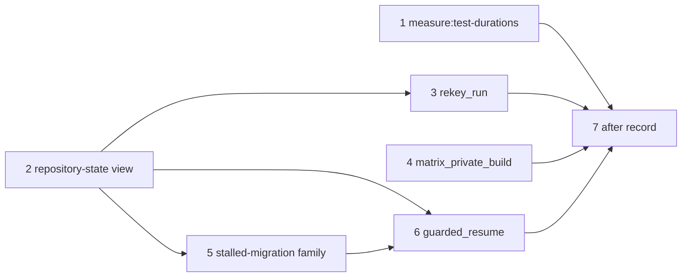

# Shorten the Slowest Tests in the CLI Unit Suite Implementation Plan

## Overview

PP-943 shortens `accelerator-migrate::guarded_resume` and the three tests
that end `test:unit:cli`'s nextest phase. Every target spends its time
spawning `git` and `jj` to rebuild a starting state that is the same on
every pass. The plan builds each state once and copies it:

- **`guarded_resume`** builds the stalled migration once per run, as a new
  shared fixture family.
- **`rekey_run`** builds each test's committed repository once per VCS and
  copies it for each halt point.
- **`matrix_private_build`** compares its private build with the matrix the
  run already shares, instead of building a second one.

Each binary's change lands on its own. A new measurement task produces the
figures the work item's criteria judge.

## Current State Analysis

### Baseline record

The baseline record is
`build_2026-11-23T140904Z_engywook_warm-no-op_devtools_isolated`, at
`f253d980e9` (`main` at `4a0579d7cc` plus `meta/` edits only). It ran with
`devtools` host settings, at 24.7% idle load, with the IDE using 208.6
CPU-seconds. Its nextest-phase median is 125.9 s (min 117.2, max 134.3).

The alone runs were `mise run test:unit:cli --filter
'binary_id(<binary>)'`, three per binary, at the same commit.

| Target | Baseline runs 1 / 2 / 3 (s) | Baseline median (s) | Alone median (s) |
|---|---|---|---|
| `guarded_resume` total test-seconds | 212.6 / 197.5 / 192.2 | 197.5 | 108.8 |
| `guarded_resume` slowest test | 29.4 / 28.2 / 27.0 | 28.2 | 13.6 |
| `matrix_private_build` | 35.5 / 29.6 / 33.2 | 33.2 | 7.5 |
| `rekey_run` kill test | 23.8 / 20.7 / 23.3 | 23.3 | 11.6 |
| `rekey_run` edit-refusal test | 17.9 / 16.0 / 18.1 | 17.9 | 6.6 |

In all three runs, the last three to finish were the edit-refusal test, the
kill test and `matrix_private_build`, at completion positions 8267–8269.

Per `guarded_resume` test (s, baseline median / alone median):

| Test | Baseline | Alone |
|---|---|---|
| `moving_onto_new_parents_starts_a_fresh_jj_run` | 28.2 | 13.6 |
| `rewriting_or_rebasing_the_parent_makes_a_jj_stall_stale` | 21.1 | 11.9 |
| `a_clean_jj_run_records_the_parents_of_the_working_copy` | 21.1 | 11.3 |
| `a_stall_recorded_before_the_upgrade_is_refused_until_its_output_is_committed` | 19.7 | 10.5 |
| `a_stall_on_a_merge_resumes_until_one_parent_is_rewritten` | 18.2 | 9.9 |
| `a_jj_stall_resumes_across_jj_status` | 18.0 | 10.1 |
| `a_jj_stall_resumes_across_owned_edits_and_describing_the_working_copy` | 17.9 | 10.0 |
| `a_manifested_path_edited_on_a_new_change_with_the_same_parent_is_unowned` | 16.5 | 8.9 |
| `editing_a_sibling_lists_its_changes_as_unowned` | 15.7 | 8.8 |
| `a_jj_refusal_lists_only_the_current_runs_unowned_changes` | 13.5 | 7.7 |
| `an_unreadable_jj_working_copy_is_warned_about_and_treated_as_clean` | 3.2 | 2.6 |
| `force_over_an_unreadable_jj_working_copy_records_no_run_base` | 2.9 | 2.4 |
| `a_git_stall_resumes_after_writing_its_named_decisions_file` | 2.2 | 2.1 |

### Targets after the author review

The half-ratio rule put four targets under review. On 2026-11-23 the author
kept the 20 s ceiling and both `rekey_run` halving targets. The
`matrix_private_build` target moved to its own work, and the work item's
**Tail-test timing** criterion now carries the revision.

| Target | Threshold |
|---|---|
| `guarded_resume` total test-seconds, plus the stalled-migration family's build time | ≤ half the before median (≈ 98.75 s) |
| Each `guarded_resume` test | < 20 s |
| `rekey_run` kill test | ≤ half the before median (≈ 11.65 s) |
| `rekey_run` edit-refusal test, over 14 halt points instead of 13 | ≤ half the before median (≈ 8.95 s) |
| `matrix_private_build` alone median | ≤ 3.75 s |
| `matrix_private_build` under the suite | ≤ 33.2 s |

**How the oracle tests count.** The work item charges a state-equality
test to "the figure of the target tests whose state it checks".
`guarded_resume`'s two oracle tests check the stall that every jj scenario
uses. They count in full towards the binary's total test-seconds. Under
the 20 s ceiling, each oracle test is one of the binary's tests and must
itself be under 20 s. Its duration is not added to each scenario's: the
ceiling bounds "the largest of its tests' durations", and charging one
shared check to ten scenarios would count it ten times. The author agreed
this on 2026-11-23.

A halving threshold is half the before median at the precision
`measure:test-durations` prints, never rounded up. The approximate values
above are halves of the 0.1 s figures in the baseline table.

`matrix_private_build`'s alone figure is read from its `PASS` lines. After
phase 4, a filtered alone run builds the matrix in the build step instead
of inside the test; the plan records that build time beside the figure and
does not add it in. Under the full suite the matrix is built for nine
other consumers anyway. The author agreed this on 2026-11-23.

### What the code does now

- **`guarded_resume`** (`cli/migrate-cli/tests/guarded_resume.rs`):
  `Stalled::on` (`:144-180`) runs 7 `jj` calls and 1 migrate run, then
  asserts a stall. It runs 26 times and makes only 4 distinct states:
  `SingleParent` or `MergeWithSibling`, under `--no-colocate` or
  `--colocate`. Tests 1–3 (`:17`, `:79`, `:108`) build their own state and
  do not use it.
- **`rekey_run`** (`cli/work-adapters/tests/rekey_run.rs:860-978`):
  `committed(vcs)` spawns 3–4 processes per pass. The kill test makes 26
  passes and the edit-refusal test 13. Halting and resuming are in-process
  (`InProcessProbe`).
- **The missing halt point:** the edit-refusal test commits
  `meta/notes/synced-only.md`, which adds a rewrite at mutation 8, so its run
  makes 14 mutations. Its loop counts 13 from the four-file corpus, so halt
  13 never runs.
- **`matrix_private_build`**
  (`cli/vcs-test-support/tests/matrix_private_build.rs:49-66`) builds the
  matrix privately, builds it again through `shared_build`, and compares the
  two manifests' `shapes`.

### Constraints found

- **Closed family set:** `Family { Matrix, StatusLog }` is mirrored in Rust,
  Python and `contract/{variables,flags}.json`. Several tests hard-code two
  families: `shared_fixtures_bin.rs:89`, `test_session.py:156-177,227`,
  `test_rust.py:272-279`, `test_log.py:296-320`.
- **Crate boundary:** `vcs-test-support` cannot depend on
  `accelerator-migrate`, because that would make a cycle through
  `vcs-adapters` (`cli/vcs-test-support/Cargo.toml:15-18`). The stall needs
  the migrate binary, so the build step passes the binary's path in.
- **Copy guard:** `tests/unit/tasks/test_fixture_builds.py` refuses
  `copy_part(` outside `copies.rs` and `copy_fidelity.rs`, and
  `Workbench::with(` outside `workbench.rs`, `matrix_private_build.rs` and
  `status_log_parts.rs`.
- **Consumer rules:** consumers are listed per binary (`consumers.py`).
  `_silent_consumers` (`log.py:427-449`) requires each listed binary to use
  the family at least once in a run, not each test.
- **One timing line:** the build step prints one `built in X s` line for
  all families (`session.py:149-152`). The families build on parallel
  threads in one process (`shared_build.rs:93-136`), so Python cannot time
  them apart.
- **No absolute paths:** jj 0.43 records `git_target` as `git`
  (`--no-colocate`) or `../../../.git` (`--colocate`). A grep of both
  colocations found no file naming the repository's absolute path.
  `Hermetic::rooted_at` writes no absolute path into the tree either
  (`hermetic.rs:50-71`).
- **Output:** no fixture output line may match `timeline.NEXTEST_SUMMARY`
  (renamed from `_NEXTEST_SUMMARY` in phase 1) or `_FINISHED_IN`
  (`test_session.py:221-245`, `test_log.py:330-337`).

## Desired End State

- `guarded_resume`'s jj tests copy a stalled migration that the build step
  made once. The binary's test-seconds, plus the family's build time, are
  at most half the before figure, and its slowest test is under 20 s.
- Each `rekey_run` tail test builds one committed template per VCS and
  copies it for each halt point. The edit-refusal test halts at all 14 of
  its mutations.
- `matrix_private_build` makes one private build and compares it with the
  run's shared matrix.
- Each loop over colocations, VCSs or halt points asserts how many
  iterations it completed.
- A test for each reused state shows that a copy matches a state built from
  scratch.
- `mise run measure:test-durations` prints every figure the criteria
  compute.
- The after record and its alone runs are taken, and their figures are
  written into this plan beside their thresholds.

Verify with `mise run` (the bare default task), then the phase 7 checks.

### Key Discoveries

- `copy_part` keeps times to the nanosecond, so git's and jj's stat caches
  read a copy as unchanged (`cli/vcs-test-support/src/copies.rs:69-237`,
  proved by `tests/copy_fidelity.rs:96-169`). Since phase 3 it clones each
  directory whole on macOS.
- `Workbench::writable` already does copy, named-by check and fixture-log
  `copy` event for any `CopyableFamily` (`workbench.rs:179-198,278-308`).
- `States` is the copyable family to mirror: its manifest, `entries`,
  `build_part_privately` and `rebased` are in `status_log.rs:502-701` and
  `status_log_manifest.rs`.
- `UnitListing.executable(name)` already finds a bin target in the cargo
  test-build output (`tasks/test/cli.py:289-304`). It finds
  `accelerator-migrate` the same way it finds `shared-fixtures`.
- `mutations_of_a_whole_run` counts mutations with the scripted probe,
  because the corpus status is always `Clean` (`support/mod.rs:487`). A
  variant that seeds extra files counts the five-file corpus correctly.
- The stall leaves migrated files unsnapshotted on disk. Any jj read the
  equality projection makes must pass `--ignore-working-copy`, or it would
  snapshot them and change the state it reads.
- **Alone runs are parallel.** A filtered run still runs the binary's
  tests 16 at a time, and they slow each other 2.4–7×. Phase 3's tests
  took 0.2–1.4 s each on one thread and 1.5–3.4 s on sixteen. A step
  timed on its own undercounts its cost in an alone run.
- **`fsync` serialises tests.** `store`'s atomic writes call
  `File::sync_all` twice each, which on macOS is `F_FULLFSYNC`, a full
  drive flush. It was 57.6% of a `rekey_run` pass, and parallel tests
  queue behind each other's flushes. Migrate writes through the same
  `store` crate.
- **Copies cost per entry.** Once the syncs were gone, copying a template
  and removing its tempdir were 84% of a pass under 16 threads. Fewer
  entries, or a whole-directory clone, is what makes a copy cheap.

## What We're NOT Doing

- Changing nextest's scheduling, test-threads, priorities or binary order,
  although the tail tests start 94–122 s into the phase.
- Splitting tests to shorten them. No target test is split or merged, so
  the **Split tests** and **Merged tests** criteria do not apply.
- Using scoped threads inside `Matrix::build_with`, which PP-957 held in
  reserve. The stalled-migration family's own per-stall threads are a
  separate case, which phase 5 adds.
- Redesigning the shared helpers or `shared_build` beyond what each
  approach needs.
- Changing `guarded_resume` tests 1–3, which do not use `Stalled::on`.
- Moving `preflight_vcs_parity.rs`'s string-array `COLOCATIONS` onto
  `JjColocation`. It is not a target, and a follow-up can unify it.
- Adding a nextest setup script, a dependency task, or any cache that
  survives between runs.

## Implementation Approach



Phases 3, 4 and 6 are the three binaries' landing commits, and none
depends on another. Everything two of them share (`each_of`,
`copy_private_tree`, `JjColocation`, `RepositoryState`) lands in phase 2.
Phases 1, 2 and 5 add capabilities that nothing consumes until a later
phase, so each merges alone with the suite green.
Every behaviour change starts with a failing test.

Do not merge any phase into `main` while PP-958 has a before or after
record outstanding: a new builder or test binary changes the compile units
it counts.

---

## Phase 1: Per-test duration figures

### Overview

Add `measure:test-durations`, which reads nextest `PASS` lines from a
`measure:build` record's kept logs, or from alone-run logs, and prints the
figures the PP-943 criteria compute. The phase changes no Rust.

**Landed** in changes `unnvyztl` (the log parser) and `vxwmnlwm` (the
task), with the full `mise run` green. Over the reference record it gives
228.6 s and 34.7 s, the work item's figures.

### Changes Required

#### 1. Log parsing and figures

**File**: `tasks/shared/build_measurement/test_durations.py` (new)
**Changes**: A pure module, with no I/O beyond what it is given.

```python
@dataclass(frozen=True)
class TestId:
    binary: str
    test: str


@dataclass(frozen=True)
class PassedTest:
    id: TestId
    seconds: float
    position: int
    finished_at: float | None


@dataclass(frozen=True)
class RunFigure:
    per_run: Sequence[float | None]
    median: float
    missing_from: Sequence[int]


@dataclass(frozen=True)
class TimedRun:
    passes: Mapping[TestId, PassedTest]
    phase_seconds: float | None
    phase_end: float | None
    family_builds: Mapping[Family, float]

    @classmethod
    def parse(cls, lines: Iterable[StampedLine]) -> "TimedRun": ...

    @classmethod
    def parse_unstamped(cls, text: str) -> "TimedRun": ...

    def last_finishers(self, count: int) -> list[PassedTest]: ...


@dataclass(frozen=True)
class DurationFigures:
    runs: Sequence[TimedRun]

    charges: Sequence[Charge] = ()
    served_by: Mapping[str, Family] = field(default_factory=dict)

    def per_test(self, binary: str) -> Mapping[TestId, RunFigure]: ...
    def binary_seconds(self, binary: str) -> RunFigure: ...
    def slowest_test(self, binary: str) -> tuple[TestId, RunFigure]: ...
    def family_build(self, family: Family) -> RunFigure: ...


@dataclass(frozen=True)
class Charge:
    checker: TestId
    target: TestId

    @classmethod
    def parse(cls, text: str) -> "Charge": ...
```

- **Charges:** each `Charge` adds the checker test's duration to the
  target test's within each run, before any median. `per_test` and
  `slowest_test` report charged figures.
- **Families served:** `served_by` maps a binary to the family whose build
  it is charged with. `binary_seconds` adds that family's build time to
  the binary's test-seconds within each run, then takes the median, as
  the work item combines figures.

- **Two entry points, one line reader:** `parse` takes the `StampedLine`s
  that `timeline.read_stamped` produces from a record's logs, and
  `parse_unstamped` takes an alone-run log's text. Both strip ANSI codes
  (`timeline.ANSI_CSI`, promoted from `_ANSI_CSI`) and an optional
  `[task]` prefix, so an alone log reads whether or not `mise` prefixed
  it. The phase line is matched by `timeline._NEXTEST_SUMMARY`, promoted
  to the public `NEXTEST_SUMMARY`. Medians come from
  `tasks.shared.measurement.median`.
- **Pass-like statuses:** `PASS`, `TRY n PASS` and `LEAK` count as passes,
  whatever the padding nextest gives the duration and counter fields.
  `FAIL`, `TRY n FAIL`, `SLOW` and `SIGTERM` lines are not passes.
- **Final attempt:** a later pass line for the same `(binary, test)`
  replaces an earlier one, which covers nextest's retries.
- **Combining:** a figure is combined within each run first, then the
  median is taken across runs. `RunFigure` holds each run's value and the
  median. A test missing from some runs takes its median over the runs
  that have it, and `RunFigure` names the runs it is missing from.
- **Alone logs** carry no timestamp prefix, so `finished_at` is `None` and
  `last_finishers` orders by completion position only.
- **Family builds** are read from the per-family build lines that phase 5
  adds (`shared VCS fixtures: <heading> built in X s`, for example
  `stalled-migration set built in 2.4 s`), with or without a stamp
  prefix. The heading is mapped back to its `families.Family` through
  `Family.heading`, so `family_builds` is keyed by family, and callers
  name a family by its name (`stalled-migration`). Before phase 5 the
  mapping is empty.
- **`TestId`** is not a pytest test class. Its name begins with `Test`,
  so it sets `__test__ = False`.

**File**: `tasks/shared/build_measurement/timeline.py`
**Changes**: Rename `_NEXTEST_SUMMARY` to `NEXTEST_SUMMARY` and `_ANSI_CSI`
to `ANSI_CSI`, and update their readers, including `test_session.py` and
`test_log.py`.

#### 2. The task

**File**: `tasks/measure.py`
**Changes**: Add `per_test_durations(context, record: str | None = None, log:
list[str] | None = None, binary: list[str] | None = None, charge:
list[str] | None = None, served_by: list[str] | None = None)`, declared
with `name="test-durations"`, `iterable=["log", "binary", "charge",
"served_by"]` and a `help` entry per option, as `compare_builds` is. The
function's name avoids a `test_` prefix, which ruff and pytest read as a
test.

- `--record <run-id>` reads `run-*-test_unit_cli.log` under
  `.accelerator-measure/build/<run-id>/`.
- `--log <path or glob>` (repeatable) reads alone-run logs instead.
- `--binary <id>` (repeatable) selects the binaries.
- `--charge '<binary> <checker>=<binary> <target>'` (repeatable), each
  test named as nextest prints it, adds the checker test's
  duration to the target test's in each run, before the median. This
  applies the work item's rule that a state-equality test counts towards
  the figure of the target tests whose state it checks.
- `--served-by <binary>=<family>` (repeatable) adds the build time of the
  family named `<family>` to the binary's test-seconds in each run, before
  the median. It fills `DurationFigures.served_by`.

For each binary it prints:

- every test's per-run durations and median;
- the total test-seconds and slowest test;
- each family's build time, when present;
- for a record, each run's last three finishers and the phase end.

Refuse when:

- no `--binary` is named, or both or neither of `--record` and `--log`;
- a record or `--log` path matches no file;
- a named binary has no pass line;
- a `--charge` or `--served-by` value lacks `=`;
- a charge names a test with no pass line;
- `--served-by` names an unknown family, or a family with no build line.

**File**: `mise.toml`
**Changes**: Register `[tasks."measure:test-durations"]` beside
`measure:compare-builds`, with a `description` in the same style and
`depends = ["deps:install:python"]`.

**File**: `tasks/README.md`
**Changes**: Document the task under the measure namespace, with the alone
run command it pairs with.

### Tests (written first)

**File**: `tests/unit/tasks/shared/build_measurement/test_test_durations.py`

- A record line `9.73 [test:unit:cli]         PASS [   0.014s] (   1/8113)
  a b`, with nextest's real padding, parses into binary, test, duration,
  position and stamp.
- An alone line without the stamp prefix parses with `finished_at` `None`.
- `TRY 2 PASS` and `LEAK` lines count as passes. `FAIL`, `TRY 1 FAIL`,
  `SLOW` and `SIGTERM` lines do not.
- A retried test keeps its final attempt's duration.
- The `Summary [ 126.068s]` line gives the phase duration and end.
- `binary_seconds` sums each run first, then takes the median.
- A charge adds the checker's duration to the target's in each run, then
  takes the median. A charge naming a test with no pass line is refused,
  and `Charge.parse` refuses text without `=`.
- A served family's build time is added to the binary's test-seconds in
  each run before the median. Over three runs where the median of sums
  differs from the sum of medians, the figure is the median of sums.
- A test missing from one of three runs takes the median of the other two,
  and its figure names the missing run.
- `last_finishers(3)` returns the three highest completion positions.
- A `shared VCS fixtures: status-log set built in 2.4 s` line gives the
  `Family.STATUS_LOG` build, with and without a stamp prefix, and the
  combined `built in … digested in …` line names no family. `family_build`
  takes the median across runs. Phase 5 adds the stalled-migration case.
- A golden test over three trimmed logs copied from the baseline record
  reproduces its medians (197.5 s, 28.2 s, 33.2 s, 23.3 s and 17.9 s) and
  each binary's pass-line count per run.

**File**: `tests/unit/tasks/test_measure.py`

- The task refuses an unknown run ID, a `--log` that matches no file, a
  binary with no pass line, a `--charge` or `--served-by` value without
  `=`, and a `--served-by` family that is unknown or has no build line.
- Over a small fixture record with a status-log build line, the task run
  with one `--charge` and one `--served-by <binary>=status-log` prints the
  charged test figure and the binary's figure with the family build added.
  Phase 5 repeats this with `stalled-migration`.
- Over a small fixture record, the task prints each binary's per-test
  medians, total, slowest test and last finishers.

### Success Criteria

#### Automated Verification

- [x] The new tests pass: `mise run test:unit:tasks --filter
      test_durations`
- [x] Build-system checks pass: `mise run build-system:check`
- [x] Over the baseline record, `mise run measure:test-durations --
      --record build_2026-11-23T140904Z_engywook_warm-no-op_devtools_isolated
      --binary accelerator-migrate::guarded_resume --binary
      vcs-test-support::matrix_private_build --binary work-adapters::rekey_run`
      reproduces the Current State tables.
- [x] `mise run` exits 0.

#### Manual Verification

- [x] Over the reference record `build_2026-11-20T130237Z_…`, the output
      matches the work item's reference figures (228.6 s and 34.7 s).

---

## Phase 2: Repository-state view

### Overview

Add the crate's one colocation type, the counted-loop helper `each_of`,
the private-tree copy `copy_private_tree`, and a projection of a
repository's state that two builds of the same script share, whatever
their IDs and times. Phases 3 and 6 use the
projection for their reused-state tests, `each_of` for their loops and
`copy_private_tree` for their templates and oracle prefixes.
Nothing else changes.

**Landed** in changes `ysntqsyx` (`JjColocation`), `qpkmmznu` (`each_of`),
`qvsuxtvl` (`copy_private_tree`), `xlowttwq` (`RepositoryState`),
`tlumpksx` (joined run bases), `znvwzrpz` (file kinds) and `ztuqlvkr` (the
git side), with the full `mise run` green. The sections below describe
what was built. It departs from the reviewed plan in six ways:

- **Refusal message:** `TreeCopy::require_clean(copied, source)` replaces
  the free `still_naming(source, named_by)`. `Workbench::copied` and
  `copy_private_tree` both call it, and the workbench's message is
  unchanged.
- **Scan order:** `copy_part` now copies every entry before scanning any.
  A top-level symlink to a later entry failed the scan, because
  `files_naming` follows a root symlink.
- **Readers:** no `git log` or `rev-list` is spawned. The `cat-file
  --batch` session resolves `HEAD` and walks parents itself. The jj
  reader lists `all() ~ root()`, because the root commit has no object in
  the git store.
- **Joined run bases:** the manual check found that migrate writes a
  merge's run base in hash order (`RunBase::from_base_commits`), so a
  masked `+`-joined list compared unequal across two builds about half the
  time. `IdMasking` now orders a joined list by position.
- **Gaps closed after the manual check:** files carry their kind, and git's
  references and index are projected for a colocated jj repository as
  well as a git one. jj bookmarks have their own field.
- **Process budget:** reading git's side costs a `for-each-ref` and an
  `ls-files`. A projection spawns 2 processes for pure jj, 3 for git and
  4 for colocated jj, instead of at most 2.

### Changes Required

#### 1. Colocation

**File**: `cli/vcs-test-support/src/colocation.rs` (new), exported from
`src/lib.rs`

```rust
#[derive(Debug, Clone, Copy, PartialEq, Eq, PartialOrd, Ord)]
pub enum JjColocation {
    Pure,
    Colocated,
}

impl JjColocation {
    pub const ALL: [Self; 2] = [Self::Pure, Self::Colocated];

    pub fn flag(self) -> &'static str { ... }
}
```

`Pure` and `Colocated` follow the crate's existing `jj_main_pure` and
`jj_main_colocated`. `flag()` gives `--no-colocate` or `--colocate`. Phases
2, 5 and 6 share this one type.

**File**: `cli/vcs-test-support/src/counted.rs` (new), exported from
`src/lib.rs`

```rust
pub fn each_of<T, E>(
    expected: usize,
    items: impl IntoIterator<Item = T>,
    body: impl FnMut(T) -> Result<(), E>,
) -> Result<(), E>
where
    E: From<Error>,
{ ... }
```

`each_of` runs `body` for every item. It fails unless `expected` is
non-zero and exactly `expected` bodies completed. The caller states
`expected` independently of `items`, so a loop that silently runs fewer
iterations, or none, fails. `rekey_run` and `guarded_resume` both use this
one definition.

#### 2. The projection

**File**: `cli/vcs-test-support/src/repository_state.rs` (new), exported
from `src/lib.rs`, with its steps in `repository_state/{order,masking,
reading}.rs`

```rust
#[derive(Debug, Clone, PartialEq, Eq)]
pub struct RepositoryState {
    pub kind: RepositoryKind,
    pub commits: Vec<CommitState>,
    pub bookmarks: BTreeMap<String, CommitPosition>,
    pub git: Option<GitSide>,
    pub working_copy_parents: Vec<CommitPosition>,
    pub working_copy: BTreeMap<String, FileState>,
}

#[derive(Debug, Clone, PartialEq, Eq)]
pub struct GitSide {
    pub references: BTreeMap<String, CommitPosition>,
    pub index: BTreeMap<String, FileState>,
}

#[derive(Debug, Clone, PartialEq, Eq, PartialOrd, Ord)]
pub struct FileState {
    pub kind: FileKind,
    pub content: String,
}

#[derive(Debug, Clone, Copy, PartialEq, Eq, PartialOrd, Ord)]
pub enum FileKind {
    Regular,
    Executable,
    Symlink,
}

#[derive(Debug, Clone, Copy, PartialEq, Eq)]
pub enum RepositoryKind {
    Git,
    Jj(JjColocation),
}

#[derive(Debug, Clone, PartialEq, Eq)]
pub struct CommitState {
    pub position: CommitPosition,
    pub parents: Vec<CommitPosition>,
    pub description: String,
    pub files: BTreeMap<String, FileState>,
}

#[derive(Debug, Clone, Copy, PartialEq, Eq, PartialOrd, Ord)]
pub struct CommitPosition(pub usize);

impl RepositoryState {
    pub fn of(root: &Path, hermetic: &Hermetic) -> Result<Self, Error> { ... }
}
```

The projection covers the following, with `git` and `jj` as each repository
kind needs:

- **Commits:** every visible commit (`jj log -r 'all() ~ root()'`, or
  every commit git's projected references reach), as a position in a total
  topological order. Parents come before children. Ties are broken by
  description, then file tree, then the parents' positions, then the
  sorted names of references pointing at the commit, then whether it is a
  working-copy parent. Commits still indistinguishable after that are
  refused with an error naming them, rather than ordered arbitrarily.
  Each commit carries its parents' positions, description and file tree
  (path to `FileState`).
- **Files:** each `FileState` is `Regular`, `Executable` or `Symlink`,
  with its content, or a symlink's target.
- **Bookmarks:** jj's local bookmarks, each mapped to the position it
  points at.
- **Git side:** for a git repository, or a jj one colocated with git,
  `HEAD`, `refs/heads/*` and `refs/tags/*` by position, and every index
  entry (`path (stage N)` for a conflicted stage). `refs/jj/*` is
  excluded, because jj names those refs after commit hashes. A pure jj
  repository has no git side.
- **Working copy:** the working copy's parents, and every file on disk
  outside `.git`, `.jj` and `hermetic-*` entries.
- **Kind:** jj when `.jj` is a directory, colocated when `.git` exists
  beside it, and git when only `.git` exists. The backing store is read
  from `.jj/repo/store/git_target`.
- **Hidden IDs:** every full commit ID or change ID that appears in a
  file's content, alone or in a `+`-joined list, is replaced with
  `<commit N>` or `<change N>`, and a joined list is ordered by position,
  since migrate orders it by hash. This lets
  `.accelerator/state/migrations-run.id` compare by graph position.
  Abbreviated IDs are not masked, so a file holding one makes two builds
  compare unequal, and fails loudly rather than passing.
- **Excluded:** commit hashes, change IDs, operation IDs and timestamps
  never appear.
- **No snapshot:** every `jj` call passes `--ignore-working-copy`, so
  reading never snapshots the working copy or records an operation.
- **Batched reads:** each projection spawns a fixed number of processes,
  whatever the number of commits: 2 for pure jj, 3 for git and 4 for
  colocated jj. Each per-kind reader is one function in `reading.rs`, so
  a reviewer can check the budget in one place. One `jj log -T` template
  gives every jj commit's IDs, parents, bookmarks and description. Git's
  side adds `git for-each-ref` and `git ls-files --stage`. One
  `git cat-file --batch` session, against the backing git store
  (`.jj/repo/store/git` under `Pure`), resolves `HEAD` and reads every
  commit, tree and blob.

`of` composes three seams, each tested on its own:

- per-kind readers that return raw commits, bookmarks and git side;
- a pure `ordered_positions` step;
- a pure `IdMasking` step.

The pure steps need no `git` or `jj`.

#### 3. Copying a test's own tree

**File**: `cli/vcs-test-support/src/copies.rs`
**Changes**: Add `copy_private_tree`, which copies every top-level entry of
a tree the test built for itself through `copy_entry`, and fails unless the
copy names nothing from the source. `TreeCopy::require_clean` takes over
the error message that `Workbench::copied` built inline, so both callers
share it.

```rust
pub fn copy_private_tree(
    template: &Path,
    destination: &Path,
) -> Result<PathBuf, Error> {
    let entries = top_level_entries(template)?;
    let names: Vec<&str> = entries.iter().map(String::as_str).collect();
    let copy = copy_part(template, &names, destination)?;
    copy.require_clean(
        "the copy",
        format_args!("its template {}", template.display()),
    )?;
    Ok(copy.root)
}
```

**File**: `tests/unit/tasks/test_fixture_builds.py`
**Changes**: Add `copy_private_tree(` to `GUARDED_CALLS`, permitted only in
`cli/vcs-test-support/tests/copies.rs`. Phases 3 and 6 each add the one
consumer file they need. The guard, not a docstring, keeps the unlogged
copy off shared trees.

### Tests (written first)

**File**: `cli/vcs-test-support/tests/repository_state.rs` (new)

- Two builds of the same script, under git, jj pure and jj colocated,
  project equal states, even though their commit IDs differ.
- A state differs when one thing differs, one case each: a description, a
  file's content, a commit's parents, a git ref or `HEAD`, a bookmark, a
  working-copy parent, or the kind.
- A state differs on a file's kind: an executable bit in a commit, one on
  disk only, and a symlink against a file naming its target.
- Git's index: a staged change differs from the same change unstaged.
- A colocated repository projects its git `HEAD`, branches and index, and
  differs when its git `HEAD` or a git-only tag differs from jj's view.
- A file holding a commit ID compares by position: equal across two builds,
  and different when it names a different commit. A `+`-joined pair
  compares equal in either order, and differs when it names a different
  set.
- A `refs/jj/keep/<hash>` ref does not break equality.
- Two sibling commits with equal descriptions and trees, told apart by a
  bookmark, project in the same order across two builds. Two that nothing
  tells apart are refused.
- Reading a jj repository with unsnapshotted edits leaves `jj op log`
  unchanged and still reports the edits in `working_copy`.
- `ordered_positions` and `IdMasking` have unit tests over raw commits,
  with no tools spawned.
- `each_of` fails when fewer or more than `expected` bodies complete,
  when `expected` is 0, and when a body fails. It passes when exactly
  `expected` bodies complete.
- Each tie-break key has its own `ordered_positions` test: two siblings
  that differ only in that key get the same order whichever way the input
  lists them. A further test shows that when two keys disagree, the
  earlier key wins.
- The copy guard's red case: a `copy_private_tree(` call outside the
  permitted files is refused.
- `copies.rs` tests: `copy_private_tree` copies every entry with its times
  and contents, and refuses a template whose file names its own path.

### Success Criteria

#### Automated Verification

- [x] The new tests pass: `mise run test:unit:cli --filter
      'binary_id(vcs-test-support::repository_state)'`, along with the
      crate's unit tests for the pure steps.
- [x] `mise run test:unit:cli --filter 'binary_id(vcs-test-support::copies)'`
      passes.
- [x] `mise run test:unit:tasks --filter test_fixture_builds` passes, with
      `copy_private_tree(` guarded.
- [x] CLI checks pass: `mise run cli:check`
- [x] `mise run` exits 0.

#### Manual Verification

- [x] A reviewer checks the projection's fields against the work item's
      **Reused state** list.

---

## Phase 3: `rekey_run` tail tests

### Overview

Fix the edit-refusal test's missing halt point, build each test's committed
repository once per VCS, and give every halt pass a copy. This is
`rekey_run`'s landing commit.

**Landed** in changes `rpslxtmv` (the halt count), `olroyumo` (counted
loops), `qnwxvnop` (`Committed` and the reused-state tests), `orlqwppk`
(the switch), `xnxxskun` and `xnwoztqo` (unsynced writes), `okymqnny` (the
directory clone) and `mwtvsvpx` (trimmed templates, the landing commit),
with the full `mise run` green at `orlqwppk` and at `mwtvsvpx`. The
projection gate in step 5 passed but was wrong, and the last four changes
are the fix the author chose once alone runs showed it; the sections below
record why. Changes Required items 4–6 were added after review. Two smaller
departures:

- **Halt-count VCSs:** the exact-halt-count test checks the four-file
  corpus under Git and jj and the five-file corpus under Git, the VCSs
  each corpus's tail test uses.
- **Single-VCS loop:** the edit-refusal reused-state test loops
  `each_of(1, [Vcs::Git], …)`, so its one comparison is still counted.

**Profile before switching** (instrumented, alone, sequential):

| Step | Git | jj |
|---|---|---|
| Template build | 51–62 ms | 180–185 ms |
| One copy | 15–16 ms | 26–31 ms |
| Halt and resume, one pass | 122–158 ms | 115–126 ms |
| One projection | 16–17 ms | 26–28 ms |

Over 13 passes, rebuilding took 2.2–3.1 s (Git) and 4.0–6.9 s (jj), and
copying a template took 1.7 s and 2.1–2.3 s.

Projected charged figures, alone cost times the baseline under-suite/alone
ratio: the kill test ≈ (4.2 s + 0.6 s reused) × 2.01 ≈ 9.6 s, against
≤ 11.65 s; the edit-refusal test ≈ (2.25 s + 0.21 s reused) × 2.71 ≈
6.7 s, against ≤ 8.95 s. The ratios are 23.3 / 11.6 (kill), 17.9 / 6.6
(edit-refusal) and 91.3 / 45.4 (`rekey_run` binary-wide, from one alone
run at `olroyumo`'s parent). The reused-state tests take the worse of
their tail test's and the binary-wide ratio.

**The projection missed.** It priced steps timed one after another, but an
alone run still runs the binary's 32 tests in parallel. Three quiet alone
runs at `orlqwppk`, charged, put the kill test at 16.9 s and the
edit-refusal test at 13.0 s, slower than before (10.6 s and 5.5 s).

**Where a pass goes.** A 3 s `sample` of 13 copied passes per VCS, run in
sequence:

| Cause | Share of the test thread |
|---|---|
| `fsync` (`File::sync_all`, `F_FULLFSYNC` on macOS) | 57.6% |
| Copying a template | 16.9% |
| Probe: jj working-copy state | 9.6% |
| Removing tempdirs | 5.7% |

795 of the 892 `fsync` samples are `store::atomic_write`'s two syncs,
reached through `CountingStore`'s `FileCorpusStore`, and 97 are
`store::atomic_create`'s directory sync. A full flush serialises at the
drive, so parallel tests queue behind each other's flushes.

**Unsynced writer.** On 2026-11-23 the author chose a test-side writer.
`UnsyncedStore`, in the work-adapters test support module, replaces
`FileCorpusStore` inside `CountingStore`. It keeps the store's
containment, staging and modes and drops only the syncs: `write` calls
`store::replace_without_sync`, and `create_new` stages and persists without
clobbering. Every test that builds `Ports`, in `rekey_run` and
`rekey_execute`, stops exercising the real synced write path, which
`store` and `corpus-adapters` test themselves. Contract tests run each case
against both stores.

**Contention after the syncs.** On one test thread the edit-refusal test
takes 0.52 s and its reused-state test 0.20 s; on 16 they take 2.7 s and
1.5 s. A `sample` under 16 threads put 58.8% of the test in
`copy_private_tree` and 25.5% in removing tempdirs, both per-entry
filesystem work. The five-file template held 94 entries, 59 of them git's
sample hooks and loose objects.

**Clone and trim.** On 2026-11-23 the author chose both:

- **Directory clone:** `copy_part` clones each top-level directory whole
  with `fclonefileat` on macOS. A clone keeps every entry's contents, mode
  and times except each directory's modification time, which one walk
  restores along with owner write. `EXDEV`, `ENOTSUP` and other platforms
  fall back to copying entry by entry. `vcs-test-support` gains `rustix`.
- **Trimmed templates:** git templates are initialised with `--template=`,
  so they carry no sample hooks, and `Committed::packed` packs a copied
  template's objects (jj's backing store included) with `git repack -a
  -d`.

The fix landed in `xnxxskun` (`UnsyncedStore`), `xnwoztqo` (`CountingStore`
writes unsynced), `okymqnny` (the directory clone) and `mwtvsvpx` (trimmed
templates, now the landing commit), with the full `mise run` green.

Three alone runs at each step, charged (s, median):

| Step | Kill test | Edit-refusal test | Load average |
|---|---|---|---|
| Copies with syncs (`orlqwppk`) | 16.9 | 13.0 | 3–22 |
| Unsynced writes (`xnwoztqo`) | 5.6 | 4.2 | 11–12 |
| Clone and trim (`mwtvsvpx`) | 5.2 | 3.7 | 26–30 |
| Early signal | ≤ 5.8 | ≤ 3.3 | |

### Changes Required

#### 1. Adopting a copy as a `Repo`

**File**: `cli/work-adapters/tests/support/mod.rs`
**Changes**:

- Add `Repo::copy_of(template: &Repo) -> Result<Repo, TestError>`, which
  makes a tempdir, calls `copy_private_tree(template.root(), …)` and wraps
  the tempdir without seeding.
- Add `Repo::seeded_with(seed)`, which runs `new()` and then the seed
  closure.

**File**: `tests/unit/tasks/test_fixture_builds.py`
**Changes**: Permit `copy_private_tree(` in
`cli/work-adapters/tests/support/mod.rs` (written first: the guard goes red
on the new call).

#### 2. The template, halt count and iteration counts

**File**: `cli/work-adapters/tests/rekey_run.rs`
**Changes**:

- `mutations_of_a_whole_run_over(seed)` counts a whole run over
  `Repo::seeded_with(seed)`. `mutations_of_a_whole_run()` becomes
  `…_over(|_| Ok(()))`.
- `struct Committed { template: Repo, env: Hermetic, vcs: Vcs }` replaces
  `committed(vcs)` in the two tail tests:
  - `Committed::build(vcs)` checks the tool version once, then inits and
    commits the four-file corpus with the template's own `Hermetic`.
  - `then_committing(seed)` writes `seed` into the template and commits
    again with that `Hermetic`, keeping the two-commit history the
    edit-refusal test has today.
  - `fresh_copy()` returns `(Repo, Hermetic)`: `Repo::copy_of(&self
    .template)` and `Hermetic::rooted_at(copy.root())`. Rooting rewrites
    the copied `hermetic-*` files with identical content.
- `committed(vcs)` delegates to `Committed::build(vcs)` and still returns
  `(Repo, Hermetic)`, so the init-and-commit sequence lives in one place.
  `discard_refuses_a_committed_half_run` and
  `a_resume_after_a_completed_synced_entry_is_not_refused_as_dirty` keep
  calling `committed(vcs)`. They are not targets.
- `Vcs::ALL: [Vcs; 2]`.
- **Counted loops:** every loop below uses `vcs_test_support::each_of`
  (phase 2).
- **Kill test:** `each_of(Vcs::ALL.len() * halts, …)` over `Vcs::ALL` ×
  `0..halts`, where `halts` is `mutations_of_a_whole_run()`.
- **Edit-refusal test:** builds its template once as
  `Committed::build(Vcs::Git)?.then_committing(seed_synced_only)`, and
  loops `0..mutations_of_a_whole_run_over(seed_synced_only)` (14 halts),
  keeping `checked > 0`. It counts checked and skipped halts apart, and
  asserts that they sum to the halt count. The edit since the halt still
  happens in each pass's copy, after the halt.
- **Exact halt count:** a test pins each count by its boundary.
  `Fault::HaltAt(count - 1)` halts at `count - 1`, and
  `Fault::HaltAt(count)` runs to completion without halting. It runs over
  both the four-file and the five-file corpus, each built as today's tests
  build it (`committed(vcs)`, then for five files a write of `SYNCED_ONLY`
  and `commit_everything`). It catches a count that drifts low, which the
  loops alone cannot. Because it copies nothing, it needs none of this
  phase's new types.

#### 3. Reused-state test

**File**: `cli/work-adapters/tests/rekey_run.rs`
**Changes**: Add one reused-state test per target test, so each test's
duration is charged to the tail test whose state it checks:

- `in_a_real_repository::the_kill_tests_copied_repository_matches_one_built_from_scratch`
  checks the four-file corpus under Git and jj.
- `in_a_real_repository::the_edit_refusal_tests_copied_repository_matches_one_built_from_scratch`
  checks the five-file corpus under Git.

For each corpus, the test compares `RepositoryState::of` a `fresh_copy()`
with that of the same corpus built afresh in its own tempdir:
`Committed::build(vcs)` for the four-file corpus, and
`Committed::build(Vcs::Git)?.then_committing(seed_synced_only)` for the
five-file corpus. It asserts
the five-file projection has two commits, as today's test builds, and
that `each_of` ran two comparisons in the first test and one in the
second.

#### 4. Writing without syncing

**File**: `cli/work-adapters/tests/support/unsynced_store.rs` (new),
declared `pub mod` from `support/mod.rs`
**Changes**: `UnsyncedStore` implements `AtomicWrite`, `ExclusiveCreate`
and `FileRemove` as `FileCorpusStore` does, without syncing. `write` calls
`store::replace_without_sync`; `create_new` checks containment with
`store::ensure_contained`, stages a `kernel::TEMP_PREFIX` temporary and
persists it without clobbering; `remove` delegates to `FileCorpusStore`.
`CountingStore` wraps it in place of `FileCorpusStore`, so `rekey_run` and
`rekey_execute` both write unsynced. `FileRecoveryCopies` and `Repo::new`'s
baseline write still sync; neither showed in the profile.

#### 5. Cloning whole directories

**File**: `cli/vcs-test-support/src/copies.rs`, `Cargo.toml`
**Changes**: `copy_entry` tries `cloned_whole` for a directory: on macOS,
`rustix::fs::fclonefileat` with `CloneFlags::NOFOLLOW`. On success,
`restore_what_a_clone_drops` walks the copy once, restoring each
directory's times from its source and adding owner write where the source
lacked it. `EXDEV` and `ENOTSUP`, and every other platform, fall back to
the per-entry copy. Any other error fails the copy. The change reaches
every `copy_part` caller, including `Workbench::writable` and phase 6's
stall copies.

#### 6. Trimmed templates

**File**: `cli/work-adapters/tests/rekey_run.rs`
**Changes**: `Committed::build` initialises git with `--template=`, so a
template has no sample hooks. `Committed::packed` runs `git repack -a -d
-q` against `.git`, or `.jj/repo/store/git` for jj; every template a test
copies, and every reused-state build, is packed. `git repack -a -d` keeps
every object a ref reaches, jj's `refs/jj/keep/*` included, and leaves
unreachable loose objects alone.

### Tests (written first, in this order)

1. The copy guard goes red on `Repo::copy_of`'s call until the support
   module is permitted.
2. The exact-halt-count test, over corpora built the way today's tests
   build them. For the five-file corpus it is red against today's count:
   `HaltAt(13)` halts at 13 instead of completing. It goes green when
   `mutations_of_a_whole_run_over` exists.
3. The `each_of` loops in both tail tests.
4. The reused-state tests. They fail until `Repo::copy_of` exists.
5. **Profile before switching:** in a scratch run, time `committed(vcs)`,
   one copy, and the halt-and-resume part of one pass. Project each tail
   test's charged figure from them: template builds, plus N × (copy +
   in-process pass), plus its reused-state test's estimated cost. Scale
   the tail test's own work by the baseline's under-suite/alone ratio for
   that test. Scale the reused-state test by the worse of that ratio and
   `rekey_run`'s binary-wide ratio, since it may run earlier, under
   heavier load. Record the ratios used. If either projection exceeds its
   threshold, stop and revisit the approach with the author.
6. Then switch both tail tests to `Committed`, keeping their assertions
   word for word.
7. **Added after review:** `UnsyncedStore`'s eight contract tests, each
   run against `FileCorpusStore` too, red until the type existed. The
   switch of `CountingStore` onto it was a refactor under the green suite.
8. **Added after review:** a bare directory clone turned the existing
   `copies` and `copy_fidelity` tests red (directory times, sealed
   directories); the restore walk turned them green. Trimming the
   templates was a refactor under the green reused-state tests.

### Test mapping

All 29 tests in `work-adapters::rekey_run` keep their names, and 11 are
added, for 40. The table lists only those that change.

| Before test | Successor | Assertions |
|---|---|---|
| `…::a_run_killed_at_every_write_resumes_over_its_own_writes` | same name | `Rekeyed` per VCS × halt, unchanged; adds the pass count |
| `…::a_resume_refuses_an_edit_since_the_halt_to_a_path_not_yet_written` | same name | `DirtyWorkingCopy([SYNCED_ONLY])` per checked halt and `checked > 0`, unchanged; adds the halt count; halts at 14 points instead of 13 |
| none | `…::a_whole_run_makes_exactly_the_counted_mutations` | new; halts at `count - 1` and completes under `HaltAt(count)`, for both corpora |
| none | `…::the_kill_tests_copied_repository_matches_one_built_from_scratch` | new; Git and jj four-file states equal; charged to the kill test |
| none | `…::the_edit_refusal_tests_copied_repository_matches_one_built_from_scratch` | new; Git five-file state equal, two commits; charged to the edit-refusal test |
| none | eight `an_unsynced_store_writes_as_the_file_store_does::…` tests | new; each case passes for `FileCorpusStore` and `UnsyncedStore` alike |

### Success Criteria

#### Automated Verification

- [x] `mise run test:unit:cli --filter 'binary_id(work-adapters::rekey_run)'`
      passes.
- [x] `mise run test:unit:tasks --filter test_fixture_builds` passes, with
      `copy_private_tree(` permitted in the support module.
- [x] `mise run` exits 0 at the landing commit, which is recorded under
      Recorded Figures.

#### Manual Verification

- [x] Three alone runs of `work-adapters::rekey_run`, with each
      reused-state test charged to its tail test, show the kill test at or
      under 5.8 s and the edit-refusal test at or under 3.3 s. This is an
      early signal, not a criterion. At `mwtvsvpx` the kill test met it
      (5.2 s) and the edit-refusal test missed it (3.7 s). On 2026-11-23
      the author accepted the miss: phase 7's under-suite figure, against
      ≤ 8.95 s, decides the target.

---

## Phase 4: `matrix_private_build`

### Overview

Compare the private build with the matrix the run shares, falling back to
an in-process `shared_build` when the run hands none over. This is the
binary's landing commit.

**Landed** in change `mvpknsxp`, with the full `mise run` green. Two
departures:

- **Boxed workbench:** `SharedMatrix::Adopted` holds a `Box<Workbench>`,
  because clippy's `large_enum_variant` refuses a 320-byte variant beside a
  24-byte one.
- **Fixture-log doubles:** `test_log.py`'s `MATRIX_CONSUMERS` and the
  adoption counts in `test_session.py` and `test_rust.py` name five matrix
  consumers. The torn-line test derives its line number from the clean
  run's length instead of a literal.

Under the full suite at the landing commit it took 19.0 s (one run,
against a 33.2 s baseline median).

### Changes Required

#### 1. The test

**File**: `cli/vcs-test-support/tests/matrix_private_build.rs`
**Changes**:

```rust
enum SharedMatrix {
    Adopted(Box<Workbench>),
    Built(TempDir),
}

impl SharedMatrix {
    fn for_this_run() -> Result<Self, TestError> {
        let handover = Handover::from_environment();
        if handover.shared_tree(Family::Matrix).is_some() {
            Ok(Self::Adopted(Box::new(Workbench::with(handover)?)))
        } else {
            Ok(Self::Built(tempfile::tempdir()?))
        }
    }

    fn shapes(&self) -> Result<Vec<(String, String, PathBuf)>, TestError> {
        match self {
            Self::Adopted(run) => shapes(&*run.matrix()?),
            Self::Built(directory) => shapes(&shared_build(directory.path())?),
        }
    }
}

#[test]
fn a_workbench_handed_no_matrix_builds_the_one_a_run_would_share(
) -> Result<(), TestError> {
    let directory = tempfile::tempdir()?;
    let log = directory.path().join("private.jsonl");
    let workbench = Workbench::with(Handover {
        log: FixtureLog::at(&log),
        ..Handover::nothing()
    })?;
    let shared = SharedMatrix::for_this_run()?;

    let private = workbench.matrix()?;

    assert_eq!(shapes(&private)?, shared.shapes()?);
    let recorded = events(&log)?;
    assert_eq!(recorded.len(), 1);
    assert_eq!(recorded[0]["event"], "private-build");
    assert_eq!(recorded[0]["fixtures"], "matrix");
    Ok(())
}
```

#### 2. Registering the consumer

**File**: `tasks/shared/shared_fixtures/consumers.py`
**Changes**: Add `"vcs-test-support::matrix_private_build": _MATRIX`, so a
filtered run builds the matrix for it and the log rules accept its
adoption.

**File**: `tests/unit/tasks/shared/shared_fixtures/test_consumers.py`
**Changes**: Add the binary to the exact matrix-consumer set (written first;
red until `consumers.py` changes).

**File**: `tasks/README.md`
**Changes**: Name the binary where the matrix's consumers are described.

**Files**: `tests/unit/tasks/shared/shared_fixtures/test_log.py`,
`test_session.py`, `tests/unit/tasks/test_rust.py`
**Changes** (found by the first full `mise run`): `MATRIX_CONSUMERS` gains
the binary, and the expected summaries count five matrix adoptions instead
of four. `test_a_line_that_does_not_parse_is_named_by_number` takes its
line number from the clean run's length, so a new consumer no longer
moves it.

`matrix_private_build.rs` already permits `Workbench::with(`, and
`Workbench::with(Handover::from_environment())` is what `for_this_test`
does.

**Accepted gap:** once the binary is a registered consumer, every `mise
run` lane hands the matrix over, so the `Built` arm runs only under a
direct `cargo nextest run`. Making it run in CI would mean building a second
matrix in every run, which is the cost this phase removes. The success
criteria run the direct form once at landing.

### Test mapping

| Before test | Successor | Assertions |
|---|---|---|
| `a_workbench_handed_no_matrix_builds_the_one_a_run_would_share` | same name | private shapes equal shared shapes; exactly one `private-build` event for `matrix`; unchanged |

### Success Criteria

#### Automated Verification

- [x] `mise run test:unit:cli --filter
      'binary_id(vcs-test-support::matrix_private_build)'` passes, and the
      fixture log shows one adoption by this binary.
- [x] `cargo nextest run --manifest-path cli/Cargo.toml -p vcs-test-support
      --test matrix_private_build` passes through the fallback.
- [x] `mise run test:unit:tasks --filter test_consumers` passes.
- [x] `mise run` exits 0 at the landing commit.

#### Manual Verification

- [x] Three alone runs put the median at or under 3.75 s. At
      `mvpknsxp` they took 3.5 / 3.3 / 3.7 s (median 3.5 s), with the
      build step's matrix build at 3.5 / 3.4 / 3.7 s beside them, at load
      averages of 17–26.

---

## Phase 5: Stalled-migration shared family

### Overview

Add a third copyable family, `stalled-migration`, that the build step makes
once per run. It has four parts: `SingleParent` and `MergeWithSibling`
under each colocation. The build step gives each family its own timing
line. No test consumes the family yet, and `consumers.py` lists no consumer
for it, so the step builds it only in unfiltered runs. That costs one build
per run until phase 6.

**Landed** in changes `rynwpwmz` (build inputs), `wskrlqzk` (per-family
timing), `tvyxyqml` (the corpus move) and `vousnyqr` (the family), with the
full `mise run` green. Under the full suite the set built in 1.7–1.8 s. Four
departures:

- **Corpus imports:** `common/mod.rs` does not re-export the moved corpus.
  `common` is compiled into each migrate test binary, and a re-export one
  binary leaves unused fails `unused_imports`, so `guarded_resume` imports
  `vcs_test_support::stalled_migration::corpus` itself.
- **Builder-binary tests:** the missing-variable and failing-stub cases
  drive the `shared-fixtures` binary from `shared_fixtures_bin.rs`, because
  `inputs_from_environment` reads the process environment.
- **Stall directories:** each stall lives at `<tree>/<key>`, named by
  `StallKey`'s `Display` (`pure-single-parent` and so on), and the manifest
  parses keys back through `FromStr`.
- **Coverage:** the stalls' migrate runs inherit the builder's
  `LLVM_PROFILE_FILE`, because `Hermetic::apply` clears no variable, so
  `cli.py` needed no coverage change. A held instrumented run found no
  `.profraw` file in the stalled-migration tree.

### Changes Required

#### 1. The family in Rust

**File**: `cli/vcs-test-support/src/stalled_migration.rs` (new), mirroring
`status_log.rs:502-701`

```rust
pub struct StalledMigrations {
    base: PathBuf,
    stalls: BTreeMap<StallKey, Stall>,
}

#[derive(Debug, Clone)]
pub struct Stall {
    pub root: PathBuf,
    pub base: String,
    pub sibling: String,
}

#[derive(Debug, Clone, Copy, PartialEq, Eq, PartialOrd, Ord)]
pub enum ParentShape {
    SingleParent,
    MergeWithSibling,
}

impl ParentShape {
    pub const ALL: [Self; 2] = [Self::SingleParent, Self::MergeWithSibling];
}

#[derive(Debug, Clone, Copy, PartialEq, Eq, PartialOrd, Ord)]
pub struct StallKey {
    pub colocation: JjColocation,
    pub shape: ParentShape,
}

#[derive(Debug, Clone, PartialEq, Eq)]
pub struct MigrateBinary(pub PathBuf);
```

`StalledMigrations` is `SharedFamily<Inputs = MigrateBinary>` and
`CopyableFamily<Part = StallKey>`. A part names a stall and nothing more.

- **The stall:** `pub(crate) Stall::build(key, directory, hermetic,
  &MigrateBinary)`, crate-private like the other families' builders,
  repeats `Stalled::on`'s steps:
  1. `jj git init`;
  2. seed the corpus;
  3. `jj commit -m corpus`;
  4. read `base`;
  5. `jj describe -m sibling`, then write `meta/sibling.md`;
  6. read `sibling`;
  7. `jj new` onto the shape's parents;
  8. run `migrate` with stdin null, `ACCELERATOR_LOG=warn` and the force
     and decisions variables removed;
  9. require exit 1 and `MIGRATION STALLED` on stderr. Otherwise fail with
     an error naming the family, the stall key, migrate's exit code and
     its stderr. The error also says that `cargo nextest run -p
     accelerator-migrate --test guarded_resume` reproduces it.
- **Failing fast:** a stall that fails to build aborts the whole
  `test:unit:cli` run before nextest starts, as a matrix or status-log
  failure does. A change that stops migrate stalling on this corpus
  therefore fails every crate's run, not only `guarded_resume`. That is an
  accepted tradeoff. Withholding just this family's handover would need a
  degraded mode in the generic build step and new fixture-log rules, and
  the error above names the cause directly.
- **The corpus** moves from `migrate-cli/tests/common/mod.rs` into the
  submodule `stalled_migration::corpus`:
  `seed_output_then_ambiguous_reference`, `OWNED_NOTE`, the ledger and
  `work_item`. Only the family and migrate's tests import it.
  `common/mod.rs` re-exports what `guarded_resume` and the other migrate
  tests still use.
- **The migrate invocation:** `stalled_migration::corpus::migrate_command(
  migrate, root, hermetic)` is the base invocation a stall needs: stdin
  null, `ACCELERATOR_LOG=warn`, and the force and decisions variables
  removed. `Stall::build` uses it. `common::run` starts from it and keeps
  its own extra variables and `Outcome` decoding in `migrate-cli`. All 11
  migrate test binaries therefore take their base invocation from
  `vcs-test-support`. That is accepted, because it keeps the stall and the
  tests running migrate the same way, and a new variable to strip changes
  one place.
- **Why here:** `vcs-test-support` now holds migrate's corpus and its stall
  contract (exit 1, `MIGRATION STALLED`). The alternative, a second builder
  binary owned by `migrate-cli`, would keep the crate VCS-only, but it would
  give the build step two builders to locate, run and judge. One builder
  is the simpler build step, and `stalled_migration::corpus` keeps the
  migrate knowledge in one named place.
- **The manifest:** `StalledMigrationManifest` (new
  `stalled_migration_manifest.rs`) writes `stalled-migrations.tsv` with
  `key\tpath\tbase\tsibling` lines. `base` and `sibling` are change IDs,
  which a copy keeps.
- **The family:** `impl SharedFamily` (`adopt` reads the manifest;
  `build_privately` builds all four stalls) and `impl CopyableFamily`
  (`entries` returns the part's directory; `build_part_privately` builds
  one stall; `rebased` keeps the copied stalls).
- `build_for_sharing(tree, &MigrateBinary)` and the whole-family
  `build_privately` build the four stalls on `std::thread::scope`, one
  thread per `StallKey`. The stalls are independent repositories, and they
  build before nextest starts, while CPUs are free. A failing stall fails
  the build after the others finish, and its error names its key.

**File**: `cli/vcs-test-support/src/family.rs`
**Changes**:

- Add `Family::StalledMigration`, with `ALL: [Self; 3]` and traits: name
  `stalled-migration`, `ACCELERATOR_SHARED_STALLED_MIGRATION`,
  `--stalled-migration`, noun `the stalled-migration set`.
- `SharedFamily` gains `type Inputs`, the build inputs a family needs
  beyond a directory and a hermetic environment. The new signatures keep
  the `PrivateBuild` token, which stops code outside the crate calling a
  private build:
  - `build_privately(directory, hermetic, inputs: &Self::Inputs, token:
    PrivateBuild)`;
  - `build_part_privately(part, directory, hermetic, inputs:
    &Self::Inputs, token: PrivateBuild)`.
- `Matrix` and `States` declare `type Inputs = ()`, and their call sites
  pass `&()`.
- `SharedFamily` gains `fn inputs_from_environment() -> Result<Self::Inputs,
  Error>`, which the build step calls for each requested family.
  `Matrix` and `States` return `Ok(())`. `StalledMigrations` reads
  `ACCELERATOR_SHARED_FIXTURES_MIGRATE`, and fails with `building the
  stalled-migration set needs ACCELERATOR_SHARED_FIXTURES_MIGRATE` when it
  is missing. The family that needs an input owns how it is read.

**File**: `cli/vcs-test-support/tests/workbench.rs`
**Changes**: The test family `Marked` (`:39-108`) declares `type Inputs =
()`, takes `&()` in both build methods, and returns `Ok(())` from
`inputs_from_environment`. A second test family, `MarkedWith`, declares a
non-unit `Inputs`, to exercise `writable_with`.

**File**: `cli/vcs-test-support/src/shared_build.rs`
**Changes**:

- `SharedBuildRequest` is unchanged, so its struct literals in
  `tests/shared_build.rs:22` and `tests/matrix_private_build.rs:33` keep
  compiling.
- Each family's dispatch arm resolves its inputs through
  `inputs_from_environment` before building. A failure there fails the
  build with the family's own message.
- Each family's thread times its build, and `Event::SharedBuild` gains
  `seconds: f64`.

**File**: `cli/vcs-test-support/src/workbench.rs`
**Changes**:

- `shared::<F>()` and `writable::<F>(part)` gain an `Inputs = ()` bound and
  keep their parameters: `shared::<F: SharedFamily<Inputs = ()>>()` and
  `writable::<F: CopyableFamily + SharedFamily<Inputs = ()>>(part)`.
  Existing call sites compile unchanged.
- `writable_with::<F>(part, &F::Inputs)` serves families that need inputs.
  It copies from the handed tree exactly as `writable` does, and passes the
  inputs only to a private build.
- `writable_stalled_migrations(key, &MigrateBinary)` returns
  `Held<'_, StalledMigrations>`, like `writable_status_log_states`.
  `StalledMigrations::stall(key) -> Result<&Stall, Error>` looks up a
  stall, and names the key when the set holds no stall for it, as
  `States::get` does. Its paths cannot outlive the workbench that holds
  them.

**File**: `cli/vcs-test-support/tests/fixtures/shared_fixtures.rs`
**Changes**: Name the migrate variable in the usage line.

**Files**: `cli/vcs-test-support/contract/{variables,flags}.json`,
`contract/fixture-log.jsonl`
**Changes**: Add the family's variable and flag, and `seconds` on the
`shared-build` line. `variables.json` gains an `executables` key mapping
each family to the executables its build needs:
`{"stalled-migration": {"ACCELERATOR_SHARED_FIXTURES_MIGRATE":
"accelerator-migrate"}}`. Rust's `inputs_from_environment` and Python's
per-family declaration are both checked against it.

#### 2. The build step in Python

**File**: `tasks/shared/shared_fixtures/families.py`
**Changes**:

- Add `Family.STALLED_MIGRATION` with its traits, heading
  `stalled-migration set`.
- Each family declares the executables its build needs, as a mapping from
  environment variable to bin target name. `STALLED_MIGRATION` declares
  `ACCELERATOR_SHARED_FIXTURES_MIGRATE` → `accelerator-migrate`, and the
  other two declare none.

**File**: `tasks/test/cli.py`
**Changes**:

- `_locate_builder` finds the builder, then every executable that the
  requested families declare, all in the same `UnitListing`.
- `_building_with` sets each located executable's variable in the
  builder's environment. A run whose requested families declare none sets
  none.
- Under coverage, the migrate runs write profile data beside the tests', as
  the builder's own runs do.
- The docstring names the third family.

**File**: `tasks/shared/shared_fixtures/session.py`
**Changes**: After the combined line, print one line per family from the
log's `shared-build` events: `shared VCS fixtures: {family.heading} built
in X s`.

**File**: `tasks/shared/shared_fixtures/log.py`
**Changes**: Parse `seconds` on `shared-build` events, and add the third
family's summary line.

**File**: `tasks/README.md`
**Changes**: Update the family lists, run directory layout, variable count,
`writable` examples and fault-injection table (`:315-428`).

### Tests (written first)

Rust:

- `tests/fixture_log.rs`: the contract tests go red on the new family, the
  new variable and `seconds` until the contract files and `Event` change.
- `tests/shared_build.rs`: a `--stalled-migration` request without the
  migrate variable fails with the message above. A `build_with` stub's
  timing reaches the event.
- `tests/shared_fixtures_bin.rs:89`: the expected-families message names
  all three.
- `tests/workbench.rs`: `writable_with::<MarkedWith>` with no handover
  builds the part privately with the given inputs, and the log records one
  `private-build` event. With a handover it copies, and the inputs go
  unused. `Marked` keeps passing through `shared` and `writable`.
- `tests/stalled_migration_sharing.rs` (new): the manifest round-trips, and
  `entries` per part is the part's directory alone. `rebased` keeps each
  copied stall's `base` and `sibling` change IDs and points its root into
  the copy.
- `tests/stalled_migration_parts.rs` (new) drives part builds through
  `Workbench::with(Handover { log: FixtureLog::at(<tempdir>), ..Handover::
  nothing() })` and `writable_with::<StalledMigrations>(key,
  &MigrateBinary(<stub>))`, as `status_log_parts.rs` does. The stub
  migrate executables are written into the test's tempdir. The file joins
  the `Workbench::with(` allow-list in `test_fixture_builds.py`.
  - With a stub that exits 1 and prints `MIGRATION STALLED`, each key's
    stall projects (`RepositoryState`) the key's kind and one working-copy
    parent for `SingleParent` or two for `MergeWithSibling`.
  - A stub that exits 0, and one that exits 1 without the marker, each
    fail with an error that names the key, the exit code, the stub's
    stderr and the `guarded_resume` reproduction command.
  - No file in a built stall names its tree (`files_naming`).
- `tests/shared_build.rs`: with `ACCELERATOR_SHARED_FIXTURES_MIGRATE`
  naming a stub that fails for one key's directory alone, a
  `--stalled-migration` request fails and names that key, and the other
  three stall directories exist. This exercises the parallel whole-family
  build.
- `tests/fixture_log.rs`: the `executables` contract entry names
  `ACCELERATOR_SHARED_FIXTURES_MIGRATE` for `stalled-migration`, the
  variable `inputs_from_environment` reads.

Python:

- `test_session.py`: the per-family line appears for each family and
  matches neither `NEXTEST_SUMMARY` nor `_FINISHED_IN`. Update the
  handover set, `building …` line and `digest_phases` lists for three
  families.
- `test_log.py`: the three-family summary lines, and `seconds` parsing.
  A contract assertion, beside the existing handover check
  (`:266-277`), equates `variables.json`'s `executables` with the
  families' declared executables.
- `test_rust.py:272-279`: the builder gets three flag pairs and the migrate
  variable. A run that requests only the matrix sets no migrate variable.
  A missing `accelerator-migrate` in the listing fails with a cargo
  message.
- `test_families.py`: each family's declared executables.
- `test_test_durations.py`: a `shared VCS fixtures: stalled-migration set
  built in 2.4 s` line gives the `Family.STALLED_MIGRATION` build, with and
  without a stamp prefix. `test_measure.py`: `--served-by
  <binary>=stalled-migration` adds that build to the binary's figure.
- `test_consumers.py`: the family has no consumers yet.

The real migrate binary first builds a stall in a test in phase 6, the
only place its path is known to a test. Phase 5's stub tests cover
`Stall::build`'s own steps and failure paths.

### Success Criteria

#### Automated Verification

- [x] `mise run test:unit:cli --filter
      'binary_id(vcs-test-support::fixture_log) |
      binary_id(vcs-test-support::shared_build) |
      binary_id(vcs-test-support::shared_fixtures_bin) |
      binary_id(vcs-test-support::stalled_migration_sharing) |
      binary_id(vcs-test-support::stalled_migration_parts) |
      binary_id(vcs-test-support::workbench)'` passes.
- [x] `mise run test:unit:tasks` passes.
- [x] An unfiltered `mise run test:unit:cli` prints a `shared VCS
      fixtures: stalled-migration set built in X s` line and passes the
      fixture-log judgement.
- [x] `mise run cli:check` and `mise run build-system:check` pass.
- [x] `mise run` exits 0.

#### Manual Verification

- [x] `rg -l "$TREE" $TREE/stalled-migration` over a held run directory
      (`ACCELERATOR_SHARED_FIXTURES_HOLD`) finds no file naming the tree.
      This checks the real migrate's output, which the stub tests cannot.
      In a held unfiltered instrumented run, only `stalled-migrations.tsv`,
      at the tree's root and copied by no part, names the tree, its `/var`
      alias or the run directory, and no stall holds a `.profraw` file.

---

## Phase 6: `guarded_resume` consumes the family

### Overview

`Stalled::on` becomes a copy of one stall part. Each loop asserts its
iteration count, and two new tests, one per colocation, show that each
copied stall matches the one the scenarios have always built. This is
`guarded_resume`'s landing commit.

### Changes Required

#### 1. `Stalled`

**File**: `cli/migrate-cli/tests/guarded_resume.rs`

```rust
struct Stalled<'w> {
    workbench: &'w Workbench,
    stalls: Held<'w, StalledMigrations>,
    key: StallKey,
    decisions: String,
}

impl<'w> Stalled<'w> {
    fn copied(
        workbench: &'w Workbench,
        key: StallKey,
    ) -> Result<Self, TestError> {
        let stalls = workbench.writable_stalled_migrations(
            key,
            &MigrateBinary(PathBuf::from(common::BIN)),
        )?;
        Ok(Self {
            workbench,
            stalls,
            key,
            decisions: decisions_file_for(MIGRATION_0007),
        })
    }

    fn stall(&self) -> Result<&Stall, TestError> {
        Ok(self.stalls.stall(self.key)?)
    }

    fn env(&self) -> &Hermetic {
        self.workbench.hermetic()
    }
}
```

Each scenario opens its own workbench, since a workbench holds one
fixture:

```rust
let workbench = Workbench::for_this_test()?;
let stalled = Stalled::copied(&workbench, key)?;
```

Reads of `stalled.root`, `stalled.base` and `stalled.sibling` become
`stalled.stall()?.root` and so on. The compiler now ties every stall path
to the workbench that holds it.

- `COLOCATIONS` becomes `JjColocation::ALL`. Assertion messages keep the
  colocation flag (`--no-colocate` or `--colocate`) through
  `JjColocation::flag()`.
- `assert_jj_matches("0.43.0")` runs once per test, through
  `for_each_colocation`, not once per copy.
- `for_each_colocation(body)` is `each_of(2, JjColocation::ALL, body)`,
  using `vcs_test_support::each_of` (phase 2), after the version check.
  Inner loops over rewrites, moves, parent sets and attempts use `each_of`
  too, each with its expected count written as a literal.
- `Base` is replaced by `ParentShape`.

#### 2. Consumer registration

**File**: `tasks/shared/shared_fixtures/consumers.py`
**Changes**: Define `_STALLED_MIGRATION =
frozenset({Family.STALLED_MIGRATION})` beside `_MATRIX` and
`_STATUS_LOG`, and add `"accelerator-migrate::guarded_resume":
_STALLED_MIGRATION`.

**File**: `tests/unit/tasks/shared/shared_fixtures/test_consumers.py`
**Changes**: The exact consumer set for the family (written first).

#### 3. Reused-state test

**File**: `cli/migrate-cli/tests/guarded_resume.rs`
**Changes**:

- **The oracle:** today's `Stalled::on` steps stay in the file, kept on
  purpose and independent of `Stall::build`. If the family's recipe drifts
  from the one the scenarios were written against, the copy and the oracle
  differ. They are split at the point where the two shapes part:
  - `prefix_the_way_the_scenarios_always_have(colocation)` runs steps 1–6
    (init, seed, commit, describe, sibling) once, in a tempdir of the
    test's own.
  - `stalled_the_way_the_scenarios_always_have(prefix, shape)` copies the
    prefix with `copy_private_tree` and finishes one shape: `jj new` onto
    its parents, then the migrate run that stalls.
- **One test per colocation,** so the two shapes share one prefix build,
  and nextest runs the two tests in parallel:
  - `copied_stalls_match_the_scenarios_stalls_when_pure`
  - `copied_stalls_match_the_scenarios_stalls_when_colocated`
  Each loops `each_of(2, ParentShape::ALL, …)`.
- **What each compares:** for each shape, `RepositoryState::of` a
  `Stalled::copied(&workbench, key)`, on a workbench opened for that shape,
  with `RepositoryState::of` the oracle's stall. The `.accelerator/state`
  stall files (`migrations-applied`, `migrations-run-paths.txt` and
  `migrations-run.id`) are compared through the projection's
  `working_copy`, which already masks their IDs.
- **Absolute facts:** each test also asserts the copy's kind is
  `RepositoryKind::Jj(key.colocation)`, and that it has one working-copy
  parent for `SingleParent` or two for `MergeWithSibling`.

No `Workbench::with(` call is added, so its guard is unchanged.

**File**: `tests/unit/tasks/test_fixture_builds.py`
**Changes**: Permit `copy_private_tree(` in
`cli/migrate-cli/tests/guarded_resume.rs`, for the oracle's prefix copy
(written first: the guard goes red on the new call).

### Tests (written first, in this order)

1. Split `Stalled::on` into the oracle's two halves, with
   `copy_private_tree` between them, and route `Stalled::on` through
   them. The scenarios still call `Stalled::on`, so their unchanged
   assertions check the split oracle, prefix copy included, before any
   scenario moves onto copies. Today's tests stay green.
2. The two reused-state tests, red until `Stalled::copied` exists.
3. The iteration-count assertions, added to the existing loops and green
   on today's code.
4. Switch every `Stalled::on` call to `Stalled::copied`, keeping each
   assertion word for word. Only the reused-state tests call the oracle
   afterwards.

### Test mapping

All 13 tests keep their names, and two are added. Tests 1–3 do not
change.

| Before test | Copies (was builds) | Added assertion |
|---|---|---|
| `a_jj_stall_resumes_across_jj_status` | 2 | colocation count |
| `a_jj_stall_resumes_across_owned_edits_and_describing_the_working_copy` | 2 | colocation count |
| `a_jj_refusal_lists_only_the_current_runs_unowned_changes` | 2 | colocation count |
| `rewriting_or_rebasing_the_parent_makes_a_jj_stall_stale` | 4 | colocation and rewrite counts |
| `moving_onto_new_parents_starts_a_fresh_jj_run` | 6 | colocation and move counts |
| `editing_a_sibling_lists_its_changes_as_unowned` | 2 | colocation count |
| `a_manifested_path_edited_on_a_new_change_with_the_same_parent_is_unowned` | 2 | colocation count |
| `a_stall_on_a_merge_resumes_until_one_parent_is_rewritten` | 2 | colocation count |
| `a_clean_jj_run_records_the_parents_of_the_working_copy` | 2 | colocation and parent-set counts |
| `a_stall_recorded_before_the_upgrade_is_refused_until_its_output_is_committed` | 2 | colocation and attempt counts |
| new: `copied_stalls_match_the_scenarios_stalls_when_{pure,colocated}` | 2 copies + 1 oracle prefix and 2 shape finishes each | state equality, kind and parent count per shape; shape count |

Every scenario keeps its pairing with both colocations, so all 26 stalls the
scenarios build today become 26 copies. The two new tests' durations
count towards `guarded_resume`'s test-seconds.

### Success Criteria

#### Automated Verification

- [ ] `mise run test:unit:cli --filter
      'binary_id(accelerator-migrate::guarded_resume)'` passes, and the
      fixture log shows one shared build and 30 copies of the family: 26
      for the scenarios and 4 for the reused-state tests. Their oracle builds
      use no workbench, so they do not appear in the run's log.
- [ ] `cargo nextest run --manifest-path cli/Cargo.toml -p
      accelerator-migrate --test guarded_resume` passes through private
      builds.
- [ ] The other `migrate-cli` binaries that share `common/mod.rs` pass:
      `mise run test:unit:cli --filter 'package(accelerator-migrate)'`.
- [ ] `mise run test:unit:tasks` passes.
- [ ] `mise run` exits 0 at the landing commit.

#### Manual Verification

- [ ] Three alone runs put the binary's test-seconds plus the family's
      build time at or under 54.4 s (half the baseline alone median), and
      the slowest test at or under 10 s. This is an early signal, not a
      criterion.

---

## Phase 7: After record and figures

### Overview

Once phases 3, 4 and 6 are on `main`, take the after record and its alone
runs, decide whether a rebaseline is needed, and write every figure into
this plan.

### Steps

1. **Rebaseline check:** list commits on `main` between `f253d980e9` and
   the after commit that are not PP-943's. If any touches test sources,
   Cargo dependencies, the dev profile or a toolchain pin, propose a
   rebaseline and get the author's confirmation. A confirmed rebaseline is
   taken at current `main` with PP-943's commits reverted, with fresh
   alone runs. Re-apply the half-ratio rule and review any target whose
   outcome changes.
2. **Host check:** on `engywook`, confirm only `devtools` settings are in
   force and no other measurement session (PP-962, PP-958) is running.
3. **After record:** `mise run measure:build -- --isolate test:unit:cli
   --host-settings devtools --runs 3 --keep`.
4. **Alone runs:** three of each binary:
   `mise run test:unit:cli --filter 'binary_id(<binary>)' 2>&1 | tee
   <log>`.
5. **Figures:** `mise run measure:test-durations` over both records and
   both sets of alone logs. After records charge each `rekey_run`
   reused-state test to its tail test with `--charge`, and add the
   stalled-migration build to `guarded_resume` with `--served-by
   accelerator-migrate::guarded_resume=stalled-migration`.
6. **Comparison:** `mise run measure:compare-builds -- <before> <after>
   --task test:unit:cli`.
7. **Test mapping evidence:** `cargo nextest list` for the three binaries
   at the before and after commits, checked against the mapping tables in
   phases 3, 4 and 6.
8. Commit the kept records and this plan's filled-in tables.

### Recorded Figures

Before record: `build_2026-11-23T140904Z_engywook_warm-no-op_devtools_isolated`
(unless a rebaseline replaces it). After record: _to fill_.

| Figure | Before | After | Threshold | Status |
|---|---|---|---|---|
| `guarded_resume` test-seconds + family build | 197.5 | | ≤ ½ before | ⚪ not measured |
| `guarded_resume` slowest test | 28.2 | | < 20 | ⚪ not measured |
| `rekey_run` kill test | 23.3 | | ≤ ½ before | ⚪ not measured |
| `rekey_run` edit-refusal test (14 halts after, 13 before) | 17.9 | | ≤ ½ before | ⚪ not measured |
| `matrix_private_build` alone (step's matrix build beside) | 7.5 | | ≤ 3.75 | ⚪ not measured |
| `matrix_private_build` under the suite | 33.2 | | ≤ 33.2 | ⚪ not measured |
| Nextest-phase median | 125.9 | | ≤ 125.9 or within [117.2, 134.3] | ⚪ not measured |

Also to record:

- each target's alone and under-suite medians for the after record;
- the family build time added to `guarded_resume`'s figure;
- each after run's last three finishers and phase end;
- each run's three per-family build lines, showing which family the build
  step waited on;
- the three landing commits (phases 3, 4 and 6): phase 3 is
  `mwtvsvpx` and phase 4 is `mvpknsxp`.

### Success Criteria

#### Automated Verification

- [ ] `compare-builds`' first line reads `conditions match`.
- [ ] `compare-builds` reports the nextest phase no longer than before, or
      within noise.
- [ ] `mise run test:unit:cli` passes at each of the three landing commits.

#### Manual Verification

- [ ] Every row of Recorded Figures is filled and meets its threshold.
- [ ] A reviewer confirms the test-mapping tables against both `nextest
      list` outputs.

---

## Testing Strategy

### Unit Tests

- Log parsing: nextest padding, pass-like statuses, retries, alone logs,
  phase lines, family build lines, missing runs, and medians over runs.
- The repository-state projection: equal across rebuilds, different on
  each field, ID masking (single and `+`-joined), excluded `refs/jj/*`,
  stable sibling order, and no snapshot.
- `copy_private_tree`: fidelity, refusing a self-naming tree, and the
  copy guard.
- `copy_part`'s directory clone, through the existing fidelity tests:
  directory times, sealed directories and owner write.
- `UnsyncedStore`'s contract, each case run against `FileCorpusStore`
  too.
- `Stall::build` against stub migrate executables: the shape and kind of
  each key, and both not-stalled failures.
- The exact halt counts of both `rekey_run` corpora.
- Family wiring: contract files, request parsing, the missing migrate
  variable, per-family timing, the consumer sets, and the summary lines.

### Integration Tests

- Reused-state tests in `rekey_run` and `guarded_resume`, under every
  colocation and VCS each uses.
- Unfiltered and filtered `test:unit:cli` runs, which the fixture-log
  judgement checks for unlisted and silent consumers.
- `cargo nextest run` directly on each changed binary, exercising the
  private-build fallbacks.

### Manual Testing Steps

1. Hold a run with `ACCELERATOR_SHARED_FIXTURES_HOLD` and inspect the
   stalled-migration tree for absolute paths.
2. Take three alone runs per binary at each landing commit and compare with
   the baseline alone medians.
3. Read the after record's last three finishers to see whether the phase's
   end moved.

## Performance Considerations

- **`guarded_resume`:** 26 builds of 7 `jj` spawns and 1 migrate run
  become 4 builds in the build step and 26 copies. That removes 182 of ~248
  `jj` spawns, but only 26 of 64 migrate runs: the 38 resumes and refusals
  remain, and they cost more than a `jj` spawn. The two reused-state tests
  add 2 oracle prefixes, 4 shape finishes and 8 projections: ~42 spawns,
  ~17 for the pure test and ~25 for the colocated one.
- **Projection budget:** each `RepositoryState::of` spawns 2 processes for
  pure jj (one `jj log -T`, one `git cat-file --batch`), 3 for git and 4
  for colocated jj (adding `git for-each-ref` and `git ls-files`).
- **Projected budget gate:** before step 4 of phase 6's tests, project
  `guarded_resume`'s charged figure at under-suite rates:
  1. Derive per-class under-suite rates. Time one `Stalled::on` build (7
     `jj` spawns and 1 migrate run) and one whole scenario, counting its
     `jj` spawns and migrate runs, inside an alone run of the whole
     binary, with its tests running in parallel, not on their own: phase
     3's sequential profile undercounted 3–6×. Solve the two equations
     for the alone cost of a `jj` spawn and of a migrate run. Scale both
     by the binary's baseline under-suite/alone ratio (197.5 / 108.8 ≈
     1.82). Write both rates here. Migrate's own writes go through
     `store`'s synced path, which phase 3's `UnsyncedStore` does not
     reach; profile a scenario for `fsync` before pricing it. The author
     agreed this revised method on 2026-11-23.
  2. Price the binary as it will be: the remaining spawns, the 26 copies,
     the two reused-state tests, and the family's build time.
  3. Price the slowest test the same way: the slowest scenario
     (`moving_onto_new_parents_starts_a_fresh_jj_run`, 6 copies), and
     each oracle test.
  4. Write both projections here.
  5. If the total exceeds half the before median, or any test reaches
     20 s, stop and bring the author the options rather than landing.
     The options are in-process projection reads, or revisiting the
     target under the work item's half-ratio review rule.
- **`rekey_run`:** 39 passes (26 kill, 13 edit-refusal) spawned ~169
  processes. After phase 3, 3 packed template builds and 40 copies replace
  them. Copying alone made both tail tests slower in alone runs; the
  passes' `fsync`s and per-entry copy cost dominated, and phase 3's fix
  removed both. Alone, `rekey_run`'s total test-seconds fell from 45.4 s to
  26.5 s.
- **Tail payoff:** with the three tail tests left out, the next finisher
  ends 7–9 s before the phase, so the phase can lose at most that much.
- **Before phase 6:** phase 5's family is built in unfiltered runs with no
  consumer, which adds one family's build time to each run until phase 6
  lands.

## Migration Notes

- **Rollback:** each landing commit reverts on its own. Reverting phase 6
  leaves phase 5's family built without a consumer. Revert phase 5 with it,
  or keep it if a follow-up will consume it. Phase 3's directory clone
  (`okymqnny`) also reverts on its own; copies then fall back to copying
  entry by entry.
- **PP-958:** do not merge any phase to `main` while PP-958 has a before or
  after record outstanding.
- **Cached runs:** none. The shared family is built from scratch in every
  run's build step and removed with the run directory.

## References

- Work item: `meta/work/PP-943-shorten-the-slowest-tests-in-the-cli-unit-suite.md`
- Research: `meta/research/codebase/2026-11-23-PP-943-shorten-the-slowest-tests-in-the-cli-unit-suite.md`
- PP-957 plan: `meta/plans/2026-11-18-PP-957-build-the-vcs-test-fixtures-once-per-test-run.md`
- Baseline record: `meta/measurements/build_2026-11-23T140904Z_engywook_warm-no-op_devtools_isolated.json`
- Copyable family to mirror: `cli/vcs-test-support/src/status_log.rs:502-701`
- Copy helper: `cli/vcs-test-support/src/copies.rs:69-237`
- Build step: `tasks/test/cli.py:289-333`, `tasks/shared/shared_fixtures/session.py:127-152`
