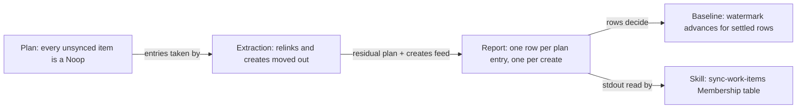

# [0352] Report each unsynced item once, by its create

## Problem

`accelerator work sync` reported every unsynced item it planned a create for
twice: once by its create (`create-from-local`, `adopt` or `failed`) and once
as a leftover `noop\tunsynced` row. Found during 0300's manual checks against
the `TES` sandbox, on preview and apply runs and on the released
`1.24.0-pre.86` binary:

```text
0004	failed	unsynced	terminal
0004	noop	unsynced	-
```

That leftover row caused three problems:

- **Misleading output.** A failed create sat beside a row that read as if
  nothing was wrong, and `/sync-work-items` needed an interim rule telling it
  to ignore the `noop` row.
- **A failed create looked settled.** The `noop` row counted as reconciled,
  so the item's baseline watermark advanced to the run's start even though
  the create failed. For an item still carrying an old baseline entry, a
  create that wrote its link and then failed could hide that link from the
  next run's local-change check.
- **A false warning.** For an item whose baseline entry came from a newer
  release, the `noop` row was relabelled "left untouched; upgrade the
  plugin", although the create ran and replaced that entry.

## Summary

Each unsynced item sync creates or adopts now reports once, by its create,
and a failed create leaves its watermark where it was. Unsynced drafts and
items under `--pull-only` keep their single `noop` row.

The planner gives every unsynced item a `Noop` entry. Creates used to be
copied from those entries, leaving the `Noop` behind; now they are moved out,
as relinks already were:

```diff
 prepare_run
   plan = knowledge.plan(…)            # every unsynced item planned as Noop
   relinks(&mut plan)                  # moves relink entries out
+  unsynced_creates(&mut plan)         # moves create entries out
   …
-  unsynced_creates(&plan)             # copied create entries, left the Noop
 report
   for planned in plan.actions         # one row per entry left in the plan
   for create in creates_from_local    # one row per create
```

## Evidence

The push-only preview in `cli/work-cli/tests/cli_sync.rs` compares the whole
of stdout.

- **Before:**
  ```text
  0001	create-from-local	unsynced	-
  0001	noop	unsynced	-
  #	discovery	skipped	push-only
  ```
  **After:**
  ```text
  0001	create-from-local	unsynced	-
  #	discovery	skipped	push-only
  ```

The engine tests in `cli/work-adapters/tests/sync_create.rs` check every row
for an id, not the first:

- **Before:** nine tests fail against `main`.
  ```text
  a_failed_create_is_the_items_only_row
    only_row(report, "0001")
    ✗ 0001 reported as [Noop, CreateFromLocal]
  a_failed_create_leaves_the_items_watermark_where_it_was
    seed entry with local_synced_at 0, run against an unreachable tracker
    ✗ stored watermark Some(1700000000), expected Some(0)
  ```
  **After:** `sync_create` passes 121/121, and the regression guards for
  drafts and `--pull-only` pass both before and after.

## Merge Danger

**Door:** two-way

No stored state changes shape: the baseline file, pending-push markers and
dossiers are read and written as before. Reverting restores the old output.

**Blast Radius:** narrow

- `work sync` stdout drops one row per item it creates or adopts. A script
  that listed unsynced items by their `noop` row stops seeing those items.
  The duplicate only shipped in 1.24.0 pre-releases.
- `/sync-work-items` reads that output. It ships with the binary, and its
  Membership table changes here to match.
- A failed create no longer advances its baseline watermark. That only shows
  for an item still carrying an old baseline entry.

## Changes

- **`cli/work-adapters/src/sync/run.rs`**: `unsynced_creates` now takes the
  entries it turns into creates out of `plan.actions`, as `relinks` already
  did, instead of cloning them and leaving the originals behind. It returns
  before partitioning under `--pull-only`, so those runs keep their `noop`
  rows. The eligibility rule moves into `creatable_item`: an unsynced,
  non-draft entry the plan leaves as `Noop`, with a matching local item. The
  call sits directly after `relinks` in `prepare_run`, so the two steps that
  take entries out of the plan are side by side.
- **`cli/work-adapters/tests/sync_create.rs`**: `only_row` asserts an id has
  exactly one report row, rather than finding the first. Eight behaviour tests
  cover preview and apply, plain create, create order and adopt order, a
  tracker failure, an adopt refused at apply time, the failed-create
  watermark, and an unknown-recipe baseline entry in preview and apply.
  Regression guards cover a successful create's watermark, an unsynced draft,
  `--pull-only`, orders refused on both, and the unknown-recipe warning that
  drafts and `--pull-only` items keep. Two unit tests in `run.rs` pin that an
  unsynced `Noop` is created from local and an unsynced relink is not.
- **`cli/work-cli/tests/cli_sync.rs`**: the push-only preview's expected
  stdout drops the `noop` line.
- **`skills/work/sync-work-items/SKILL.md`**: the interim Membership rule for
  a create's duplicate `noop` row goes. A `noop\tunsynced` row beside a
  `failed` row, `order-refused` (an order on a draft, or any order under
  `--pull-only`) is now the only pairing left, and it gets the rule instead,
  so that item is still summarised once.
- **`CHANGELOG.md`**: a `Fixed` entry.

## Context

- Work item: `meta/work/0352-sync-reports-every-unsynced-item-twice.md`
- Plan: `meta/plans/2026-11-11-0352-sync-reports-every-unsynced-item-twice.md`
- Research:
  `meta/research/codebase/2026-11-10-0352-sync-reports-every-unsynced-item-twice.md`
- Reviews: `meta/reviews/prs/188-review-1.md`,
  `meta/reviews/prs/188-review-2.md`
- Related: 0351, whose preview tests can assert one row per item once this
  lands.

## Testing

- [x] Every new behaviour test, the extended
  `adopting_a_missing_issue_is_refused` and the CLI preview test were seen
  failing before the partition. The regression guards passed before and
  after.
- [x] The guards added after review were each seen failing against the
  breakage they protect from: the relink unit test with the `Action::Noop`
  clause removed, and the preview unknown-recipe test with create rows routed
  through the unknown-recipe relabelling.
- [x] `sync_create` passes 121/121 and `cli_sync` 19/19.
- [x] The whole `cli/` workspace passes locally, and workspace rustfmt and
  clippy (`-D warnings`) are clean.
- [x] The `cli:check` Python guards and every `build-system:check` task
  pass, including the skill structure tests (74 passed, the new one seen
  failing first).
- [x] All 15 required CI checks pass on `f9887ec71`.
- [ ] The bare `mise run` was not run locally: the mise-pinned Python 3.14.4
  is SIGKILLed on launch on this machine, so every invoke-backed `mise` task
  fails before it starts. The checks above were run by hand, through a scratch
  venv on Homebrew Python 3.14.7, and CI covers the rest.
- [ ] Manual checks against the `TES` sandbox (preview, an `Attempted`
  pending-push marker, `--pull-only`) are still to do.

## Notes for Reviewers

- **Behaviour change for scripts**: an item sync creates or adopts no longer
  has a `noop\tunsynced` row. A script that listed unsynced items by that row
  should read the item's `create-from-local`, `adopt` or `failed` row
  instead. The CHANGELOG says so.
- **Dropped warning**: an unsynced item carrying a baseline entry under an
  unknown digest recipe no longer gets the "left untouched; upgrade the
  plugin" warning or an `Unobserved` dossier status when the run creates it.
  Neither was true: the create replaces the entry. Drafts and `--pull-only`
  items keep the warning.
- **Order-independent guard**: the `Action::Noop` clause in `creatable_item`
  cannot be reached through `run_sync`, since the planner gives every
  unsynced item `Noop` and `relinks` has already taken the `Relink` entries
  out. It keeps the predicate stating the rule rather than relying on call
  order, and a unit test calls it directly.
- **Not changed**: the decision table, the dossier mapping, and the
  `order-refused` line an order on a draft or under `--pull-only` prints
  beside its `noop` row.

<details>
<summary>Walkthrough</summary>



### Tour

#### 0. Relevant context

The pure planner gives every unsynced item (no `external_id`) a `Noop`
entry, in every direction
([`cli/work/src/sync/decide.rs`](https://github.com/atomicinnovation/accelerator/blob/f9887ec718bb95a61801426c9173de864e8ca9a0/cli/work/src/sync/decide.rs#L115-L119)).
Only the adapter knows the run's direction, drafts and orders, so it decides
which unsynced items become creates after planning.

A run's report merges two row sources: every entry left in `plan.actions`,
then every create
([`run.rs` preview](https://github.com/atomicinnovation/accelerator/blob/f9887ec718bb95a61801426c9173de864e8ca9a0/cli/work-adapters/src/sync/run.rs#L2367-L2385),
[`run.rs` apply](https://github.com/atomicinnovation/accelerator/blob/f9887ec718bb95a61801426c9173de864e8ca9a0/cli/work-adapters/src/sync/run.rs#L2469)).
`relinks` already moved its entries out of the plan with `std::mem::take`
([`run.rs`](https://github.com/atomicinnovation/accelerator/blob/f9887ec718bb95a61801426c9173de864e8ca9a0/cli/work-adapters/src/sync/run.rs#L1288-L1310)), so a
relink reports once. `unsynced_creates` cloned instead, so every create's
item had a second, `Noop` row.

`finalise_baseline` advances the watermark of any id with a row that passes
`definitively_reconciled`
([`run.rs`](https://github.com/atomicinnovation/accelerator/blob/f9887ec718bb95a61801426c9173de864e8ca9a0/cli/work-adapters/src/sync/run.rs#L334-L384)). A leftover
`(Unsynced, Noop, NotApplied)` row passes, so a failed create's id advanced.

#### 1. Creates leave the plan

[`cli/work-adapters/src/sync/run.rs`](https://github.com/atomicinnovation/accelerator/blob/f9887ec718bb95a61801426c9173de864e8ca9a0/cli/work-adapters/src/sync/run.rs#L1343-L1378)

```diff
 fn unsynced_creates<'a>(
-    plan: &work::sync::SyncPlan,
+    plan: &mut SyncPlan,
     items: &'a [LocalItem],
     direction: SyncDirection,
 ) -> Vec<LocalCreate<'a>> {
     if matches!(direction, SyncDirection::PullOnly) {
         return Vec::new();
     }
-    plan.actions.iter()
-        .filter(|planned| planned.state() == SyncState::Unsynced)
-        … .map(|item| LocalCreate { item, planned: planned.clone() })
-        .filter(|create| DraftId::parse(&create.item.id).is_none())
-        .collect()
+    for planned in std::mem::take(&mut plan.actions) {
+        match creatable_item(&planned, items) {
+            Some(item) => creates.push(LocalCreate { item, planned }),
+            None => remaining.push(planned),
+        }
+    }
+    plan.actions = remaining;
+    creates
 }
```

The `--pull-only` return comes **before** the partition. `relinks` checks
direction after partitioning, because relinks are refused under
`--pull-only`; unsynced items must keep their `noop` rows there instead.

`creatable_item` states the rule in one place: unsynced, still `Noop`, not a
draft, with a matching local item. The `Noop` clause cannot be reached
through `run_sync` today, because `relinks` runs first; it keeps the rule
independent of call order.

#### 2. The call moves next to relinks

[`cli/work-adapters/src/sync/run.rs`](https://github.com/atomicinnovation/accelerator/blob/f9887ec718bb95a61801426c9173de864e8ca9a0/cli/work-adapters/src/sync/run.rs#L2224-L2227)

```diff
     let relinks = relinks(&mut plan, request.reconciled(), request.direction);
+    let mut creates_from_local =
+        unsynced_creates(&mut plan, request.reconciled(), request.direction);
+    creates_from_local.extend(relinks);
     …
-    let mut creates_from_local =
-        unsynced_creates(&plan, request.reconciled(), request.direction);
-    creates_from_local.extend(relinks);
```

Nothing between the old and new positions reads `plan.actions`, so the two
steps that take entries out of the plan now sit side by side.

#### 3. What the report and baseline now see

The report loops are unchanged. With the `Noop` entry gone, each create's
item has one row, carrying the create's outcome.

- **Watermark**: a failed create's only row is `Failed`, which
  `definitively_reconciled` rejects, so its watermark stays put. A
  successful create still advances through its own `Applied` row.
- **Unknown-recipe warning**: `reported_as` relabels only plan rows as
  `UnsupportedRecipe`
  ([`run.rs`](https://github.com/atomicinnovation/accelerator/blob/f9887ec718bb95a61801426c9173de864e8ca9a0/cli/work-adapters/src/sync/run.rs#L2367-L2369)). An item
  the run creates no longer has a plan row, so it no longer gets the false
  "left untouched; upgrade the plugin" warning. Drafts and `--pull-only`
  items keep their plan row, and the warning.

#### 4. Tests

[`cli/work-adapters/tests/sync_create.rs`](https://github.com/atomicinnovation/accelerator/blob/f9887ec718bb95a61801426c9173de864e8ca9a0/cli/work-adapters/tests/sync_create.rs#L3512-L3558)
adds `only_row`, which asserts an id has exactly one row and prints every
action when it does not. The older helpers return an id's first row, which
was the `Noop` row, so none of them could see the duplicate.

- **Behaviour** (failed before the partition): preview and apply, plain and
  ordered creates, adopts, a tracker failure, an adopt refused at apply
  time, the failed-create watermark, unknown-recipe entries
  ([L3785-L3986](https://github.com/atomicinnovation/accelerator/blob/f9887ec718bb95a61801426c9173de864e8ca9a0/cli/work-adapters/tests/sync_create.rs#L3785-L3986)).
- **Guards** (passed before and after): drafts and `--pull-only` keep one
  `noop` row and the unknown-recipe warning; a successful create watermarks
  its new entry
  ([L3987-L4110](https://github.com/atomicinnovation/accelerator/blob/f9887ec718bb95a61801426c9173de864e8ca9a0/cli/work-adapters/tests/sync_create.rs#L3987-L4110)).
- **Unit**: `creatable_item` accepts an unsynced `Noop` and rejects an
  unsynced `Relink`
  ([`run.rs`](https://github.com/atomicinnovation/accelerator/blob/f9887ec718bb95a61801426c9173de864e8ca9a0/cli/work-adapters/src/sync/run.rs#L2561-L2597)).
- **CLI**: the push-only preview's full stdout loses its `noop` line
  ([`cli_sync.rs`](https://github.com/atomicinnovation/accelerator/blob/f9887ec718bb95a61801426c9173de864e8ca9a0/cli/work-cli/tests/cli_sync.rs#L327-L363)).

#### 5. The skill and the changelog

[`skills/work/sync-work-items/SKILL.md`](https://github.com/atomicinnovation/accelerator/blob/f9887ec718bb95a61801426c9173de864e8ca9a0/skills/work/sync-work-items/SKILL.md#L466)
had an interim Membership rule telling the model to ignore a create's
duplicate `noop` row. That pairing no longer occurs. The one that still
does, a `noop` row beside a `failed` row, `order-refused`, for an order on a
draft or under `--pull-only`, gets the rule instead, pinned by
[`test_a_refused_order_s_noop_row_joins_no_group`](https://github.com/atomicinnovation/accelerator/blob/f9887ec718bb95a61801426c9173de864e8ca9a0/tests/unit/tasks/test_sync_work_items_skill_structure.py#L450-L460).

[`CHANGELOG.md`](https://github.com/atomicinnovation/accelerator/blob/f9887ec718bb95a61801426c9173de864e8ca9a0/CHANGELOG.md#L781-L787) records the fix under Fixed
and tells scripts that listed unsynced items by their `noop` row to read the
create's row instead.

**Review discussion**: two `/review-pr` rounds
(`meta/reviews/prs/188-review-1.md`, `188-review-2.md`) found nothing
blocking. Fixes landed as follow-up commits; the planner emitting
`CreateFromLocal`, a shared extraction helper and older test helpers were
declined as out of scope, with reasons on each thread.

</details>
