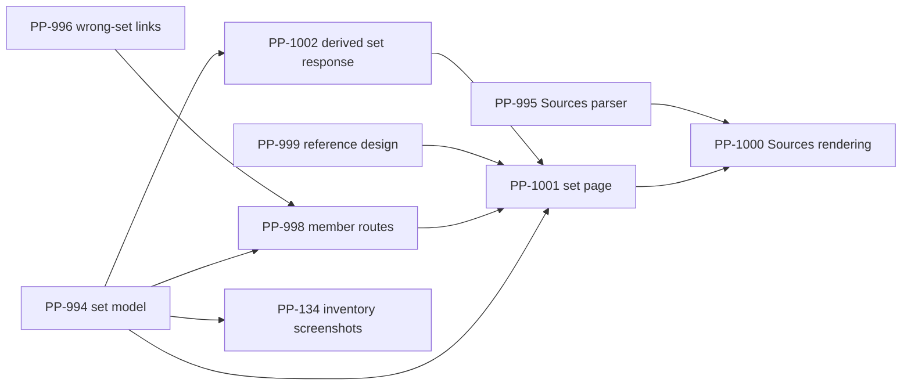

# [PP-868] Split the topic-research set page into reviewed, ready child work items

## Summary

PP-868, the topic-research set detail page, was one story too large to plan.
This PR turns it into a container over eight child work items, records two
rounds of review on each child, and marks PP-868 and all eight children
`ready`. Only `meta/` and the Linear sync baseline change; no code, skill or
test is touched.

## Changes

The eight children, in the order the dependencies allow:

Each arrow means "blocks". PP-1000 is also blocked by PP-994, PP-998,
PP-999 and PP-1002 directly; those edges are left out of the diagram.

| Item | Kind | What it delivers |
|---|---|---|
| PP-994 | story | A generic set model: a doc type whose entries are directories, indexed as a root plus members and assets, with a member API |
| PP-995 | task | One Rust reading of the Sources grammar and tier text in the `research` crate |
| PP-996 | bug | Links to a research set or design inventory open the one named, not the first by path |
| PP-998 | story | Each set member opens at its own URL |
| PP-999 | task | An approved reference design for the set page and its Sources component |
| PP-1002 | story | The server's derived set response, built through the `research` crate |
| PP-1001 | story | The set page itself, replacing `LibraryDocView` for topic-research entries |
| PP-1000 | story | Tiers, venues and marks shown in each Sources entry |

Around the split:

- **PP-868** becomes a container: it is done when its eight children are.
- **PP-1002** was split out of PP-1001 after the second round of reviews, so
  the page story carries no server derivation.
- **PP-997** (stable focus-area identifiers) is drafted as a follow-up under
  PP-22, not as a child; it stays `draft`.
- **PP-134** is now blocked by PP-994, and adds the asset route under the
  member route shape PP-998 settles.
- **PP-792** is abandoned as a duplicate of PP-134.
- **PP-953** takes Linear's version of its body, pulled during a sync.

## Reviews

The 14 review files under `meta/reviews/work/` cover all eight children: two
reviews each for six of them, one for PP-996, and one for PP-1002, which was
split out after the second round. Each review then lists the changes made
after it.
The reviewers' last verdicts were `REVISE` or `COMMENT`. The author has since
approved all 14, and each file now ends with an approval section that says so
and that nobody reviewed the item again after the later changes.

## Context

- Parent work item: `meta/work/PP-868-topic-research-set-detail-page.md`
- Epic: PP-22, the topic-research skillset. PP-868 is the remaining work
  that closes it, aside from bugs already in progress.

## Testing

- [x] `accelerator corpus frontmatter validate` passes on all 27 changed
  Markdown files.
- [x] `.accelerator/state/integrations/linear/last-sync.json` parses as JSON.
- [x] `accelerator work sync` over PP-868 and its eight children exits 0;
  title and description are pushed to Linear.
- [ ] `mise run` not run: the PR changes no code, skill, template or test.

## Notes for Reviewers

- ⚠️ This PR is stacked on #250 (`PP-893-spawn-context-by-reference`). Merge
  #250 first, then retarget this PR to `main`.
- Linear still shows all nine issues in `Backlog`. `work sync` carries title
  and description only, so the local `ready` status has not reached Linear.
- The diagram and table are the quickest way in. The acceptance criteria in
  each child are where review effort pays off, especially PP-994's, since
  five items wait on it.
