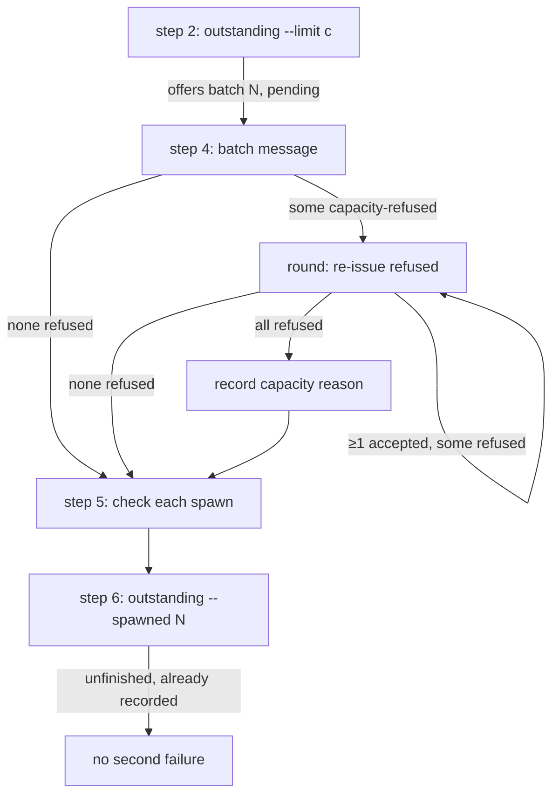

# Default research concurrency exceeds the subagent limit (0303)

**Date**: 2026-10-10T20:58:19+00:00
**Author**: Toby Clemson
**Git Commit**: `5d3d3c4518ead8693069c9a08b27bd482217d89e` (jj working copy
`7206297c` is an empty change on top of it)
**Branch**: `0303-refine-concurrency-work-item`
**Repository**: accelerator

## Research Question

What in the codebase does work item
[0303](../../work/0303-research-concurrency-exceeds-subagent-limit.md)
touch, how do those parts work today, and does the item's proposed fix
(default 20, a cap clamp in skill prose, capacity-refusal retry rounds in
step 4) fit the existing mechanisms?

## Summary

The fix fits the existing design with no CLI change. The default of 24 lives
in one place, the config catalogue, and is pinned in three more: a catalogue
unit test, the launcher's `dump.golden`, and the configure skill's table. The
knob is unreleased (only under `## [Unreleased]` → Added in `CHANGELOG.md`),
so its changelog entry can be amended in place.

The run ledger already supports retry rounds. A spawn re-issued inside step 4
is still in the ledger's pending batch, so its file is excused from the
`unexpected` check, and `--spawned N` then acknowledges it like any other
spawn. A spawn still refused when rounds stop lands in `attempted`, comes back
as `unfinished` with `rejected: null`, and step 6's existing "not already
recorded as failed" clause prevents a second failure. A fresh `--start` run
mints a new ledger, so the spawn is offered again.

Three things the work item leaves implicit need a decision in the plan:

- **Env var read mechanism.** No skill reads a `CLAUDE_CODE_*` variable
  today. A non-`accelerator` `!` command needs its own `allowed-tools` entry,
  is skipped by the permission lint, and is never executed by the
  skill-invocation integration test.
- **Empty cap versus empty knob.** The knob rule stops the verb on an empty
  value. An unset or empty `CLAUDE_CODE_MAX_CONCURRENT_SUBAGENTS` must instead
  fall back to 20 silently, so the prose must keep the two rules apart.
- **The failure record is conversational.** "Recorded as failed" in step 5 is
  a tally the orchestrator holds in context; there is no file or CLI record.
  The capacity reason joins that tally.

The work item's line references into `SKILL.md` (59-87, 305-357, 359-370, 372,
441) still match the current file.

## Detailed Findings

### Where the default of 24 lives

| Surface | Location | Change for 0303 |
|---|---|---|
| Catalogue default | [`cli/config/src/catalogue.rs:393`](https://github.com/atomicinnovation/accelerator/blob/5d3d3c4518ead8693069c9a08b27bd482217d89e/cli/config/src/catalogue.rs#L393) | `Default::Scalar("24")` → `"20"` |
| Catalogue test | [`cli/config/src/catalogue.rs:540-543`](https://github.com/atomicinnovation/accelerator/blob/5d3d3c4518ead8693069c9a08b27bd482217d89e/cli/config/src/catalogue.rs#L540-L543) | assert `"20"` (red first) |
| Dump golden | [`cli/launcher/tests/fixtures/dump/dump.golden:18`](https://github.com/atomicinnovation/accelerator/blob/5d3d3c4518ead8693069c9a08b27bd482217d89e/cli/launcher/tests/fixtures/dump/dump.golden#L18) | `` `24` `` → `` `20` `` |
| Configure docs | [`skills/config/configure/SKILL.md:438`](https://github.com/atomicinnovation/accelerator/blob/5d3d3c4518ead8693069c9a08b27bd482217d89e/skills/config/configure/SKILL.md#L438) | default, cap source, clamp |
| Changelog | [`CHANGELOG.md:139-142`](https://github.com/atomicinnovation/accelerator/blob/5d3d3c4518ead8693069c9a08b27bd482217d89e/CHANGELOG.md#L139-L142) | amend "(default 24)" in place |

- The default is a string scalar. `Default` is
  `enum { Scalar(&'static str), Seq(..) }`
  ([`catalogue.rs:18-36`](https://github.com/atomicinnovation/accelerator/blob/5d3d3c4518ead8693069c9a08b27bd482217d89e/cli/config/src/catalogue.rs#L18-L36)),
  so the test asserts `Value::Scalar(Scalar::String("20".to_owned()))`. The
  config crate does no range validation.
- `dump.golden` is consumed by `dump_matches_the_committed_golden`
  ([`cli/launcher/tests/config_read.rs:907-914`](https://github.com/atomicinnovation/accelerator/blob/5d3d3c4518ead8693069c9a08b27bd482217d89e/cli/launcher/tests/config_read.rs#L907-L914)),
  a byte-for-byte match of `accelerator config dump`.
- No change is needed to fixtures that set explicit values:
  `cli/config-adapters/tests/parity.rs:87` (`"6"`), the `research-knobs`
  fixture configs (`12`, `6`), or
  `cli/research-cli/tests/topic_outstanding.rs:1259`
  (`a_24_limit_offers_24_arxiv_spawns_and_counts_the_rest`, which passes
  `--limit 24` explicitly and tests the unbounded CLI, not the default).
- The docs-site copies of the configure and research-topic skills
  (`docs-site/src/content/docs/reference/skills/...`) are generated and
  gitignored (`.gitignore:28`), so they need no hand edit. The 0295 research
  calls them a mirror; they regenerate from `SKILL.md`.

### Knob resolution in `research-topic` SKILL.md

The rule sits at
[`SKILL.md:59-87`](https://github.com/atomicinnovation/accelerator/blob/5d3d3c4518ead8693069c9a08b27bd482217d89e/skills/research/research-topic/SKILL.md#L59-L87).

- Lines 65-67 inject each knob with
  ``!`accelerator config get research.topic.<knob> --fail-safe` ``.
- Order of rules: flag beats config (69-71); empty value stops the verb
  (73-75); an integer ≥ 1 passes (76); zero, negative or non-integer clamps to
  1 with `Warning: research.topic.<knob> must be a positive integer, got
  '{value}' — clamping to 1` (77-84); misplaced flag ignored (85-87).
- Line 83 carries the sentence 0303 overrides for concurrency only: "There is
  no upper bound; breadth is the per-round cost guard."
- Conduct step 1
  ([`SKILL.md:234-236`](https://github.com/atomicinnovation/accelerator/blob/5d3d3c4518ead8693069c9a08b27bd482217d89e/skills/research/research-topic/SKILL.md#L234-L236))
  applies the rule. The cap clamp slots in after rule 4, matching the
  acceptance criteria's "validation before the cap clamp" (`--concurrency
  50.5` → 1 with the invalid-value warning, no clamp warning).
- The skill passes the resolved value only as `--limit {concurrency}` on the
  step 2 plan (242-254). The tick step (396-400) drops `--limit`. Nowhere else
  uses concurrency, so clamping in prose bounds every batch.

`--limit` in the CLI accepts any positive `u32`
([`cli/research-cli/src/topic_command.rs:113-124`](https://github.com/atomicinnovation/accelerator/blob/5d3d3c4518ead8693069c9a08b27bd482217d89e/cli/research-cli/src/topic_command.rs#L113-L124),
`positive` at 183-190). That stays unbounded, per the item's drafting note.

### Reading `CLAUDE_CODE_MAX_CONCURRENT_SUBAGENTS`

No skill reads a `CLAUDE_CODE_*` variable today. The only env var expanded
inside a `!` command is `$PPID` in
[`skills/visualisation/visualise/SKILL.md:30`](https://github.com/atomicinnovation/accelerator/blob/5d3d3c4518ead8693069c9a08b27bd482217d89e/skills/visualisation/visualise/SKILL.md#L30),
inside an `accelerator visualiser` command.

Tooling that constrains the choice:

- **Permissions.** research-topic's `allowed-tools` (lines 14-20) grant only
  `accelerator config|corpus|research` commands. A `printenv` or `echo` line
  needs its own `Bash(...)` entry.
- **Lint.** `tasks/lint/skill_permissions.py:127-129` skips any `!` command
  that is not a plugin invocation (`is_plugin_invocation`,
  `tasks/shared/skill_parsing.py:107-117`), so a non-`accelerator` line is not
  checked against the frontmatter.
- **Metacharacters.** `_METACHARACTERS` in `skill_parsing.py:26` bans `&&`,
  `||`, `;`, `|`, `$(`, backtick, `<(`, `>(`. A `${VAR-}` expansion passes.
- **Integration coverage.** `tests/integration/support/skill_corpus.py:91-106`
  executes only `!` lines containing `accelerator config `, with an empty
  environment. An env-var line is not exercised there.

The work item records the `!` preprocessor seeing the variable from the
shell, project `settings.json` `env` and `--settings` `env`, verified with a
probe skill. It does not record which command form the probe used, nor how a
non-zero exit (for example `printenv` on an unset variable) renders in the
injected prompt.

The parsing itself (trim, `^[+-]?\d+$`, ≥ 1, else 20) is done by the model
reading prose, not by code. The injected value must make leading and trailing
whitespace and the empty case legible, for example by quoting it, so the
` 8 ` and empty acceptance cases are decidable.

### Spawn step, per-spawn check and re-plan

- **Step 4**
  ([`SKILL.md:305-357`](https://github.com/atomicinnovation/accelerator/blob/5d3d3c4518ead8693069c9a08b27bd482217d89e/skills/research/research-topic/SKILL.md#L305-L357))
  says "Spawn the batch of exactly the offered spawns, never more: every Task
  call issued together in one message and each waited on in full before the
  next step." It says nothing about refusals or retries. Rounds re-issue
  already-offered spawns, so "never more" still holds.
- **Step 5**
  ([`SKILL.md:359-370`](https://github.com/atomicinnovation/accelerator/blob/5d3d3c4518ead8693069c9a08b27bd482217d89e/skills/research/research-topic/SKILL.md#L359-L370))
  lists the no-file reasons "(an unavailable source, a failed or denied
  fetch, a blocked command, an agent error, or a refusal)". The new sentence
  `A capacity refusal is not one of these; the spawn step handles it.` goes
  after this bullet.
- **Step 6**
  ([`SKILL.md:372-384`](https://github.com/atomicinnovation/accelerator/blob/5d3d3c4518ead8693069c9a08b27bd482217d89e/skills/research/research-topic/SKILL.md#L372-L384))
  records "each `unfinished` entry whose spawn was not already recorded as
  failed". This existing clause is the no-double-record hook 0303 needs.
- **Failure record.** Step 5's "recorded as failed" is an in-context tally.
  Failures surface only in the per-batch progress line (380-382), the final
  summary's Failures section (417-422) and the reason table. The work item's
  "batch's failure record, the same record step 5 writes" means this tally.
- **Reason table**
  ([`SKILL.md:441-454`](https://github.com/atomicinnovation/accelerator/blob/5d3d3c4518ead8693069c9a08b27bd482217d89e/skills/research/research-topic/SKILL.md#L441-L454))
  has two columns, `Reason | Next step`, and 12 rows. It has no row for a
  Task refusal, a usage limit, or the pair variants "wrote no finding" / "wrote
  a finding `outstanding` does not accept".

### Run ledger behaviour under retry rounds

The ledger lives at `<set_root>/.conduct-run.json`
([`cli/research-adapters/src/conduct/ledger.rs:30-35`](https://github.com/atomicinnovation/accelerator/blob/5d3d3c4518ead8693069c9a08b27bd482217d89e/cli/research-adapters/src/conduct/ledger.rs#L30-L35));
its domain logic is in `cli/research/src/conduct/{ledger,memory,window}.rs`.

| Event | Ledger effect | Code | Consequence for 0303 |
|---|---|---|---|
| Plan offers batch | spawns become `pending` (batch N) | `ledger.rs:103-115` | round spawns stay pending |
| File written while pending | excused from `unexpected` | `window.rs:147-168` | round output is not flagged |
| `--spawned N` (N matches) | pending → `attempted` | `ledger.rs:77-98`, `memory.rs:25-31` | accepted and exhausted alike |
| Attempted, still outstanding | listed `unfinished`, `rejected: null` | `window.rs:62-68` | no second failure (step 6) |
| `--start` | new ledger, empty `attempted` | `ledger.rs:59-68` | re-run offers it again |

- `window()` never offers a spawn in `attempted`
  ([`window.rs:47-50`](https://github.com/atomicinnovation/accelerator/blob/5d3d3c4518ead8693069c9a08b27bd482217d89e/cli/research/src/conduct/window.rs#L47-L50);
  test `an_attempted_spawn_is_never_offered_again` at 390-404). Rounds must
  therefore finish before step 6 calls `--spawned`, as the item requires;
  acknowledging first would strand refused spawns until the next run.
- The CLI never emits "wrote no note". A `null` `rejected` is turned into
  "wrote no note" / "wrote no finding" by step 6 prose
  ([`SKILL.md:374-379`](https://github.com/atomicinnovation/accelerator/blob/5d3d3c4518ead8693069c9a08b27bd482217d89e/skills/research/research-topic/SKILL.md#L374-L379)).
- The CLI has no failure command and the ledger JSON has no reason field
  (`ledger_to`, `research-adapters/src/conduct/ledger.rs:119-137`). The
  0303 change is prose-only on the ledger side.

### Structural tests

`tests/unit/tasks/test_research_structure.py` is run by
`mise run test:unit:tasks` (`uv run pytest tests/unit/tasks -v`); one test
runs with `uv run pytest tests/unit/tasks/test_research_structure.py -k
<name>`.

- `_prose` (48-51) collapses whitespace, so verbatim sentences match across
  line wraps. Backticks are kept, so `` `^[+-]?\d+$` `` is asserted as the
  substring `^[+-]?\d+$`.
- `_section(prose, start, end)` (159-165) slices between two markers and
  asserts both exist. Existing markers:
  - knob rule: `"knobs bound the research"` → `"## Shared Preamble"` (188)
  - conduct: `"### conduct"` → `"### synthesise"`
- No test slices step 4 or step 5 on their own. Natural markers:
  - step 4: `"**Spawn the batch**"` → `"**Check each spawn**"`
  - step 5: `"**Check each spawn**"` → `"**Loop.**"`
- Table rows are checked on raw lines, not `_prose`:
  `_lock_contention_row()` (484-493) filters lines starting with the row's
  first cell and asserts exactly one. The exhaustion-reason row can follow
  the same pattern.
- `test_research_topic_clamps_concurrency_under_the_knob_rule` (188-202) is
  the natural home for the cap assertions. Nothing currently pins "no upper
  bound", the default 24, or the 0282 clamp warning.
- The configure skill has no research-section test. The only structural test
  over it is `tests/unit/tasks/test_design_structure.py:14,40-43`, which
  defines a `CONFIGURE` constant and checks two `paths` keys.

### Configure documentation

[`skills/config/configure/SKILL.md:428-466`](https://github.com/atomicinnovation/accelerator/blob/5d3d3c4518ead8693069c9a08b27bd482217d89e/skills/config/configure/SKILL.md#L428-L466)
documents the three knobs in a `Key | Default | Description` table (concurrency
`24`, line 438) and ends the resolution paragraph with "There is no upper
bound — breadth is the per-round cost guard." That sentence needs the same
concurrency-only carve-out as research-topic line 83. The example YAML
(458-464, `concurrency: 12`) stays below the cap.

## Code References

- `cli/config/src/catalogue.rs:390-394` - `RESEARCH_KEYS`, concurrency default `"24"`
- `cli/config/src/catalogue.rs:530-544` - `default_for_the_research_knobs_are_typed_scalars`
- `cli/launcher/tests/fixtures/dump/dump.golden:16-18` - research knob rows
- `cli/launcher/tests/config_read.rs:907-914` - golden consumer
- `skills/research/research-topic/SKILL.md:14-20` - `allowed-tools`
- `skills/research/research-topic/SKILL.md:59-87` - knob-resolution rule
- `skills/research/research-topic/SKILL.md:234-260` - conduct steps 1-2, `--limit {concurrency}`
- `skills/research/research-topic/SKILL.md:305-357` - step 4, spawn the batch
- `skills/research/research-topic/SKILL.md:359-370` - step 5, check each spawn
- `skills/research/research-topic/SKILL.md:372-384` - step 6, loop and `unfinished`
- `skills/research/research-topic/SKILL.md:417-454` - Failures summary and reason table
- `skills/config/configure/SKILL.md:428-466` - research knob docs
- `cli/research-cli/src/topic_command.rs:113-124` - `--limit` parsing
- `cli/research/src/conduct/window.rs:38-73` - offer, `repeated`, `unfinished`
- `cli/research/src/conduct/ledger.rs:59-115` - start, continue, record
- `cli/research/src/conduct/memory.rs:25-47` - acknowledge, replace
- `tests/unit/tasks/test_research_structure.py:155-202,484-508` - section helpers, concurrency and table-row tests
- `tasks/shared/skill_parsing.py:22-26,107-117` - `!` parsing, metacharacters, plugin invocation
- `tasks/lint/skill_permissions.py:127-129` - non-plugin `!` lines skipped
- `tests/integration/support/skill_corpus.py:91-106` - executes `accelerator config` `!` lines only
- `CHANGELOG.md:139-142` - unreleased concurrency entry

## Architecture Insights

- **Clamping is prose-only by design.** The skill validates every knob in
  prose (the 0283 research notes there are no Rust clamps) and the CLI
  re-validates only well-formedness of `--limit`. 0303 keeps that split and
  keeps the Claude Code env var out of the CLI.
- **The ledger's pending batch is the retry window.** Everything between an
  offer and its `--spawned` acknowledgement is excused and re-issuable. This
  is what makes in-step-4 rounds safe without touching Rust.
- **Failures are conversational, not persisted.** The run ledger tracks
  attempts, never reasons; the orchestrator owns reasons for the run's
  lifetime. A capacity failure is therefore recoverable only by re-running,
  which the `--start` replacement guarantees.
- **TDD path.** Every changed artefact has a red-first test: the catalogue
  assertion, the golden file, and new structural pins in
  `test_research_structure.py` (plus a configure pin). The manual runs cover
  behaviour the prose tests cannot.

## Historical Context

- `meta/plans/2026-09-26-0283-recursive-finding-deepening.md` - defined the
  ledger, offered spawns, `--spawned` and `unfinished`. No rationale for 24 is
  recorded; its Phase 5 check "30 pairs → batches of 24 and 6" passed
  (`meta/validations/2026-09-28-0283-...-validation.md:55`), apparently on a
  harness before the cap was enforced.
- `meta/plans/2026-09-20-0282-tunable-depth-and-breadth.md` - the knob rule
  and "no upper bound" (`:185`, `:643`). Done; 0303 overrides it for
  concurrency only, with no back-reference by decision.
- `meta/validations/2026-10-06-0295-fair-arxiv-fetch-queue-validation.md:148,257-262`
  - an independent sighting of the 20 cap: the 24th researcher launched only
  once a slot freed. It recommends `CLAUDE_CODE_MAX_CONCURRENT_SUBAGENTS=24`
  for arXiv step-17 runs; after 0303 that is required for a 24-wide load.
- `meta/reviews/work/0303-research-concurrency-exceeds-subagent-limit-review-1.md`
  - four passes, verdict COMMENT. Deliberately open minors: unpinned knob
  sub-rules (equal-to-cap, raised cap, trimming, fallback), thinner pins than
  the Requirements, no holder-exit detection, no fallback if holders prove
  infeasible, and an incomplete External dependency entry.
- Siblings, all draft with no plan:
  - `meta/work/0310-recovering-from-an-interrupted-conduct-run.md` - halting-failure class in
    step 5 and the table; whichever of 0303/0310 lands second adds "a halting
    failure stops retry rounds early" and fixes the reason for spawns left
    refused after such a stop.
  - `meta/work/0304-fail-web-nodes-on-websearch-quota-exhaustion.md` - another
    table row; its `relates_to` omits 0303 (one-way link).
  - `meta/work/0307-pass-conduct-spawn-context-by-reference.md` - owns making
    its "current offered batch" node query answer for spawns re-issued in
    rounds.

## Related Research

- `meta/research/codebase/2026-09-26-0283-recursive-finding-deepening.md`
- `meta/research/codebase/2026-10-06-0295-fair-arxiv-fetch-queue.md`

## Open Questions

- Which command form reads `CLAUDE_CODE_MAX_CONCURRENT_SUBAGENTS` in the `!`
  preprocessor (`printenv`, `echo "${VAR-}"`, or similar), what
  `allowed-tools` entry it needs, and how an unset variable or non-zero exit
  renders? The item's probe verified visibility but did not record the form.
- Should the injected cap value be quoted so the model can see surrounding
  whitespace and an empty value, given the parser cases ` 8 ` and empty?
- Should the configure-doc pin live in `test_research_structure.py` or beside
  the existing `CONFIGURE` constant in `test_design_structure.py`?
- Can a holder subagent wait for its stop file without tripping the
  foreground-`sleep` guard (carried from the work item; blocks both hold runs)?
- Is the issue #140 brief retrievable for the full-load run (carried from the
  work item)?
