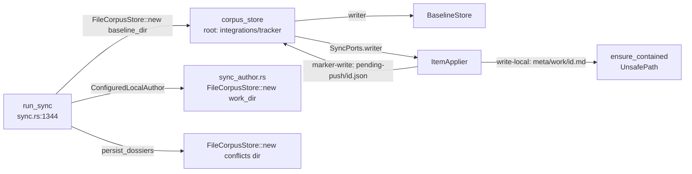

# Sync pulls of tracked work items fail silently

**Date**: 2026-10-11 00:42:53 BST
**Author**: Toby Clemson
**Git Commit**: b986a74eae4c13bbdf163025980c87f61a84fff5
**Branch**: unnamed jj working-copy change (not pushed)
**Repository**: accelerator

## Research Question

For the bug in `meta/work/0300-sync-pulls-of-tracked-work-items-fail-silently.md`:
where does a pull into a tracked work item fail, why is the failure silent,
why does a `--target` run delete other items' conflict dossiers, and what in
the codebase shapes the fix the work item requires?

## Summary

The work item's diagnosis holds on every point, and the code adds four
findings it does not yet account for.

Confirmed:

- **Mis-rooted writer.** `run_sync` builds one `FileCorpusStore` rooted at
  `<paths.integrations>/<tracker>/` and passes it as both the baseline
  store's writer and `SyncPorts.writer` (`cli/work-cli/src/sync.rs:1488-1532`).
  `ItemApplier::pull` writes the work-item file through that writer
  (`cli/work-adapters/src/sync/apply.rs:240-242`), `ensure_contained` refuses
  it with `StoreError::UnsafePath`, and the applier wraps it as
  `ApplyError::Io { operation: "write-local" }`.
- **Silent failure.** `ApplyError::class` returns `None` for `Io`
  (`apply.rs:51-61`), `render_report` renders `None` as `-`
  (`sync.rs:422-440`) and never formats the error, and `exit_code_for_report`
  maps the failure through `class().map(failure_code)`, so it contributes no
  code (`sync.rs:499-520`).
- **Dossier pruning.** `clear_stale_dossiers` deletes every id-shaped `.md`
  in `conflicts/` (`sync.rs:528-546`) on every `Ok` run, preview included,
  while dossiers are built only for the run's reconciled (targeted) items
  (`run.rs:499-512`).

Not yet in the work item:

1. **The classification table is incomplete.** The applier emits `Io` failures
   for operations the table omits or misplaces: a create-from-local refusal
   (`operation: "create"`), `read-local` and `hash-local` *after* a tracker
   `update` on push or after `link-external-id` on a local create, and
   `read-local` after `author-local` on a remote create. Under the work item's
   governing rule ("earlier write landed → terminal") several of these are
   terminal, not retryable as the table's `read-local | never` row implies.
2. **A failed resolve-to-remote pull loses its dossier today.** `--resolve`
   turns the `Prompt` into a `Pull` at planning time (`cli/work/src/sync/plan.rs:120-128`),
   so no dossier is built for it, and the clear-all deletes the old one before
   the apply outcome is known. Meeting the "dossier still exists after a failed
   resolution pull" criterion means dossier persistence must see apply
   outcomes, not only the plan.
3. **The `sync-work-items` skill never names `retryable`, `terminal` or `-`
   row details**, has no completion gate on exit code or `failed` rows, and its
   precedence line omits exit 1 (`skills/work/sync-work-items/SKILL.md:195-232`).
4. **`run_sync` has no store-injection seam and prints straight to
   stdout/stderr**, so the regression and `baseline-set` fault-injection
   criteria need a new seam (precedent: `Seams.store_at` in `create.rs`) or a
   subprocess harness.

## Detailed Findings

### Writer wiring in `work sync`



- `run_sync` (`cli/work-cli/src/sync.rs:1344`) resolves the work directory via
  `config::resolve_work_dir` — the `work-item` doc-type directory, not a
  literal `work.dir` key (`cli/work-cli/src/config.rs:111-127`) — and the
  integrations root via `integrations_dir` (`sync.rs:85-97`), defaulting to
  `.accelerator/state/integrations` (`cli/config/src/catalogue.rs:57`).
- `IdentityWorkspace::open` creates the baseline directory up front because
  containment canonicalises the root (`cli/work-cli/src/identity_workspace.rs:44-79`).
- The store and ports (`sync.rs:1488-1532`):
  ```rust
  let baseline_dir = baseline_path.parent().unwrap_or(&integrations_root);
  let corpus_store = FileCorpusStore::new(baseline_dir);
  // ...
  let mut baseline_store = workspace.baseline(&corpus_store);
  // ...
  writer: &corpus_store,
  ```
  `project_store` (repo root), `state_store` (state dir) and
  `integrations_store` (integrations root) are built alongside for retirement
  and promotion (`sync.rs:1491-1493`).
- The local-author port does not use `corpus_store`. `author_from_remote`
  writes through `FileCorpusStore::new(&self.work_dir)` with an exclusive
  create (`cli/work-cli/src/sync_author.rs:315-321`) — the existing precedent
  for a store rooted at the work directory. `link_external_id` roots a store
  at the file's own parent (`sync_author.rs:242-244`).
- `work promote` wires the same four stores (`cli/work-cli/src/promote.rs:202-211`);
  `work update` roots item writes at `path.parent()` (`cli/work-cli/src/update.rs:235-237`).
  No role-typed wrapper exists: roles are distinguished only by variable name.

### Containment in `FileCorpusStore` and `store`

- `FileCorpusStore::bounds()` sets `permitted_root` and `project_root` to the
  same root (`cli/corpus-adapters/src/store.rs:48-53`); `write` delegates to
  `store::atomic_write` (`store.rs:55-67, 140-144`).
- `store::atomic_write` (`cli/store/src/lib.rs:99-113`): `ensure_contained` →
  `create_dir_all(parent)` → temp file with `kernel::TEMP_PREFIX` in the
  canonical parent → fsync → rename → fsync parent. A `PermissionDenied` while
  staging becomes `NotWritable` — the error the retryable criterion will see
  for a non-writable work directory.
- `ensure_contained` (`lib.rs:187-209`) canonicalises the parent with
  `canonicalize_allowing_missing` (`lib.rs:262-282`), which resolves the
  deepest existing ancestor and re-appends the missing tail **verbatim**, then
  compares with component-wise `Path::starts_with`. A leaf symlink must also
  resolve inside the root.
- `to_store_error` maps `WriteError::UnsafePath` to `StoreError::UnsafePath`
  (`corpus-adapters/src/store.rs:112-128`), displayed as
  `refusing to write through an unsafe path '<path>'`
  (`cli/corpus/src/store.rs:42-45`). `io_error` flattens it to a string in
  `ApplyError::Io.detail` (`apply.rs:144-154`).
- `RecordStore::read_records` reads with plain `fs::read` and enforces no
  containment (`corpus-adapters/src/store.rs:228-242`).

### Applier paths, operations and `ApplyError`

`FailureClass { Retryable, Terminal, Unconfigured, Rejected }` and
`ApplyError { Tracker { item_id, operation, source }, Io { item_id, operation, detail } }`
live at `apply.rs:25-45`. `class()` maps the four `TrackerError` kinds one to
one and `Io` to `None`, documented only as "a store-originated failure, which
carries no class the report can render" (`apply.rs:47-62`). `Display` is
`"{item_id}: {operation} failed: {source|detail}"` (`apply.rs:64-79`).

Ordered side effects per path, with the label each failure carries:

| Path | Sequence (operation label) | Earlier write landed before | Source |
|---|---|---|---|
| Push | `read-local` (caller) → tracker `update` → `show` (swallowed) → `read-local` → `hash-local` → `baseline-set` | 2nd `read-local`, `hash-local`, `baseline-set`: tracker | `run.rs:708-734`, `apply.rs:193-227` |
| Pull | `write-local` → `hash-local` → `baseline-set` | `hash-local`, `baseline-set`: local file | `run.rs:736-757`, `apply.rs:236-259` |
| Create from remote | tracker `show` → `author-local` → `read-local` → `hash-local` → `baseline-set` | `read-local` onwards: local file | `apply.rs:274-313` |
| Create from local | `read-local` (caller) → `create` refusal → `marker-write` → tracker `create` → `marker-write` → `link-external-id` → `show` (swallowed) → `read-local` → `hash-local` → `baseline-set` → marker removal (ignored) | everything after tracker `create` | `run.rs:813-852`, `apply.rs:327-500` |

Points the classification table in 0300 does not cover:

- **`create` as an `Io` operation.** `push_precondition` refusals (marker
  unreadable, prior attempt of unknown outcome, fingerprint mismatch, already
  written) return `Io { operation: "create" }` (`apply.rs:109-131, 338-342`).
  No write has landed, so by the rule they are retryable — but a re-run hits
  the same refusal, which makes "retryable" misleading.
- **Post-tracker `read-local`/`hash-local`.** On push and on create-from-local
  these follow a landed tracker write, so the rule makes them terminal; the
  table lists `read-local` as "never" and `hash-local` only after a pull.
- **`marker-write` item id.** Marker failures carry `item_id: "<marker>"`, not
  the item id (`apply.rs:452-460`), so a stderr line "naming the item" needs
  the id threaded through.
- **`create-from-remote` row id.** The row and `author-local` error carry the
  external id, not a local id (`run.rs:1216-1220`, `apply.rs:286-293`).
- **`finalise`.** `ItemApplier::finalise` uses operation `finalise` with
  item id `<run>` (`apply.rs:508-512`), but the run calls `finalise_baseline`,
  which reduces the result to a `bool` (`run.rs:329-355`); it is not an item
  apply failure.
- **Terminal tracker `create`** rewrites the `Attempted` marker with the
  failure and leaves it on disk; other tracker errors delete the marker
  (`apply.rs:418-450`).

The run continues after an item fails: each pass converts `Err` into
`ItemOutcome::Failed` and moves on, and `finalise_baseline` runs
unconditionally (`run.rs:1210-1251`). Within an item, `?` stops at the first
failing step. `definitively_reconciled` excludes failed items from the
watermark advance (`run.rs:357-367`).

### Baseline store

- `BaselineStore { path, reader: &dyn FileReader, writer: &dyn AtomicWrite }`
  (`cli/work-adapters/src/sync/baseline_store.rs:25-29`).
- `set` reloads, updates one entry and rewrites the whole `last-sync.json`
  per call (`baseline_store.rs:74-78`); the doc comment at `:17-24` explains
  the read-modify-write narrows the lost-update window. A `baseline-set`
  failure is therefore per item, as the work item states.
- `finalise_run` performs one load and one write for blanking, watermarks and
  the document timestamp (`baseline_store.rs:122-148`).
- Path: `<integrations>/<integration>/last-sync.json` (`baseline.rs:228-232`).

### Pending-push markers

- Path `<integrations>/<integration>/pending-push/<id>.json`
  (`cli/work-adapters/src/sync/pending_push.rs:64-71`), written through
  `ItemApplier.writer`, read with plain `std::fs::read_to_string`
  (`apply.rs:356`).
- `prepare_dir` (writes the `*` `.gitignore`) is called from creation and
  promotion but not from the sync run (`pending_push.rs:83-97`).
- Splitting `SyncPorts.writer` means `ItemApplier` needs both writers: the
  work-item writer for `pull`, the integration-state writer for markers.

### Report rendering and exit code

- Rows: `"{id}\t{action_field}\t{state}\t{detail}"`. A failure gets
  `action_field = "failed"` and the class name, or `-` for `None`; any other
  row gets `(action_keyword(..), "-")` (`sync.rs:401-466`, keywords at
  `:304-315`). Synced rows fold into `#\tsummary\tsynced\tN`.
- Nothing in the `Ok` path writes per-item failure detail to stderr. Existing
  stderr output is baseline-degradation, keyed-read, dossier, finaliser,
  outstanding-push and kept-recovery warnings (`sync.rs:1607-1663`).
- `severity` (`sync.rs:468-480`): `TERMINAL 71 > ERROR 1 > UNRESOLVED 4 >
  REJECTED 75 > UNCONFIGURED 74 > RETRYABLE 70 > 0`. Constants in
  `cli/work-cli/src/exit_codes.rs:125-140`.
- `exit_code_for_report` (`sync.rs:499-520`) takes the maximum of item failure
  classes, awaiting-human (4), read or discovery failure (70) and promotion
  exits, defaulting to `CLEAN`. `ERROR` reaches the fold only through
  `promotion_exit`.
- Run-level `RunError` maps to 5, 74, 7, 71, 70 or 1 via `run_error_outcome`
  (`sync.rs:1285-1337`); dossiers are not touched on that path.

### Conflict dossiers

- `build_dossiers` keeps plan actions with `Action::Prompt` that have a local
  item in `request.reconciled()` (`cli/work-adapters/src/sync/run.rs:499-512`),
  before any apply step; preview returns them too (`run.rs:1163-1191`).
- The CLI persists them at `<integrations>/<integration>/conflicts/` in the
  `Ok` arm (`sync.rs:1634-1647`):
  - `prepare_conflicts_dir` (`sync.rs:554-568`): `create_dir_all`, write and
    verify a `*` `.gitignore`, then `clear_stale_dossiers`. If preparation
    fails it warns and clears nothing.
  - `clear_stale_dossiers` (`sync.rs:528-546`): removes every `<stem>.md` whose
    stem passes `id_is_token_safe` (`sync.rs:522-526`), plus temp artefacts,
    regardless of what the run planned.
  - `persist_dossiers` (`sync.rs:570-597`) writes through a fresh
    `FileCorpusStore::new(dir)` rooted at the conflicts directory, warning on
    each failure without changing the exit code.
- The work item requires the integration-state writer to carry dossier
  writes. Today they use their own conflicts-rooted store; rooting at
  `<integrations>/<tracker>/` widens it by one level and still contains it.
- Under `--target`, `request.reconciled()` holds only targets, so the clear
  removes untargeted dossiers and rewrites only targeted ones.

### `--target`, `--resolve`, `--preview`, `--per-item-reads`

- `--resolve` is parsed by `parse_resolutions` (`sync.rs:279-302`; duplicate
  id → exit 2) and `resolve_conflict_token` (`cli/work/src/sync/decide.rs:126-135`;
  unknown token → warning, becomes `Skip`), then applied in `compute_plan`:
  `AcceptRemote → Pull`, `PushLocal → Push`, `Skip → Prompt`
  (`cli/work/src/sync/plan.rs:120-128`).
- `--target` goes through `build_selection` → `resolve_targets`
  (`sync.rs:740-884`) into `ItemSelection::Targeted { items, pull_ids }`,
  retargeted after renames in `settled_run.rs:207-224`.
- `--preview` → `RunMode::Preview`; the early return at `run.rs:1163` skips
  the applier.
- `--per-item-reads` → `RetrievalStrategy::PerItem` (`sync.rs:1538-1542`),
  which only reaches `fetch::gather`. That fits the observation in 0300 that
  it makes no difference: the failure is in the write, not the read.

### `sync-work-items` skill

- Single file, `skills/work/sync-work-items/SKILL.md` (480 lines). The engine
  owns the logic and the skill renders the report and drives the gates (`:27-32`).
- The exit-code paragraph (`:195-232`) opens "The stdout report is
  authoritative" and covers 0, 4, 70, 71, 74 (two senses), 75. Exit 1 is not
  described as a sync exit, and the precedence line `71 > 4 > 75 > 74 > 70`
  (`:220`) omits it.
- Per-item `failed` details named: `rejected` (`:214`) and `unconfigured`
  (`:216`) only. The generic four-column row is never documented, and Step 5
  summary buckets (`needs-retry:` and others, `:364-381`) have no row-to-bucket
  mapping.
- There is no general instruction to relay stderr for failed items. Stderr is
  mentioned only for target aborts, dropped dossier writes, pull filters and
  `retirement-incomplete` (`:73-76, 152, 248-249, 444`).
- There is no completion gate: Step 5 summarises unconditionally, and the final
  step validates touched items' frontmatter (`:471-479`).
- The Step 2 command template omits `--target` and `--allow-unbounded`,
  though both are parsed in Step 1 (`:160-165`).
- Tests touching the skill:
  - `tests/unit/tasks/test_skill_frontmatter_validation.py:36, 80-96, 179`
    requires the `accelerator corpus frontmatter validate` step to stay in a
    `bash` fence.
  - `cli/work-cli/tests/sync_resolves_argv.rs` pins `--resolve` argv
    acceptance (accepted codes `0|4|5|70|71|74`, `:72`).
  - Generic lints apply: `tasks/lint/skill_permissions.py`,
    `tasks/lint/bare_invocation.py`, `tasks/lint/git_tokens.py`.
  - `tasks/shared/skill_keyword_parity.py` covers only the integrations
    skills.
- The 0213 plan describes a `tasks/lint/sync_conflict_flow.py` that pins
  named exit codes; it does not exist in the tree today.
- `docs-site/src/content/docs/guides/sync-work-items.mdx` may mirror the
  skill prose.

### Test harnesses and what they cannot see

| Suite | Writer double | Containment exercised |
|---|---|---|
| `cli/work-adapters/tests/sync_run.rs` | in-memory `Spy` (`:49-98`), fake paths `/baseline/…`, `/items/…` | no |
| `cli/work-adapters/tests/sync_apply.rs` | in-memory `Fake` with `fail_next_write_to(path)` (`:58-60, 84-101`) | no |
| `cli/work-adapters/tests/sync_settled.rs` | real `FileCorpusStore::new(repo.root())` (`:530, 590`) | yes, but rooted at the whole repo |
| `cli/work-cli/src/sync.rs` `mod tests` (`:3466-4142`) | production wiring via `run_sync` + `StubRegistry` | yes — but no test seeds a pull |

- The in-crate `run_sync` tests are the only seam that runs production wiring
  without a live tracker (`sync.rs:3466-3472`). Helpers: `sync_repo`
  (`:3570-3591`), `work_file` (`:3603-3612`), `sync_args` (`:3614-3627`),
  `drive_sync` (`:3629-3650`), `StubRegistry` (`cli/work-cli/src/test_support.rs:20-29`).
  `a_locally_resolvable_target_makes_no_fetch_all_call` (`:4043-4059`) seeds a
  tracked item but no baseline entry, so it never pulls. `run_sync` returns an
  opaque `ExitCode` and writes with `println!`/`eprintln!`, so in-process
  tests cannot assert stdout or stderr.
- Subprocess tests (`cli/work-cli/tests/cli_sync.rs`) assert exact stdout and
  stderr, but cannot inject a tracker (`:1-8`).
- Fault-injection decorators:
  - `Faults { inner, applies: fn(&Path) -> bool, left }`
    (`cli/work-cli/src/test_support.rs:89-137`), injected through the
    `store_at` seam in `create.rs:997-1022`. Its path-predicate shape fits
    "fail only that item's baseline write".
  - `Faulty` (`sync_settled.rs:295-340`; `retirement.rs:97-154`) fails by
    operation index.
- Permission tests share one shape — chmod `0o555`, act, restore before
  asserting: `sync.rs:3427-3464`, `cli/work-cli/tests/cli_update.rs:423-450`,
  `pending_push.rs:633-654`, `cli/store/src/lock.rs:731-749`.
- There is no root-skip precedent in `cli/`. `work-cli` and `work-adapters`
  depend on none of `libc`, `rustix` or `nix`. `geteuid` appears only in
  `cli/design-adapters/src/marker.rs:103-106` (`libc`) and
  `cli/launcher/src/launch/outbound/resolve/tree/layout.rs:285` (`rustix`).
- Exit-code and rendering tests to extend:
  - `exit_code_for_report_ranks_outcomes` (`sync.rs:3173-3223`)
  - `failed(id, state, TrackerError)` helper (`sync.rs:2236-2254`)
  - golden `cli/work-cli/tests/fixtures/sync-report.golden`
  - `the_stale_clear_removes_only_canonical_dossiers_and_artefacts`
    (`sync.rs:3366-3401`)

## Code References

- `cli/work-cli/src/sync.rs:1488-1532` - single `FileCorpusStore` wired as baseline writer and `SyncPorts.writer`
- `cli/work-cli/src/sync.rs:401-466` - `render_report`; `None` class → `-`
- `cli/work-cli/src/sync.rs:468-520` - `severity`, `failure_code`, `exit_code_for_report`
- `cli/work-cli/src/sync.rs:522-617` - dossier id check, clear, prepare, persist
- `cli/work-cli/src/sync.rs:1634-1665` - `Ok` arm: dossiers, report, finaliser, exit
- `cli/work-cli/src/sync_author.rs:242-244, 315-321` - local-author stores (work-dir precedent)
- `cli/work-cli/src/test_support.rs:89-137` - `Faults` path-predicate decorator
- `cli/work-adapters/src/sync/apply.rs:25-81` - `FailureClass`, `ApplyError`, `class`, `Display`
- `cli/work-adapters/src/sync/apply.rs:144-154` - `io_error`
- `cli/work-adapters/src/sync/apply.rs:236-259` - `ItemApplier::pull`
- `cli/work-adapters/src/sync/apply.rs:327-500` - create-from-local, markers, `link_and_baseline`
- `cli/work-adapters/src/sync/run.rs:103-113` - `SyncPorts`
- `cli/work-adapters/src/sync/run.rs:499-512` - `build_dossiers`
- `cli/work-adapters/src/sync/run.rs:1203-1251` - apply passes and finalisation
- `cli/work-adapters/src/sync/baseline_store.rs:17-29, 74-78` - per-item read-modify-write
- `cli/work/src/sync/plan.rs:120-128` - `--resolve` turns `Prompt` into `Pull`/`Push`
- `cli/corpus-adapters/src/store.rs:48-67, 112-128` - bounds, write, error mapping
- `cli/store/src/lib.rs:99-141, 187-209, 262-282` - atomic write and containment
- `skills/work/sync-work-items/SKILL.md:195-232, 358-479` - exit-code handling, summary, completion

## Architecture Insights

- **One writer port for two roots is the design flaw, not a wiring slip.**
  The 0194 plan gave `SyncPorts` a single `writer` (0194 plan `:2224-2229`) and
  never specified the `FileCorpusStore` root (`:2500-2503`). Every adapter-level
  test used rootless in-memory doubles, so the two roots were never forced
  apart. The fix the work item asks for — a work-item writer and an
  integration-state writer — makes the two roles explicit in the port.
- **ADR-0053 and ADR-0069 place the bounded writers in `work-cli`.** Only the
  composition root binds adapters to ports (ADR-0069 rule 5), and
  `work-adapters` must not depend on `corpus-adapters` (rule 4). The 0194 plan
  deliberately kept `work-adapters` free of a `store` edge (`:1613-1615`).
  Two `FileCorpusStore`s rooted differently, injected as distinct
  `&dyn AtomicWrite` fields, fit without new crate edges. A domain-named type
  per role (for example a work-item writer and an integration-state writer
  field pair, rather than one `writer`) expresses the distinction in the
  domain language the project requires.
- **Classifying `Io` contradicts no contract; leaving it `None` contradicts
  two.** 0194's report contract says a `failed` line carries `retryable` or
  `terminal` (`:2517-2519`), and its exit table defines 70/71 over "every
  per-item failure" (`:2581-2582`). `Option<FailureClass>` is the type that
  lets the gap exist; a total `class() -> FailureClass` closes it at compile
  time, which is what the "classification is total" criterion asks for.
- **Classifying `Io` by position needs knowledge the error does not carry.**
  The same operation (`read-local`, `hash-local`, `baseline-set`) is retryable
  or terminal depending on whether an earlier write landed in that item apply.
  Either the applier attaches the class at each `io_error` call site (it knows
  the sequence), or `ApplyError::Io` carries a "write landed" fact. A class
  derived from the operation label alone cannot be correct for `read-local` or
  `hash-local`.
- **Dossiers are a CLI concern computed from the plan.** Fixing pruning for
  `--target` needs the planned id set (to scope the clear). Keeping the
  dossier of a failed resolution pull needs the apply outcome and the
  pre-resolution conflict state — information `build_dossiers` does not have,
  because `--resolve` has already rewritten the action.

## Historical Context

- `meta/plans/2026-08-13-0194-tracker-crate-and-remote-sync-engine.md` -
  origin of `SyncPorts.writer`, `BaselineStore` ports, `ApplyError::class`
  returning `None` for store errors (`:1916-1922`), and the 71 > 4 > 70 > 0
  precedence with its rationale (`:2589-2607`).
- `meta/plans/2026-08-19-0213-conversational-conflict-resolution-flow.md` -
  dossier design and the fail-closed stale clear (`:591-603`). Its premise
  that every run classifies the whole corpus (`:157-159`) became false with
  0257. Dossier write failures only warn (`:625-630`).
- `meta/plans/2026-09-06-0257-sync-specific-work-items.md` - `--target`
  narrows `request.reconciled()`. The plan states conflict dossiers are
  "reused unchanged" (`:144-150`) and missed the CLI-side clear as a
  whole-corpus coupling. `resolve_path_class` (`:196-214`) is a containment
  precedent.
- `meta/plans/2026-09-08-0285-targeted-pull-of-remote-only-work-items.md` -
  the skill-update pattern: rewrite every exit-code surface by content, not
  line (`:514-539`); skill changes were verified manually.
- `meta/reviews/work/0300-sync-pulls-of-tracked-work-items-fail-silently-review-1.md` -
  APPROVE after five passes. Residual pass-5 points (`:527-550`): attribution
  of dossier and baseline writes, tracker operation labels, mixed-outcome
  precedence tests, total-classification assertion, non-root runner.
- `meta/decisions/ADR-0053-thin-cli-over-a-hexagonal-ports-and-adapters-core.md`,
  `meta/decisions/ADR-0069-crate-dependency-rules-for-the-hexagonal-cli-workspace.md` -
  where the bounded writers are built and bound.

## Related Research

- `meta/research/codebase/2026-08-12-0194-tracker-crate-and-remote-sync-engine.md`
- `meta/research/codebase/2026-08-18-0213-conversational-conflict-resolution-flow.md`
- `meta/research/codebase/2026-09-06-0257-sync-specific-work-items.md`
- `meta/research/codebase/2026-09-08-0285-targeted-pull-of-remote-only-work-items.md`
- `meta/research/codebase/2026-10-06-0299-crate-dependencies-adr-0069.md`

## Open Questions

- **Classification table gaps.** How should the work item classify the
  `create` refusal, post-tracker `read-local`/`hash-local` on push and
  create-from-local, and `read-local` after `author-local`? The governing rule
  says terminal for the post-write cases; the table's `read-local | never` row
  disagrees. A `create` refusal is "no write landed" but not fixed by a re-run.
- **Failed resolution pull and its dossier.** Persistence must learn which
  planned items were conflicted before resolution and which resolution pulls
  failed. Does the engine re-emit a dossier for a resolved item whose apply
  failed, or does the CLI skip clearing it?
- **`..` with a missing intermediate directory.** Reading
  `canonicalize_allowing_missing` suggests `root/missing/../../x` passes the
  `starts_with` check, because the missing tail is re-appended verbatim. If
  so, the "`..` path escaping the work directory" criteria could pass for an
  existing-parent `..` and still leave this case open. Not verified by running
  it; no test in `cli/store` or `cli/corpus-adapters` covers `..`.
- **Regression seam.** `run_sync` builds its stores inline and prints
  directly. The regression test and the `baseline-set` fault-injection
  criterion need either a `store_at`-style seam (as in `create.rs`) plus an
  output sink, or a subprocess harness that can stub the tracker.
- **Root detection for permission tests.** `work-cli` has no `libc`,
  `rustix` or `nix` dependency. Adding one for `geteuid`, or probing
  writability after the chmod, are the options. Not evaluated against
  `cargo-deny` or ADR-0069.
- **Skill completeness beyond scope.** Exit 1 missing from the skill's
  precedence, and the Step 2 template omitting `--target`, are adjacent
  defects. Decide whether 0300's skill change absorbs them.
