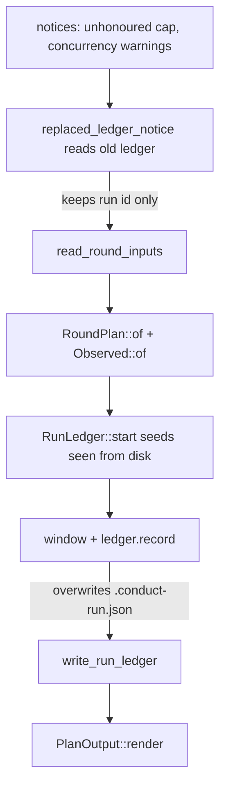

# Recovering from an interrupted conduct run (0310)

**Date**: 2026-10-13 10:54 BST
**Author**: Toby Clemson
**Git Commit**: `55c54746ca09` (jj working copy, on top of "Narrow 0310 to
what next-run recovery lacks"; not on `main`)
**Branch**: none (detached; `main` is `f9dab44a997b`)
**Repository**: accelerator

## Research Question

What does the codebase need to change, and where, to deliver work item 0310?
That means an interrupted-run report from `outstanding --start` when it
replaces another run's readable ledger, quarantine of written-but-invalid
leftover findings by skill step 3, and an "unfinished run" row in the
failure-reason table.

## Summary

Everything 0310 needs is already in memory inside `run_outstanding`. Today the
code throws it away.

- `replaced_ledger_notice` reads and parses the old `RunLedger`. It keeps only
  `stored.run()` and drops the rest, including `pending.spawns`, which is the
  last offered batch.
- `read_round_inputs` and `RoundPlan::of` then produce everything needed to
  sort those spawns into written and valid, written but invalid, and not
  written.

No new filesystem port or adapter function is needed. The classification can
be a pure domain function in `research::conduct` over `(&RunLedger,
&RoundInputs, &RoundPlan)`.

The work divides into three slices:

1. **CLI.** Keep the replaced ledger instead of formatting it into a notice.
   Classify its pending spawns once the inputs are read. Render a new
   conditional JSON key with the old run id, the three classes, and the
   finding paths to quarantine. Drop the "replaced the ledger of run" notice
   for a readable ledger, and keep the corrupt-ledger notice unchanged.
2. **Quarantine.** An invalid leftover finding is never at an offered path.
   With empty claims on `--start`, `claim_index` skips invalid findings and
   allocates a fresh index above them, so today's step 3 never touches the
   file. Step 3 needs a second rule driven by the new quarantine-path list.
3. **Skill.** Show the report before the first batch with the fixed opening
   sentence, and add an "unfinished run" row to the failure-reason table.
   Update the pytest structure tests that pin today's "a replaced ledger"
   sentence.

## Detailed Findings

### Where the replaced ledger is read and discarded

`run_outstanding` (`cli/research-cli/src/topic_command.rs:238-339`) runs in
this order under `RunMode::Start`:



- `replaced_ledger_notice` (`topic_command.rs:386-405`) calls
  `read_run_ledger`, which has four outcomes:
  - no ledger: no notice;
  - a readable ledger: `"replaced the ledger of run {id}; if that run is
    still going it {CONSEQUENCE}"`;
  - `LedgerError::Corrupt`: `"replaced a corrupt run ledger; if its run is
    still going it {CONSEQUENCE}"`;
  - `LedgerError::Unreadable`: a hard error, raised before anything is
    written.

  `CONSEQUENCE` is a function-local `const` (`:390-391`).
- It runs at `:272`, before `read_round_inputs` (`:281-290`). The
  classification has to run after the reading, so the stored ledger must
  outlive the notice. The likely shape is a three-way outcome (`None` /
  readable `RunLedger` / corrupt) carried through the function.
- ⚠️ The work item's Technical Notes cite `:364-383` for the replaced-ledger
  read. That range is now `continued_ledger` (`:372-384`). The notice is at
  `:386-405` and `end-run` at `:348-370`.
- The ledger lives at `<set_root>/.conduct-run.json`
  (`cli/research-adapters/src/conduct/ledger.rs:30-35`) and is gitignored
  (`.gitignore:1`). `ledger_from` (`:140-168`) decodes it strictly: any
  out-of-type field makes it `Corrupt`. This is why a corrupt ledger can
  yield no run id and no report.

### What the replaced ledger holds

- `RunLedger { run, claims, memory }` is defined at
  `cli/research/src/conduct/ledger.rs:42-47`. `RunMemory { pending,
  attempted, just_acknowledged, seen }` is at
  `cli/research/src/conduct/memory.rs:60-66`.
- **`pending.spawns`** is exactly the last batch the dead run was offered.
  `record` sets it from `window.offered` (`ledger.rs:103-115`) just before
  `write_run_ledger`, and that write is fail-closed before rendering, so no
  batch is ever spawned unrecorded.
  - An unacknowledged batch stays in `pending`.
  - A batch acknowledged with `--spawned` moves to `attempted`, and the next
    offer replaces `pending`.
- `just_acknowledged` is always empty on disk, because `record` clears it.
  `attempted` holds every earlier acknowledged batch. 0310 reads only `run`
  and `pending`, which is the boundary 0307 relies on
  (`meta/work/0307-…:127-129`).
- On-disk shape (`ledger_to`, `research-adapters/src/conduct/ledger.rs:103-138`):

  ```jsonc
  { "run": "<id>",
    "pending": { "number": 0, "spawns": ["01-a-web", "02-b-web:1.2"] },
    "claims": { "<normalised question>": 1 },
    "attempted": [], "just_acknowledged": [],
    "seen": { "notes": { "<stem>:<lineage>": "<64 hex>" }, "answered": ["<stem>"] } }
  ```

### Spawn refs and their single output file

- `SpawnRef { Pair(Stem), Node(NoteRef) }` is at
  `cli/research/src/conduct/spawn.rs:11-15`. Its text form is `<stem>` or
  `<stem>:<lineage>` (`:20-38`). There is no serde: the adapter parses
  strings.
- Each kind maps to one path through a pure function in the domain crate:

| Spawn | Path function | Relative path |
|---|---|---|
| `Pair(stem)` | `Stem::finding_path` (`topic/layout/stem.rs:65-68`) | `findings/<stem>.md` |
| `Node(note_ref)` | `NoteRef::path` (`topic/layout/note_ref.rs:17-20`) | `findings/<stem>.levels/<lineage>.md` |

- The CLI makes paths absolute with `set_root.join(..)`
  (`topic_command.rs:580-582`).
- `.invalid` markers never parse as findings or notes. The guard refuses
  dot-prefixed names (`topic/layout/finding_path.rs:9-29`), and agents
  cannot write `.invalid` names (`research-cli/tests/guard.rs:343,377`).

### Classifying a pending spawn

`RoundInputs` already carries everything needed. `judge_note` and
`read_finding` are private (`research-adapters/src/topic.rs:222-248,
328-358`), so the classification should consume their results through
`read_round_inputs` (`:123-161`) rather than re-read files.

| Spawn | Written and valid | Written but invalid | Not written |
|---|---|---|---|
| Pair | `Finding` with `stem() == stem` and `answer().is_some()` | that `Finding` with `answer().is_none()` | no `Finding` with that stem |
| Node | note accepted in the stem's `LevelsDirectory::notes()` and not `rejected` in the plan | `rejected().get(lineage)`, or the plan's node carries `rejected` | neither |

- **Finding validation** (`topic.rs:222-248`) runs these checks:
  1. `validate_path` from the corpus frontmatter pipeline;
  2. the frontmatter must parse;
  3. `question` and `source_profile` must be string scalars.

  This is the "same structural pipeline as step 5" the work item cites.
  ⚠️ The violations are discarded, so the report can say a finding is
  invalid but cannot say why. Notes, by contrast, keep a `NoteRejection`.
- **Node validity** needs the plan as well as the reading. `TreeWalk::answer`
  (`cli/research/src/topic/tree.rs:190-217`) can reject a note that
  `judge_note` accepted, with `QuestionDisagreesWithCandidate`, when its
  question no longer matches the candidate. The work item's rule is "valid
  when the plan accepts it and invalid when the plan rejects it, so the node
  carries `rejected`". That means a node's class should come from
  `plan.pairs[stem].Stage::ResearchNodes` where it is listed. Where it is not
  listed, the class comes from the reading.
- A pair's "valid" means `answer().is_some()`, the same test `Observed::of`
  uses for `answered` (`cli/research/src/conduct/observed.rs:34-39`).
  `Planner::answer` (`topic/plan.rs:265-274`) applies a stronger test: the
  question and profile must match the outline. The work item's criterion,
  "its pair counts as answered and is not offered again", tracks the
  planner's test. A schema-valid finding whose question no longer matches the
  outline is an edge case; see Open Questions.

### Plan JSON today

- `PlanOutput` (`topic_command.rs:421-430`) is hand-built with `json!` in
  `render()` (`:433-526`). Its top-level keys are:
  - `items`
  - `pairs`
  - `skipped`
  - `warnings`
  - `depth`
  - `concurrency`
  - `subagent_cap`
  - `remaining`
  - `unfinished`
  - `trims`
  - `shallow`
  - plus `run`, `batch` and `unexpected`, rendered only when a ledger exists
    (`:515-524`).
- That conditional-key pattern is the model for a key rendered only when
  `--start` replaced a readable ledger. Absent and present are then two
  distinct, testable states. Both the no-ledger and corrupt-ledger criteria
  reduce to "key absent".
- There is no quarantine-path field anywhere. `.invalid` markers only feed
  `RoundInputs.quarantined: Vec<IndexClaim>` for index allocation
  (`topic/plan.rs:28`; `research-adapters/src/topic.rs:184-194`).
- Notices reach two sinks (`topic_command.rs:313-324`):
  - stderr, as `warning: …` lines;
  - JSON `warnings`, in the order plan warnings, then reading warnings, then
    notices.

  Removing the readable-ledger notice touches both sinks.

### Why step 3 never quarantines an invalid leftover finding

- `claim_index` (`topic/plan.rs:279-309`) tries, in order:
  1. the run's ledger claim;
  2. the lowest index among retained findings for the question;
  3. the lowest index among file claims (`.invalid` markers and `.levels/`
     directories);
  4. a fresh `next_unclaimed`.

  `--start` passes empty claims (`topic_command.rs:277-280`). An invalid,
  unquarantined finding is in none of steps 1–3, but it raises the floor
  (`:120-134`).
- So the re-planned pair always lands at a different stem. The test
  `an_invalid_finding_holds_its_index_but_leaves_its_pair_outstanding`
  (`topic/plan.rs:570-582`) pins this: `01-a-web.md` goes to `02-a-web.md`.
  The CLI test `an_invalid_unquarantined_finding_leaves_its_pair_outstanding`
  (`research-cli/tests/topic_outstanding.rs:329-351`) pins the same.
- Step 3 (`skills/research/research-topic/SKILL.md:297-310`) renames only a
  file at an offered spawn's `path`. The stray `01-a-web.md` is therefore
  never renamed, and the `finding_count` rule (`SKILL.md:611-618`) counts it
  as a visible `<nn>-*.md`.
- After step 3 renames it to `.01-a-web.md.invalid`:
  - `read_findings` turns the marker into `IndexClaim::quarantined(name,
    question)` (`topic/claims.rs:65-71`), which keeps index 01 reserved;
  - continued plans in the same run keep stem `02` through the ledger claim
    that `record` stored.

  Both behaviours are what the requirement wants, and neither needs CLI
  changes beyond emitting the path list.
- Invalid leftover notes are already handled. The plan marks the node
  `rejected`, and step 3 quarantines it at its offered `path`. ⚠️ That
  happens only when the node is in the offered window. If concurrency holds
  it back, it is quarantined at a later batch's step 3. This differs from the
  finding rule, which must act before the first batch.

### The skill (`skills/research/research-topic/SKILL.md`)

- **First-plan warnings** (`:262-267`): "report the first plan's `warnings`
  as soon as it returns — a replaced ledger or a clamped concurrency". The
  report needs its own instruction here, with the fixed opening "run X did
  not end; if it is still going, it stops at its next batch, and what it
  writes from now on may show as unexpected". The "a replaced ledger" phrase
  then names only the corrupt case.
- **Fields read** (`:269-291`): the read list ends "Ignore any field not
  named here", so the new key must be added to it. Planner text is opaque
  data passed verbatim (`:292-295`). Spawn refs in the report are the CLI's
  typed strings, so no free text from the old file reaches the prose; strict
  decoding guarantees this (0283 plan L1733-1739).
- **Step 3 Clear** (`:297-310`) needs a third bullet: rename each listed
  quarantine path to `.<name>.invalid` with a unique suffix (`:309-310`).
- **Step 5** (`:390-402`), **step 7** (`:418-447`) and **Unexpected notes**
  (`:455-458`) need no change. Step 7 already derives `round_count` and
  `finding_count` from disk, so the step 7 criterion is a regression guard.
- **Failure-reason table** (`:473-487`): the new "unfinished run" row sits
  beside:
  - the concurrent-subagent-limit row (`:485`);
  - `rate_limited`/`upstream_error` (`:477`).

  The 0303 precedent placed its row after the refused-note row (`:484`).

### 0304 interplay

- 0304 adds halting-reason rows and a halt that still runs step 7 in full.
  `end-run` therefore removes the ledger, and its criterion (0304 L134-136) is
  "the new run reports no replaced ledger". 0310's no-ledger criterion
  already covers this, but a cross-item regression test is cheap.
- If 0310 lands first, the row carries "re-run after the reset time in the
  message, or after raising the limit when it gives none" inline, as one
  clause that 0304 can swap for a reference.

## Code References

- `cli/research-cli/src/topic_command.rs:238-339` - `run_outstanding`; notice at `:272`, inputs `:281-290`, `RunLedger::start` `:293-297`, write `:305-312`
- `cli/research-cli/src/topic_command.rs:386-405` - `replaced_ledger_notice` and `CONSEQUENCE`
- `cli/research-cli/src/topic_command.rs:421-526` - `PlanOutput` and `render()`; conditional run keys `:515-524`
- `cli/research-cli/src/topic_command.rs:348-370` - `run_end_run`
- `cli/research-cli/src/plan_wording.rs:12-38` - wording for plan warnings and rejections, with unit tests `:89-232`
- `cli/research/src/conduct/ledger.rs:42-115` - `RunLedger`, `start`, `continue_as`, `record`
- `cli/research/src/conduct/memory.rs:11-75` - `PendingBatch`, `RunMemory`, `excuses`
- `cli/research/src/conduct/spawn.rs:11-38` - `SpawnRef`
- `cli/research/src/conduct/window.rs:26-34,149-170` - `Window`; `unexpected`
- `cli/research/src/topic/layout/stem.rs:65-68` - `Stem::finding_path`
- `cli/research/src/topic/layout/note_ref.rs:17-20` - `NoteRef::path`
- `cli/research/src/topic/plan.rs:120-134,265-309,570-582` - index floor, answer, `claim_index`, invalid-finding re-plan test
- `cli/research/src/topic/tree.rs:190-217` - node acceptance against the candidate question
- `cli/research/src/topic/evidence.rs:22-56,92-100,160-188` - `Finding`, `answers`, `LevelNote::from_frontmatter`
- `cli/research-adapters/src/topic.rs:123-161,184-194,222-248,258-358` - reading, markers, finding validation, note judgement
- `cli/research-adapters/src/conduct/ledger.rs:30-168` - ledger path, read/write/delete, strict decoding
- `skills/research/research-topic/SKILL.md:262-310,390-402,418-487,611-618` - warnings, Clear, Check, step 7, table, count rule

## Test Seams

The tests that change or extend sit in four layers:

| Layer | File | What changes |
|---|---|---|
| CLI integration | `cli/research-cli/tests/topic_outstanding.rs` | `starting_over_a_stale_ledger_replaces_it_with_a_warning` (`:980-999`) and `concurrency_warnings_precede_a_replaced_ledger_notice` (`:1775-1793`) pin the warning being removed; new mixed-batch fixture tests; corrupt test (`:1001-1018`) asserts the key is absent |
| Domain unit | `cli/research/src/conduct/` | the classification function tested over `RoundInputs` built from `Finding::retained`/`Finding::invalid`/`LevelsDirectory::new` (as in `observed.rs:52-133`) |
| Wording unit | `cli/research-cli/src/plan_wording.rs` | none if the report is structured data, not text |
| Skill prose | `tests/unit/tasks/test_research_structure.py` | `test_research_topic_passes_the_concurrency_flag_through` (`:239-248`) pins "a replaced ledger or a clamped concurrency"; add an `_unfinished_run_row()` alongside `_capacity_row()` (`:633-659`); add opening-sentence and step 3 assertions via `_section` |

- To simulate a dead run, call `started(&project, &[])`, write some files
  directly, then call `--start` again. The `Project` helpers are
  `write_note`, `write`, `ledger()`, `level_note`, `finding` and `note_path`
  (`topic_outstanding.rs:22-153, 448-500`). A rejected note fixture is
  `a_refused_note_is_reported_on_its_node_with_its_reason` (`:611-634`).
- Three whole-plan equality tests break whenever a key is added
  unconditionally (0303 plan L553-554). A key rendered only on a replaced
  ledger avoids that.
- Further touch points for a new plan field:
  - `docs-site/src/content/docs/research.md`: the `outstanding` field list,
    and the 0283-era line "A leftover ledger means a run was interrupted, and
    is safe to delete";
  - `CHANGELOG.md` `[Unreleased]`;
  - `mise run public-api:update` if `research` gains public types.

## Architecture Insights

- **Hexagonal split holds without new ports.** The `research` domain crate is
  pure (`cli/pup.ron:98-111`). All reading is in `research-adapters`.
  Classification needs only values already returned (`RunLedger`,
  `RoundInputs`, `RoundPlan`), so it belongs in `research::conduct` beside
  `window` and `observed` (ADR-0053, ADR-0069).
- **The CLI never renames files.** This is a convention, not an ADR: the CLI
  only atomically writes and deletes the ledger. 0310 keeps it by emitting
  paths for step 3 to rename (ADR-0045 division of labour).
- **Strict ledger decoding** guarantees that no unchecked text from the file
  reaches output. The report inherits that guarantee as long as it renders
  only `RunId` and `SpawnRef` values.
- **The write-before-render order** is what makes `pending` a trustworthy
  record of the last offered batch. Any refactor of `run_outstanding` must
  keep the ledger write ahead of `render()`.

## Historical Context

- `meta/plans/2026-09-26-0283-recursive-finding-deepening.md` defines:
  - the ledger, `--start` replacement (L1797-1805), strict decoding
    (L1733-1757) and `end-run` (L1825-1832);
  - the accepted residual that a forged note from an interrupted run is
    absorbed into the next run's snapshot (L193-194);
  - "on `--start` the CLI reads nothing yet" (L1836-1837), which 0310
    changes.
- `meta/plans/2026-10-10-0303-research-concurrency-subagent-limit.md` is the
  template for a plan field plus a skill row plus structure tests (Phase 5,
  L1307-1437).
  - Non-goal: "no reason field in the ledger" (L165-166). The report
    therefore cannot carry failure reasons.
  - Its line attributing the halting rule to 0310 (L167-168) is stale; that
    rule is now 0304's.
- `meta/work/0304-…` (draft) owns the halting-failure class and the
  agent-usage-limit wording (L81-103). If 0310 lands first, its landing-order
  clause (L151-155) governs the row.
- `meta/work/0307-…` (draft) will add snapshot fields to the ledger. 0310
  must read only `run` and `pending`. A 0307 schema change would turn
  pre-0307 ledgers `Corrupt`, losing the report for them.
- `meta/work/0308-…` (draft) owns late writes by a replaced run (L99-113).
- `meta/reviews/work/0310-…-review-1.md` approves 0310 but leaves these
  minors to planning:
  - a criterion for the quarantine-path list;
  - a criterion for marker index retention;
  - a verification approach for the skill-side criteria;
  - vocabulary drift ("replaced", "stale", "superseded" and others);
  - the K = N and empty-batch boundaries.

## Related Research

- `meta/research/codebase/2026-09-26-0283-recursive-finding-deepening.md`
- `meta/research/codebase/2026-10-10-0303-research-concurrency-subagent-limit.md`
- `meta/research/codebase/2026-10-03-cli-surface-inventory.md`

## Open Questions

All six were resolved on 2026-10-13; see the follow-up section below. They are
kept as originally posed.

- ❓ **Empty pending batch.** A run can die after a plan that offered nothing
  but before `end-run`. Does a readable ledger with zero pending spawns still
  produce a report naming the run? Or is the key absent? The review flagged
  this boundary.
- ❓ **Earlier batches' failures.** `attempted` holds spawns from earlier
  acknowledged batches. The dead run's conversational tally of those spawns
  was never summarised. 0310 scopes the report to the last batch, so those
  failures stay silent, although `unfinished` in the new run does not
  re-surface them either (its `attempted` starts empty). Confirm this scope
  is intended.
- ❓ **Pair "valid" test.** `answer().is_some()` (schema-valid) and
  `Planner::answer` (also matches the outline question and profile) differ
  when the outline was edited between runs. The second matches "not offered
  again". Which does the report class by?
- ❓ **Nodes absent from the plan.** A pending node may no longer be a
  candidate, for example because its parent note changed or the pair moved to
  `compose`. Classing by the reading (accepted, rejected, absent) seems right.
  Confirm, since the work item defines node validity by the plan.
- ❓ **stderr.** Today's notice also prints `warning: …` to stderr. Should the
  report keep any stderr line, or is it JSON-only, with the skill rendering
  it?
- ❓ **Report scope versus unrelated invalid findings.** The quarantine list
  covers only the replaced batch's invalid findings. Any other unquarantined
  invalid finding on disk keeps today's behaviour: it is counted and never
  renamed.
- **Not checked.** `docs-site` content was not read beyond the line the 0283
  plan cites. The bash 3.2 shell surface is irrelevant here.

## Follow-up Research 2026-10-13T11:35:12+00:00

The six open questions were resolved one by one with the author. Each
decision below names the cost it accepts.

| Question | Decision | Accepted cost |
|---|---|---|
| Empty pending batch | report whenever a readable ledger is replaced; the skill shows the opening sentence with no spawn groups | a report that may look empty |
| Earlier batches | report the last offered batch only | an earlier failure that later succeeds goes unmentioned |
| Pair validity | valid means the stem's finding answers an outline pair (`Finding::answers`); otherwise written but invalid, quarantined, pair offered again | requirement 1's "the validation `outstanding` applies to every finding" needs amending |
| Unlisted nodes | class by the reading (accepted / rejected / absent); the plan's `rejected` overrides an accepted note | a rare non-candidate node is reported as offered again when it is not |
| stderr | the report is in the JSON only; no stderr line, and nothing in `warnings` | a hand-run `--start` gets no stderr hint |
| Quarantine scope | list only the replaced batch's invalid findings | hand edits and corrupt-ledger leftovers keep today's behaviour |

### Consequences for the work item

- **Requirement 1** should judge a pair's finding by whether it answers its
  outline pair, not by schema validity alone. This matches step 3's existing
  "does not complete its pair" standard (`SKILL.md:300-302`). It also makes
  the criterion "passes validation … not offered again" hold when an agent
  writes a schema-valid finding with the wrong `question`.
- **Requirement 1** should state that the report appears for every readable
  replaced ledger, including one whose last batch is empty. A criterion for
  the empty batch closes the review's boundary minor.
- **Criterion 2** can add that the report adds no stderr line and no entry in
  `warnings`.
- The **quarantine requirement** is unchanged in scope. Under the broader
  validity test, its "written but invalid" set now includes findings whose
  question or profile does not match.

### Consequences for the classification

For each spawn in the replaced ledger's `pending.spawns`:

- **Pair**: find the `Finding` in `RoundInputs.findings` with
  `stem() == stem`.
  - **Written and valid**: the finding answers an outline pair.
  - **Written but invalid**: the finding exists but does not; its
    `stem.finding_path()` joins the quarantine list.
  - **Not written**: no such finding.
- **Node**:
  - **Written but invalid**: the plan lists the node with `rejected`, or the
    stem's `LevelsDirectory::rejected()` holds the lineage.
  - **Written and valid**: otherwise, the directory's `notes()` holds the
    lineage.
  - **Not written**: otherwise.
