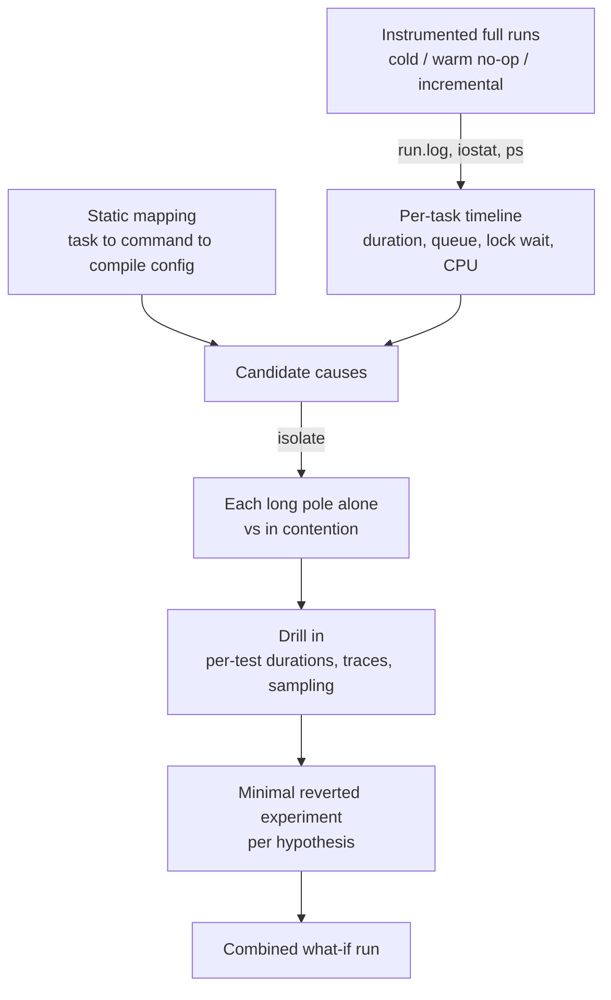

# Why the full `mise run` build is slow, and where to speed it up without losing confidence

**Date**: 2026-10-28 14:06 UTC
**Author**: Toby Clemson
**Git Commit**: `57a6fe699f535cf90cec7125f7b4b18a17be9177` (an empty working-copy change on `main` at `02c61f4c0f295da736e8b6a479f85a4379cf71ad`; permalinks below point at the `main` commit)
**Branch**: `main` (jj workspace `ticket-management`)
**Repository**: accelerator

## Research Question

The full build, run as a bare `mise run`, now takes a long time, and we do not
know why. Design a workflow that finds the main sources of contention and
slowness. Use it to write findings we can turn into scheduled work that speeds
the build up without losing the confidence it gives us. Make no improvements
now, though running any part of the build and making small, reverted
experiments to test theories is in scope.

## Summary

A warm `mise run` with **no source changes at all** takes **317 s** on an
Apple M4 Max. A cold workspace takes 464 s, and touching one core crate takes
338 s. In a typical run Rust compilation is not the main cost. Eight
long-running test tasks set the floor, and each is slow for a specific,
fixable reason:

| Long pole (warm no-op run) | In full run | Alone | Root cause |
|---|---|---|---|
| `test:unit:cli` | 307 s | 247 s | `cargo llvm-cov` cleans and recompiles every workspace crate on every run (≈90 s), then nextest runs for 150 s |
| `test:integration:skill-invocation` | 252 s | 163 s | a **debug-built** `minisign-verify` shim takes 1.15 s per launcher verification, ×143 cases |
| `test:integration:dev` | 179 s | 163 s | serial suite with about 10 s of fixed sleeps and timeouts per test |
| `test:e2e:visualiser` | 160 s | 131 s | Playwright `workers: 1` for all 356 tests, though 313 of them are read-only |
| `test:integration:visualiser` | 65–303 s | 51 s | re-runs the 338 lib unit tests that `test:unit:visualiser` already ran |
| `test:unit:visualiser` | 64–222 s | 43 s | log-rotation tests make about 13 M two-byte `write` syscalls; runs in two feature passes |
| `test:integration:research` | 54 s | 42 s | about 11k process spawns (already threaded; no action proposed) |
| `test:integration:hooks` | 18–58 s | 48 s | downloads the **published** launcher from GitHub on every run |

Each root cause was confirmed by a reverted experiment, not just by reading the
code:

- Optimising one crate in the dev profile cut `test:integration:skill-invocation` from 163 s to 18 s.
- Plain nextest instead of llvm-cov cut `test:unit:cli` from 247 s to 152 s.
- Six Playwright workers cut the read-only specs from 106 s to 34 s.
- `pytest-xdist -n 6` cut the dev suite from 163 s to 40 s.

Applying five quick wins together took the warm no-op `default` from 317 s to
**244 s**. That run still included the unfixed log-rotation tests.
They became the new tail: `test:unit:visualiser` took 162 s under load. The
projected floor with them fixed is roughly 170–190 s, bounded by nextest. That
figure is a projection, not a measurement.

The cold run is a different problem. The CPU is saturated (83% average, 100%
for about 3.5 minutes):
- **2,015 crate compilations** produce 456 distinct crates, across **15 distinct compile configurations**.
- 33 cargo invocations serialise on one `cli/target/debug` lock.
- Tasks spent about 440 s, summed across tasks, blocked on that lock.

Here the levers are fewer configurations and fewer redundant rebuilds, not more
parallelism.

The same long poles dominate CI. On the `ubuntu-latest` runner,
`test:integration:skill-invocation` alone takes 1,266 s, at a median of 8.0 s
per case. That makes the 23-minute integration job the critical path of every
workflow run; the next-longest job takes 11.5 minutes. `default` mirrors CI by
decision (see the follow-ups), so every recommendation here changes shared
task definitions or code and speeds up both.

## Measurement Workflow

The workflow separates four questions:
- How long does the whole run take?
- Which tasks are on the tail?
- Is each tail task slow intrinsically or only under contention?
- What inside it is slow?

The harness scripts are in the appendix.



1. **Instrumented full runs** (`timed-run.sh`). Run `mise run --output prefix
   --continue-on-error default` with every line timestamped by `ts`. Sample
   `iostat -w 2` for CPU and `ps -Ao pid,ppid,time,command` every second for
   cumulative CPU per process. Do this in three cache states: a cold workspace,
   a warm run with no changes, and a run after `touch cli/kernel/src/lib.rs`.
   `--continue-on-error` is mandatory today, because `deny:check` fails on a
   new advisory and otherwise aborts the run after 3 s.
2. **Per-task timeline** (`analyse.py`). Using `mise tasks --json` for the DAG,
   compute each task's duration, its queueing delay behind mise's job limit,
   the time it spent on cargo's "Blocking waiting for file lock" messages, and
   its `Compiling`/`Checking` unit counts. Then build a 30-second profile of
   CPU busy and running tasks.
3. **Static mapping.** Map every reachable task to its exact command, cargo
   flags, toolchain and target directory. Group the cargo calls into compile
   configurations that can or cannot share artefacts.
4. **Isolation** (`iso.sh`). Run each long-pole task alone with `mise run
   --skip-deps <task>`. The gap between the isolated and in-run durations is
   the contention cost. The isolated duration is the intrinsic cost.
5. **Drill in.** Use per-test durations: pytest `-v` lines with timestamps,
   nextest `PASS [ n s]`, Playwright per-spec. Also use `bash -x` traces of
   the bootstrap with timestamped `PS4`, 0.1 s process sampling, and
   `/usr/bin/time -l` to split user from system CPU.
6. **One reverted experiment per hypothesis.** Change the smallest thing that
   could confirm the cause, measure, restore from backup, and check
   `jj diff --stat` shows nothing.
7. **Combined what-if.** Apply the confirmed quick wins together and run the
   full build twice, keeping the warm second run.

⚠️ All figures come from one developer workstation that was also doing other
work:
- The machine is an Apple M4 Max (12P + 4E cores, 128 GB) on macOS 26.3, with mise's default of 8 concurrent jobs.
- With no build running it sat at 22–30% CPU busy, from IntelliJ, Chrome, `syspolicyd` and Dropbox.
- Most numbers come from one run each; repeated measurements varied by about ±15%.
- Treat absolute numbers as indicative and the ratios as the finding.
- "Cold workspace" means no `cli/target` and no frontend `node_modules`. The globally installed nightly, `cargo-pup`, `cargo-public-api` and `cargo-about` were already present, and so was the cargo registry.

## Detailed Findings

### Baseline runs

| Scenario | Wall | Busy core-seconds | Mean CPU busy |
|---|---|---|---|
| Cold workspace | 464 s | 6,437 | 83% |
| Warm, no changes | 317 s | 3,898 | 73% |
| Warm, after `touch cli/kernel/src/lib.rs` | 338 s | 4,278 | 76% |
| Warm, five quick wins applied (what-if) | 244 s | 3,135 | 77% |

Without `--continue-on-error`, `mise run` aborted after **3 s**. Every run
today fails `deny:check` on RUSTSEC-2026-0414, a pulldown-cmark wikilink
advisory that the live advisory database now reports. So the first thing a developer
sees from a bare `mise run` is one supply-chain failure and none of the other
results. This is not a speed problem, but it is the hidden cost of the advisory
database being a live network input.

Warm no-op timeline (seconds from start):

```mermaid
gantt
    dateFormat X
    axisFormat %s
    section Rust
    unit cli (llvm-cov)            : 10, 317
    unit visualiser                : 65, 129
    integration visualiser         : 11, 76
    section Python
    integration skill-invocation   : 2, 254
    integration dev                : 2, 181
    integration research           : 8, 61
    section Frontend
    e2e visualiser                 : 67, 227
    unit frontend                  : 42, 65
```



For the first ~150 s the CPU runs at 65–100% busy, mostly above 88%. After
that only 2–5 long serial suites remain and utilisation falls to 42–79%. mise is not short of
job slots at that point. It has nothing else left to run.

### The coverage lane cleans and recompiles every run

`test:unit:cli` runs `cargo llvm-cov nextest --workspace --exclude
accelerator-visualiser --all-features --summary-only`
([tasks/test/cli.py:11-14, 31-36](https://github.com/atomicinnovation/accelerator/blob/02c61f4c0f295da736e8b6a479f85a4379cf71ad/tasks/test/cli.py#L11-L36)).
By default cargo-llvm-cov first runs `cargo clean --package <every workspace
member>` against `cli/target/llvm-cov-target`. Process sampling caught it
directly.

| Phase (isolated, warm) | Duration |
|---|---|
| `cargo clean --package …` (single-threaded, 59 CPU-s) | 61 s |
| Recompile the 44 workspace crates instrumented | 30 s |
| nextest: 6,407 tests across 369 binaries | 149 s |
| Report | 4 s |
| **Total** | **247 s** |

Experiments, all warm and alone:
- `ACCELERATOR_COVERAGE=off`, the existing escape hatch (plain nextest): **152 s**.
- `cargo llvm-cov nextest … --no-clean`: **160 s**.
- `cargo llvm-cov clean --workspace` alone: **70 s**.

Instrumentation itself costs only about 8 s. The clean, and the recompile it
forces, cost about 90 s.

Coverage is report-only:
- It has no `--fail-under` threshold.
- No code branches on `cfg(coverage)`.
- `.github/workflows/main.yml` does not upload the report.

So in a local `mise run`, coverage changes nothing about pass or fail. It also
relinks 369 test binaries on every run, which feeds the `syspolicyd` scanning
described under "Host environment". The 0162 plan already recorded that
"coverage instrumentation recompiles the workspace". The full cost of the
clean is new here.

### nextest phase: VCS fixture matrices dominate the long tail

The nextest phase is 2,296 test-seconds across 16 threads. The slowest 25
tests, at 20–47 s each, are all VCS fixture tests. The heaviest test binaries
are:

| Binary | Tests | Test-seconds |
|---|---|---|
| `vcs-adapters::classify` | 6 | 277 |
| `vcs-test-support::matrix` | 6 | 208 |
| `accelerator-migrate::guarded_resume` | 13 | 191 |
| `accelerator-work` (bin unit tests) | 338 | 176 |
| `vcs-adapters::queries` | 6 | 172 |
| `vcs-adapters::dirty_paths_size` | 14 | 102 |
| `accelerator-vcs::status_log_goldens` | 9 | 95 |

Thirteen tests across `classify`, `queries` and `scrub` each call
`Matrix::build_in(base.path())`
([cli/vcs-adapters/tests/classify.rs:177](https://github.com/atomicinnovation/accelerator/blob/02c61f4c0f295da736e8b6a479f85a4379cf71ad/cli/vcs-adapters/tests/classify.rs#L177)).
That rebuilds the full git/jj fixture matrix with real `git` and `jj`
subprocesses, separately in each nextest process. One matrix build alone takes
**3.3 s wall and 1.9 CPU-s**, of which 1.17 s is sys time. Under the full
suite's load the same tests take 35–47 s. A shared-matrix mechanism already
exists:
- `Matrix::build_or_adopt` with `ACCELERATOR_ZERO_SPAWN_MATRIX` ([cli/vcs-test-support/src/fixtures.rs:25, 47-57, 109-116](https://github.com/atomicinnovation/accelerator/blob/02c61f4c0f295da736e8b6a479f85a4379cf71ad/cli/vcs-test-support/src/fixtures.rs#L25-L116)).
- Only the zero-spawn lane uses it.

Two hypotheses were ruled out:
- **nextest's process-per-test model is not the overhead.** The 338
  `accelerator-work` bin tests took 10.8 s under nextest and 11.1 s under
  `cargo test`.
- **The phase is not CPU-saturated.** CPU ran at about 50% busy during the
  isolated nextest phase. So the phase is bound by spawn latency and its long
  poles, not by core count.

### Debug-built verify shim in the bootstrap suites

`test:integration:skill-invocation` runs 143 `config` commands through the
real `bin/accelerator` bootstrap. On every call the bootstrap verifies the
cached launcher's minisign signature
([bin/accelerator:409-411, 435](https://github.com/atomicinnovation/accelerator/blob/02c61f4c0f295da736e8b6a479f85a4379cf71ad/bin/accelerator#L409-L435)).
The fixture's shim and launcher are debug builds made by
[tests/support/artefacts.py:56-93](https://github.com/atomicinnovation/accelerator/blob/02c61f4c0f295da736e8b6a479f85a4379cf71ad/tests/support/artefacts.py#L56-L93).
`minisign-verify`
([cli/verify/Cargo.toml:22](https://github.com/atomicinnovation/accelerator/blob/02c61f4c0f295da736e8b6a479f85a4379cf71ad/cli/verify/Cargo.toml#L22))
hashes the whole 76 MB debug launcher with unoptimised code.

| Verifier | Time to verify the 76 MB launcher |
|---|---|
| Debug-built shim (as tested) | 1.15 s |
| Committed release shim `bin/accelerator-verify-darwin-arm64` | 0.06 s |
| Debug shim with `[profile.dev.package.minisign-verify] opt-level = 3` | 0.06 s |

Sampling at 0.1 s over 44 cases found the shim running in 299 of 328 ticks,
about 90% of the suite's wall-clock. With the
three-line profile override, which takes 1.8 s to rebuild:
- `test:integration:skill-invocation` went from **163 s to 18 s**.
- `test:integration:entrypoint` went from 18 s to 14 s.

The tests still exercise the real shim and the real bootstrap. Only the
optimisation level of one crate changes.

The test docstring estimates "~0.1s a go" per case. The real figure is about
1.1 s alone and about 1.75 s under load.

### Visualiser lib tests: syscall-bound log tests, run three times

The 338 visualiser lib unit tests run three times per `default`:
- **`test:unit:visualiser`, `dev-frontend` pass** ([tasks/test/unit.py:24](https://github.com/atomicinnovation/accelerator/blob/02c61f4c0f295da736e8b6a479f85a4379cf71ad/tasks/test/unit.py#L24)).
- **`test:unit:visualiser`, `embed-dist` pass** ([tasks/test/unit.py:27](https://github.com/atomicinnovation/accelerator/blob/02c61f4c0f295da736e8b6a479f85a4379cf71ad/tasks/test/unit.py#L27)).
- **`test:integration:visualiser`**: it uses `cargo test --tests` ([tasks/test/integration.py:27](https://github.com/atomicinnovation/accelerator/blob/02c61f4c0f295da736e8b6a479f85a4379cf71ad/tasks/test/integration.py#L27)), which includes the lib target, with the same `dev-frontend` features as the first pass.

The third run is a pure duplicate.

Three tests in `log::tests` push 2-byte lines past the 5 MiB cap
([cli/visualiser/server/src/log.rs:19, 122-170](https://github.com/atomicinnovation/accelerator/blob/02c61f4c0f295da736e8b6a479f85a4379cf71ad/cli/visualiser/server/src/log.rs#L19-L170)).
`retains_at_most_three_rotated_segments` takes **22.3 s, of which 20.8 s is
kernel time**: about 13 M `write` syscalls. The module costs about 42 CPU-s
per pass, almost all of it sys time. That explains the lib suite's extreme
sensitivity to load:

| Run | Lib-test phase of `test:integration:visualiser` |
|---|---|
| Warm no-op | 33 s |
| After kernel touch | 238 s |
| Alone (nextest) | 24 s |

In the quick-wins what-if, the `dev-frontend` pass of `test:unit:visualiser`
took 129 s. That made it the run's last task.

### Serial Playwright

[playwright.config.ts:14](https://github.com/atomicinnovation/accelerator/blob/02c61f4c0f295da736e8b6a479f85a4379cf71ad/cli/visualiser/frontend/playwright.config.ts#L14)
forces `workers: 1` for both projects. The config comment justifies this for
the kanban drag tests and the visual snapshots. However, 313 of the 356 tests
are in the `resolved-styles` project, which reads computed styles from static
showcase routes.

| Run | Wall |
|---|---|
| Both projects, 1 worker (as today, alone) | 131 s |
| `resolved-styles` only, 1 worker | 106 s |
| `resolved-styles` only, 6 workers | 34 s (313/313 passed, one run) |
| `chromium` only, 1 worker | 25 s |

Running `resolved-styles` in parallel and `chromium` serially brings the
suite to about 60 s. `retries: 1` (line 9) applies locally as well as in CI,
which can hide flakes. It did not trigger in these runs.

### Dev-task integration suite sleeps serially

`tests/integration/dev` has 17 tests that drive real circusd. Each costs
4–20 s, mostly in fixed waits:
- **`grace_kill`:** 3.0 s on every stop ([dev_integration_driver.py:196](https://github.com/atomicinnovation/accelerator/blob/02c61f4c0f295da736e8b6a479f85a4379cf71ad/tests/integration/dev/dev_integration_driver.py#L196)).
- **`probe_timeout`:** 5.0 s whenever teardown probes an absent arbiter ([dev_integration_driver.py:191](https://github.com/atomicinnovation/accelerator/blob/02c61f4c0f295da736e8b6a479f85a4379cf71ad/tests/integration/dev/dev_integration_driver.py#L191)).
- **Settle sleeps:** 0.5 s each.

No pytest suite in the repo uses parallelism
([tasks/test/integration.py:36](https://github.com/atomicinnovation/accelerator/blob/02c61f4c0f295da736e8b6a479f85a4379cf71ad/tasks/test/integration.py#L36)).
`uv run --with pytest-xdist pytest tests/integration/dev -n 6` passed 17/17
in **40 s** against 163 s. This was one run, with no port or state collisions.

### Hooks smoke test downloads the published launcher

`test_launcher_dispatch_smoke_on_a_plain_non_repo_dir`
([tests/integration/hooks/test_vcs_detect_registration.py:30-70](https://github.com/atomicinnovation/accelerator/blob/02c61f4c0f295da736e8b6a479f85a4379cf71ad/tests/integration/hooks/test_vcs_detect_registration.py#L30-L70))
sets `ACCELERATOR_VCS_BIN` but not `ACCELERATOR_BIN`, and points
`ACCELERATOR_CACHE_DIR` at an empty temporary directory. A `bash -x` trace
shows what happens next:
- The bootstrap `curl`s `https://github.com/atomicinnovation/accelerator/releases/download/v1.24.0-pre.87/accelerator-darwin-arm64` (17 MB), and that fetch alone took 42 s.
- The whole test took 53–66 s when run alone.

The cache-hit path takes 0.32 s. So the test depends on the network, fails
offline, and exercises the **published** launcher rather than the one under
test.

### Rust compile configurations and the shared target lock

The cargo calls reachable from `default` fall into 15 compile configurations.
A configuration is the combination of toolchain, target directory, profile,
mode, wrapper, package selection and unified features. Artefacts are shared
only within a configuration:

| Configuration | Tasks |
|---|---|
| Stable debug build, one root each (×6) | `build:server:dev`, `build:cli:dev` (+ in-test `build_launcher`), `build:cli:{vcs,corpus,research}:dev`, in-test `build_shim` |
| Stable debug test, visualiser (×2) | `test:unit:visualiser` (both passes); `test:integration:visualiser` shares the first |
| Stable clippy check (×3) | `lint:server:check` (two passes), `lint:cli:check` |
| Nightly check and rustdoc, 16 roots | `public-api:check` |
| Nightly pup-driver check in `cli/.pup` | `pup:check` |
| Stable release, thin LTO | `build:cli:fixture-size` |
| Stable instrumented test in `llvm-cov-target` | `test:unit:cli` |

Resolver 3 unifies features only across the packages selected in a call, so
each `--bin` root gets its own feature closure. In `cli/target/debug/deps`,
`kernel` exists as 7 different artefacts and `syn` as 5 build-mode rlibs.

In the cold run:
- **Volume:** 1,164 `Compiling` units and 851 `Checking` or `Documenting` units, 2,015 in all, for 456 distinct crates.
- **Lock contention:** 33 invocations shared `cli/target/debug/.cargo-lock`.
- **Lock waits:** build and test tasks spent about 440 task-seconds waiting on it. `test:integration:visualiser` waited 75 s, `test:unit:visualiser` 73 s, `lint:server:check` 70 s, `public-api:check` 65 s and `build:cli:corpus:dev` 50 s.

Because the CPU was saturated, most of that waiting reordered work rather than
adding wall-clock. The lever is to cut duplicate work. Separate target
directories would remove lock waits but compile the shared dependency graph
yet again.

After a `kernel` touch, `kernel` was rebuilt in 10 configurations: 5 compiles,
4 checks and 1 rustdoc. That run took 338 s against 317 s for a no-op. On this
machine incremental Rust work adds about 20 s, and the test floor dominates.

### Rebuild triggers on unchanged inputs

- **`build:frontend` rewrites `dist/` on every run.** It has no
  `sources`/`outputs` ([mise.toml:205-208](https://github.com/atomicinnovation/accelerator/blob/02c61f4c0f295da736e8b6a479f85a4379cf71ad/mise.toml#L205-L208)).
  The visualiser `build.rs` watches the whole directory
  ([cli/visualiser/server/build.rs:20](https://github.com/atomicinnovation/accelerator/blob/02c61f4c0f295da736e8b6a479f85a4379cf71ad/cli/visualiser/server/build.rs#L20)),
  so even a no-op run recompiled `accelerator-visualiser` in `pup:check` and in
  the `embed-dist` pass of `test:unit:visualiser`. With no `build` block in
  `vite.config.ts`, Vite's default `emptyOutDir` also races the stub-gated
  `build.rs` assert in concurrent clippy and pup runs.
- **The launcher's `build.rs` reruns when the parent repository's `.git/HEAD`
  moves** ([cli/launcher/build.rs:18-25](https://github.com/atomicinnovation/accelerator/blob/02c61f4c0f295da736e8b6a479f85a4379cf71ad/cli/launcher/build.rs#L18-L25)).
  It watches `/Users/…/accelerator/.git/HEAD` through vergen-gitcl. Commits in
  the main jj workspace therefore rebuild the launcher in every configuration
  of every other workspace. `build_timestamp(true)` guarantees the recompile
  is never a no-op.
- **`deps:install:node` runs `npm ci` unconditionally**
  ([tasks/deps.py:204](https://github.com/atomicinnovation/accelerator/blob/02c61f4c0f295da736e8b6a479f85a4379cf71ad/tasks/deps.py#L204)).
  That deletes `node_modules`, and with it the `tsBuildInfoFile`s
  ([tsconfig.app.json:3](https://github.com/atomicinnovation/accelerator/blob/02c61f4c0f295da736e8b6a479f85a4379cf71ad/cli/visualiser/frontend/tsconfig.app.json#L3))
  and the Vite cache. Both `tsc -b` runs (in `build:frontend` and
  `types:frontend:check`) then start cold. It costs only about 5 s alone, but
  the churn also feeds the IDE indexer.
- **`test:unit:frontend-licenses` runs its own sourcemap Vite build and a
  second `license-checker`.** About 3 s alone, but up to 49 s under load.

### Scheduling: why more parallelism is not the lever

mise ran 8 jobs. In the cold run, ready tasks queued for up to 125 s behind the
job limit while the CPU sat at 97–100%, so more slots would only add
contention. In every warm run the tail is 1–5 internally serial suites with
idle cores. Raising `jobs` does nothing for those. Shortening the suites does.

### Host environment

`syspolicyd` and IntelliJ react to what the build writes, so they belong to its
cost on this machine:
- **`syspolicyd`:** 44–78 CPU-s per run. It is the XProtect/Gatekeeper assessment of newly linked or copied executables. Each coverage run relinks 369 test binaries, and the bootstrap suites copy binaries into temporary installations.
- **IntelliJ:** 272–384 CPU-s per run.
- **After a build:** both stayed above 80% of a core for minutes.

These effects were observed but not separated out by experiment.

### Smaller observations

- **`default` never runs `lint:fix`.** It reaches `format:fix` but not
  `lint:fix` ([mise.toml:757-759](https://github.com/atomicinnovation/accelerator/blob/02c61f4c0f295da736e8b6a479f85a4379cf71ad/mise.toml#L757-L759)),
  despite the root `CLAUDE.md` saying it "applies all formatters and safe lint
  fixes".
- **`format:fix` runs in parallel with lint and test tasks** that read the
  same files. It is an ordering hazard rather than a speed cost.
- **`format:server:fix` and `format:cli:fix` both format the whole workspace**,
  because `--all` through a member manifest covers every member.
- **`public-api:check` runs 16 sequential nightly rustdoc calls.** That is
  12–51 s depending on load, all on the shared debug lock.
- **`lint:store-duplication:check` walks the 17 GB `cli/target` tree**
  unpruned (0.6–2.5 s).
- **The `docs:*` tasks are the only tasks with working mise
  `sources`/`outputs` caching.** They were skipped correctly in warm runs.

## Recommended Work

Rows are ordered by return on effort. Savings were measured alone unless
marked projected. Effort is a rough t-shirt size.

| ID | Change | Saving | Effect on confidence |
|---|---|---|---|
| A1 | Add `[profile.dev.package.minisign-verify] opt-level = 3` to `cli/Cargo.toml` (XS) | skill-invocation 163 → 18 s; entrypoint 18 → 14 s | None: same code, real shim |
| A2 | In the shared coverage task, replace the full clean with `cargo llvm-cov clean --profraw-only` then `--no-clean`, and make `--summary-only` take effect; keep instrumentation everywhere, since `default` mirrors CI (never bare `--no-clean`; see the follow-ups) (XS) | 247 → about 160 s on the longest pole | None: same instrumented run as CI, correct figures |
| A3 | Rewrite the `log::tests` writes in large chunks, or inject a small cap (S) | ≈42 sys-CPU-s per pass ×3; lib phase 33–238 s → projected under 10 s | None, if rotation is byte-based (check) |
| A4 | Give `test:integration:visualiser` `--test '*'` instead of `--tests` (XS) | 24–238 s of duplicate lib tests | None: same tests, same features, already run in `test:unit:visualiser` |
| A5 | Run `resolved-styles` with 6 workers and `chromium` serially (S) | 131 → about 60 s | None, if parallel runs stay flake-free (validate over repeated runs) |
| A6 | Parallelise `tests/integration/dev` (xdist), or shrink `grace_kill`/`probe_timeout` for tests (S) | 163 → 40 s | Validate for flakes; xdist adds a dev dependency |
| A7 | Run the hooks smoke test against the local launcher (`ACCELERATOR_BIN`) or a stubbed downloader (S) | Most of the 18–58 s task (the download alone took 42 s); removes the network | Improves: tests the code under test and works offline |
| B1 | Build the VCS fixture matrix once per run (nextest setup script plus `ACCELERATOR_ZERO_SPAWN_MATRIX`) and adopt it in the read-only tests (M) | Shortens the 35–47 s long poles; projected 20–40 s off nextest | Only safe for tests that do not mutate the matrix (audit each) |
| B2 | Collapse the debug builds into one `cargo build` with unified features, drop in-test cargo builds that mise already covers, and align clippy feature sets (M) | Cold and incremental CPU: fewer than the 2,015 units and 15 configurations | None |
| B3 | Give `build:frontend` `sources`/`outputs` so an unchanged frontend leaves `dist/` alone (S) | Removes visualiser recompiles in 2–4 configurations per run, and the `emptyOutDir` race | None |
| B4 | Give `deps:install:node` `sources`/`outputs` on `package-lock.json` (XS) | About 5 s; keeps `tsc -b` and the Vite cache incremental | None |
| B5 | Trial `debug = "line-tables-only"` for dependencies in the dev profile (S) | Not measured: smaller binaries (the launcher is 76 MB), faster links and hashing | Some debugger detail lost in dependencies |
| B6 | Exclude the parent `.git/HEAD` and the build timestamp from launcher rebuilds in dev builds (S) | One launcher recompile per configuration per upstream commit | None for tests; release builds keep the metadata |
| C1 | Commit the appendix harness as a `measure:build` task and record a baseline (S) | Lets each change above be checked | None |
| C2 | Host hygiene: add the terminal and IDE to macOS Developer Tools; exclude `cli/target` and `node_modules` from indexing (XS) | Not measured: 44–78 CPU-s of `syspolicyd` and 270–380 CPU-s of IntelliJ per run | None |

**A2** is the one row that is a policy choice rather than a pure fix. Dropping
instrumentation locally loses nothing that fails a build today. It does mean a
developer no longer sees the coverage summary on every local run.
Bare `--no-clean` is not a safe middle ground. It never deletes old profile
data, so every report merges in counts from earlier runs. Cleaning only the
profraw files first keeps the summary at close to plain-nextest cost. The
follow-up section has the measurements.

**A5 and A6** trade a little flake risk for large savings. Both passed in the
single runs here. Each needs repeated-run validation, for example 10
consecutive runs under a full `mise run` load, before it lands.

**B1** has the largest structural payoff in the Rust suite. It needs an audit
of which matrix consumers only read. `scrub` "poisons" the environment, not the
fixtures, but that needs confirming.

### Combined what-if result

A1, A2 (as `ACCELERATOR_COVERAGE=off`), A4, A5 and A6 were applied together as
temporary edits, then reverted. The warm second run:

| Task | Warm no-op | Quick wins |
|---|---|---|
| `default` wall | 317 s | **244 s** |
| `test:unit:cli` | 307 s | 169 s |
| `test:integration:skill-invocation` | 252 s | 19 s |
| `test:integration:dev` | 179 s | 56 s |
| `test:e2e:visualiser` | 160 s | 107 s |
| `test:unit:visualiser` | 64 s | 162 s |

`test:unit:visualiser` became the new tail. Its `dev-frontend` pass took 129
s, because the syscall-bound log tests now overlapped the busiest phase. With
A3, the projected floor is the nextest phase under load, roughly 170–190 s.
B1 attacks that next. The what-if run's only failure besides `deny:check` was
`lint:build-system:check`, where ruff flagged a temporary over-long line.

## Code References

- [`mise.toml:757-759`](https://github.com/atomicinnovation/accelerator/blob/02c61f4c0f295da736e8b6a479f85a4379cf71ad/mise.toml#L757-L759): the `default` task's dependency list.
- [`mise.toml:205-208`](https://github.com/atomicinnovation/accelerator/blob/02c61f4c0f295da736e8b6a479f85a4379cf71ad/mise.toml#L205-L208): `build:frontend` with no `sources`/`outputs`.
- [`mise.toml:82-84`](https://github.com/atomicinnovation/accelerator/blob/02c61f4c0f295da736e8b6a479f85a4379cf71ad/mise.toml#L82-L84): `deps:install:node` with no freshness guard.
- [`tasks/test/cli.py:11-36`](https://github.com/atomicinnovation/accelerator/blob/02c61f4c0f295da736e8b6a479f85a4379cf71ad/tasks/test/cli.py#L11-L36): the llvm-cov nextest command and the `ACCELERATOR_COVERAGE` switch.
- [`tasks/test/unit.py:24-27`](https://github.com/atomicinnovation/accelerator/blob/02c61f4c0f295da736e8b6a479f85a4379cf71ad/tasks/test/unit.py#L24-L27): the two visualiser lib passes.
- [`tasks/test/integration.py:27`](https://github.com/atomicinnovation/accelerator/blob/02c61f4c0f295da736e8b6a479f85a4379cf71ad/tasks/test/integration.py#L27): `cargo test --tests` re-runs the lib tests.
- [`tasks/test/integration.py:36`](https://github.com/atomicinnovation/accelerator/blob/02c61f4c0f295da736e8b6a479f85a4379cf71ad/tasks/test/integration.py#L36): the serial dev suite.
- [`tasks/shared/dev_builds.py:68-78`](https://github.com/atomicinnovation/accelerator/blob/02c61f4c0f295da736e8b6a479f85a4379cf71ad/tasks/shared/dev_builds.py#L68-L78): one `cargo build` per binary group.
- [`tasks/lint/server.py:15`](https://github.com/atomicinnovation/accelerator/blob/02c61f4c0f295da736e8b6a479f85a4379cf71ad/tasks/lint/server.py#L15): the two clippy feature passes.
- [`tasks/public_api.py:117`](https://github.com/atomicinnovation/accelerator/blob/02c61f4c0f295da736e8b6a479f85a4379cf71ad/tasks/public_api.py#L117): the per-crate nightly `public-api` loop.
- [`tasks/deps.py:204`](https://github.com/atomicinnovation/accelerator/blob/02c61f4c0f295da736e8b6a479f85a4379cf71ad/tasks/deps.py#L204): the unconditional `npm ci`.
- [`tests/support/artefacts.py:56-93`](https://github.com/atomicinnovation/accelerator/blob/02c61f4c0f295da736e8b6a479f85a4379cf71ad/tests/support/artefacts.py#L56-L93): debug shim and launcher built inside pytest.
- [`bin/accelerator:409-435`](https://github.com/atomicinnovation/accelerator/blob/02c61f4c0f295da736e8b6a479f85a4379cf71ad/bin/accelerator#L409-L435): the launcher is verified on every call, including cache hits.
- [`cli/verify/Cargo.toml:22`](https://github.com/atomicinnovation/accelerator/blob/02c61f4c0f295da736e8b6a479f85a4379cf71ad/cli/verify/Cargo.toml#L22): the `minisign-verify` dependency.
- [`cli/Cargo.toml:260-262`](https://github.com/atomicinnovation/accelerator/blob/02c61f4c0f295da736e8b6a479f85a4379cf71ad/cli/Cargo.toml#L260-L262): the only profile override (release).
- [`cli/vcs-test-support/src/fixtures.rs:25-116`](https://github.com/atomicinnovation/accelerator/blob/02c61f4c0f295da736e8b6a479f85a4379cf71ad/cli/vcs-test-support/src/fixtures.rs#L25-L116): `ACCELERATOR_ZERO_SPAWN_MATRIX`, `matrix_root` and `build_or_adopt`.
- [`cli/vcs-adapters/tests/classify.rs:177`](https://github.com/atomicinnovation/accelerator/blob/02c61f4c0f295da736e8b6a479f85a4379cf71ad/cli/vcs-adapters/tests/classify.rs#L177): a matrix rebuilt in each test.
- [`cli/visualiser/server/src/log.rs:19-170`](https://github.com/atomicinnovation/accelerator/blob/02c61f4c0f295da736e8b6a479f85a4379cf71ad/cli/visualiser/server/src/log.rs#L19-L170): the 5 MiB cap and the 2-byte-write rotation tests.
- [`cli/visualiser/server/build.rs:20`](https://github.com/atomicinnovation/accelerator/blob/02c61f4c0f295da736e8b6a479f85a4379cf71ad/cli/visualiser/server/build.rs#L20): `rerun-if-changed` on the whole `dist/` directory.
- [`cli/launcher/build.rs:18-25`](https://github.com/atomicinnovation/accelerator/blob/02c61f4c0f295da736e8b6a479f85a4379cf71ad/cli/launcher/build.rs#L18-L25): vergen build timestamp and git metadata.
- [`cli/visualiser/frontend/playwright.config.ts:9-14`](https://github.com/atomicinnovation/accelerator/blob/02c61f4c0f295da736e8b6a479f85a4379cf71ad/cli/visualiser/frontend/playwright.config.ts#L9-L14): `retries: 1`, `workers: 1`.
- [`cli/visualiser/frontend/vite.config.ts:66-78`](https://github.com/atomicinnovation/accelerator/blob/02c61f4c0f295da736e8b6a479f85a4379cf71ad/cli/visualiser/frontend/vite.config.ts#L66-L78): Vitest timeouts raised to 30 s because of build contention.
- [`tests/integration/hooks/test_vcs_detect_registration.py:30-70`](https://github.com/atomicinnovation/accelerator/blob/02c61f4c0f295da736e8b6a479f85a4379cf71ad/tests/integration/hooks/test_vcs_detect_registration.py#L30-L70): the smoke test that fetches the release.
- [`tests/integration/dev/dev_integration_driver.py:191-196`](https://github.com/atomicinnovation/accelerator/blob/02c61f4c0f295da736e8b6a479f85a4379cf71ad/tests/integration/dev/dev_integration_driver.py#L191-L196): `probe_timeout` 5 s, `grace_kill` 3 s.

## Architecture Insights

- **`default` is the sum of about 12 CI jobs run on one host.** CI spreads
  `check-*`, `test-unit`, `test-integration`, `test-e2e` and the nightly lane
  across separate runners, each with its own `cli/target`. Locally they share
  one target directory, one cargo lock and one CPU, so contention exists only
  locally. Fixes should target that local sharing rather than copy CI's
  layout.
- **The repository already pays for contention in its tests.** Vitest
  timeouts were raised to 30 s, the visualiser has a 30 s startup budget, and
  the artefact "claim" copy in `tests/support/artefacts.py` exists because
  concurrent cargo builds unlink binaries mid-run. Those mitigations treat the
  symptom. The long poles above are the cause.
- **Dev-profile builds sit in the middle of crypto-heavy test paths.** The
  shim and launcher are tested exactly as shipped, except for the
  optimisation level. Per-package `opt-level` keeps that fidelity at release
  speed.
- **Freshness caching is almost absent from the task tree.** Only the docs
  tasks declare `sources`/`outputs`. Every other task, including `npm ci`, the
  frontend build and twelve Python guards, runs on every invocation.

## Historical Context

- `meta/decisions/ADR-0050-mise-invoke-task-runner.md`: mise and invoke, a parallel `depends` graph, and "local mirrors CI". No ADR mandates coverage, or any particular test lane, in the local `default`.
- `meta/decisions/ADR-0053-thin-cli-over-a-hexagonal-ports-and-adapters-core.md` and `meta/plans/2026-08-11-0204-remote-tracker-port.md`: the isolated nightly lane that `pup:check` and `public-api:check` run in.
- `meta/plans/2026-07-02-0162-rust-toolchain-guard-rails.md`: put coverage in `test`, not `check`. Notes that "coverage instrumentation recompiles the workspace" and adds `ACCELERATOR_COVERAGE=off` as the fast loop.
- `meta/work/0188-library-backed-vcs-adapter.md`: an earlier cold measurement of `build:server:dev` (21.2 s wall, 103 CPU-s, gix about 64%).
- `meta/validations/2026-08-03-0188-library-backed-vcs-adapter-validation.md`: target-directory contention causing "not built" failures under a full `mise run`. That is the origin of the artefact-claim helper.
- `meta/validations/2026-08-02-0187-generalise-sub-binary-registration-surface-validation.md`: flakes in a fully parallel `mise run test` (a `node_modules` copytree race and a Vitest worker timeout).
- `meta/plans/2026-10-06-0299-crate-dependencies-adr-0069.md`: introduced the per-binary `build:cli:<token>:dev` leaves and `test-loopback` in every debug build.
- `meta/plans/2026-06-12-0108-local-docker-visual-regression-baselines.md`: where `workers: 1` comes from, for the screenshot specs.
- `meta/plans/2026-07-10-0177-documentation-site-for-docs-tree.md`: Chromium download cost for the docs build, with caching deferred.

## Related Research

- `meta/research/codebase/2026-06-29-0162-rust-toolchain-guard-rails-wiring.md`
- `meta/research/codebase/2026-06-09-0098-repo-wide-linting-formatting-static-analysis.md`
- `meta/research/codebase/2026-08-02-0188-library-backed-vcs-adapter.md`
- `meta/research/codebase/2026-10-06-0299-crate-dependencies-adr-0069.md`

## Open Questions

- Resolved: `default` mirrors CI as far as possible, with no lighter local
  profile. Local runs therefore keep coverage instrumentation, using a
  profraw-only clean plus `--no-clean`. See the second follow-up.
- Which consumers of the VCS fixture matrix mutate it (B1)? Not audited.
- Does the 5 MiB rotation logic depend on line boundaries (A3)? Chunked
  writes are only equivalent if rotation is byte-based. Not checked.
- How much do the Developer Tools exemption and IDE exclusions (C2) save?
  Not measured.
- Cold-run CPU attribution per crate (`cargo build --timings`) was not
  collected. The 0188 figure, gix at about 64% of cold CPU for the server
  build, is the best available proxy.
- Not covered: CI wall-clock per job, the Linux legs, and the
  `test:e2e:visualiser:docker` lane.

## Follow-up Research 2026-10-28T15:39:09+00:00

### Keeping or dropping local coverage instrumentation

**Question:** should a local `mise run` keep the coverage summary, perhaps
via `--no-clean`, or drop instrumentation entirely?

**Superseded by the next follow-up.** Because `default` mirrors CI,
instrumentation stays, and the profraw-only variant below is the one to
adopt. The analysis is kept for the record.

**Original recommendation:** drop instrumentation from the local `default`
and add an opt-in coverage task that cleans only profraw files. Never use bare
`--no-clean`, because it quietly accumulates stale profile data, as measured
below. The pass/fail result is the same under every option, because the
coverage report gates nothing.

#### What the coverage lane produces today

`cargo llvm-cov nextest … --summary-only` runs in four stages:
1. Delete every workspace member's artefacts and all `*.profraw` files in `cli/target/llvm-cov-target`.
2. Build the test binaries with coverage instrumentation, injected through cargo-llvm-cov's `RUSTC_WRAPPER`, with `cfg(coverage)` set.
3. Run nextest. Each test process writes a profile file: about 9,200 files, or 0.8 GB, per full run.
4. Merge the files with `llvm-profdata` and print a report.

Two facts limit what that output is worth locally:
- **The report is a 523-row per-file table.** cargo-llvm-cov documents
  `--summary-only` as working only with `--json`, `--lcov` or `--cobertura`,
  so in text mode the task prints the full table. In a full `mise run` that
  table sits in the middle of interleaved output from 60-odd tasks.
- **Nothing consumes it.** There is no `--fail-under-*`, CI does not upload
  it, and no code branches on `cfg(coverage)`. Instrumented and plain runs
  execute the same 6,407 tests with the same features and give the same
  verdict.

#### Options and their measured costs

All timings are warm and isolated, from the main measurements.

| Option | `test:unit:cli` | Coverage figures | Side effects |
|---|---|---|---|
| Keep today's behaviour (full clean) | 247 s alone; 307 s in a full run | Correct each run | 61–107 s single-threaded `cargo clean -p ×44`; 30 s recompile; relinks 369 binaries each run; 9.4 GB target directory |
| Bare `--no-clean` | 160 s | **Wrong from the second run on** | About 9,200 files and 0.8 GB more profile data per run, never deleted, all merged into each report |
| `cargo llvm-cov clean --profraw-only`, then `--no-clean` | About 160 s (projected; the profraw clean took about 1 s for 18 files) | Matched a full clean in the one scenario tested | Leftover instrumented binaries remain (see the caveat below) |
| Plain nextest (`ACCELERATOR_COVERAGE=off`) | 152 s alone; 169 s in a full run | None locally | The test build moves into the shared `cli/target/debug` lock (1–2 s of lock wait in warm runs); the 9.4 GB directory is no longer needed |

Three experiments on `kernel` support the "wrong from the second run on"
claim:

| Run | Profraw before → after | Kernel line / function / region coverage |
|---|---|---|
| `-p kernel --no-clean`, with a prior full run's files present | 9,201 → 9,219 | 89.94% / 96.88% / 86.22% |
| `-p kernel` with the default clean | → 18 | 77.99% / 84.38% / 75.59% |
| `clean --profraw-only`, then `-p kernel --no-clean`, after seeding with a `-p corpus` run | 305 → 18 | 77.99% / 84.38% / 75.59% |

With bare `--no-clean`, the report counted kernel lines that the run under
test never executed: 12 percentage points of line coverage inherited from an
earlier, different run. The likely mechanism is that `llvm-profdata` merges
counters by function identity across every profile file present. Stale files
from an earlier run therefore add executions the current run never made.
Inside a stable full-workspace loop the inflation would usually be smaller,
coming only from tests that have since been removed or changed. The file
count, the disk use and the merge time still grow without limit.

⚠️ The profraw-only variant still leaves stale instrumented *binaries* in
place. cargo-llvm-cov's warning that `--no-clean` "can cause false
positives/false negatives due to old build artifacts" covers that case: for
example, a deleted test file whose old binary survives. This was not
reproduced, and how cargo-llvm-cov chooses the objects it reports on was not
examined. An occasional full `cargo llvm-cov clean --workspace`, such as on
the opt-in task's first run or weekly, bounds the risk.

#### How each choice would be wired

- **Drop locally, keep in CI.** Make `coverage_enabled()` default to off, and
  have `.github/workflows/main.yml` set `ACCELERATOR_COVERAGE=on` on the jobs
  that run `test:unit`. The "Contributor environment variables" table in
  `tasks/README.md` says "CI ignores both (it runs the fail-closed
  defaults)", so it needs rewording. The setting has no pass/fail effect, so
  the convention that a local run mirrors CI still holds for the verdict.
  Leaving the instrumented run as an opt-in task, for example
  `test:unit:cli:coverage`, keeps the table one command away.
- **Keep the summary locally.** Swap the full clean for
  `cargo llvm-cov clean --profraw-only` followed by `cargo llvm-cov nextest
  --no-clean`. Also either drop the ineffective `--summary-only` or pair it
  with a format where it works, such as `--json --summary-only` fed to a
  short totals line, so a full run prints one line instead of 523.

Either way the longest local pole shrinks by roughly 90 s, or about 140 s
inside a full run, where the clean's single thread competes for CPU. Choosing
between them comes down to whether anyone reads coverage figures during a
local run. The task tree does not record that they do.

## Follow-up Research 2026-10-28T15:46:52+00:00

### Decision: `default` mirrors CI as far as possible

The team decided that a bare `mise run` should mirror CI as far as possible,
with no lighter local profile. Three things follow.

**1. Coverage stays instrumented locally (A2 re-scoped).** CI's `test:unit`
jobs run the instrumented lane, so dropping instrumentation locally would
diverge from CI. Change the shared task, which both CI and local runs use, to:
- `cargo llvm-cov clean --profraw-only` followed by `cargo llvm-cov nextest --no-clean`;
- an effective summary, either `--json --summary-only` reduced to a totals line or no `--summary-only` at all.

That keeps one command everywhere and recovers about 90 s locally. CI keeps
correct figures, and its stale-binary risk is low because its target
directory is rebuilt from cache. Locally, an occasional full
`cargo llvm-cov clean --workspace` bounds that risk.

**2. Parallelism must be sized relative to the host.** A5 and A6 apply on
CI's runners, which have 3–4 vCPUs, as well as on 16-core workstations. Use
relative counts rather than the fixed 6 workers tested here: Playwright
`workers: "50%"` for `resolved-styles`, and `pytest -n auto` or a logical-CPU
fraction for the dev suite.

**3. Live network inputs stay.** CI fetches the advisory database and runs
`npm audit`, so `default` does too. A new advisory therefore stops a bare
`mise run` at `deny:check` after about 3 s, exactly as it would fail CI's
`check-supply-chain`. CI's last run passed that job at 2026-10-27 23:25 UTC.
Every local run today fails on RUSTSEC-2026-0414, so CI's next run will very
likely fail too.

### The same long poles in CI

Per-task durations come from the `Finished in` lines in the logs of workflow
run 40601848159, a pull request, on 2026-10-27. Jobs run in parallel on
separate runners.

| Job (wall-clock) | Slowest tasks |
|---|---|
| Integration, ubuntu (**23.0 min**) | skill-invocation 1,266 s · dev 217 s · entrypoint 205 s · visualiser 175 s · fixture-size 156 s |
| Unit, macOS (11.5 min) | cli 574 s · visualiser 315 s · frontend 254 s |
| Unit, ubuntu (8.1 min) | cli 356 s · frontend 153 s · visualiser 137 s |
| Integration, macOS (7.1 min) | skill-invocation 353 s · dev 190 s · visualiser 139 s · fixture-size 102 s · entrypoint 102 s |
| E2E, macOS (6.5 min) | e2e visualiser 305 s |
| E2E, ubuntu (5.5 min) | e2e visualiser 226 s |

On ubuntu, `test:integration:skill-invocation` has a median of 8.0 s per case,
uniform across 143 cases. The one outlier, 154 s, is the first case, which
builds the fixture. That pattern fits a per-invocation verification cost.
The Linux debug launcher is probably much larger than the 76 MB macOS one,
because it embeds its DWARF, but its size was not measured. So A1 is likely
also the largest single CI saving. It should take the critical path from
23.0 minutes to roughly the 11.5-minute macOS unit job. After that, A2, A3
and A4 shorten the macOS unit job (`test:unit:cli` and the visualiser lib
tests), and A5 shortens the E2E jobs.

### Where `default` does not yet mirror CI

These gaps were found while checking the decision. Closing them adds work to a
local run, by amounts that were not measured.

| CI job runs | `default` today |
|---|---|
| `lint:workflows:check` (actionlint) in `check-build-system`, via `build-system:check` | Not reached: `default` depends on `lint:check`, which omits it |
| `test:integration:pup` in `check-architecture` | Not reached: not in the `test:integration` roll-up |
| `test:integration:measure` in `check-measure-harness` | Not reached; it needs network egress |
| `test:e2e:visualiser:docker` in `test-visual-regression` | Not reached; it needs Docker |
| `format:*:check`, which fails on drift | `format:*:fix`, which rewrites files and passes |

The formatting row is a deliberate local convenience. It means `default` can
pass where CI fails until the reformatted files are committed. Separately,
`default` reaches `format:fix` but not `lint:fix`, despite the root
`CLAUDE.md` saying it applies "all formatters and safe lint fixes".

## Appendix: Measurement Harness

The harness is three scripts kept outside the repository. `mise tasks --json >
tasks.json` supplies the DAG.

`timed-run.sh <label> [mise run args…]`. It writes `run.log`, `iostat.log`,
`ps.log` and `meta.txt` under `runs/<label>/`:

```bash
#!/usr/bin/env bash
set -u
label="$1"; shift
here="$(cd "$(dirname "$0")" && pwd)"
out="$here/runs/$label"
mkdir -p "$out"
cd "$(git rev-parse --show-toplevel)"

( iostat -w 2 | ts '%.s' > "$out/iostat.log" ) &
iostat_pid=$!
( while :; do
    now=$(gdate +%s.%N)
    ps -Ao pid=,ppid=,time=,command= | sed "s/^/$now /"
    sleep 1
  done > "$out/ps.log" ) &
ps_pid=$!

start=$(gdate +%s.%N)
echo "$start start $*" > "$out/meta.txt"
mise run --output prefix "$@" 2>&1 | ts '%.s' > "$out/run.log"
status=${PIPESTATUS[0]}
end=$(gdate +%s.%N)
echo "$end end status=$status" >> "$out/meta.txt"
kill "$iostat_pid" "$ps_pid" 2>/dev/null
pkill -f 'iostat -w 2' 2>/dev/null
echo "wall=$(echo "$end - $start" | bc)s" >> "$out/meta.txt"
```

`iso.sh <label> <task>…`. It runs each task alone with `--skip-deps`, one at a
time:

```bash
#!/usr/bin/env bash
set -u
label="$1"; shift
out="$(cd "$(dirname "$0")" && pwd)/runs/$label"; mkdir -p "$out"
cd "$(git rev-parse --show-toplevel)"
for task in "$@"; do
  s=$(gdate +%s.%N)
  mise run --output prefix --skip-deps "$task" 2>&1 | ts '%.s' \
    > "$out/$(echo "$task" | tr ':' '_').log"
  st=${PIPESTATUS[0]}
  e=$(gdate +%s.%N)
  printf '%-45s %8.1fs status=%s\n' "$task" "$(echo "$e - $s" | bc)" "$st" \
    | tee -a "$out/summary.txt"
done
```

`analyse.py <run-dir> <tasks.json>`. It produces per-task duration, queueing
delay, cargo unit counts and lock waits, and a 30-second CPU and concurrency
profile:

```python
import collections
import json
import pathlib
import re
import sys

run_dir, tasks_json = pathlib.Path(sys.argv[1]), pathlib.Path(sys.argv[2])
tasks = {t["name"]: t for t in json.loads(tasks_json.read_text())}
t0 = float((run_dir / "meta.txt").read_text().split()[0])
ansi = re.compile(r"\x1b\[[0-9;]*[A-Za-z]")
prefixed = re.compile(r"^(\d+\.\d+) \[([^\]]+)\] ?(.*)$")
crate_unit = re.compile(r"(?:^|\s|\])(Compiling|Checking|Documenting) (\S+) v")
mise_finished = re.compile(r"^Finished in ([\d.]+)(ms|s|m)?$")

first, last, reported = {}, {}, {}
compiles, checks = collections.Counter(), collections.Counter()
lock_wait, waiting_since = collections.Counter(), {}
for raw in (run_dir / "run.log").read_text(errors="replace").splitlines():
    m = prefixed.match(ansi.sub("", raw))
    if not m or "ERROR task failed" in m[3] or "exited with status" in m[3]:
        continue
    ts, task, text = float(m[1]), m[2], m[3]
    first.setdefault(task, ts)
    last[task] = ts
    if "Blocking waiting for file lock" in text:
        waiting_since.setdefault(task, ts)
        continue
    if task in waiting_since:
        lock_wait[task] += ts - waiting_since.pop(task)
    for unit in crate_unit.finditer(text):
        (compiles if unit[1] == "Compiling" else checks)[task] += 1
    done = mise_finished.match(re.sub(r"^.*\[K", "", text).strip())
    if done:
        scale = {"ms": 0.001, "m": 60.0}.get(done[2], 1.0)
        reported[task] = float(done[1]) * scale

span = {t: (first[t] - t0, last[t] - t0) for t in first}
duration = {t: reported.get(t, e - s) for t, (s, e) in span.items()}


def ready_at(name: str) -> float:
    deps = tasks.get(name, {}).get("depends") or []
    return max(
        (span[d][1] if d in span else ready_at(d) for d in deps), default=0.0
    )


print(f"{'task':42} {'dur':>7} {'start':>7} {'queued':>7} "
      f"{'compile':>7} {'check':>6} {'lock':>6}")
for task in sorted(duration, key=duration.get, reverse=True):
    start = span[task][0]
    print(f"{task:42} {duration[task]:7.1f} {start:7.1f} "
          f"{max(0.0, start - ready_at(task)):7.1f} {compiles[task]:7} "
          f"{checks[task]:6} {lock_wait[task]:6.1f}")

cpu = []
for raw in (run_dir / "iostat.log").read_text().splitlines():
    fields = raw.split()
    try:
        cpu.append((float(fields[0]) - t0, float(fields[-6]) + float(fields[-5])))
    except (ValueError, IndexError):
        continue
print("\n30s buckets: CPU busy % and tasks running")
end = max(e for _, e in span.values())
for b in range(0, int(end) + 30, 30):
    busy = [u for t, u in cpu if b <= t < b + 30]
    running = sorted(t for t, (s, e) in span.items() if s <= b + 15 < e)
    mean = sum(busy) / len(busy) if busy else float("nan")
    print(f"{b:4}s {mean:5.1f}% {len(running):2}  {' '.join(running)[:140]}")
```

CPU attribution per task walks each sampled process's `ppid` chain up to the
child of the `mise run` process. It then matches that command against the
`run` strings in `tasks.json` and sums the last cumulative `time` seen per
process. Sampling once a second misses processes that live under a second, so
treat the figures as lower bounds. Use it to spot host-level consumers such as
`syspolicyd` and the IDE, not for precise per-task CPU.
