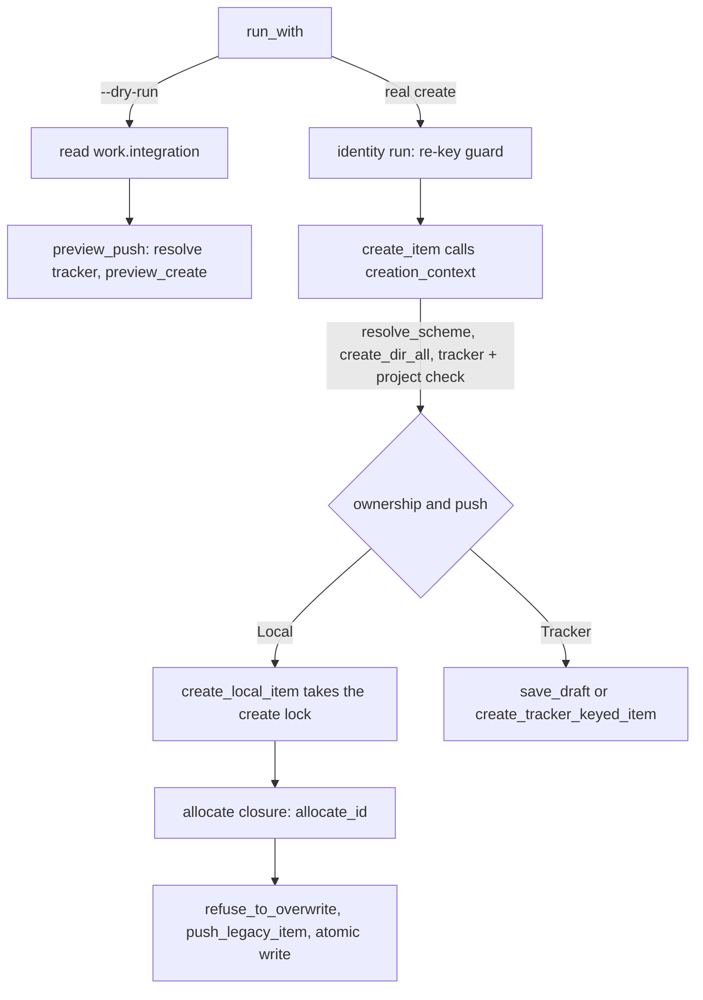

# Explicit Work Item ID on accelerator work create: implementation surface

**Date**: 2026-10-29T13:36:05+00:00
**Author**: Toby Clemson
**Git Commit**: 6d875be38dbe18118c96723aa7bb32ee947433da (jj change `xzpnluwzxowu`, unpushed working copy)
**Branch**: detached (jj workspace `visualisation-system`)
**Repository**: accelerator

## Research Question

What does the codebase provide and constrain for work item 0319, which adds
`--id <ID>` to `accelerator work create` and `/create-work-item`? Five refusals
are in scope: `--id` with `--project`, the `{tracker}` pattern, a draft ID, a
pattern mismatch, and a collision. Two behaviours change: case-insensitive
per-key allocation, and refusal checks on the dry-run path. The skill also gets
a dedicated `--id` argument and its correction rules.

## Summary

The local create path already has a seam that fits the collision check.
`create_local_item` (`cli/work-adapters/src/creation.rs:629-636`) takes an
`allocate: &dyn Fn(&CreateLockGuard) -> Result<String, String>` closure and
calls it under the create lock. The closure runs before `refuse_to_overwrite`,
`push_legacy_item` and the atomic write. A closure that refuses a taken `--id`
and otherwise returns it replaces `allocate_local_id`. A `String` error then
flows through `CreateFailure::Failed` to `Error: <message>` and exit 1
(`cli/work-cli/src/main.rs:287-290`). That is the contract 0319 requires.

Everything else 0319 needs is either missing or only half there:

- **The exact-shape check is new code.** No existing function matches an ID
  against the pattern at its exact width and literal text:
  - `parse_full_id` accepts any width, and under a keyless pattern any digit
    string.
  - `is_canonical_id_token` checks the exact width, but checks the key against
    the configured key case-sensitively and returns only a `bool`.
  - `WorkItemIdScheme::canonicalise_id` drops literal text.
  - The `work` domain crate may not depend on `regex` (`cli/pup.ron:152-166`).
- **The identity set exists, but the comparator and filename scan do not.**
  `ItemIdentity { path, id, aliases, external_id }` is built from
  `FilesystemWorkItemFiles::files()`, which includes `drafts/`. Every matcher
  compares whole strings ignoring ASCII case, with no number normalisation, and
  `holder_of` skips `external_id`. Nothing collects the filename's ID prefix.
- **Both allocators share `work::next_number::allocate`.** Each builds its own
  scanner from `compile_scan_regex` and `RegexScanner::compile` (plain
  `Regex::new`), so the scan is case-sensitive. The visualiser also calls
  `compile_scan_regex`, so case-insensitivity has to be added at the scanner or
  at the call site, not inside `compile_scan_regex`.
- **The dry-run returns before anything the `--id` checks need.** `run_with`
  returns at its first statement (`cli/work-cli/src/create.rs:651-657`). It
  reads `work.integration` and calls `preview_push` whether or not `--push` is
  given. It never resolves the scheme, never runs the identity run and never
  checks `--project`. The `--id` checks must come before the integration read,
  so the dry-run path has to resolve the scheme itself.
- **`creation_context` creates the work directory before it refuses.** It calls
  `create_dir_all(work_dir)` before its `{tracker}` + `--project` check
  (`create.rs:459-467`), so any refusal placed after that point leaves an empty
  `meta/work/` behind.
- **The skill has no argument parsing today.** It passes its single free-text
  argument to `work resolve`. The projected ID is the `work next-number` output
  from step 5.1, and it appears only in the preview path and the skill's own
  exact-path existence check. The push-gate dry-run carries only the
  positionals, `--push --dry-run` and `--body-file`.
- **`work canonicalise-id` cannot be the skill's correction step.** It pads a
  number and adds `work.key`. It also strips over-padding (`04000` → `4000`)
  and does no range check (`10000` and `0000` pass); this was verified by
  running it. 0319 says the skill must explain all three of those cases rather
  than correct them.
- **Test models exist for every acceptance-criterion class.** The gaps:
  - no subprocess test of `--dry-run`;
  - no test that `create-batch` rejects an unknown argument;
  - no frozen table of `work create` `E_` identifiers.

  The help golden `cli/work-cli/tests/fixtures/cli_surface.golden` will change.
  Skill evals need a recorded `with_skill` benchmark run for every eval ID,
  with a mean pass rate of at least 0.9.

## Detailed Findings

### `work create` invocation path

**Argument declaration**
- The clap `CreateArgs` is at `cli/work-cli/src/cli.rs:272-336`. It has the
  positionals `title`, `kind` and `priority`, the flags `--project` (305-306),
  `--push` (325-326) and `--dry-run` (334-335), and the linkage flags. No create
  flag uses `value_parser` or `conflicts_with`. The `promote` command shows the
  newtype precedent: `--adopt` uses `value_parser = parse_issue_key`, which
  returns a `TrackerKey` (`cli.rs:185-190`, `425-431`).
- The domain struct `create::CreateArgs` is at `cli/work-cli/src/create.rs:76-94`.
  It is built in four places, and each will need the new field:
  - `create_args_from_cli` (`main.rs:216-236`)
  - `ManifestEntry::create_args` (`batch_manifest.rs:53-77`, which hard-codes
    `project: None` and `dry_run: false`)
  - `PushingRepo::args` (`create.rs:858-878`)
  - `create_pushed` (`sync.rs:4314-4332`)
- `create-batch` has its own `CreateBatchArgs` (`cli.rs:339-359`). No clap
  struct allows external or trailing arguments, so `create-batch --id` already
  fails as a clap usage error with exit 2. The manifest parser behaves
  differently: it ignores unknown keys silently (`batch_manifest.rs:321-360`).

**`run_with`** (`create.rs:644-683`)
1. `--dry-run` runs first (651-657). It reads `work.integration` and returns
   `preview_push(&integration, &args.kind, registry)`.
2. It discovers the root, then begins the identity run
   (`identity_run::begin`, 659-665). A refusal becomes `RunOutcome::Refused` with
   `E_REKEY_IN_PROGRESS` or `E_REKEY_PLAN_UNREADABLE` (exit 4), or
   `E_IDENTITY_RUN_BUSY` (exit 1). The guard is held for the whole create, push
   included.
3. It calls `create_item` (666-674). `create-batch` reuses `create_item`, and
   the 0302 plan placed the re-key guard in `run_with`, not in `create_item`,
   for exactly that reason.

**`creation_context`** (`create.rs:449-489`), in order:
1. `resolve_scheme` (`config.rs:54-91`): `E_WORK_ID_PATTERN_INVALID`, or
   `E_WORK_KEY_REQUIRED`. `scheme.key` is filled only when the pattern
   references `{key}` or `{project}`.
2. `discover_root`, then `resolve_work_dir`.
3. `create_dir_all(&work_dir)`, a side effect.
4. Under `IdOwnership::Tracker`, any `--project` (even an empty one) refuses
   with `E_PATTERN_KEY_UNUSED` (462-467). Under `Local`, the `--project` checks
   happen later, inside `allocate` under the lock.
5. Date, author and template resolution, and the template-drift check.

**Strategy dispatch in `create_item`** (`create.rs:522-603`):

| Ownership, `--push` | Strategy | Create lock held across |
|---|---|---|
| `Local`, off | `create_local_item(.., allocate_local_id, None, ..)` | allocation, write |
| `Local`, on | `create_local_item(.., Some(&LegacyPushing{..}), ..)` | allocation, push, write, baseline |
| `Tracker`, off | `save_draft` | mint, draft write |
| `Tracker`, on | `create_tracker_keyed_item` | `pending_create`, mint, draft write |

**`create_local_item`** (`cli/work-adapters/src/creation.rs:629-705`):
1. `hold_create_lock` (230-237) creates
   `<work_dir>/.accelerator-work-create.lockdir`
   (`cli/corpus-adapters/src/lock.rs:21`). Its 300 s ceiling comes from
   `store::lock` defaults.
2. `allocate(&create)` returns the ID. `allocate_local_id` (`create.rs:436-446`)
   takes `--project` if given, otherwise `scheme.key`, and calls `allocate_id`
   (`create.rs:206-224`).
3. `target_for(id)` builds `work_dir/{id}-{slug}.md`. `refuse_to_overwrite`
   (247-255) then checks that exact path only.
4. Without `--push`: `write_new` checks the path again, then writes atomically
   (stage, fsync, rename, fsync parent).
5. With `--push`: `push_legacy_item` (462-533) runs before the write, under the
   lock. Its `request_digest` covers the body with the ID already substituted
   (473).

**`NNNN` substitution**
- The frontmatter is composed fresh by `compose_frontmatter`
  (`cli/work/src/create.rs:85-167`) from `CreateInputs { id, .. }`. The
  template's frontmatter is used only for the key-set drift check.
- The body goes through `resolve_body` (`create.rs:265-282`), which applies
  `.replace("NNNN", id)` to every occurrence, the H1 included. Whatever string
  `allocate` returns therefore lands verbatim in the filename, the `id` field
  and the H1. That is how 0319's "written in the letter case given" works.

### Where each `--id` check can sit

| Check | Needs | Earliest point today | Real-create constraint |
|---|---|---|---|
| `--id` with `--project` | args only | before the dry-run return | ahead of `creation_context`'s `E_PATTERN_KEY_UNUSED` |
| `{tracker}` | `scheme.ownership()` | after `resolve_scheme` | `resolve_scheme` is inside `creation_context` |
| draft reservation | the token (`canonical_draft_id`) | anywhere | ordered after `{tracker}` |
| pattern mismatch | `id_pattern`, `references_key` | after `resolve_scheme` | none |
| collision | work dir, identities, filenames | after `resolve_work_dir` | under the create lock, inside the `allocate` closure |

There are two consequences:
- The `resolve_scheme` refusals (`E_WORK_ID_PATTERN_INVALID`,
  `E_WORK_KEY_REQUIRED`) necessarily come before checks 2 to 5. 0319's order
  does not mention them; they are config errors, not `--id` refusals.
- Running checks 2 to 4 "before `creation_context`" requires resolving the
  scheme outside it, or splitting `creation_context` so that its scheme step
  comes before `create_dir_all`. Otherwise a refusal leaves an empty work
  directory.

### ID pattern machinery

**Two implementations of the pattern grammar**, kept in step by
`cli/corpus-adapters/tests/parity.rs`:
- **Regex compiler**: `cli/corpus-adapters/src/work_item_pattern.rs` (`P`
  below).
- **Regex-free scheme**: `WorkItemIdScheme { id_pattern, key }`
  (`cli/corpus/src/work_item_id.rs:75-79`, `W` below).

Neither has a compiled pattern struct. Every function re-walks the raw
`&str`.

**The grammar, as `compile` enforces it** (P:234-321):
- **Literal braces**: `{{` and `}}`.
- **Key token**: `{key}`, and the deprecated synonym `{project}` (W:267-274).
  The key value must match `[A-Za-z][A-Za-z0-9]*` (`is_valid_key`, P:135-143,
  private).
- **Number token**: `{number}`, which defaults to `04d` (P:210-211), or
  `{number:0Nd}`.
- **Hostile literals** are refused: `/ \ : * ? < > |` and the double quote.
- **Tracker form**: `{tracker}` must be the sole token. `ownership()` returns
  `Tracker` only for that exact string (W:97-103).

**The number cap has two inconsistent definitions:**

| Function | Bare `{number}` width | Production caller |
|---|---|---|
| `pattern_max_number` (P:361-380) | 4, giving 9999 | none |
| `work::next_number::pattern_cap` (`cli/work/src/next_number.rs:47-52`) | 4 | `allocate_above` |
| `WorkItemIdScheme::canonical_digit_width` (W:128-146) | 0, meaning any width | `is_canonical_id_token` |

**`compile_scan_regex`** (P:332-337):
- **Construction**: the key is embedded as literal characters, `{number}`
  becomes `([0-9]+)`, and the whole is anchored as `^...-`. For example,
  `{key}-{number:04d}` with key `PP` gives `^PP-([0-9]+)-`.
- **Width and case**: group 1 captures digits at any width. The regex is
  case-sensitive; nothing in `cli/` builds an ID regex with `(?i)` or
  `RegexBuilder`.
- **`{tracker}`** gives the fixed regex `^([A-Za-z][A-Za-z0-9_]*-[0-9]+)-`
  (P:23). Tracker keys allow `_`; `{key}` values do not.
- **Production callers**:
  - `allocate_id` (`create.rs:213`)
  - `work next-number` (`cli/work-cli/src/next_number.rs:139-150`)
  - the visualiser (`cli/visualiser/server/src/compose.rs:197-221`, compiled in
    `cli/visualiser/server/src/config.rs:95-108`)
- `RegexScanner::compile` is `Regex::new(pattern)`
  (`cli/corpus-adapters/src/scanner.rs:25-27`). It is the only route from a scan
  string to an `IdScanner`.

**Existing ID parsers, none of which is an exact-shape check:**

| Function | Width | Key | Literal text |
|---|---|---|---|
| `parse_full_id` (P:465-495) | any | any `[A-Za-z][A-Za-z0-9]*`, any case | keyed: matched exactly; keyless: ignored, any digit string accepted |
| `is_canonical_id_token` (W:109-123) | exact (bare `{number}`: any) | configured key only, case-sensitive, `-` hard-coded | ignored |
| `work::resolve::match_full_id` (`cli/work/src/resolve.rs:116-166`, private) | any | any, any case | matched exactly; returns only the key |
| `canonicalise_id` (P:552-590) | re-pads, strips over-padding | keeps the parsed key and its case | follows the pattern |
| `WorkItemIdScheme::canonicalise_id` (W:189-213) | pads | `format!("{code}-{padded}")` | dropped (`v{number:03d}` renders `001`) |

`parse_full_id` is a fit for parsing held IDs, which are compared by key and
number at any width. It is not a fit for validating `--id`. Two details matter
for that use:
- It skips `validate_id_pattern` and does not handle `{{`.
- `draft-123456` is not a draft (the suffix has no letter), so it parses as key
  `draft`, number `123456`, under a `{key}` pattern. 0319's `draft-040000`
  acceptance criterion depends on exactly that.

### Draft IDs

`corpus::canonical_draft_id` (W:287-305; re-exported at
`cli/corpus/src/lib.rs:48`) implements 0319's reserved form exactly:
- **Normalisation**: it lowercases the whole token.
- **Shape**: `draft-` followed by exactly 6 characters, each an ASCII digit or
  a lowercase letter other than `i l o u`, with at least one letter.
- **No aliasing**: `O`, `I` and `L` are rejected, not mapped to digits.

`work::draft_id::DraftId::parse` delegates to it (`cli/work/src/draft_id.rs:20-22`).
Its test cases (W:524-533) already cover `Draft-K7MQ3X`, a 5-character suffix,
an all-digit suffix and an `i` in the suffix. 0319's acceptance criteria add
`draft-k7mq3xy` (7 characters) and `draft-k7mq3u`. Both fall through to the
mismatch check.

### Identity set and collision primitives

**Collection.** `FilesystemWorkItemFiles::new(work_dir).files()`
(`cli/work-adapters/src/filesystem.rs:64-106`) reads `work_dir/*.md`, then
`work_dir/drafts/*.md`, without recursion. `identities(&files)`
(`cli/work/src/work_item_files.rs:37-52`) then projects each file to
`ItemIdentity { path, id, aliases, external_id }` (`cli/work/src/identity.rs:5-11`).

Five quirks matter for a collision check:
- **Case-sensitive extension**: `files()` accepts the `.md` extension exactly,
  whereas the allocator's `is_md_filename` ignores case.
- **Hand-rolled frontmatter reader**: `identity_of` uses its own line reader.
  A field counts only when it starts its line unindented as `field:`, with one
  pair of surrounding quotes stripped (`cli/work/src/show.rs:9-26`).
- **`id` fallback**: `id` falls back to `work_item_id`, and a file with neither
  is dropped.
- **Unreadable files**: these are skipped silently. A directory listing error
  other than `NotFound` returns `Err`.
- **Holder path kept**: `path` is `work_dir.join(name)`, so the holder's file
  path is available for the refusal message.

**Matchers** (`cli/work/src/identity.rs:44-117`). All three compare whole
strings with `eq_ignore_ascii_case`, so `ACC-42` and `ACC-0042` do not match:
- `resolve_identity` checks `id`, `aliases` and `external_id`, and returns
  `Conflicting` when two different items match. That is the ambiguity 0319
  cites for why aliases count.
- `holder_of` checks `id` and `aliases` only, and skips `external_id`
  (98-103). Draft minting uses it.
- `linker_of` checks `external_id` only.

`Creation::identities` (`creation.rs:284-286`, `315-320`) is private. It reads
through `std::fs` directly rather than through `self.reader`.

**Existing collision refusals that record the holder's path**, as precedent for
message shape:
- Retirement's `refuse_collisions` (`cli/work/src/retirement.rs:600-629`) gives
  `RetirementRefusal::IdTaken { holder, field }`, with messages at 217-241.
- Re-key's `refuse_collisions` (`cli/work/src/rekey/collision.rs:16-64`) gives
  `NotRekeyed::Collision`.

**Filename side**
- `FilesystemLister::filenames()` (`filesystem.rs:19-42`) lists the top level
  only: no `drafts/`, and an empty list for a missing directory.
- `WorkItemIdScheme::extract_id(filename, scanner)` (W:239-258) derives a
  filename's ID, but `work-cli` never calls it.

**What the collision check has to add:**
- a key-and-number comparator, ignoring key case, for held IDs that parse under
  the pattern;
- a whole-string, case-insensitive fallback for held IDs that do not parse;
- a filename scan keyed on the `--id`'s parsed key rather than `work.key`.

### Allocators and case sensitivity

- **Shared allocator.** `allocate` (`cli/work/src/next_number.rs:77-131`)
  serves both allocators:
  - It refuses a `{key}` pattern with no project (`MissingKey`) and a project
    under a keyless pattern (`ProjectUnused`).
  - It scans each `.md` filename and takes the highest number at any width.
    Digit runs that overflow `u64` are skipped silently.
  - `allocate_above` (140-167) then formats `highest + 1` with the key
    verbatim, or returns `Overflow`.
- **Per-key number spaces.** The key is embedded in the scan regex, so each key
  has its own number space. Under a `{key}` pattern, bare legacy `0042-*.md`
  files are ignored, and so are other keys' files. Frontmatter `id` and
  `aliases` are never read.
- **Two scanner build sites.** The scanner is built separately in `allocate_id`
  (`create.rs:212-217`) and in `next_number::run` (`next_number.rs:139-150`).
  `allocation_message` is also duplicated, at `create.rs:140-177` and
  `next_number.rs:41-78`.
- **Locks.** `work next-number` takes the identity-run lock (`:127`) but not
  the create lock.
- **Case-insensitive key precedent.** Re-key's `default_key_floor`
  (`cli/work/src/rekey/mapping.rs:105-126`) compares keys with an inline
  `eq_ignore_ascii_case`. There is no reusable case-insensitive key comparator
  or scanner.
- **Deferred by 0302.** "What We're NOT Doing" includes counting aliases when
  `work create` allocates. 0319 keeps that deferral for automatic allocation and
  counts aliases only in the `--id` taken check.
- **Overflow wording.** `E_PATTERN_OVERFLOW` has two texts:
  - When `highest > cap`: "Rename the stray file or widen the pattern."
  - When `highest == cap`: "Archive completed work items or widen the
    pattern."

  An `--id 9999` reaches the second text. 0319's Assumptions say the message
  names "renamed or the pattern widened". Only the out-of-width text says
  "rename".

### Dry-run path

- **What it does.** It reads `work.integration` with `effective_nonempty` (an
  error becomes `Failed`, exit 1). It then calls `preview_push`
  (`create.rs:327-354`), which resolves the tracker from the registry and calls
  `preview_create(kind)`.
- **Its outputs**:
  - On success, one line on stdout: `<integration>\t<type>\t<type_src>\t<project>\t<project_src>`,
    or the Linear variant.
  - A failed selection: `PreviewFailed`, exit 72, 73 or 74.
  - A failed preview: `PreviewFailed`, exit 70, 71, 74 or 75.

  The preview line carries no ID, which is why 0319 can promise that a valid
  `--id` leaves the output unchanged.
- **`--push` is never consulted.** "With and without `--push`" run the same
  code today.
- **What it skips**: scheme resolution, the identity run, every `--project`
  check, work-directory creation, author and template resolution, and the
  create lock.
- **No guard.** `create_dry_run_is_not_guarded` (`create.rs:1044-1060`) pins the
  absence of the re-key guard, and 0351 inverts it. 0351 also needs
  allocation to work without `CreateLockGuard`, so a collision check that can
  run only with the guard would not compose with 0351.

### Push path

- **Timing.** `push_legacy_item` runs under the create lock, after allocation
  and before the write. A refusal from the `allocate` closure therefore sends
  nothing. That gives 0319's "no tracker request of any kind" for the real
  create.
- **Outcomes** (`main.rs:255-274`, `cli/work/src/sync/push_decide.rs:26-51`):

  | Situation | Stdout line 2 | Exit | File |
  |---|---|---|---|
  | accepted | `write-once\t<KEY>` | 0 | written with `external_id` |
  | unreachable or selection failure | `local-save\t` | 0 | written, no `external_id` |
  | rejected | `rejected\t` (and `Error: <cause>` on stderr) | 75 | written, no `external_id` |
  | terminal | `loud-terminal\t` | 71 | written, marker kept |

- **`push_precondition` refusals** (`E_PUSH_MARKER_UNREADABLE`,
  `E_PUSH_PENDING`, `E_PUSH_FINGERPRINT_MISMATCH`, `E_PUSH_ALREADY_WRITTEN`;
  `creation.rs:379-431`) exit 1 with nothing written. The pending-push marker
  is keyed by slug (`cli/work/src/sync/pending_push.rs:73-78`), and the digest
  covers the ID-substituted body.
- **Sync keeps the filename.** `/sync-work-items` links an unsynced legacy item
  through `link_external_id` and leaves both the filename and `id` unchanged:
  - `a_legacy_unsynced_item_pushed_under_tracker_keeps_its_id`
    (`cli/work-cli/src/sync_author.rs:645-658`)
  - `an_unsynced_item_issues_exactly_one_create_and_links_it`
    (`cli/work-adapters/tests/sync_create.rs:1712-1757`)

### Error identifiers

Every `E_` identifier `work create` can emit today:

| Identifier | Defined at | Exit |
|---|---|---|
| `E_WORK_ID_PATTERN_INVALID`, `E_WORK_KEY_REQUIRED` | `cli/work-cli/src/config.rs:66`, `:31` | 1 |
| `E_PATTERN_KEY_UNUSED`, `E_PATTERN_OVERFLOW` | `cli/work-cli/src/create.rs:151`, `:163`/`:170` | 1 |
| `E_PATTERN_MISSING_KEY` | `create.rs:144` (unreachable from create; `resolve_scheme` enforces the key first) | 1 |
| `E_REKEY_IN_PROGRESS`, `E_REKEY_PLAN_UNREADABLE`, `E_IDENTITY_RUN_BUSY` | `cli/work/src/rekey/outcome.rs:177-178`, `:203` | 4, 4, 1 |
| `E_PUSH_MARKER_UNREADABLE`, `E_PUSH_PENDING`, `E_PUSH_FINGERPRINT_MISMATCH`, `E_PUSH_ALREADY_WRITTEN` | `cli/work-adapters/src/creation.rs:386-422` | 1 (local), 4 (`{tracker}`) |
| `E_DRAFT_EXISTS`, `E_DRAFT_ID_EXHAUSTED` | `creation.rs:740-763`, `cli/work/src/draft_id.rs:45` | 4, 1 |

- **Naming convention.** Names follow `E_<FAMILY>_<CAUSE>`, printed as
  `E_X: <what>. <remedy>.`. Existing messages quote the pattern as
  `pattern '<pattern>'`.
- **Error types.** The create path's errors are all `String`. There is no
  shared constants module or uniqueness test for the `E_PATTERN_*` messages.
- **Precedents for distinctness tests**:
  - `FROZEN_NOT_REKEYED` with a `BTreeSet` length check
    (`cli/work-cli/tests/keyword_exit_codes.rs:206-315`)
  - `every_outcome_has_a_distinct_code_except_the_two_number_space_cases`
    (`cli/work/src/rekey/outcome.rs:839-864`)
  - the exhaustive `const fn covered` match (`outcome.rs:590-616`), which makes
    a new variant a compile error until it is covered
- **Exit-code documentation.** `cli/work-cli/src/exit_codes.rs` documents
  exit codes per command.

### `/create-work-item` skill

- **Arguments today.**
  - Frontmatter: `argument-hint: "[topic or existing work item path/number]"`.
    `allowed-tools` lists `accelerator config`, `accelerator work`,
    `corpus metadata derive` and `corpus frontmatter validate`.
  - There is no `$ARGUMENTS` token parsing.
  - Step 0 (`skills/work/create-work-item/SKILL.md:77-169`) passes the whole
    argument to `accelerator work resolve`:
    - exit 0: enrich-existing mode
    - exit 1 or 3: topic
    - exit 2: ambiguous
    - exit 6: outside the work directory
  - A bare number matching nothing becomes the topic string, so there is no
    route to a requested new ID.
- **Projection** (step 5, `SKILL.md:439-469`).
  - Under `{tracker}`, steps 1 to 3 are skipped ("there is no projected ID").
  - Otherwise, step 1 calls `work next-number`, and step 2 builds
    `{work_dir}/<full-id>-<slug>.md`.
  - Step 3 aborts if that exact path exists. This is the same weak check as
    `refuse_to_overwrite`, and the CLI collision check supersedes it for
    `--id`.
  - The confirmation prints `work create`'s first stdout line and tells the
    model not to assume it matches the preview (`SKILL.md:639-642`).
- **Push gate** (`SKILL.md:520-552`):
  `accelerator work create "<title>" <kind> <priority> --push --dry-run --body-file <body-tmp>`.
  - Exit 0 offers the push.
  - Exit 70 offers to save locally or retry.
  - Any other non-zero exit relays stderr and saves locally.

  The real create (`SKILL.md:490-514`, `581-585`) adds `--status`, `--author`,
  `--producer`, the linkage flags and `[--project <code>]`. On a non-zero exit
  it relays stderr verbatim and aborts.
- **Flag precedents.** `/create-adr` uses
  `"[topic or description] [--supersedes ADR-NNNN]"`, which is the closest
  topic-plus-flag shape. `sync-work-items` and `rekey-work-items` pass flags
  through to the CLI.
- **`work canonicalise-id`** (`cli/work-cli/src/canonicalise_id.rs`). Measured
  against this repository's `{number:04d}`:

  | Input | Result |
  |---|---|
  | `400` | `0400` |
  | `04000` | `4000` |
  | `10000` | `10000` (exit 0) |
  | `0000` | `0000` (exit 0) |
  | `XY-400`, `XY400`, `draft-k7mq3x`, `foo` | `E_PATTERN_BAD_FORMAT_SPEC` (exit 1) |

  Under a `{key}` pattern it re-formats a full ID under the key parsed from the
  input, preserving case (P:567-573). That matches 0319's "a key the request
  carries is kept". It cannot tell a left-pad apart from an over-padding strip,
  and it does no range check. `update-work-item` already uses it for `parent`
  (`skills/work/update-work-item/SKILL.md:158-170`).
- **Evals.** `skills/work/create-work-item/evals/evals.json` holds 41 entries;
  ids 33-38 assert on the exact commands run.
  `tests/unit/tasks/test_evals_structure.py` requires a `with_skill` run in
  `benchmark.json` for every eval ID, with mean pass rate ≥ 0.9. The runner is
  not in the repository; results are committed. No test checks that a flag a
  SKILL.md names on `accelerator work create` exists in the CLI.

### `extract-work-items`, `create-batch`, `sync-work-items`

- **`/extract-work-items`, numeric patterns.** It never calls `work create`. It
  calls `work next-number --project <code> --count <n>` and writes the files
  itself (`skills/work/extract-work-items/SKILL.md:386-533`). The
  acceptance criterion that no call carries `--id` holds because no
  `work create` call exists on that path.
- **`/extract-work-items`, `{tracker}`.** It calls `work create-batch --manifest`
  (`SKILL.md:612-615`). Manifest entries have no `id`.
- **`/refine-work-item`** calls `work create` for children under `{tracker}`,
  without `--id` (`skills/work/refine-work-item/SKILL.md:200-205`).

### Test surfaces for the acceptance criteria

| Acceptance-criterion class | Model | Location |
|---|---|---|
| written filename, `id`, H1, no `NNNN` | `body_file_content_has_every_nnnn_occurrence_substituted`, `identity_of` assertions | `cli/work-cli/tests/cli_create.rs:143-171`, `create.rs:1199-1228` |
| `{key}` config | `.accelerator/config.md` front matter; `FakeConfig` pairs | `cli/work-cli/tests/cli_next_number.rs:21-31`, `cli/work-cli/src/config.rs:184-192` |
| refusal identifier, nothing written, no request | `refusal_of`, `meta_tree(..).is_empty()`, `tracker.calls().is_empty()` over `for push in [false, true]` | `create.rs:1010-1042` |
| another holder writes under the create lock | mpsc handshake holding `store::lock::acquire` | `create.rs:1507-1536` |
| dry-run does not wait on the lock | `recv_timeout` while a lock is held | `cli/work-cli/src/sync_author.rs:764-798` |
| push accept, reject, unreachable | `RecordingTracker::failing_create`, `creates(..)`, `PushOutcome` | `create.rs:903-948`, `1189-1197`, `1411-1447`; `cli/work-cli/tests/cli_create_push.rs:107-258` |
| `create-batch --id` unrecognised | `Cli::try_parse_from(..).is_err()` | `cli.rs:472-513` |
| overflow after `9999` | partial-output and exit 1 assertions | `cli_next_number.rs:119-131`, `cli_create.rs:264-280` |
| distinct identifiers | frozen table plus `BTreeSet` length | `keyword_exit_codes.rs:206-315` |
| unsynced item keeps its ID through sync | `link_external_id` then `identity_at` | `sync_author.rs:645-658` |

`cli/cli-test-support` is not a dev-dependency of `work-cli`.

## Code References

- `cli/work-cli/src/cli.rs:272-336`: clap `CreateArgs`.
- `cli/work-cli/src/cli.rs:339-359`: `CreateBatchArgs`.
- `cli/work-cli/src/main.rs:216-296`: `create_args_from_cli`, `run_create`,
  output and exit mapping.
- `cli/work-cli/src/create.rs:76-94`: domain `CreateArgs`.
- `cli/work-cli/src/create.rs:140-177`: `allocation_message`.
- `cli/work-cli/src/create.rs:206-224`: `allocate_id`.
- `cli/work-cli/src/create.rs:265-282`: `resolve_body`, the `NNNN` replacement.
- `cli/work-cli/src/create.rs:327-354`: `preview_push`.
- `cli/work-cli/src/create.rs:436-489`: `allocate_local_id`, `creation_context`.
- `cli/work-cli/src/create.rs:498-604`: `create_item` strategy dispatch.
- `cli/work-cli/src/create.rs:644-683`: `run_with`.
- `cli/work-cli/src/config.rs:54-91`: `resolve_scheme`.
- `cli/work-cli/src/next_number.rs:112-172`: `work next-number`.
- `cli/work-cli/src/batch_manifest.rs:53-77`: batch `CreateArgs` construction.
- `cli/work-adapters/src/creation.rs:221-290`: create lock,
  `refuse_to_overwrite`, `write_new`, `target_for`, `identities`.
- `cli/work-adapters/src/creation.rs:462-533`: `push_legacy_item`.
- `cli/work-adapters/src/creation.rs:629-705`: `create_local_item`.
- `cli/work-adapters/src/filesystem.rs:19-106`: `FilesystemLister`,
  `FilesystemWorkItemFiles`.
- `cli/work/src/next_number.rs:47-167`: `pattern_cap`, `allocate`,
  `allocate_above`.
- `cli/work/src/identity.rs:5-117`: `ItemIdentity`, `resolve_identity`,
  `holder_of`, `linker_of`.
- `cli/work/src/work_item_files.rs:18-107`: `WorkItemFiles` port, `identity_of`.
- `cli/work/src/draft_id.rs:9-103`: `DraftId`, minting.
- `cli/work/src/rekey/mapping.rs:105-126`: `default_key_floor`.
- `cli/work/src/rekey/sequence.rs:13-32`: `sequence_of`, `project_key_of`.
- `cli/corpus/src/work_item_id.rs:75-213`: `WorkItemIdScheme`.
- `cli/corpus/src/work_item_id.rs:287-305`: `canonical_draft_id`.
- `cli/corpus-adapters/src/work_item_pattern.rs:135-143`: `is_valid_key`.
- `cli/corpus-adapters/src/work_item_pattern.rs:234-337`: `compile`,
  `compile_scan_regex`.
- `cli/corpus-adapters/src/work_item_pattern.rs:361-380`: `pattern_max_number`.
- `cli/corpus-adapters/src/work_item_pattern.rs:409-495`: `build_full_id_regex`,
  `parse_full_id`.
- `cli/corpus-adapters/src/scanner.rs:25-40`: `RegexScanner`.
- `cli/pup.ron:152-166`: `work` domain import rule.
- `skills/work/create-work-item/SKILL.md:77-169`: Step 0, argument resolution.
- `skills/work/create-work-item/SKILL.md:439-514`: projection and the real
  create.
- `skills/work/create-work-item/SKILL.md:520-620`: push gate and outcomes.
- `tests/unit/tasks/test_evals_structure.py`: eval and benchmark contract.

## Architecture Insights

- **Hexagonal split with a regex ban in the domain.** `work` imports only std,
  `kernel`, `corpus`, `tracker` and itself. Regex-backed pattern logic lives in
  `corpus-adapters`, and `corpus` mirrors it without regex, kept in step by a
  parity test. A strict `--id` shape check therefore lives either in
  `corpus-adapters` or as a regex-free matcher in `corpus`/`work`.
- **The ID is a plain `String`.** It is a `String` from allocation to
  rendering. The only ID newtypes are `DraftId`, `TrackerKey` and `ExternalId`,
  so a validated work-item ID would be a new domain type. The `promote --adopt`
  `value_parser` shows the clap-side precedent.
- **Lock order.** The global order is identity run, then batch journal, then
  retirement, then create, then per-file. The create lock serialises numbering
  and writing, and the local push runs inside it. 0230 and 0302 both require
  the check-then-write sequence to sit inside one create-lock hold.
- **Identity comparison ignores ASCII case everywhere** except the filename
  scans. Three reasons are recorded:
  - `work resolve` matches case-insensitively (0230);
  - re-key's floor ignores key case (0302);
  - a case-only rename breaks `create_new` on case-insensitive filesystems
    (0302 Key Discoveries).

  0319 extends this to the filename scans.
- **Division of labour.** ADR-0045 puts deterministic procedure in the CLI.
  0319's skill-side correction rules (pad, add `work.key`, classify cases that
  have no exact form) are deterministic. See Open Questions.

## Historical Context

- `meta/decisions/ADR-0070-tracker-owned-work-item-identity.md`: `{tracker}`
  makes `id` equal `external_id`, defines the draft form, and has retired IDs
  move into `aliases`.
- `meta/decisions/ADR-0044-remote-work-item-identity-in-external-id.md`:
  `external_id` is the remote join under every non-`{tracker}` pattern.
- `meta/decisions/ADR-0045-skills-vs-cli-division-of-labour.md`: judgement
  belongs in skills, procedure in the CLI.
- `meta/decisions/ADR-0053-thin-cli-over-a-hexagonal-ports-and-adapters-core.md`:
  the split between `work-cli` and the domain crate.
- `meta/decisions/ADR-0068-general-slug-resolution-in-the-corpus-cli.md`:
  `work resolve` is a deliberately fuzzy matcher, which is why `--id` bypasses
  it.
- `meta/reviews/work/0319-explicit-work-item-id-on-accelerator-work-create-review-1.md`:
  produced the five-check order, the distinct identifiers, dry-run parity, the
  skill's recovery rules and the key-and-number taken rule. The `E_` names were
  "deferred to planning by decision".
- `meta/work/0351-invocation-validation-on-accelerator-work-create-dry-run.md`:
  moves `run_with`'s early return and folds in 0319's five checks. It needs a
  lock-free allocation path.
- `meta/plans/2026-09-26-0230-tracker-owned-work-item-id-generation.md`: the
  identity set, draft minting under the create lock, and the push outcome
  keywords.
- `meta/plans/2026-10-15-0302-work-item-re-key-command.md`: the identity-run
  guard placement, the lock order, case-insensitive comparisons, per-key number
  spaces, and the deferred alias-aware allocation.
- `meta/plans/2026-09-10-0228-layered-configuration-key-model.md`: the `{key}`
  model, the two pattern implementations, and the move to `E_PATTERN_*_KEY`
  vocabulary.

## Related Research

- `meta/research/codebase/2026-10-15-0302-work-item-re-key-command.md`
- `meta/research/codebase/2026-09-26-0230-tracker-owned-work-item-id-generation.md`
- `meta/research/codebase/2026-09-10-0228-layered-configuration-key-model.md`
- `meta/research/codebase/2026-04-28-configurable-work-item-id-pattern.md`
- `meta/research/codebase/2026-10-03-cli-surface-inventory.md`

## Open Questions

- **The five `E_` names** are unassigned. They must avoid every identifier in
  the table above. No family has been chosen.
- **Where the exact-shape check lives.** It could be a regex in
  `corpus-adapters` (beside `build_full_id_regex`) or a regex-free matcher in
  `corpus` beside `WorkItemIdScheme`. The second keeps the `work` domain able to
  hold a validated ID type, at the cost of a parity obligation.
- **Exact padding under bare `{number}`.** `compile` and `pattern_cap` treat it
  as width 4; `canonical_digit_width` treats it as any width. 0319's "the
  `{number}` padding exactly" needs one answer.
- **Literal-text patterns** such as `v{number:03d}`.
  - `parse_full_id` ignores the literal under a keyless pattern.
  - `WorkItemIdScheme::canonicalise_id` drops it.
  - Automatic allocation writes `001-*`, not `v001-*`.

  The `--id` shape check, held-ID parsing and allocation would disagree under
  such a pattern unless they are decided together.
- **Skill-side correction mechanism.** `work canonicalise-id` pads and adds the
  key, but normalises over-padding and does not range-check. The skill can
  either encode 0319's rules in prose, or compare the `canonicalise-id` result
  with the request and send out-of-range cases to the CLI. The second fits
  ADR-0045 better. Adding a CLI check mode would widen scope beyond "`--id`
  only on `work create`".
- **Scheme resolution on the dry-run path.** 0319 requires a dry-run without
  `--id` to stay unchanged. Resolving the scheme only when `--id` is present
  avoids new `E_WORK_*` failures on plain dry-runs. 0351 later makes them
  unconditional.
- **Order against `create_dir_all`.** Do 0319's "writes nothing" criteria count
  an empty `meta/work/` created by `creation_context`? `meta_tree` asserts on
  files, so existing tests would not notice. Placing the refusals before
  `creation_context` avoids the question.
- **Pending-push marker and `--id`.** The marker is keyed by slug and its
  digest covers the ID-substituted body. This research did not trace how
  `push_precondition` treats a re-run with a different `--id` under the same
  slug after a terminal failure.
- **Overflow wording.** 0319's Assumptions say the `E_PATTERN_OVERFLOW` message
  names renaming. After `--id 9999` the actual text is "Archive completed work
  items or widen the pattern." Either amend the assumption or adjust the
  message.

This research did not check the visualiser's handling of a `draft-NNNNNN`
numeric-keyed item, or `work resolve`'s cross-project bare-number search, which
excludes the `draft` prefix, for items written under `work.key: draft`.
