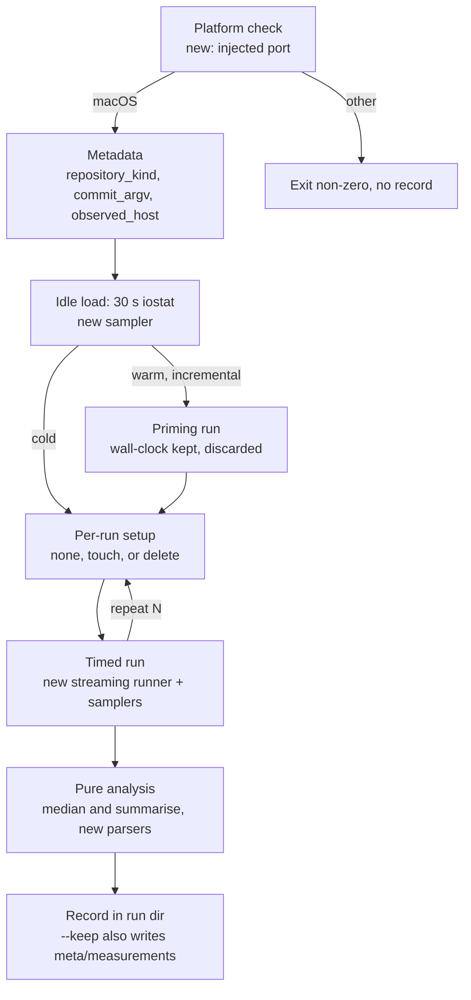

# Implementation surface for 0368: the `measure:build` harness and host guidance

**Date**: 2026-10-30 16:06 UTC
**Author**: Toby Clemson
**Git Commit**: `a3bf3abcbb48ad4d73a68cfa29de9285be710c4b`. This is an empty working-copy change. Its parent, `b1ae71609bc9`, is four `meta/`-only commits ahead of `main` at `a6c598385d83`, so every code permalink below points at `main`.
**Branch**: none (jj workspace `ticket-management`, detached from `main`)
**Repository**: accelerator

## Research Question

For work item 0368, "Build-performance measurement and host guidance", this document answers four questions about a `measure:build` task:
- what it plugs into;
- what it can reuse from the existing `measure:*` namespace;
- what has to be built new;
- where the work item's assumptions do not match the code, mise, or the macOS tools it samples.

It also asks what the sibling items 0361–0369 expect from it.

## Summary

Wiring `measure:build` in is cheap, but most of its machinery is new.

- **Wiring.** A `mise.toml` entry with `run = "invoke measure.build"` and a `@task(name="build")` in `tasks/measure.py` are enough. The existing closure guard then keeps it out of `check` and `default` (Requirement 10) without any change to the guard.
- **Reuse.** The namespace's ports-and-pure-core split carries over: `typing.Protocol` runners injected as parameters, with the analysis kept pure. So do several helpers: `repository_kind`, `commit_argv`, `observed_host`, `observed_chip`, `median`, `summarise` and `build_provenance`, which already records `mise --version`.
- **New.** The following do not exist anywhere in the repository:
  - a streaming build runner that stamps each line;
  - the `iostat` and `ps` samplers;
  - the log analysis;
  - the search for the measured commit;
  - the hostname, OS-version and job-limit probes;
  - the macOS refusal;
  - a gitignored run directory and a record-naming scheme;
  - a `maximum` on `Summary`;
  - Python fixtures that build real jj and git repositories.

Live probes against mise 2026.10.8 and this host found seven places where the work item does not match reality. The first three change requirements or acceptance criteria:

| # | Work item says | Observed | Affects |
|---|---|---|---|
| 1 | A task whose dependency failed is "not run" | Under `--continue-on-error`, mise **runs dependants of a failed task** once the failure has happened | Req 1, failure AC |
| 2 | A task either started or was not run | mise also **skips a fresh task**, printing `sources up-to-date, skipping`; 4 tasks in `default` can do this | Req 1, record schema |
| 3 | Every run fails `deny:check` on RUSTSEC-2026-0414 | `deny:check` **passes** today: "advisories ok" in 1.43 s | Req 7 example, Drafting Notes |
| 4 | Idle load is the mean over 30 s of `iostat` | `iostat`'s **first report averages since boot** | Req 2, buckets |
| 5 | The IDE is matched by name patterns | `fsnotifier` runs **inside the IDE bundle** (`IntelliJ IDEA.app/Contents/bin/fsnotifier`), and PyCharm runs a second one | Req 1 process attribution |
| 6 | The working copy is checked by VCS commands | In a secondary jj workspace, **`git` resolves to the parent repository** | Req 5, both-VCS AC |
| 7 | "Host model" names the machine | `hw.model` is `Mac16,5`; the chip is `Apple M4 Max` | Req 7 comparability |

## Detailed Findings

### How the measurement session would run

The flow below follows the work item's Requirements 1–6. Each node is labelled with the existing helper it would reuse, or "new".

### Registration and the closure guard

`measure:build` registers exactly as the four existing `measure:*` leaves do:

- **mise leaf.** The existing leaves sit under a shared comment at [`mise.toml:389-416`](https://github.com/atomicinnovation/accelerator/blob/a6c598385d832d0134c2c0815bf301f045af1a26/mise.toml#L389-L416). The comment says they are "Deliberately NOT in the aggregate `check`, the bare `default` task, or the test:integration roll-up". Each leaf has a `description` that names its prerequisites in brackets, `depends = ["deps:install:python"]` and `run = "invoke measure.<name>"`.
- **invoke task.** `tasks/__init__.py` registers the whole module with `ns.add_collection(Collection.from_module(measure))` ([`tasks/__init__.py:68`](https://github.com/atomicinnovation/accelerator/blob/a6c598385d832d0134c2c0815bf301f045af1a26/tasks/__init__.py#L68)). A new `@task(name="build")` in `tasks/measure.py` is therefore picked up automatically.
- **Guard.** `_tasks_reaching_measure` identifies a measure task by the substring `"invoke measure."` in its `run` string. It does not use the name prefix ([`tests/unit/tasks/test_mise.py:244-258`](https://github.com/atomicinnovation/accelerator/blob/a6c598385d832d0134c2c0815bf301f045af1a26/tests/unit/tasks/test_mise.py#L244-L258)). `test_no_measure_reaching_task_is_in_the_ci_mirror` is parametrised over `check` and `default` ([`:291-299`](https://github.com/atomicinnovation/accelerator/blob/a6c598385d832d0134c2c0815bf301f045af1a26/tests/unit/tasks/test_mise.py#L291-L299)). The guard parses `mise.toml` with `tomllib` and follows only `depends` edges. `_MEASURE_MODULE` appears only in the failure message. The work item's note that a task placed elsewhere "must extend the guard" holds only if that task's `run` string drops `invoke measure.`.
- **Docs.** `### The measure namespace` runs from [`tasks/README.md:260`](https://github.com/atomicinnovation/accelerator/blob/a6c598385d832d0134c2c0815bf301f045af1a26/tasks/README.md#L260) to the eval section at line 362. "Launcher size and summary latency" (line 283) is the precedent for adding a later task as its own bold-headed paragraph. `TestMeasureNamespaceDocs` slices the README from that heading to `\n### Criterion constants`. It then requires the strings `quiet`, `network egress`, `published signed release`, `measure:teardown` and `.accelerator-measure/manifest.json` ([`tests/unit/tasks/test_measure.py:1304-1319`](https://github.com/atomicinnovation/accelerator/blob/a6c598385d832d0134c2c0815bf301f045af1a26/tests/unit/tasks/test_measure.py#L1304-L1319)). New text must keep those strings in the section.

⚠️ The README's "What a run requires" paragraph (line 306) says "A quiet darwin-arm64 host". `measure:build` deliberately does not need a quiet host, so the new paragraph has to say so explicitly.

### What the measure module offers

`tasks/measure.py` is 3,727 lines of drivers. `tasks/shared/measurement.py` is a 1,191-line pure core, whose docstring says "Everything decidable about a session is a function over recorded observations". Commands are swapped for tests through `Protocol` ports passed as parameters, never through environment variables.

| Piece | Location | Use for `measure:build` |
|---|---|---|
| `RunResult`, `MeasurementRunner`, `DiagnosticRunner`, `HostProbe` | [`measure.py:393-430`](https://github.com/atomicinnovation/accelerator/blob/a6c598385d832d0134c2c0815bf301f045af1a26/tasks/measure.py#L393-L430) | Pattern only. `MeasurementRunner` returns a completed result, but the build needs a **streaming** port that yields stamped lines while the samplers run |
| `ambient_diagnostic_runner`, `raw_diagnostic_runner` | [`measure.py:541-563`](https://github.com/atomicinnovation/accelerator/blob/a6c598385d832d0134c2c0815bf301f045af1a26/tasks/measure.py#L541-L563) | As is, for one-shot probes (`sysctl`, `sw_vers`, `mise settings get jobs`) |
| `repository_kind`, `commit_argv` | [`measure.py:3202-3209`](https://github.com/atomicinnovation/accelerator/blob/a6c598385d832d0134c2c0815bf301f045af1a26/tasks/measure.py#L3202-L3209), [`:3273-3294`](https://github.com/atomicinnovation/accelerator/blob/a6c598385d832d0134c2c0815bf301f045af1a26/tasks/measure.py#L3273-L3294) | Kind detection as is. `commit_argv` resolves one revision with `--ignore-working-copy`, so it **cannot see uncommitted edits** |
| `observed_host`, `observed_chip` | [`measure.py:3169-3178`](https://github.com/atomicinnovation/accelerator/blob/a6c598385d832d0134c2c0815bf301f045af1a26/tasks/measure.py#L3169-L3178), [`:2676`](https://github.com/atomicinnovation/accelerator/blob/a6c598385d832d0134c2c0815bf301f045af1a26/tasks/measure.py#L2676) | Model and chip. `observed_host` falls back to `platform.machine()` without saying so |
| `build_provenance` | [`measure.py:2775`](https://github.com/atomicinnovation/accelerator/blob/a6c598385d832d0134c2c0815bf301f045af1a26/tasks/measure.py#L2775) | Records `mise --version`, which matters because of finding 1 |
| `median`, `percentile`, `summarise` | [`measurement.py:24-74`](https://github.com/atomicinnovation/accelerator/blob/a6c598385d832d0134c2c0815bf301f045af1a26/tasks/shared/measurement.py#L24-L74) | `Summary` has `n`, `minimum`, `median`, `p90`, `iqr` and **no `maximum`** |
| `_UNWIND_SIGNALS` | [`measure.py:566`](https://github.com/atomicinnovation/accelerator/blob/a6c598385d832d0134c2c0815bf301f045af1a26/tasks/measure.py#L566) | Pattern for killing the `mise` process group on SIGINT, SIGTERM or SIGHUP |
| `next_record_paths` | [`measure.py:1483-1508`](https://github.com/atomicinnovation/accelerator/blob/a6c598385d832d0134c2c0815bf301f045af1a26/tasks/measure.py#L1483-L1508) | Pattern only. It hard-codes `warm-dispatch-` and numbers by max+1 |

The repository has no `iostat` user, no periodic `ps -Ao` sampler, no hostname or `sw_vers` probe, no measured-commit field, no mise job-limit probe and no OS refusal. The nearest refusal is `PLATFORM_TABLE`, which raises `PreconditionFailureError` before writing any record. Precondition failures surface as uncaught exceptions, while `run_session` writes its record and then raises `Exit(code=1)`. 0368's exit-0-whenever-a-record-is-written rule is a deliberate departure from that.

### The mise output contract

Probes in a scratch project, and one real `deny:check`, pinned down what `mise run --output prefix` prints in each case:

| Event | Line printed | Note |
|---|---|---|
| Task spawns | `[t] $ <run string>`, e.g. `[deny:check] $ invoke deny.check` | Printed at spawn, so the first line is the start time |
| Task succeeds | `[t] Finished in 5.4ms` / `[t] Finished in 61.01s` | Units are `ms` or `s`; past a minute it stays in seconds |
| Task is fresh | `[t] sources up-to-date, skipping` | No `Finished in`, no `$` line |
| Task fails | `[t] exited with status 3`, then `[t] ERROR task failed` | Both come **after** the run-level `Finished in`, at the very end |
| Roll-up with no `run` | nothing | 10 tasks in the `default` closure, e.g. `test`, `lint:check`, `format:fix` |
| Run ends | `Finished in 1.02s` (no prefix), then `ERROR 1 task(s) failed:` | The process exits with the failed task's status (3), even under `--continue-on-error` |

❌ **Finding 1.** Requirement 1 and the failure acceptance criterion expect "the tasks downstream of it" to be marked not run. In a timestamped probe, task `b` exited 3 at about 0.57 s, and its dependant `e` printed `$ echo e-ran` at 0.577 s and finished. Without `--continue-on-error`, mise aborted at the first failure. With it, a real `default` never leaves a task "not run because a dependency failed". The state can only arise from a stub that does not model mise. Downstream tasks instead run against whatever the failed task left behind. Whether this is intended or configurable in mise was not checked. mise is also unpinned, with 2026.10.23 available, so the record must carry the mise version.

**Finding 2.** A fourth task outcome exists: skipped as fresh. In today's `default` closure, `deps:install:docs`, `deps:install:docs-playwright`, `docs:build` and `docs:generate` declare `sources`/`outputs`. After 0367, `build:frontend` and `deps:install:node` join them. The appendix analyser would count the skip line as a task that ran for zero seconds. Separately, a roll-up still prints nothing, so a silent task that ran and one that never ran look the same in the log. The 0368 review raised that in pass 4 and left it open.

Other facts about the contract:
- **Task DAG.** In `mise tasks --json`, `depends` is a plain list of task names. Nothing in `default` uses `depends_post` or `wait_for`, and no `depends` entry carries arguments or globs. The `default` closure has 79 tasks.
- **Job limit.** `jobs` is unset everywhere in the repo, so `mise settings get jobs` returns the built-in default, `8`.
- **ANSI codes.** None appeared when output was piped. Tasks run with `pty=True` (13 call sites in `tasks/build.py`, `dev.py`, `docs.py`, `github.py` and `test/integration.py`) may still emit them. The appendix's ANSI and `\x1b[K` stripping stays necessary.
- **No existing parser.** Nothing in `tasks/` or `tests/` parses `mise tasks --json` or a `--output prefix` log, or runs `mise run` as a subprocess.

### Sampler and parser formats

These formats were observed on the research host, macOS 26.3:

- **`iostat -w 2`.** The header row is `KB/t tps MB/s us sy id 1m 5m 15m`, so `us` is `fields[-6]` and `sy` is `fields[-5]`, as in the appendix. The man page says "The first statistics that are printed are averaged over the system uptime". The first report must be discarded before computing idle load or any bucket.
- **`ps -Ao pid=,ppid=,time=,command=`.** `TIME` is `minutes:seconds.hundredths` with no hour field: IntelliJ showed `115:00.06`. `command` is the full executable path:
  - `syspolicyd`: `/usr/libexec/syspolicyd`, child of PID 1.
  - `XprotectService`: `…/XprotectFramework.framework/…/XprotectService.xpc/Contents/MacOS/XprotectService`.
  - IntelliJ main: `…/IntelliJ IDEA.app/Contents/MacOS/idea`.
  - `fsnotifier`: `…/IntelliJ IDEA.app/Contents/bin/fsnotifier` (a child of `idea`), and also `…/PyCharm.app/Contents/bin/fsnotifier`.
- **nextest summary.** The line looks like `     Summary [   0.843s] 9 tests run: 8 passed, …`, with leading spaces and the seconds padded inside the brackets. Captured examples are in [the 0189 plan](https://github.com/atomicinnovation/accelerator/blob/a6c598385d832d0134c2c0815bf301f045af1a26/meta/plans/2026-08-11-0189-once-per-dispatch-cache-root-probe-guarantee.md). Within `default`, only `test:unit:cli` runs nextest, once ([`tasks/test/cli.py:31-36`](https://github.com/atomicinnovation/accelerator/blob/a6c598385d832d0134c2c0815bf301f045af1a26/tasks/test/cli.py#L31-L36)). So the "several `Summary` lines" case the review raised does not arise today. `test:integration:tracker-contract` and the arXiv stress test also use nextest, but both sit outside `default`.

⚠️ **Finding 5.** An IDE pattern on the bundle path, such as `IntelliJ IDEA` or `RustRover`, also matches that bundle's `fsnotifier`, so the same CPU counts twice. Matching on the executable (`Contents/MacOS/idea`, `Contents/MacOS/rustrover`) avoids that. `fsnotifier` summed across PIDs also includes PyCharm's watcher on this host. Whether that is wanted is a decision for the work item.

### Host metadata sources

| Field | Source | Value on research host | Existing helper |
|---|---|---|---|
| Hostname | `socket.gethostname()` | `engywook` | none |
| Model | `sysctl -n hw.model` | `Mac16,5` | `observed_host` |
| Chip | `sysctl -n machdep.cpu.brand_string` | `Apple M4 Max` | `observed_chip` |
| OS version | `platform.mac_ver()[0]` or `sw_vers -productVersion` | `26.3` (build `25D125`) | none; `host` records `platform.platform()` |
| Cores | `hw.ncpu`, `hw.perflevel0.logicalcpu`, `hw.perflevel1.logicalcpu` | 16 = 12 P + 4 E | `resolve_cpu_count` (no P/E split) |
| Job limit | `mise settings get jobs` | `8` | none |
| mise version | `mise --version` | `2026.10.8 macos-arm64` | `build_provenance` |

`Mac16,5` is a laptop identifier, and warm-dispatch records power state through `power_state` and `pmset -g ps`. 0368's comparability rule (Requirement 7) leaves out AC versus battery and Low Power Mode. Power state was not checked on this host.

### Commit identity and the working-copy match

The repository has no precedent for recording the measured commit. Warm-dispatch refuses a dirty tree instead: it runs `jj diff --summary keys/ bin/ hooks/ scripts/ cli/` and compares the result at entry and exit ([`measure.py:663`](https://github.com/atomicinnovation/accelerator/blob/a6c598385d832d0134c2c0815bf301f045af1a26/tasks/measure.py#L663), [`:805`](https://github.com/atomicinnovation/accelerator/blob/a6c598385d832d0134c2c0815bf301f045af1a26/tasks/measure.py#L805)).

✅ **jj (verified in a scratch repository and in this workspace, jj 0.43).** The search is `heads(::@- & files(~root:"meta/measurements"))`. In the scratch repository, the history was a code commit, then a record-only commit, then an empty commit. The search resolved to the code commit both after a further uncommitted record was added and after an outside edit. `jj diff --from <resolved> --to @ --name-only`, filtered for `meta/measurements/`, came back empty for the uncommitted record and listed `code.txt` after the outside edit.

The match has a simple definition: the tree outside `meta/measurements/` at the working copy equals the tree at the resolved commit. One diff from the resolved commit to `@` covers both the working copy and any commits since. That diff needs a snapshot, so it must not pass `--ignore-working-copy`.

**git (not verified).** A hook blocks raw `git` in this session, so the git half was not exercised. The likely forms are:
- search: `git log -1 --format=%H HEAD -- . ':(exclude)meta/measurements'`;
- match: `git diff --name-only <resolved>` plus `git ls-files --others --exclude-standard`.

The second command is needed because jj snapshots untracked files and `git diff` does not.

⚠️ **Finding 6.** This workspace has a `.jj` directory and no `.git`. Any `git` command here walks up and resolves to the parent repository at `…/accelerator`; the session's own git status shows paths such as `../../meta/plans/…`. The appendix's `cd "$(git rev-parse --show-toplevel)"` would therefore measure the wrong tree. `repository_kind` checks for `.jj` first, so it chooses correctly, but the VCS has to be chosen from that kind and never by trying `git`.

Further risks for the match:
- **Merges.** `heads(…)` can return two commits when `@-` is a merge. Neither the work item nor the precedents define "nearest" for that case.
- **`default` writes in place.** `format:fix` runs during the run. On a formatted commit it changes nothing, but on an unformatted tree "matched" can differ between the start and the end of the run. Warm-dispatch's precedent is to capture at entry and compare at exit.
- **Upstream commits.** The launcher's `build.rs` watches the parent repository's `.git/HEAD`. A commit in the main jj workspace during a timed run turns a warm no-op into launcher recompiles. That stays true until 0367's B6 lands.

### Records, run directories and the cache states

- **Run directory.** No measure task writes a run directory inside the repository. Warm-dispatch uses `tempfile.mkdtemp`, and the eval namespace uses `--out` or a temporary directory ([`tasks/eval/__init__.py:51`](https://github.com/atomicinnovation/accelerator/blob/a6c598385d832d0134c2c0815bf301f045af1a26/tasks/eval/__init__.py#L51)). `.gitignore` has `/.accelerator-measure/` and `/meta/measurements/warm-dispatch-rehearsal*.json` ([`.gitignore:77-86`](https://github.com/atomicinnovation/accelerator/blob/a6c598385d832d0134c2c0815bf301f045af1a26/.gitignore#L77-L86)) but no build-run directory. `test_measure.py` asserts that `/.accelerator-measure/` stays ignored, and a new entry would follow the same pattern.
- **Record names.** `meta/measurements/` uses two schemes: `warm-dispatch-N.json` with a `-samples.json` sidecar, and the hand-captured `YYYY-MM-DD-NNNN-slug.{json,txt}`. 0368 names no scheme for kept records. The 0189 plan found that a max+1 allocator "sees one checkout's `meta/work/` and not sibling workspaces' unmerged commits". The same collision would hit `build-N.json` across jj workspaces.
- **Raw logs.** 0217 re-derived a record from its committed `-samples.json` without measuring again. 0368 commits only the record, so a kept record cannot be re-analysed once the gitignored run directory is gone.
- **Cold state.** `deps:install:node` runs `npm --prefix cli/visualiser/frontend ci` ([`tasks/deps.py:201-204`](https://github.com/atomicinnovation/accelerator/blob/a6c598385d832d0134c2c0815bf301f045af1a26/tasks/deps.py#L201-L204)). The only `node_modules` it installs is `cli/visualiser/frontend/node_modules`. `docs-site/node_modules` comes from `deps:install:docs`, which mise can skip as fresh, so it stays warm under cold. `npm ci` deletes `node_modules` itself, which means deleting it mostly changes timing rather than what gets installed. Every cargo artefact is under `cli/target` (`CLI_TARGET_DIR`, [`tasks/shared/paths.py:18`](https://github.com/atomicinnovation/accelerator/blob/a6c598385d832d0134c2c0815bf301f045af1a26/tasks/shared/paths.py#L18)). No task sets `--target-dir` or `CARGO_TARGET_DIR`, and nothing in `tasks/` deletes either directory today. The 0189 teardown rules apply: delete by resolved path, check the path is inside the workspace, and never follow a symlinked `cli/target`.

### Test surface

- **Unit tests** for both measure modules live in one file, `tests/unit/tasks/test_measure.py`, about 3,800 lines, run by `test:unit:tasks`. The file uses one `class TestX` per behaviour, test names written as sentences, helpers as methods rather than fixtures, and hand-computed known answers with the arithmetic in a comment.
- **Captured fixtures.** The precedent is `tests/unit/tasks/fixtures/warm-terms-stdout.golden`, parsed against a pinned constant (`GOLDEN_ASSET_BYTES`, [`test_measure.py:172`](https://github.com/atomicinnovation/accelerator/blob/a6c598385d832d0134c2c0815bf301f045af1a26/tests/unit/tasks/test_measure.py#L172)). The repository's clean-comments skill says a `.golden` file is never hand-edited; it is re-captured instead. That conflicts with acceptance criteria whose known answers need edge cases a real log may not contain, such as an open lock wait at the last line or a process first seen mid-run. Edge cases go in small hand-seeded fixtures, beside one captured log.
- **Orchestration doubles.** `time_summaries` and its tests show the priming, repeat and per-run `prepare()` hook pattern ([`measure.py:3442`](https://github.com/atomicinnovation/accelerator/blob/a6c598385d832d0134c2c0815bf301f045af1a26/tasks/measure.py#L3442), [`test_measure.py:3703`](https://github.com/atomicinnovation/accelerator/blob/a6c598385d832d0134c2c0815bf301f045af1a26/tests/unit/tasks/test_measure.py#L3703)). Diagnostic probes are faked with an argv-keyed callable that raises `FileNotFoundError` for any command it does not know ([`test_measure.py:1061`](https://github.com/atomicinnovation/accelerator/blob/a6c598385d832d0134c2c0815bf301f045af1a26/tests/unit/tasks/test_measure.py#L1061)).
- **Stub executables.** Two precedents exist:
  - recording stubs driven by environment variables: `tests/integration/support/installation.py:57-73`;
  - templated fakes with a `#!{sys.executable}` shebang: `tests/integration/dev/dev_integration_driver.py:45-109`.

  No stub follows a scripted per-run plan yet. The stub `mise` in the Technical Notes would read a plan file and take its run index from the length of its own log.
- **Real repositories.** No Python helper builds temporary jj and git repositories. The real-repo builders are Rust (`cli/vcs-test-support/src/fixtures.rs`). The Python precedents are `_fixture_environment`, with `GIT_CONFIG_NOSYSTEM`, a scratch `HOME` and `GIT_CEILING_DIRECTORIES`, and the real `jj git init` tests in `TestFixtureConstruction`. Use `tests/support/tools.py` `require(name)` ([`:18`](https://github.com/atomicinnovation/accelerator/blob/a6c598385d832d0134c2c0815bf301f045af1a26/tests/support/tools.py#L18)), which skips locally but fails under CI, rather than a bare skip.
- **Platform refusal.** No test fakes `platform.system()`. The codebase injects instead: `resolve_platform_key(option=, env=)` and `HostProbe`. A platform port fits that pattern better than monkeypatching.
- **Clock.** `tasks/shared/clock.py` `Clock(sleep, now)` and `tests/unit/tasks/shared/doubles.py` `FakeClock` exist. `measure.py` does not use them; it passes elapsed times into pure functions instead.

### What the siblings expect

| Consumer | Uses | Mode and runs | Gap against 0368 |
|---|---|---|---|
| 0361 epic | Baseline and final record; task-set diff | Warm no-op `--runs 3` | Its AC still says "same machine" and "before the first child lands", and neither item names the statistic for the 200 s target |
| 0362 | Baseline must exist before any merge, A1 included | Warm no-op | None; its own medians are taken by hand |
| 0363, 0364 | Baseline gate only | — | Absolute thresholds (180 s, 75 s, 60 s) with no method; isolation mode is not cited |
| 0365 | Nextest phase median of `test:unit:cli` | Isolation, warm, default `--runs` | Before and after records need not share a host-settings label |
| 0366 | Total cold units; median cold wall-clock | Cold `--runs 1` and `--runs 3` | No run-level unit total; link time and binary size are not recorded |
| 0367 | `deps:install:node` reinstall under cold | Cold | No record state for tasks mise skips as fresh |
| 0369 | Task set in every record | Any | Per-task start and end are reported only in isolation mode |

Two further gaps cut across the siblings:
- **Gate.** The baseline gate cites "Requirements 1, 2, 5 and 7 alone", but the warm no-op state is defined in Requirement 4 and the platform check in Requirement 6.
- **Comparability.** Two `unspecified` records compare under Requirement 7 even if Developer Tools settings changed between them.

### Host guidance in `CONTRIBUTING.md`

`CONTRIBUTING.md` is 77 lines in two sections, "Local development" and "Linting, formatting, and type-checking". Neither mentions host settings, macOS privacy settings or the IDE. Requirements 8 and 9 need a new section. No earlier document gives guidance on `fsnotifier` or RustRover exclusions.

## Code References

- [`mise.toml:389-416`](https://github.com/atomicinnovation/accelerator/blob/a6c598385d832d0134c2c0815bf301f045af1a26/mise.toml#L389-L416): the `measure:*` leaves and their exclusion comment.
- [`mise.toml:761-767`](https://github.com/atomicinnovation/accelerator/blob/a6c598385d832d0134c2c0815bf301f045af1a26/mise.toml#L761-L767): the `check` and `default` dependency lists.
- [`tests/unit/tasks/test_mise.py:244-299`](https://github.com/atomicinnovation/accelerator/blob/a6c598385d832d0134c2c0815bf301f045af1a26/tests/unit/tasks/test_mise.py#L244-L299): the run-string-keyed closure guard.
- [`tasks/__init__.py:68`](https://github.com/atomicinnovation/accelerator/blob/a6c598385d832d0134c2c0815bf301f045af1a26/tasks/__init__.py#L68): `measure` collection registration.
- [`tasks/measure.py:393-430`](https://github.com/atomicinnovation/accelerator/blob/a6c598385d832d0134c2c0815bf301f045af1a26/tasks/measure.py#L393-L430): `RunResult` and the four ports.
- [`tasks/measure.py:514-563`](https://github.com/atomicinnovation/accelerator/blob/a6c598385d832d0134c2c0815bf301f045af1a26/tasks/measure.py#L514-L563): the subprocess and diagnostic runners.
- [`tasks/measure.py:1130-1192`](https://github.com/atomicinnovation/accelerator/blob/a6c598385d832d0134c2c0815bf301f045af1a26/tasks/measure.py#L1130-L1192): the thin `@task` adapters for `warm-dispatch`, `teardown` and `smoke-check`.
- [`tasks/measure.py:1483-1508`](https://github.com/atomicinnovation/accelerator/blob/a6c598385d832d0134c2c0815bf301f045af1a26/tasks/measure.py#L1483-L1508): `next_record_paths`, the max+1 record numbering.
- [`tasks/measure.py:1726`](https://github.com/atomicinnovation/accelerator/blob/a6c598385d832d0134c2c0815bf301f045af1a26/tasks/measure.py#L1726): `run_session`, which writes the record and then raises.
- [`tasks/measure.py:3169-3209`](https://github.com/atomicinnovation/accelerator/blob/a6c598385d832d0134c2c0815bf301f045af1a26/tasks/measure.py#L3169-L3209): `observed_host` and `repository_kind`.
- [`tasks/measure.py:3273-3294`](https://github.com/atomicinnovation/accelerator/blob/a6c598385d832d0134c2c0815bf301f045af1a26/tasks/measure.py#L3273-L3294): `commit_argv`.
- [`tasks/shared/measurement.py:24-74`](https://github.com/atomicinnovation/accelerator/blob/a6c598385d832d0134c2c0815bf301f045af1a26/tasks/shared/measurement.py#L24-L74): `percentile`, `median`, `Summary` and `summarise`.
- [`tasks/deps.py:201-204`](https://github.com/atomicinnovation/accelerator/blob/a6c598385d832d0134c2c0815bf301f045af1a26/tasks/deps.py#L201-L204): the only `node_modules` that `deps:install:node` installs.
- [`tasks/test/cli.py:31-36`](https://github.com/atomicinnovation/accelerator/blob/a6c598385d832d0134c2c0815bf301f045af1a26/tasks/test/cli.py#L31-L36): the one nextest call in `default`.
- [`.gitignore:77-86`](https://github.com/atomicinnovation/accelerator/blob/a6c598385d832d0134c2c0815bf301f045af1a26/.gitignore#L77-L86): the measure manifest and rehearsal-record ignores.
- [`tasks/README.md:260-361`](https://github.com/atomicinnovation/accelerator/blob/a6c598385d832d0134c2c0815bf301f045af1a26/tasks/README.md#L260-L361): "The measure namespace".
- [`tests/unit/tasks/test_measure.py:1304-1319`](https://github.com/atomicinnovation/accelerator/blob/a6c598385d832d0134c2c0815bf301f045af1a26/tests/unit/tasks/test_measure.py#L1304-L1319): the README section's pinned strings.
- [`tests/support/tools.py:18`](https://github.com/atomicinnovation/accelerator/blob/a6c598385d832d0134c2c0815bf301f045af1a26/tests/support/tools.py#L18): `require`, which skips a test locally and fails it in CI when a tool is missing.

## Architecture Insights

- **Pure core, injected shell.** Every measure task keeps decisions in pure functions over recorded observations and reaches processes, clocks and the filesystem through `Protocol` ports. The 0189 plan review drove this design: "a defect there yields a plausible-looking ratio rather than a crash". `measure:build`'s log analysis fits this shape directly. Its runner does not, because it must stream.
- **jj snapshot semantics shape the record rules.** `@` changes on every snapshot, and the 0189 plan's SD-12 found that `jj file show -r @` reads working-copy bytes. Both facts explain why 0368 searches from `@-` and keeps records gitignored unless `--keep` is given. 0217's manual cleanup of `meta/measurements/` is the problem this design removes.
- **The analysis has to model mise's scheduler as it behaves.** Queueing delay, readiness and "not run" all rest on how mise orders work and what it prints. The live probes here show that this behaviour is version-specific and differs from the work item's model. A captured fixture log from the pinned or recorded mise version is the only reliable oracle.
- **Comparability is a key, not a rule.** Requirement 7's match on hostname, model, OS, job limit, cache state and label is a composite key. Fields that affect timing but are not in it (power state, mise version, the `unspecified` label) widen the key's blind spots.

## Historical Context

- `meta/research/codebase/2026-10-28-full-build-duration-contention-and-slowness.md`: the source research. Candidates C1 and C2, the appendix harness, and the `syspolicyd` and IntelliJ figures come from here.
- `meta/plans/2026-08-11-0189-warm-dispatch-latency-measurement.md` and its two reviews: ports and fakes, the record numbering, SD-12 (jj `@`), SD-13 (capture the diff at entry and compare at exit), and the gitignored-artefact lesson.
- `meta/plans/2026-09-20-0217-measure-warm-dispatch-on-linux.md` and its validation: host probes fail quietly and must name what they could not read; a record can be re-derived from committed samples.
- `meta/plans/2026-10-06-0299-crate-dependencies-adr-0069.md`: `measure:launcher-size` and `measure:summary-latency`. They note load beside each figure instead of refusing a loaded host.
- `meta/research/codebase/2026-10-09-0225-scheduled-advisory-and-age-guards.md`: the three port styles and the registration checklist for an out-of-closure task.
- `meta/reviews/work/0368-build-performance-measurement-and-host-guidance-review-1.md`: APPROVE. No lens re-ran after the pass-5 fixes to the commit identity of kept records. Open minors cover the first `iostat` report, IDE versus `fsnotifier` matching, multiple `Summary` lines, and a silent task looking the same as one that never ran.
- `meta/decisions/ADR-0050-mise-invoke-task-runner.md`: mise and invoke, and the rule that local runs mirror CI.

## Related Research

- `meta/research/codebase/2026-10-28-full-build-duration-contention-and-slowness.md`
- `meta/research/codebase/2026-10-09-0225-scheduled-advisory-and-age-guards.md`
- `meta/research/codebase/2026-09-20-0217-measure-warm-dispatch-on-linux.md`
- `meta/research/codebase/2026-08-11-0189-once-per-dispatch-cache-root-probe-guarantee.md`

## Open Questions

- **Failure model.** Should Requirement 1 drop "not run" in favour of "ran after a failed dependency"? Or should the harness derive "downstream of a failure" from the DAG and flag those tasks while still reporting their figures?
- **Fresh tasks.** How does a record represent a task mise skipped as fresh, and should its duration count?
- **Requirement 7 key.** Should the comparability key include mise version and power state, and should `unspecified` never compare?
- **IDE matching.** Should the default patterns match the main executable (`Contents/MacOS/idea`) rather than the bundle? Should `fsnotifier` be restricted to the IDE's own child?
- **Record naming.** How are kept records named so that two jj workspaces never collide? Should `--keep` also commit a compact copy of the stamped log and samples so the record can be re-analysed?
- **Merges.** When `heads(::@- & files(…))` returns more than one commit, which is the measured commit?
- **Stale rationale.** The RUSTSEC-2026-0414 statements in Requirement 7 and the Drafting Notes are stale, since `deny:check` passes. Exiting 0 on a task failure is still justified generally.
- **Not checked.** The git half of the commit rule, because a hook blocks raw `git` here. Power state on the research host. Whether `iostat` repeats its header mid-run. Whether mise's dependant-runs-after-failure behaviour is documented or configurable.
