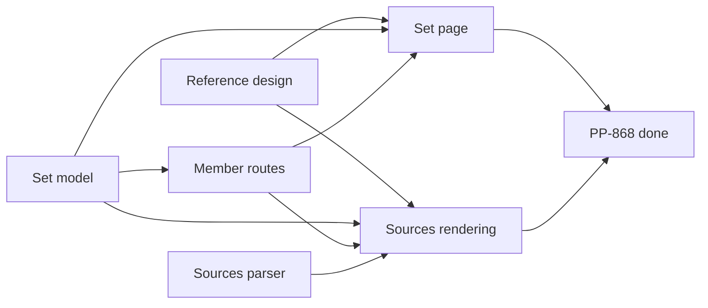

# PP-868: Topic-Research Set Detail Page

**Kind**: Story
**Status**: Draft
**Priority**: High
**Author**: Toby Clemson

## Summary

As someone reading topic research, I want to open a research set in the
visualiser and read every document in it, so that I can follow a subject from
its brief to its reports without leaving the visualiser.

This item is a container. Seven child work items deliver it, and it is done
when all seven are. It is the remaining work that closes PP-22, aside from
bugs already in progress; until it lands the visualiser shows a set's
manifest alone.

## Context

Every other slice of PP-22 has landed, so the set's on-disk contract is
settled: seven document kinds (`manifest`, `brief`, `outline`, `finding`,
`level-note`, `synthesis`, `report`) and five manifest statuses (`briefed`,
`outlined`, `researching`, `synthesised`, `complete`).

The visualiser indexes one entry per set, keyed on `manifest.md`, and renders
it through the shared `LibraryDocView`. No other document in a set is
indexed, and no route reaches one.

The work was first written as one story. A stress test and a review on
2026-11-23 widened it to a generic set model, because more multi-document
doc types will follow, and split it into the children below. Each child
carries its own requirements, acceptance criteria, and open questions; this
item states only the outcome they add up to and how they depend on each
other.

## Requirements

The children deliver, between them:

- A generic set model: a doc type whose entries are directories is indexed
  as a root plus member documents and assets, with members searchable,
  served through an API, and updated live. Topic research and design
  inventories both use it.
- Member routes and a plain member view: each member document opens at its
  own URL.
- A fix to links that open the wrong set, which exists today and can land
  first.
- A Sources parser in the `research` crate: the one Rust reading of a
  document's Sources section and its tier text.
- A reference design for the set page, approved before the page is built.
- The topic-research set page: persistent set navigation beside one member
  at a time, showing status, the outline by round, focus areas and their
  findings, level notes, and reports, and updating live.
- Sources rendering: each source's tier, venue, marks, and metadata shown as
  distinct elements wherever a topic-research document is shown.

They are sequenced as follows. The reference design, the set model, and the
Sources parser have no blockers and can start together.

### Child work items

- PP-994 — Generic Set Model: Indexing and API
- PP-998 — Set Member Routes and View
- PP-995 — Sources Parser in the Research Crate
- PP-1001 — Topic-Research Set Page
- PP-1000 — Sources Rendering in the Visualiser
- PP-999 — Reference Design for the Topic-Research Set Page
- PP-996 — Links to a Research Set or Design Inventory Open the Wrong One

## Acceptance Criteria

- [ ] All seven child work items are done.
- [ ] Given a research set with a brief, an outline, findings with level
      notes, a synthesis, and reports, when its library entry is opened in
      the visualiser, then every one of those documents can be reached and
      read without leaving the visualiser.
- [ ] Given a finding open in the visualiser, then each of its sources shows
      its tier and venue as distinct elements.
- [ ] Given a `conduct` run writing to a set that is open in the visualiser,
      then the new documents appear without a reload.
- [ ] Given a design inventory, then its listing and its page show what they
      showed before this work.

## Open Questions

- None at this level. Each child carries its own.

## Dependencies

- Blocked by: nothing. PP-862, PP-863, PP-864, PP-865, PP-867, PP-892, and
  PP-936 are done.
- Blocks: the closure of PP-22.
- Unblocks PP-134 (captured screenshots on design-inventory pages), which
  is blocked by the set model, PP-994, alone.
- Follow-up, not a blocker:
  `PP-997-stable-focus-area-identifiers-in-topic-research-sets.md`
  replaces the question-text join with an explicit identifier.
- Abandoned: PP-792, a duplicate of PP-134.

## Assumptions

- The children's acceptance criteria are the detailed statement of this
  work. The criteria above check only that the parts add up.
- Between the set model landing and the set page landing, a member opens as
  a plain document with its Sources as literal text.

## Technical Notes

**Size**: XL — the sum of its children: reference design (M), set model (L),
member routes (M), Sources parser (M), set page (L), and Sources rendering
(M).

- Technical detail lives in each child's Technical Notes.
- Reviews of the children are in `meta/reviews/work/`.

## Drafting Notes

- Rewritten as a container on 2026-11-23 at the author's direction. The
  requirements and 45 acceptance criteria it held moved into the children,
  and its earlier text is in version control.
- Scope history: level notes, set statuses, live update, and member indexing
  were added when the item was enriched; the generic set model, the
  design-inventory migration, and the unreadable and unmatched groups were
  added by the stress test; the review widened the parser to the whole
  Sources section and split out Sources rendering and the reference design.
- The item stays a story holding stories, tasks, and a bug, at the author's
  direction. If the tracker rejects that on sync, it becomes an epic or the
  children move under PP-22.
- The end-to-end criteria above are my summary of the children's; they add
  no behaviour of their own.

## References

- Source: `meta/work/PP-22-topic-research-skillset.md` (Slice 6)
- Parent epic: PP-22
- Related: PP-862, PP-863, PP-864, PP-865, PP-867, PP-892, PP-936, PP-134
- Set contract: `skills/research/research-topic/SKILL.md`
